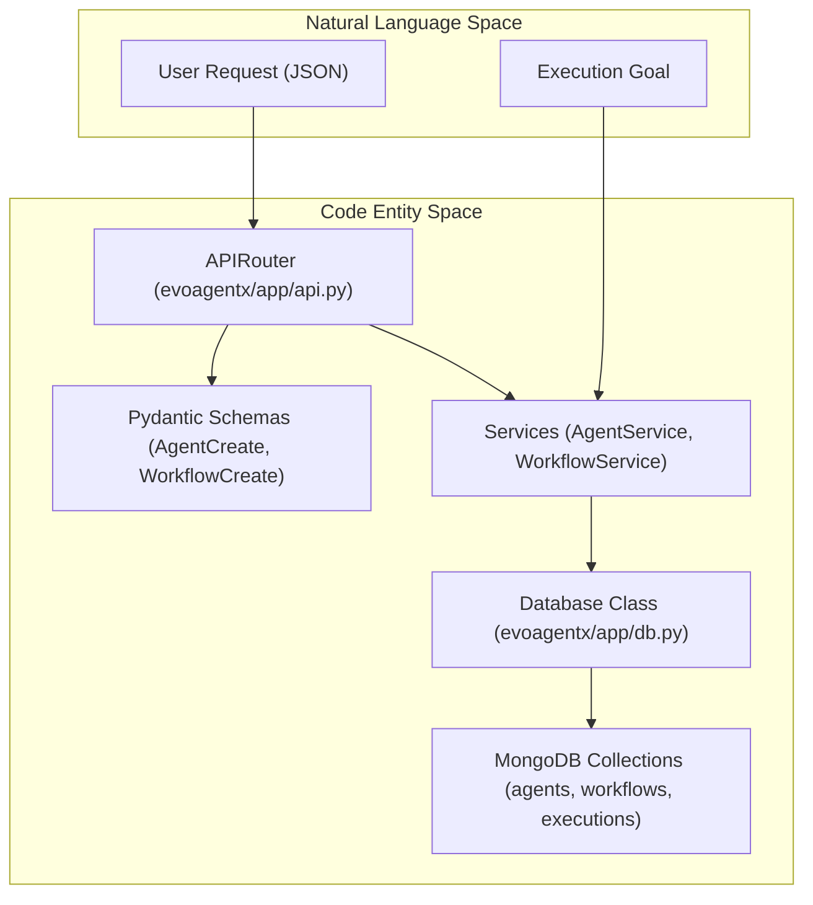
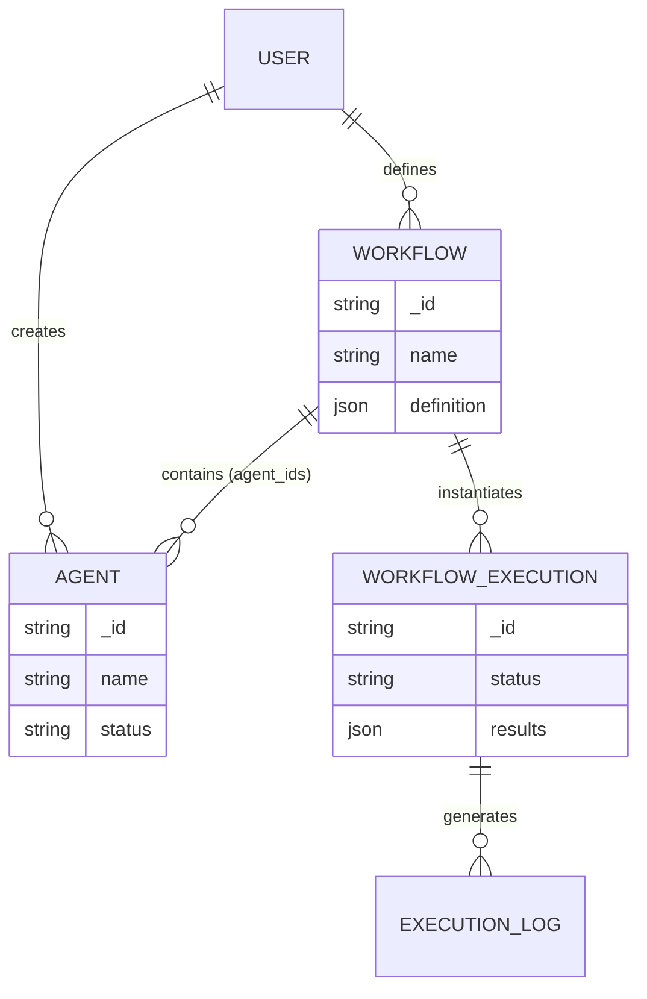

<!-- source: DeepWiki mcp.deepwiki.com · repo EvoAgentX/EvoAgentX · page 13 REST API Server · fetched 2026-10-26 -->

# REST API Server

<details>
<summary>Relevant source files</summary>

The following files were used as context for generating this wiki page:

- [docs/installation.md](docs/installation.md)
- [docs/quickstart.md](docs/quickstart.md)
- [docs/zh/installation.md](docs/zh/installation.md)
- [docs/zh/quickstart.md](docs/zh/quickstart.md)
- [evoagentx/app/.env.example](evoagentx/app/.env.example)
- [evoagentx/app/api.py](evoagentx/app/api.py)
- [evoagentx/app/config.py](evoagentx/app/config.py)
- [evoagentx/app/db.py](evoagentx/app/db.py)
- [evoagentx/app/main.py](evoagentx/app/main.py)
- [evoagentx/app/schemas.py](evoagentx/app/schemas.py)
- [evoagentx/app/security.py](evoagentx/app/security.py)
- [evoagentx/app/services.py](evoagentx/app/services.py)
- [evoagentx/fastapi_docs.md](evoagentx/fastapi_docs.md)
- [pytest.ini](pytest.ini)

</details>


The EvoAgentX REST API Server is a FastAPI-based application designed to manage the lifecycle of agents, workflows, and their executions. It provides a persistent storage layer using MongoDB and secures access through JWT-based authentication. The server acts as a centralized hub for storing agent configurations, defining multi-agent orchestration patterns, and tracking the history of asynchronous workflow executions.

### System Architecture

The server is organized into modular components including routes, services for business logic, and a database abstraction layer.

**REST API Component Mapping**



Sources: [evoagentx/app/api.py:30-34](), [evoagentx/app/services.py:22-24](), [evoagentx/app/db.py:118-126]()

### Core Functionality

The server enables remote management of the EvoAgentX framework features:
*   **Agent Management**: CRUD operations for `Agent` entities, including configuration and runtime parameters [evoagentx/app/db.py:68-80]().
*   **Workflow Orchestration**: Defining `Workflow` structures that link multiple agents together [evoagentx/app/db.py:81-93]().
*   **Execution Tracking**: Managing `WorkflowExecution` states (PENDING, RUNNING, COMPLETED, FAILED) and storing step-by-step results [evoagentx/app/db.py:104-116]().
*   **Security**: Implementing OAuth2 with Password flow and JWT tokens for secure multi-user access [evoagentx/app/api.py:37-62]().

**Data Entity Relationships**



Sources: [evoagentx/app/db.py:68-116](), [evoagentx/app/services.py:157-171]()

### API Endpoints
The server exposes several route groups to handle different aspects of the system. This includes authentication for user management, agents for individual LLM configurations, and workflows for complex task graphs.

For details, see [API Endpoints](#13.1).

Sources: [evoagentx/app/api.py:30-34]()

### API Configuration and Security
The server relies on environment variables defined in a `.env` file for critical settings like `MONGODB_URL`, `SECRET_KEY`, and `CORS_ORIGINS`. Security is enforced through dependency injection in FastAPI routes, ensuring that only authenticated users or admins can access specific resources.

For details, see [API Configuration and Security](#13.2).

Sources: [evoagentx/app/config.py:9-35](), [evoagentx/app/api.py:123-127]()

### Quick Start (Server)
To start the API server locally, ensure you have a MongoDB instance running and execute the main module:

```bash
# Set up environment variables in .env
python -m evoagentx.app.main
```

The server will be available at `http://localhost:8000` by default, with interactive documentation available at `/docs`.

Sources: [evoagentx/fastapi_docs.md:33-38](), [evoagentx/app/config.py:14-15]()

---

