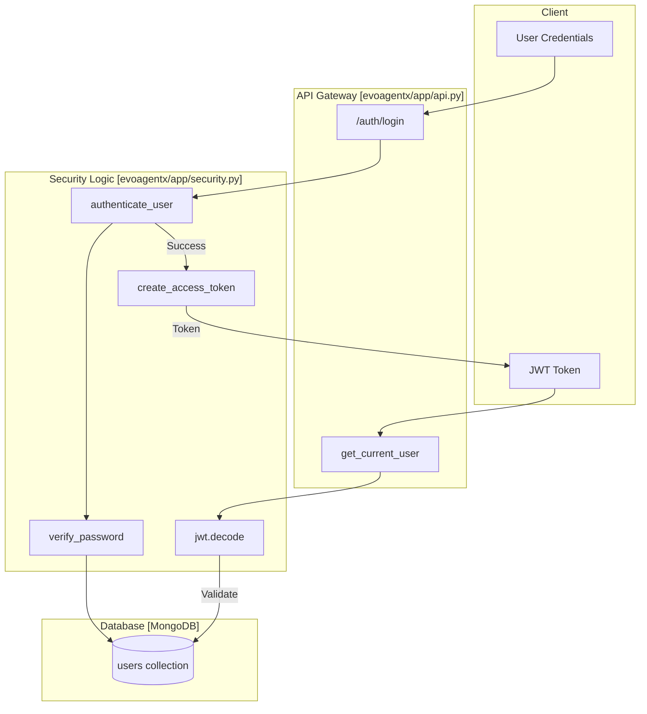
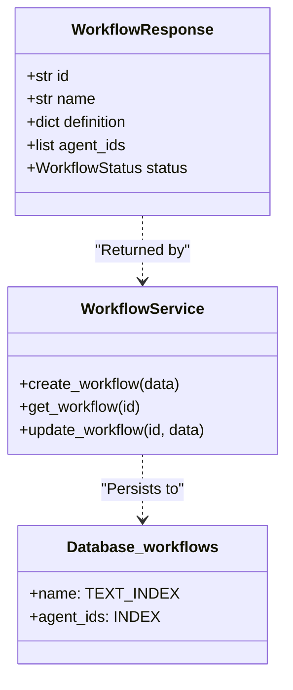

<!-- source: DeepWiki mcp.deepwiki.com · repo EvoAgentX/EvoAgentX · page 13.1 API Endpoints · fetched 2026-10-26 -->

# API Endpoints

Relevant source files

The following files were used as context for generating this wiki page:

- [evoagentx/app/api.py](evoagentx/app/api.py)
- [evoagentx/app/config.py](evoagentx/app/config.py)
- [evoagentx/app/db.py](evoagentx/app/db.py)
- [evoagentx/app/main.py](evoagentx/app/main.py)
- [evoagentx/app/schemas.py](evoagentx/app/schemas.py)
- [evoagentx/app/security.py](evoagentx/app/security.py)
- [evoagentx/app/services.py](evoagentx/app/services.py)

The EvoAgentX API is a FastAPI-based RESTful service that provides programmatic access to the agentic framework. It facilitates the management of agent lifecycles, workflow definitions, and execution tracking, backed by a MongoDB persistence layer.

## Authentication and Security

Authentication is implemented using JWT (JSON Web Tokens) and OAuth2 password flow. All protected routes require a `Bearer` token in the `Authorization` header.

### Authentication Flow
The system distinguishes between active users and admin users via the `is_admin` flag in the user document [evoagentx/app/security.py:31-31]().

Title: Authentication Data Flow

| Endpoint | Method | Description | Access |
| :--- | :--- | :--- | :--- |
| `/auth/register` | `POST` | Register a new user account [evoagentx/app/api.py:37-40]() | Public |
| `/auth/login` | `POST` | Exchange email/password for JWT [evoagentx/app/api.py:42-62]() | Public |

**Sources:** [evoagentx/app/api.py:30-62](), [evoagentx/app/security.py:21-101](), [evoagentx/app/schemas.py:133-157]()

---

## Agents Management

The Agents API provides CRUD operations for managing the `Agent` model. Agents are stored in the `agents` collection with unique names [evoagentx/app/db.py:136-157]().

| Endpoint | Method | Description | Schema |
| :--- | :--- | :--- | :--- |
| `/agents` | `POST` | Create a new agent [evoagentx/app/api.py:65-80]() | `AgentCreate` |
| `/agents/{agent_id}` | `GET` | Retrieve agent details [evoagentx/app/api.py:82-92]() | `AgentResponse` |
| `/agents/{agent_id}` | `PUT` | Update agent configuration [evoagentx/app/api.py:94-108]() | `AgentUpdate` |
| `/agents` | `GET` | List agents with pagination/search [evoagentx/app/api.py:110-121]() | `List[AgentResponse]` |
| `/agents/{agent_id}` | `DELETE` | Remove agent (Admin only) [evoagentx/app/api.py:123-135]() | N/A |

### Implementation Detail: Agent Deletion
Deletion is restricted if the agent is currently referenced by any existing workflow. The `AgentService.delete_agent` method performs a count check on the `workflows` collection using the `agent_ids` field [evoagentx/app/services.py:91-105]().

**Sources:** [evoagentx/app/api.py:65-135](), [evoagentx/app/services.py:22-143](), [evoagentx/app/db.py:68-80]()

---

## Workflows Management

Workflows define the graph structure of agent interactions. The API handles complex definitions containing multiple steps and dependencies.

Title: Workflow Entity Mapping

| Endpoint | Method | Description |
| :--- | :--- | :--- |
| `/workflows` | `POST` | Create a workflow definition [evoagentx/app/api.py:140-155]() |
| `/workflows/{workflow_id}` | `GET` | Get workflow by ID [evoagentx/app/api.py:159-171]() |
| `/workflows/{workflow_id}` | `PUT` | Update definition/status [evoagentx/app/api.py:172-187]() |

### Workflow Validation
During creation, `WorkflowService.create_workflow` extracts `agent_id` from each step in the definition and verifies that every referenced agent exists in the database before proceeding [evoagentx/app/services.py:157-171]().

**Sources:** [evoagentx/app/api.py:139-187](), [evoagentx/app/services.py:146-183](), [evoagentx/app/db.py:81-92]()

---

## Executions and Monitoring

The execution endpoints manage the instantiation and tracking of workflow runs.

### Execution Endpoints
*   **Create Execution**: `POST /executions` triggers a new run. It accepts `input_params` and an optional `callback_url` [evoagentx/app/schemas.py:102-106]().
*   **Execution Logs**: `GET /executions/{execution_id}/logs` retrieves the granular logs for a specific run, including agent-level messages and step IDs [evoagentx/app/db.py:94-103]().

### System Metrics
The `/metrics` endpoint provides a high-level overview of the system state by aggregating counts across collections [evoagentx/app/main.py:126-164]().

| Metric Group | Data Point | Implementation |
| :--- | :--- | :--- |
| Agents | Total/Active | `Database.agents.count_documents` |
| Workflows | Total/Running | `Database.workflows.count_documents` |
| Executions | Total/Failed | `Database.executions.count_documents` |

**Sources:** [evoagentx/app/api.py:33-34](), [evoagentx/app/main.py:126-164](), [evoagentx/app/db.py:104-116]()

---

## API Configuration

The server behavior is controlled via the `Settings` class, which loads values from environment variables or a `.env` file [evoagentx/app/config.py:9-37]().

Key configuration parameters include:
*   `API_PREFIX`: Global prefix for all routes (e.g., `/api/v1`) [evoagentx/app/config.py:13-13]().
*   `CORS_ORIGINS`: List of allowed origins for browser-based clients [evoagentx/app/config.py:30-30]().
*   `MONGODB_URL`: Connection string for the persistence layer [evoagentx/app/config.py:18-18]().

**Sources:** [evoagentx/app/config.py:1-41](), [evoagentx/app/main.py:69-76]()

---

