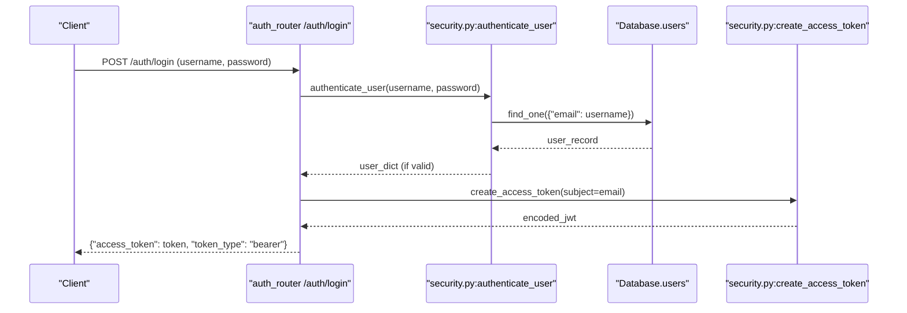
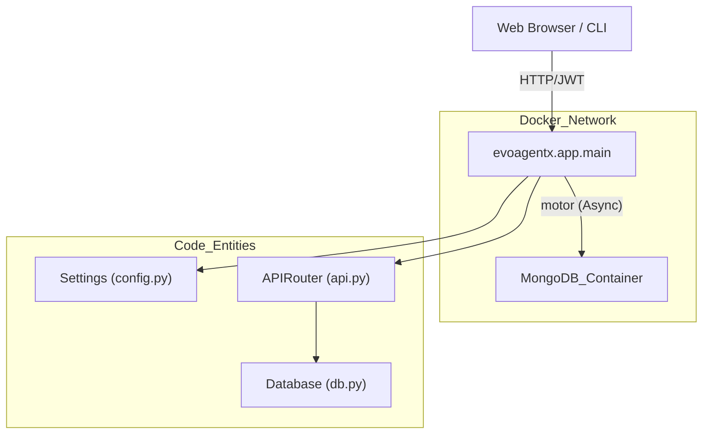

<!-- source: DeepWiki mcp.deepwiki.com · repo EvoAgentX/EvoAgentX · page 13.2 API Configuration and Security · fetched 2026-10-26 -->

# API Configuration and Security

<details>
<summary>Relevant source files</summary>

The following files were used as context for generating this wiki page:

- [docs/installation.md](docs/installation.md)
- [docs/quickstart.md](docs/quickstart.md)
- [docs/zh/installation.md](docs/zh/installation.md)
- [docs/zh/quickstart.md](docs/zh/quickstart.md)
- [evoagentx/app/.env.example](evoagentx/app/.env.example)
- [evoagentx/app/api.py](evoagentx/app/api.py)
- [evoagentx/app/config.py](evoagentx/app/config.py)
- [evoagentx/app/db.py](evoagentx/app/db.py)
- [evoagentx/app/main.py](evoagentx/app/main.py)
- [evoagentx/app/schemas.py](evoagentx/app/schemas.py)
- [evoagentx/app/security.py](evoagentx/app/security.py)
- [evoagentx/app/services.py](evoagentx/app/services.py)
- [evoagentx/fastapi_docs.md](evoagentx/fastapi_docs.md)
- [pytest.ini](pytest.ini)

</details>


The EvoAgentX REST API is built on FastAPI and provides a secure, scalable environment for managing agents and orchestrating workflows. This page details the security architecture, database integration, and configuration mechanisms required to deploy and maintain the EvoAgentX server.

## Authentication and JWT Security

EvoAgentX implements a robust authentication system using JSON Web Tokens (JWT) with OAuth2 password flow. This ensures that all operations on agents and workflows are authorized and attributed to specific users.

### Security Implementation
- **Token Generation**: Access tokens are created using the `HS256` algorithm [evoagentx/app/config.py:24]().
- **Token Expiry**: The token lifetime is configurable via `ACCESS_TOKEN_EXPIRE_MINUTES` [evoagentx/app/config.py:23]().
- **Password Hashing**: User credentials are protected using secure hashing before storage in MongoDB.
- **Dependency Injection**: Routes use FastAPI dependencies like `get_current_active_user` and `get_current_admin_user` to enforce access control [evoagentx/app/api.py:24-25]().

### Authentication Flow
The following diagram illustrates the token-based authentication process:

**Authentication Sequence**


**Sources:** [evoagentx/app/api.py:36-62](), [evoagentx/app/security.py:1-26](), [evoagentx/app/config.py:21-25]()

---

## MongoDB Database Setup

EvoAgentX uses MongoDB as its primary persistence layer, utilizing the `motor` asynchronous driver for high-performance I/O operations.

### Connection Management
The `Database` class in `evoagentx/app/db.py` manages the lifecycle of the connection:
- **`connect()`**: Initializes the `AsyncIOMotorClient` using `MONGODB_URL` and sets up collection references [evoagentx/app/db.py:129-144]().
- **Indexing**: Automatically creates indexes for optimized searching on `name`, `tags`, and `created_at` fields across `agents`, `workflows`, and `executions` collections [evoagentx/app/db.py:154-177]().

### Data Schema and Models
All database models inherit from `MongoBaseModel`, which provides compatibility between Pydantic validation and MongoDB's `ObjectId` [evoagentx/app/db.py:33-43]().

| Collection | Model Class | Purpose |
|:---|:---|:---|
| `agents` | `Agent` | Stores agent configuration, state, and metadata [evoagentx/app/db.py:68-80]() |
| `workflows` | `Workflow` | Stores DAG definitions and versioning [evoagentx/app/db.py:81-93]() |
| `workflow_executions` | `WorkflowExecution` | Tracks the runtime status and results of a workflow run [evoagentx/app/db.py:104-116]() |
| `execution_logs` | `ExecutionLog` | Granular step-by-step logs for debugging [evoagentx/app/db.py:94-103]() |

**Sources:** [evoagentx/app/db.py:1-177](), [evoagentx/app/schemas.py:1-168]()

---

## Configuration and Environment

The system utilizes `pydantic-settings` for centralized configuration management. The `Settings` class loads variables from the environment or a `.env` file.

### Key Configuration Parameters
| Variable | Description | Default/Example |
|:---|:---|:---|
| `API_PREFIX` | Prefix for all REST routes | `/api/v1` |
| `MONGODB_URL` | Connection string for MongoDB | `mongodb://localhost:27017` |
| `CORS_ORIGINS` | Allowed origins for cross-site requests | `http://localhost:3000` |
| `SECRET_KEY` | Key used for signing JWT tokens | (Must be unique/random) |

### CORS Configuration
Cross-Origin Resource Sharing (CORS) is configured to allow frontend applications (like a React-based dashboard) to communicate with the API. The `CORS_ORIGINS` setting supports a comma-separated list of allowed URLs [evoagentx/app/config.py:30-31]().

**Sources:** [evoagentx/app/config.py:9-37](), [evoagentx/app/.env.example:1-18]()

---

## Deployment with Docker

Deployment is streamlined using Docker to ensure environment parity between development and production.

### Dockerized Architecture
The system typically runs in a containerized environment where the FastAPI app and MongoDB are linked.

**Deployment Architecture**


### Execution Steps
1. **Environment Setup**: Define variables in `.env` based on `.env.example` [evoagentx/fastapi_docs.md:27-31]().
2. **Server Start**: Execute the application module [evoagentx/fastapi_docs.md:35]():
   ```bash
   python -m evoagentx.app.main
   ```

**Sources:** [evoagentx/fastapi_docs.md:11-39](), [evoagentx/app/main.py:1-20]()

---

## User Management and Permissions

The API distinguishes between active users and administrators to protect sensitive operations.

- **`UserCreate`**: Schema for registering new users [evoagentx/app/schemas.py:141-145]().
- **Admin Access**: Certain routes, such as `delete_agent`, require the `get_current_admin_user` dependency [evoagentx/app/api.py:123-127]().
- **Resource Ownership**: Created resources (Agents/Workflows) are tagged with the `user_id` of the creator [evoagentx/app/services.py:27, 151]().

**Sources:** [evoagentx/app/api.py:65-136](), [evoagentx/app/services.py:22-183](), [evoagentx/app/security.py:20-26]()

---

