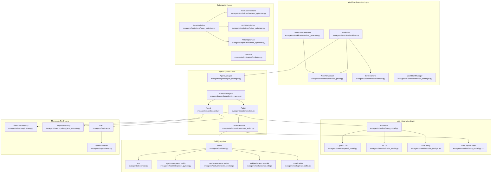
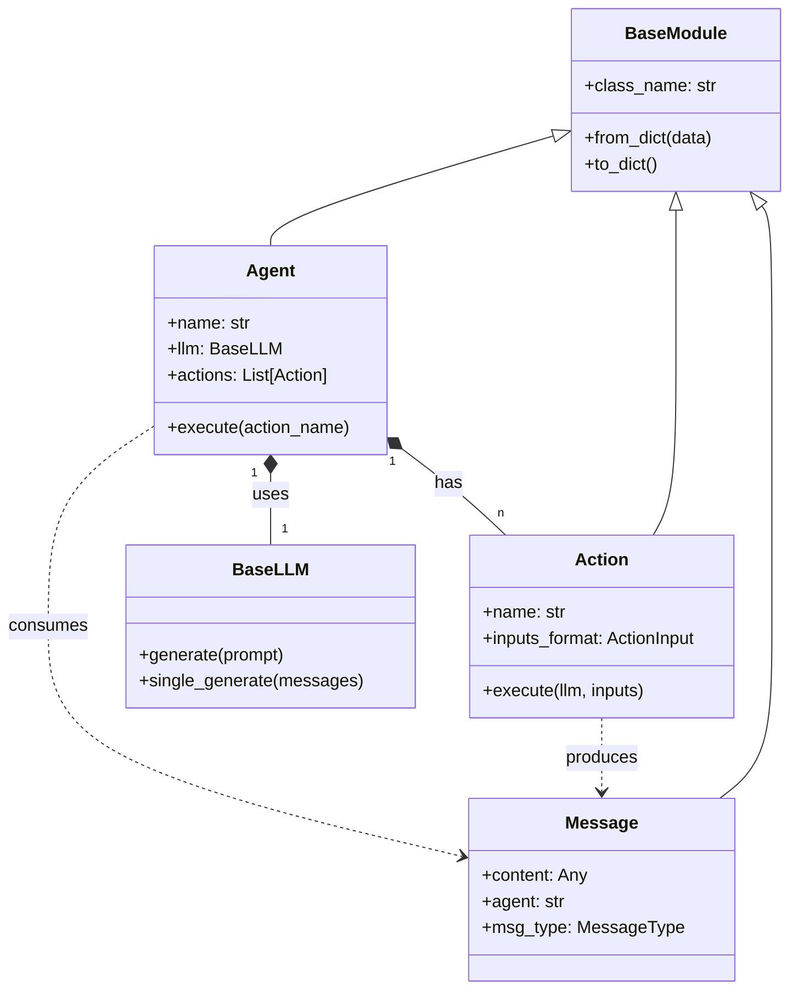

<!-- source: DeepWiki mcp.deepwiki.com · repo EvoAgentX/EvoAgentX · page 14 Developer Guide · fetched 2026-10-26 -->

# Developer Guide

Relevant source files

The following files were used as context for generating this wiki page:

- [.github/ISSUE_TEMPLATE/bug_report.yml](.github/ISSUE_TEMPLATE/bug_report.yml)
- [.github/ISSUE_TEMPLATE/feature_request.yml](.github/ISSUE_TEMPLATE/feature_request.yml)
- [.github/ISSUE_TEMPLATE/question.yml](.github/ISSUE_TEMPLATE/question.yml)
- [CONTRIBUTING.md](CONTRIBUTING.md)
- [evoagentx/actions/action.py](evoagentx/actions/action.py)
- [evoagentx/agents/agent.py](evoagentx/agents/agent.py)
- [evoagentx/core/message.py](evoagentx/core/message.py)
- [evoagentx/core/module.py](evoagentx/core/module.py)
- [evoagentx/core/module_utils.py](evoagentx/core/module_utils.py)
- [evoagentx/models/base_model.py](evoagentx/models/base_model.py)

This guide provides technical documentation for developers who want to extend EvoAgentX or contribute to the project. It covers the core architecture, module system, extension mechanisms, and contribution workflow.

## High-Level Architecture

EvoAgentX implements a modular architecture with six major subsystems: workflow management, agent orchestration, LLM integration, tool ecosystem, optimization, and memory/RAG. Each subsystem can be extended independently through well-defined interfaces.

### Core System Components and Code Mapping

The following diagram maps high-level concepts to concrete code entities in the codebase:

Sources: [evoagentx/agents/agent.py:1-50](), [evoagentx/actions/action.py:1-120](), [evoagentx/models/base_model.py:1-50](), [evoagentx/core/module.py:1-50]()

## Core Framework Patterns

### The Module System
Most components in EvoAgentX inherit from `BaseModule` [evoagentx/core/module.py:51](), which utilizes the `MetaModule` metaclass [evoagentx/core/module.py:24]() for automatic registration in the `MODULE_REGISTRY` [evoagentx/core/module.py:21](). This allows for seamless serialization and deserialization of complex agent and workflow structures.

For details, see [Module System](#14.2).

### Agent Execution Lifecycle
The `Agent` class [evoagentx/agents/agent.py:20]() manages the execution of discrete `Action` objects. When an agent is called via `__call__` [evoagentx/agents/agent.py:72](), it prepares execution by updating `ShortTermMemory` [evoagentx/agents/agent.py:108](), extracting necessary inputs via `ContextExtraction` [evoagentx/agents/agent.py:17](), and finally invoking the action's `execute` method.

For details, see [Architecture Overview](#14.1).

## Extension Points

Developers can extend the framework at several levels:

### Custom Tools and Toolkits
By extending the `Tool` or `Toolkit` base classes [evoagentx/tools/tool.py](), developers can provide agents with new capabilities like specialized search, database access, or API integrations. Tools use JSON schema for parameter definition to ensure LLM compatibility.

For details, see [Extending with Custom Tools](#14.3).

### LLM Providers and Parsers
The `BaseLLM` [evoagentx/models/base_model.py:431]() abstraction allows for integrating new model providers. Additionally, `LLMOutputParser` [evoagentx/models/base_model.py:22]() can be extended to support custom structured output formats (JSON, XML, etc.) required by specific agent tasks.

For details, see [Architecture Overview](#14.1).

### Optimization Algorithms
Custom optimization strategies can be implemented by inheriting from `BaseOptimizer` [evoagentx/optimizers/base_optimizer.py](). This enables developers to create new ways of evolving agent prompts or workflow structures based on performance metrics.

For details, see [Creating Custom Optimizers](#14.4).

## Contribution Workflow

We welcome contributions! The general process involves:
1. **Reporting**: Use the Bug Report or Feature Request templates [.github/ISSUE_TEMPLATE/bug_report.yml]().
2. **Implementation**: Follow the Google-style docstring guidelines [CONTRIBUTING.md:90]().
3. **Testing**: Ensure all tests pass using `pytest tests/` [CONTRIBUTING.md:156]().
4. **Submission**: Submit a Pull Request from a feature branch [CONTRIBUTING.md:59]().

For details, see [Contributing Guidelines](#14.5).

## Code Entity Relationship Diagram

This diagram bridges the Natural Language space (Concepts) to the Code Entity space (Classes/Files).

Sources: [evoagentx/core/module.py:51](), [evoagentx/agents/agent.py:20](), [evoagentx/actions/action.py:108](), [evoagentx/core/message.py:19](), [evoagentx/models/base_model.py:431]()

## Developer Navigation

| Child Page | Focus Area |
|------------|------------|
| [Architecture Overview](#14.1) | Component interactions and data flow |
| [Module System](#14.2) | Pydantic integration and serialization |
| [Extending with Custom Tools](#14.3) | Step-by-step tool creation guide |
| [Creating Custom Optimizers](#14.4) | Interface for evolution algorithms |
| [Contributing Guidelines](#14.5) | PR process and coding standards |
| [API Reference](#14.6) | Technical documentation of all modules |

---

