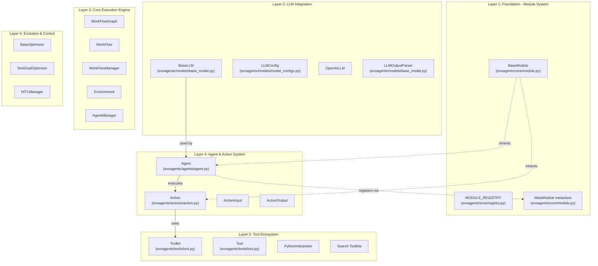
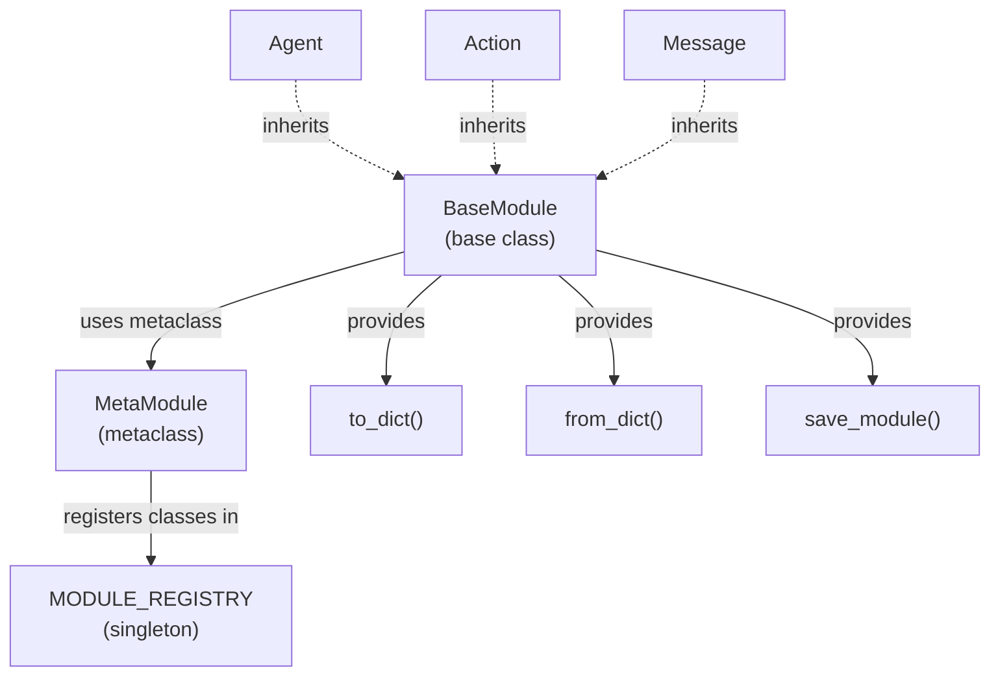
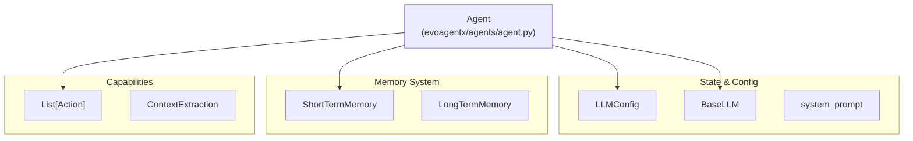
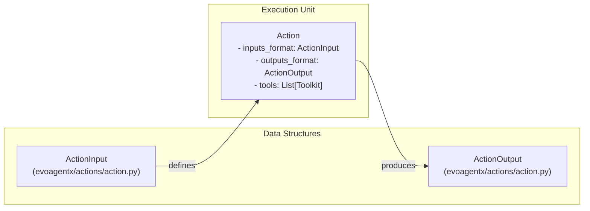
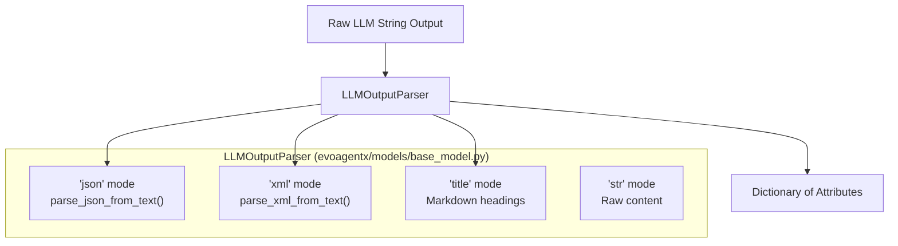

<!-- source: DeepWiki mcp.deepwiki.com · repo EvoAgentX/EvoAgentX · page 14.1 Architecture Overview · fetched 2026-10-26 -->

# Architecture Overview

Relevant source files

The following files were used as context for generating this wiki page:

- [README-zh.md](README-zh.md)
- [README.md](README.md)
- [assets/EAXLoGo.svg](assets/EAXLoGo.svg)
- [docs/assets/logo.svg](docs/assets/logo.svg)
- [docs/index.md](docs/index.md)
- [docs/overrides/main.html](docs/overrides/main.html)
- [docs/stylesheets/extra.css](docs/stylesheets/extra.css)
- [docs/zh/index.md](docs/zh/index.md)
- [evoagentx/actions/action.py](evoagentx/actions/action.py)
- [evoagentx/agents/agent.py](evoagentx/agents/agent.py)
- [evoagentx/core/message.py](evoagentx/core/message.py)
- [evoagentx/core/module.py](evoagentx/core/module.py)
- [evoagentx/core/module_utils.py](evoagentx/core/module_utils.py)
- [evoagentx/models/base_model.py](evoagentx/models/base_model.py)
- [mkdocs.yml](mkdocs.yml)

## Purpose and Scope

This document provides a comprehensive technical overview of EvoAgentX's internal architecture, focusing on the major subsystems, their implementation structure, and how components interact during workflow execution. It is intended for developers who want to understand the framework's design principles, extend its functionality, or contribute to the codebase.

EvoAgentX is designed as a modular ecosystem where components like Agents, Actions, and Workflows are treated as serializable entities that can be automatically registered, saved, and evolved [README.md:38-70]().

---

## System Architecture Layers

EvoAgentX is organized into six primary architectural layers that work together to enable self-evolving agentic workflows:

**Sources:** [evoagentx/core/module.py:51-81](), [evoagentx/agents/agent.py:20-53](), [evoagentx/actions/action.py:108-131](), [README.md:41-70]()

---

## Core Module System

### BaseModule and Registry Architecture

EvoAgentX uses a sophisticated module system that enables serialization, deserialization, and automatic registration of all framework components.

**Key Classes:**

| Class | Location | Purpose |
|-------|----------|---------|
| `MetaModule` | [evoagentx/core/module.py:24-48]() | Metaclass that automatically calls `register_module` for every new subclass of `BaseModule`. |
| `BaseModule` | [evoagentx/core/module.py:51-70]() | Foundation class inheriting from Pydantic's `BaseModel`. It provides the `class_name` attribute and handles recursive data processing. |
| `MODULE_REGISTRY` | [evoagentx/core/module.py:21-21]() | Central registry that maps string class names to actual Python class types, enabling dynamic instantiation from JSON/dictionaries. |

**Serialization Logic:**
The system handles complex nested objects by checking for a `class_name` key in dictionaries during instantiation. If found, it looks up the corresponding class in the `MODULE_REGISTRY` to create the correct sub-object [evoagentx/core/module.py:170-179]().

**Sources:** [evoagentx/core/module.py:24-179](), [evoagentx/core/registry.py]()

---

## Agent System Architecture

### Agent Class Structure

The `Agent` class is the primary actor in EvoAgentX. It manages its own memory, language model configuration, and available actions.

**Key Attributes of `Agent`:**
- `agent_id`: Unique hex identifier generated via `uuid4` [evoagentx/agents/agent.py:42](), [evoagentx/core/module_utils.py:23-24]().
- `short_term_memory`: Stores messages for a single workflow execution [evoagentx/agents/agent.py:44]().
- `actions`: A list of `Action` objects that the agent can perform [evoagentx/agents/agent.py:49]().
- `n`: Controls the context window by specifying how many latest messages to use for action execution [evoagentx/agents/agent.py:50]().

**Execution Lifecycle:**
When an agent is called via `__call__`, it automatically detects if it is in an asynchronous environment to choose between `execute` and `async_execute` [evoagentx/agents/agent.py:72-80]().

**Sources:** [evoagentx/agents/agent.py:20-80](), [evoagentx/core/module_utils.py:23-24]()

---

## Action System Architecture

### Action and Input/Output Specification

Actions represent discrete operations. They use Pydantic-based specifications for inputs and outputs to ensure type safety and provide clear schemas to LLMs.

**Implementation Details:**
- **`ActionInput`**: Inherits from `LLMOutputParser`. It generates JSON specifications of requirements (types, descriptions, required/optional status) to be injected into LLM prompts [evoagentx/actions/action.py:18-70]().
- **`Action`**: The base class for operations. It can be associated with a `prompt_template` and a set of `tools` [evoagentx/actions/action.py:108-130]().
- **Serialization**: Actions customize their dictionary representation by saving class names for `inputs_format` and `outputs_format` instead of raw objects [evoagentx/actions/action.py:140-150]().

**Sources:** [evoagentx/actions/action.py:18-160]()

---

## Language Model Integration

### LLM Abstraction and Parsing

EvoAgentX abstracts model providers (OpenAI, Aliyun, LiteLLM) behind a `BaseLLM` interface. A critical component is the `LLMOutputParser`, which handles the "Natural Language to Code Entity" transition.

**Parsing Strategies:**
- **`_parse_json_content`**: Uses `yaml.safe_load` on strings extracted via regex to handle JSON objects even if the LLM includes conversational filler [evoagentx/models/base_model.py:150-168]().
- **`_parse_str_content`**: Maps the entire raw output to all defined attributes of the parser [evoagentx/models/base_model.py:135-147]().
- **`fix_json`**: A utility in `module_utils.py` that cleans LLM output by removing comments, fixing Python-style booleans (`True` -> `true`), and escaping problematic characters [evoagentx/core/module_utils.py:197-201]().

**Sources:** [evoagentx/models/base_model.py:22-168](), [evoagentx/core/module_utils.py:147-201]()

---

## Data Flow and Communication

### Message-Based State Tracking

The system communicates via `Message` objects. These objects track the trajectory of a workflow, including which agent performed what action and for what task.

| Attribute | Purpose |
|-----------|---------|
| `content` | The actual payload (often a dict from an `ActionOutput`) [evoagentx/core/message.py:38]() |
| `agent` | The sender (agent name) [evoagentx/core/message.py:39]() |
| `action` | The specific action that generated this message [evoagentx/core/message.py:41]() |
| `wf_task` | The specific workflow node name this message belongs to [evoagentx/core/message.py:46]() |
| `msg_type` | Enum: REQUEST, RESPONSE, COMMAND, ERROR, INPUT [evoagentx/core/message.py:9-17]() |

**Message Lifecycle:**
1. **Input**: `Agent._prepare_execution` creates an `INPUT` message from raw data [evoagentx/agents/agent.py:112-122]().
2. **Execution**: Action executes and returns content.
3. **Output**: `Agent._create_output_message` wraps the result with metadata (timestamp, conversation ID) and adds it to `short_term_memory` [evoagentx/agents/agent.py:129-160]().

**Sources:** [evoagentx/core/message.py:19-50](), [evoagentx/agents/agent.py:105-160]()

---

## Summary: Technical Implementation Principles

| Principle | Implementation |
|-----------|----------------|
| **Strict Type Validation** | Extensive use of Pydantic `BaseModel` and `model_validator` across `BaseModule`, `Message`, and `Action` [evoagentx/core/module.py:51](), [evoagentx/core/message.py:91](). |
| **Robust JSON Handling** | Custom `fix_json` and `parse_json_from_text` functions to handle messy LLM outputs [evoagentx/core/module_utils.py:197-204](). |
| **Async First** | Native support for `async_execute` in Agents and LLM providers [evoagentx/agents/agent.py:77](). |
| **Modular Extensibility** | `MetaModule` ensures that simply defining a new class registers it for use in the system [evoagentx/core/module.py:24-48](). |

**Sources:** [evoagentx/core/module.py](), [evoagentx/core/module_utils.py](), [evoagentx/agents/agent.py]()

---

