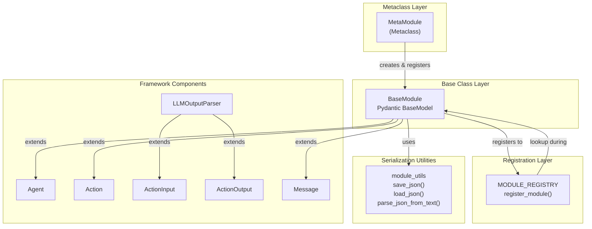
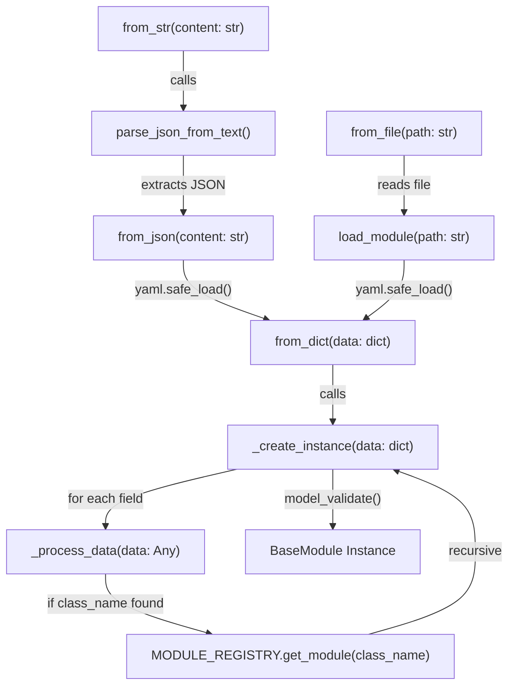
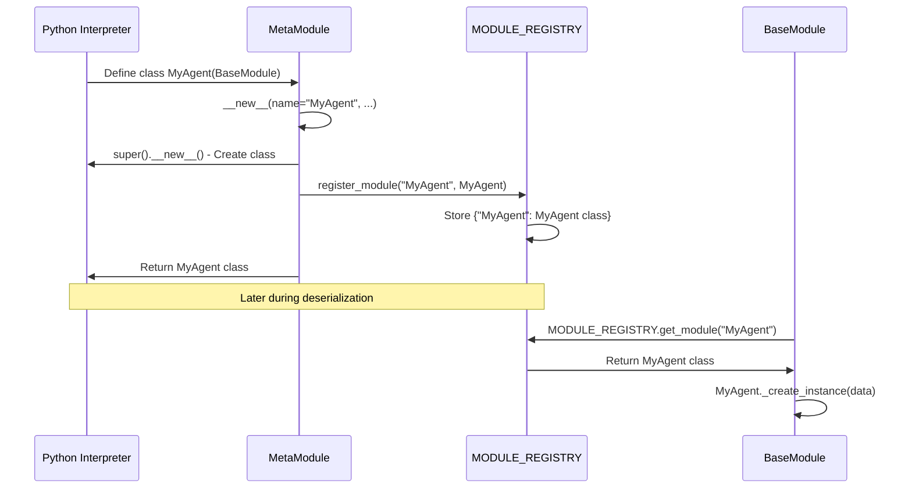
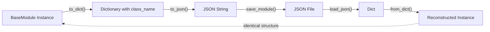

<!-- source: DeepWiki mcp.deepwiki.com · repo EvoAgentX/EvoAgentX · page 14.2 Module System · fetched 2026-10-26 -->

# Module System

<details>
<summary>Relevant source files</summary>

The following files were used as context for generating this wiki page:

- [evoagentx/actions/action.py](evoagentx/actions/action.py)
- [evoagentx/agents/agent.py](evoagentx/agents/agent.py)
- [evoagentx/core/decorators.py](evoagentx/core/decorators.py)
- [evoagentx/core/message.py](evoagentx/core/message.py)
- [evoagentx/core/module.py](evoagentx/core/module.py)
- [evoagentx/core/module_utils.py](evoagentx/core/module_utils.py)
- [evoagentx/models/base_model.py](evoagentx/models/base_model.py)

</details>


The Module System provides the foundational infrastructure for all components in EvoAgentX. It establishes a unified pattern for creating, registering, serializing, and deserializing objects throughout the framework. All major classes in EvoAgentX—including `Agent`, `Action`, `WorkFlowGraph`, `Message`, and `LLMOutputParser`—inherit from `BaseModule` and benefit from automatic registration, type-safe instantiation, and flexible serialization capabilities.

For information about workflow-specific architecture, see [Workflow System](). For details on agent implementation patterns, see [Agent System]().

---

## Core Components

The module system consists of three primary components that work together:

| Component | Location | Purpose |
|-----------|----------|---------|
| `BaseModule` | [evoagentx/core/module.py:51-476]() | Base class providing serialization, deserialization, and common module functionality |
| `MetaModule` | [evoagentx/core/module.py:24-49]() | Metaclass that automatically registers all `BaseModule` subclasses |
| `MODULE_REGISTRY` | [evoagentx/core/registry.py]() | Central registry mapping class names to class objects for dynamic instantiation |

**Module System Architecture**



Sources: [evoagentx/core/module.py:24-476](), [evoagentx/agents/agent.py:20-53](), [evoagentx/actions/action.py:108-131](), [evoagentx/core/message.py:19-51]()

---

## BaseModule Class

`BaseModule` is a Pydantic `BaseModel` that serves as the foundation for all EvoAgentX components. It provides standardized methods for instantiation, serialization, and deserialization.

### Key Features

**Automatic Class Name Tracking**

Every subclass automatically receives a `class_name` attribute that stores its class name, enabling dynamic instantiation. This is handled via `__init_subclass__`.

```python
class_name: str = None  # Automatically set to cls.__name__
```

Sources: [evoagentx/core/module.py:63](), [evoagentx/core/module.py:72-81]()

**Pydantic Configuration**

The module system uses specific Pydantic configurations to support complex object types and flexible initialization:

```python
model_config = ConfigDict(
    arbitrary_types_allowed=True,  # Allow non-Pydantic types
    extra="allow",                 # Accept extra fields beyond defined schema
    protected_namespaces=(),       # Allow fields starting with "model_"
    validate_assignment=False      # Prevent infinite recursion during validation
)
```

Sources: [evoagentx/core/module.py:65-70]()

**Initialization Hook**

Subclasses can override `init_module()` to provide custom logic after the Pydantic `__init__` is complete.

```python
def init_module(self):
    """Module initialization method that subclasses can override"""
    pass
```

Sources: [evoagentx/core/module.py:119-123]()

### Instantiation Methods

`BaseModule` provides multiple factory methods for creating instances from different data sources:

**Module Instantiation Flow**



Sources: [evoagentx/core/module.py:145-342]()

| Method | Input | Use Case |
|--------|-------|----------|
| `from_dict()` | Dictionary | Direct instantiation from structured data. [evoagentx/core/module.py:182-225]() |
| `from_json()` | JSON string | Parsing JSON configuration. [evoagentx/core/module.py:227-247]() |
| `from_str()` | Text with embedded JSON | Extracting from LLM output via `parse_json_from_text`. [evoagentx/core/module.py:249-281]() |
| `from_file()` | File path | Loading saved modules from disk. [evoagentx/core/module.py:319-342]() |

**Nested Object Processing**

The `_process_data()` method recursively processes dictionaries that contain `class_name` fields, automatically instantiating nested `BaseModule` objects using the `MODULE_REGISTRY`.

Sources: [evoagentx/core/module.py:160-179]()

### Serialization Methods

All `BaseModule` instances can be serialized to dictionaries, JSON strings, or files:

| Method | Output | Purpose |
|--------|--------|---------|
| `to_dict()` | Dictionary | Recursive conversion of the model to a dict. [evoagentx/core/module.py:349-383]() |
| `to_json()` | JSON string | String representation using `custom_serializer`. [evoagentx/core/module.py:385-408]() |
| `to_str()` | String | Alias for `to_json`. [evoagentx/core/module.py:410-419]() |
| `save_module()` | File path | Persists the module to a JSON file. [evoagentx/core/module.py:421-439]() |

**Custom Serializer**

Non-serializable objects (bytes, datetime, sets, callables) are handled by the `custom_serializer()` function in `module_utils.py`.

Sources: [evoagentx/core/module_utils.py:280-295]()

---

## MetaModule Metaclass

`MetaModule` is a metaclass inheriting from Pydantic's `ModelMetaclass`. It ensures that every class deriving from `BaseModule` is automatically registered in the global `MODULE_REGISTRY`.

### Registration Mechanism

```python
class MetaModule(ModelMetaclass):
    def __new__(mcs, name, bases, namespace, **kwargs):
        cls = super().__new__(mcs, name, bases, namespace, **kwargs)
        register_module(name, cls) # Automatic registration in MODULE_REGISTRY
        return cls 
```

Sources: [evoagentx/core/module.py:24-48]()

**Class Registration Flow**



Sources: [evoagentx/core/module.py:32-48](), [evoagentx/core/registry.py]()

---

## MODULE_REGISTRY

The `MODULE_REGISTRY` is a central registry that maps class names (strings) to class objects. It enables dynamic class lookup during deserialization when only the class name is available.

### Usage Pattern

**Lookup** (during deserialization):
The `_process_data` method uses the registry to find the correct subclass to instantiate when it encounters a `"class_name"` key in the input dictionary.

Sources: [evoagentx/core/module.py:171-173]()

---

## Serialization and Deserialization Patterns

### Round-Trip Serialization

All `BaseModule` objects support round-trip serialization:



Sources: [evoagentx/core/module.py:349-439](), [evoagentx/core/module_utils.py:29-84]()

### Handling Non-Serializable Fields

The `ignore` parameter in `to_dict` and `save_module` allows excluding fields during serialization. For example, the `Agent` class ignores `llm` and `llm_config` by default.

Sources: [evoagentx/agents/agent.py:61](), [evoagentx/core/module.py:351]()

### Exception Handling During Initialization

The module system uses an `exception_buffer` callback to collect validation errors. If no buffer is configured, it logs the error using `get_base_module_init_error_message`.

Sources: [evoagentx/core/module.py:106-117]()

---

## Integration with Framework Components

### Action Integration

`Action` (and its input/output formats) leverages the module system to define structured interfaces. `ActionInput` and `ActionOutput` inherit from `LLMOutputParser`, which provides attribute-based parsing of LLM responses.

Sources: [evoagentx/actions/action.py:18-30](), [evoagentx/actions/action.py:91-106]()

### Message Integration

`Message` uses the module system to maintain a consistent format for communication between agents. It includes a `to_dict` override to handle the `MessageType` enum.

Sources: [evoagentx/core/message.py:19-51](), [evoagentx/core/message.py:82-89]()

### LLMOutputParser Integration

`LLMOutputParser` utilizes Pydantic fields to define expected LLM output structures. It excludes the raw `content` field from serialization to focus on parsed attributes.

Sources: [evoagentx/models/base_model.py:22-32](), [evoagentx/models/base_model.py:48-56]()

---

## Summary

The Module System provides:

1. **Unified Base Class**: `BaseModule` provides the foundation for all entities.
2. **Automatic Registration**: `MetaModule` populates the `MODULE_REGISTRY` without manual intervention.
3. **Recursive Processing**: `_process_data` handles complex, nested module structures automatically.
4. **Flexible Serialization**: Supports JSON, YAML, and dictionaries with custom type handling.
5. **Dynamic Instantiation**: Enables creating objects from strings or files by referencing `class_name`.

Sources: [evoagentx/core/module.py:1-476](), [evoagentx/core/module_utils.py:1-401]()

---

