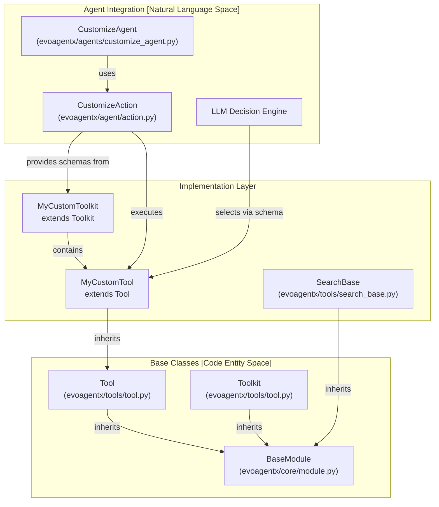
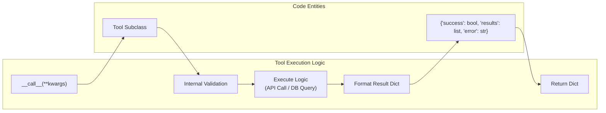
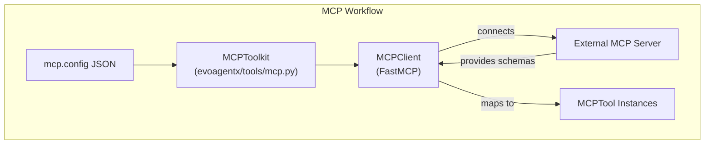

<!-- source: DeepWiki mcp.deepwiki.com · repo EvoAgentX/EvoAgentX · page 14.3 Extending with Custom Tools · fetched 2026-10-26 -->

# Extending with Custom Tools

<details>
<summary>Relevant source files</summary>

The following files were used as context for generating this wiki page:

- [docs/tutorial/mcp.md](docs/tutorial/mcp.md)
- [docs/tutorial/tools.md](docs/tutorial/tools.md)
- [docs/zh/tutorial/tools.md](docs/zh/tutorial/tools.md)
- [evoagentx/tools/__init__.py](evoagentx/tools/__init__.py)
- [evoagentx/tools/interpreter_base.py](evoagentx/tools/interpreter_base.py)
- [evoagentx/tools/interpreter_docker.py](evoagentx/tools/interpreter_docker.py)
- [evoagentx/tools/interpreter_python.py](evoagentx/tools/interpreter_python.py)
- [evoagentx/tools/mcp.py](evoagentx/tools/mcp.py)
- [evoagentx/tools/search_base.py](evoagentx/tools/search_base.py)
- [evoagentx/tools/search_ddgs.py](evoagentx/tools/search_ddgs.py)
- [evoagentx/tools/search_google.py](evoagentx/tools/search_google.py)
- [evoagentx/tools/search_google_f.py](evoagentx/tools/search_google_f.py)
- [evoagentx/tools/search_wiki.py](evoagentx/tools/search_wiki.py)
- [evoagentx/tools/tool.py](evoagentx/tools/tool.py)
- [examples/mcp_agent.py](examples/mcp_agent.py)
- [examples/sequential_workflow.py](examples/sequential_workflow.py)

</details>


## Purpose and Scope

This page provides a technical guide for developers extending EvoAgentX with custom tools and toolkits. It details the underlying architecture, implementation patterns, and integration workflows required to build reusable tools that the framework's agents can discover and execute.

**Related pages:**
- For the base module system that tools inherit from, see [Module System](#14.2)
- For information on the existing tool ecosystem, see [Tool System](#7)
- For tool usage in actions, see [Tool Calling in Actions](#5.3)

---

## Tool Architecture Overview

EvoAgentX's tool system is built on two primary abstractions: `Tool` and `Toolkit`. These classes inherit from `BaseModule`, providing them with built-in serialization and registration capabilities.

### Core Component Relationships

The following diagram bridges the natural language concepts of "Agent Abilities" to the specific code entities responsible for execution.



**Sources:** [evoagentx/tools/tool.py:1-20](), [evoagentx/core/module.py:8-15](), [evoagentx/tools/search_base.py:8-12]()

### Tool Class Structure

A `Tool` is a callable unit of work. Its metadata is used to generate the JSON schemas passed to LLMs.

| Attribute | Type | Description |
|-----------|------|-------------|
| `name` | `str` | Unique identifier (e.g., `google_search`). |
| `description` | `str` | Prompt-like text explaining *when* and *how* to use the tool. |
| `inputs` | `Dict` | Schema defining parameters (type, description). |
| `required` | `List[str]` | List of mandatory parameter names. |
| `__call__` | Method | The execution entry point for the tool logic. |

**Sources:** [evoagentx/tools/tool.py:1-15](), [evoagentx/tools/search_google.py:108-125]()

---

## Creating a Custom Tool

### Tool Implementation Workflow

The implementation follows a strict pattern to ensure the LLM can interpret the tool's purpose and the framework can handle its output.



**Sources:** [evoagentx/tools/search_google.py:127-140](), [evoagentx/tools/search_wiki.py:125-138]()

### Implementation Example: Search-style Tool

Tools often wrap a "Logic Class" that handles the heavy lifting. This separates the tool metadata from the actual implementation.

1. **Define the Logic Class**: Inherit from `BaseModule` or a specialized base like `SearchBase`.
2. **Define the Tool Wrapper**: Inherit from `Tool` and override `__call__`.

```python
# Based on the pattern in evoagentx/tools/search_google.py
class MyCustomTool(Tool):
    name: str = "my_custom_action"
    description: str = "Detailed description for the LLM"
    inputs: Dict[str, Dict[str, str]] = {
        "query": {"type": "string", "description": "The search term"}
    }
    required: Optional[List[str]] = ["query"]
    
    def __init__(self, logic_instance):
        super().__init__()
        self.logic_instance = logic_instance
    
    def __call__(self, query: str) -> Dict[str, Any]:
        return self.logic_instance.execute(query)
```

**Sources:** [evoagentx/tools/search_google.py:10-106](), [evoagentx/tools/search_google.py:108-140]()

---

## Specialized Tool Patterns

### 1. Search and Scrape Pattern
Tools that interact with the web typically extend `SearchBase`, which provides `_scrape_page` and `_truncate_content` utilities.

*   **File**: [evoagentx/tools/search_base.py:8-116]()
*   **Functionality**: Uses `BeautifulSoup` and `html2text` to convert HTML to clean markdown-like text [evoagentx/tools/search_base.py:35-41]().

### 2. Interpreter Pattern
For executing code, the framework provides `BaseInterpreter`. Custom interpreters (like Docker or Python) manage isolated environments.

*   **Python Interpreter**: Implements safety checks using `ast.parse` to analyze code before execution [evoagentx/tools/interpreter_python.py:108-113]().
*   **Docker Interpreter**: Manages container lifecycles via `docker-py` [evoagentx/tools/interpreter_docker.py:88-96]().

### 3. MCP (Model Context Protocol) Integration
The `MCPToolkit` allows dynamic tool creation by connecting to external MCP servers. It uses `FastMCP` to discover tools and wrap them into `MCPTool` instances at runtime.



**Sources:** [evoagentx/tools/mcp.py:119-142](), [docs/tutorial/mcp.md:57-87]()

---

## Creating a Custom Toolkit

A `Toolkit` is a container that initializes shared resources and instantiates multiple related `Tool` objects.

### Toolkit Initialization Pattern

```python
# Based on evoagentx/tools/search_wiki.py:140-168
class MyToolkit(Toolkit):
    def __init__(self, config_param: str, **kwargs):
        # 1. Initialize shared logic/resource
        shared_logic = MyLogicClass(config_param)
        
        # 2. Instantiate tools with shared logic
        tools = [
            ToolA(shared_logic),
            ToolB(shared_logic)
        ]
        
        # 3. Register with parent Toolkit
        super().__init__(name="MyToolkit", tools=tools)
```

**Sources:** [evoagentx/tools/search_google.py:142-168](), [evoagentx/tools/search_wiki.py:140-168]()

---

## Best Practices for Custom Tools

### 1. Consistent Return Formats
LLMs expect a predictable structure. Always return a dictionary containing at least `results` (or `data`) and `error`.
*   **Success**: `{"results": [...], "error": None}`
*   **Failure**: `{"results": [], "error": "Descriptive error message"}`

**Sources:** [evoagentx/tools/search_google.py:101-105](), [evoagentx/tools/search_wiki.py:95-99]()

### 2. Input Truncation
When returning large amounts of text (e.g., from web scraping), use `_truncate_content` to avoid exceeding LLM context limits.
*   **Implementation**: `self._truncate_content(content, max_content_words)` [evoagentx/tools/search_base.py:43-72]().

### 3. Resource Cleanup
For tools managing external processes (like Docker or MCP), implement `__del__` or `cleanup()` methods to ensure resources are released.
*   **Example**: `DockerInterpreter` removes containers on destruction [evoagentx/tools/interpreter_docker.py:102-108]().
*   **Example**: `MCPClient` disconnects from servers [evoagentx/tools/mcp.py:143-159]().

### 4. Registration
To make a toolkit available for easy importing, export it in the tools package `__init__.py`.

*   **File**: [evoagentx/tools/__init__.py:1-74]()

---

## Summary Table: Base Classes for Extension

| Base Class | File Path | Use Case |
|-----------|-----------|----------|
| `Tool` | [evoagentx/tools/tool.py]() | Single atomic operation wrapper. |
| `Toolkit` | [evoagentx/tools/tool.py]() | Collection of related tools. |
| `SearchBase` | [evoagentx/tools/search_base.py]() | Tools requiring web scraping/truncation. |
| `BaseInterpreter` | [evoagentx/tools/interpreter_base.py]() | Tools executing code snippets. |
| `BaseModule` | [evoagentx/core/module.py]() | General logic classes with serialization. |

**Sources:** [evoagentx/tools/__init__.py](), [evoagentx/tools/tool.py](), [evoagentx/tools/search_base.py](), [evoagentx/tools/interpreter_base.py]()

---

