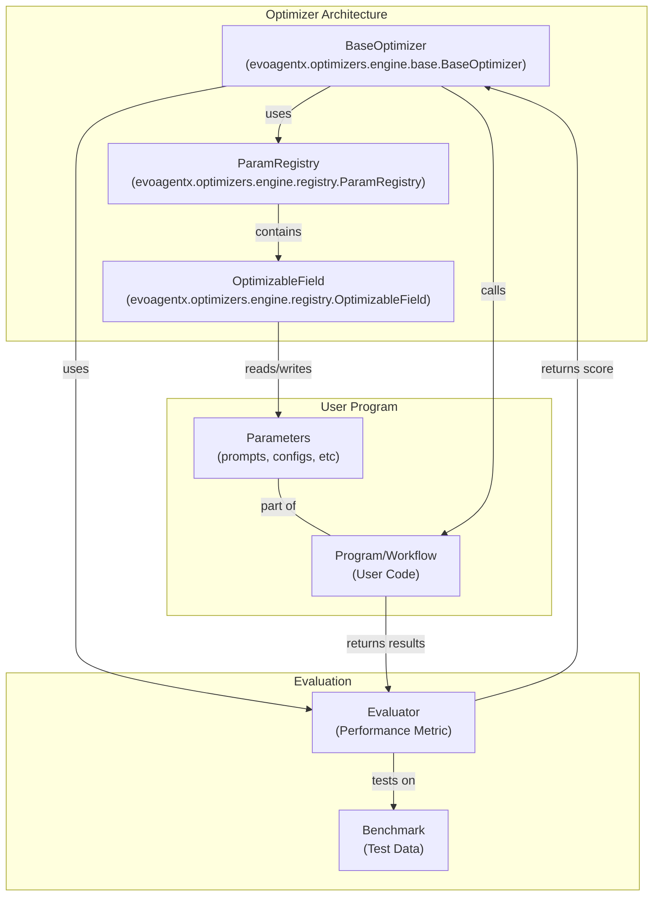
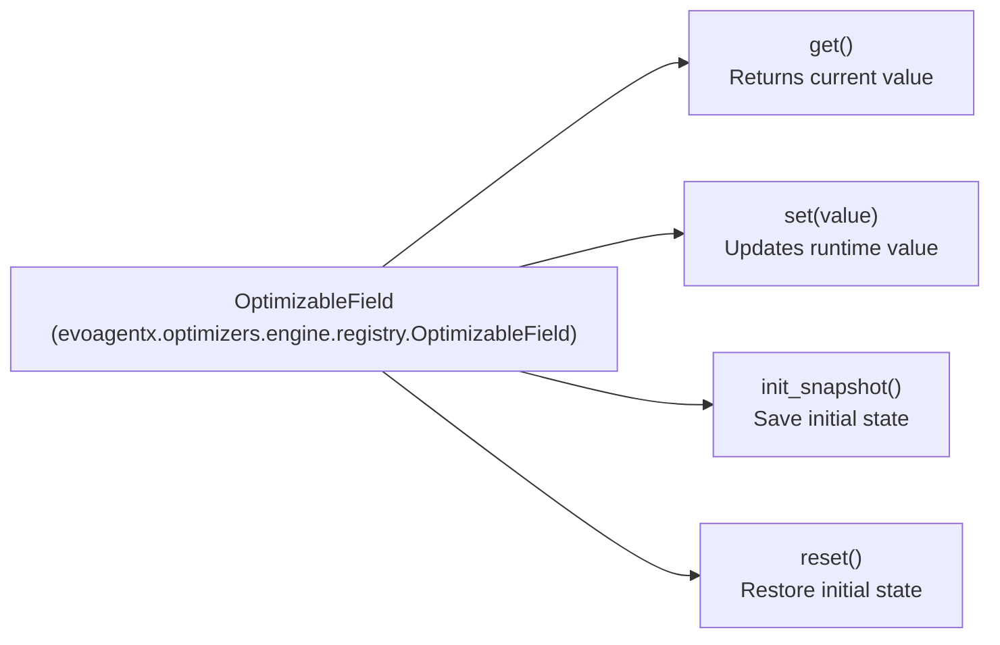
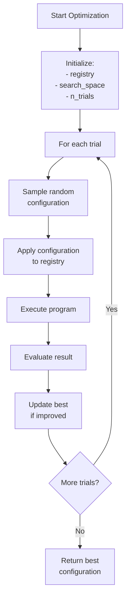
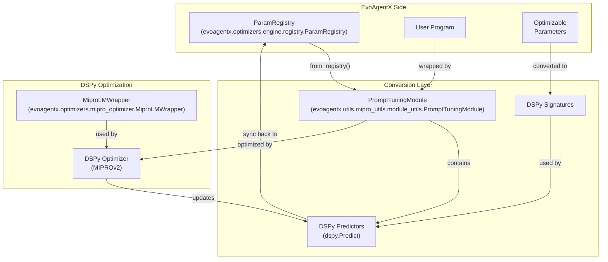

<!-- source: DeepWiki mcp.deepwiki.com · repo EvoAgentX/EvoAgentX · page 14.4 Creating Custom Optimizers · fetched 2026-10-26 -->

# Creating Custom Optimizers

<details>
<summary>Relevant source files</summary>

The following files were used as context for generating this wiki page:

- [evoagentx/models/siliconflow_model.py](evoagentx/models/siliconflow_model.py)
- [evoagentx/models/siliconflow_model_cost.py](evoagentx/models/siliconflow_model_cost.py)
- [evoagentx/optimizers/__init__.py](evoagentx/optimizers/__init__.py)
- [evoagentx/optimizers/engine/__init__.py](evoagentx/optimizers/engine/__init__.py)
- [evoagentx/optimizers/engine/base.py](evoagentx/optimizers/engine/base.py)
- [evoagentx/optimizers/engine/decorators.py](evoagentx/optimizers/engine/decorators.py)
- [evoagentx/optimizers/engine/registry.py](evoagentx/optimizers/engine/registry.py)
- [evoagentx/optimizers/example_optimizer.py](evoagentx/optimizers/example_optimizer.py)
- [evoagentx/optimizers/map_elites_optimizer.py](evoagentx/optimizers/map_elites_optimizer.py)
- [evoagentx/optimizers/mipro_optimizer.py](evoagentx/optimizers/mipro_optimizer.py)
- [evoagentx/optimizers/optimizer_core.py](evoagentx/optimizers/optimizer_core.py)
- [evoagentx/utils/mipro_utils/module_utils.py](evoagentx/utils/mipro_utils/module_utils.py)
- [evoagentx/utils/mipro_utils/register_utils.py](evoagentx/utils/mipro_utils/register_utils.py)
- [evoagentx/utils/mipro_utils/signature_utils.py](evoagentx/utils/mipro_utils/signature_utils.py)
- [examples/optimization/map_elites_demo.py](examples/optimization/map_elites_demo.py)
- [examples/optimization/mipro/math_mipro.py](examples/optimization/mipro/math_mipro.py)
- [examples/optimization/mipro/math_plug_and_play.py](examples/optimization/mipro/math_plug_and_play.py)
- [tests/src/optimizers/test_optimizer_package_imports.py](tests/src/optimizers/test_optimizer_package_imports.py)

</details>


This page provides a guide for developers who want to implement custom optimization algorithms in EvoAgentX. It covers the core interfaces, parameter registration mechanisms, and integration patterns needed to create optimizers that can automatically tune agent prompts, workflow structures, or other system parameters.

For general information about the optimization framework and built-in optimizers, see [Optimization Framework](#10.1). For using existing optimizers like TextGrad or MIPRO, see [TextGrad Optimization](#10.2) and [MIPRO Optimization](#10.3).

---

## Core Architecture

The EvoAgentX optimization system is built on three foundational components that work together to enable automated parameter tuning:



**Figure 1: Optimizer Component Architecture**

Sources: [evoagentx/optimizers/engine/base.py:6-30](), [evoagentx/optimizers/engine/registry.py:20-149]()

### BaseOptimizer Interface

The `BaseOptimizer` abstract class defines the contract that all custom optimizers must implement:

| Method | Type | Description |
|--------|------|-------------|
| `__init__` | Required | Initialize with `registry`, `program`, and `evaluator` [evoagentx/optimizers/engine/base.py:14-30]() |
| `optimize()` | Abstract | Main optimization loop - must be implemented [evoagentx/optimizers/engine/base.py:54-70]() |
| `get_param(name)` | Utility | Retrieve current parameter value [evoagentx/optimizers/engine/base.py:32-34]() |
| `set_param(name, value)` | Utility | Update parameter value [evoagentx/optimizers/engine/base.py:36-38]() |
| `param_names()` | Utility | List all registered parameter names [evoagentx/optimizers/engine/base.py:40-42]() |
| `get_current_cfg()` | Utility | Get all parameters as dictionary [evoagentx/optimizers/engine/base.py:44-46]() |
| `apply_cfg(cfg)` | Utility | Apply configuration dictionary [evoagentx/optimizers/engine/base.py:48-52]() |

Sources: [evoagentx/optimizers/engine/base.py:6-70]()

### ParamRegistry

The `ParamRegistry` provides a centralized system for tracking and modifying runtime parameters through dynamic getter/setter functions. It supports:

- **Nested attribute paths**: `"agent.system_prompt"` [evoagentx/optimizers/engine/registry.py:164-167]()
- **Dictionary keys**: `"config['temperature']"` [evoagentx/optimizers/engine/registry.py:165-167]()
- **List indices**: `"layers[0].dropout"` [evoagentx/optimizers/engine/registry.py:166-167]()
- **Batch registration**: Multiple parameters at once [evoagentx/optimizers/engine/registry.py:168-172]()
- **Snapshot/reset**: Save initial values and restore later [evoagentx/optimizers/engine/registry.py:145-149]()

Sources: [evoagentx/optimizers/engine/registry.py:109-194]()

### OptimizableField

Each registered parameter is wrapped in an `OptimizableField` that encapsulates:



**Figure 2: OptimizableField Methods**

Sources: [evoagentx/optimizers/engine/registry.py:20-107]()

---

## Creating a Simple Optimizer

The simplest way to understand the optimizer interface is through a concrete example. Here's the anatomy of a random search optimizer:



**Figure 3: Simple Optimizer Flow**

### Step 1: Define the Optimizer Class

Your optimizer must inherit from `BaseOptimizer` and implement the `optimize()` method:

```python
from evoagentx.optimizers.engine.base import BaseOptimizer
from evoagentx.optimizers.engine.registry import ParamRegistry
from typing import Callable, Dict, List, Any, Tuple

class ExampleOptimizer(BaseOptimizer):
    def __init__(self,
                 registry: ParamRegistry,
                 evaluator: Callable[[Dict[str, Any]], float],
                 search_space: Dict[str, List[Any]],
                 n_trials: int = 10):
        super().__init__(registry, evaluator=evaluator)
        self.search_space = search_space
        self.n_trials = n_trials
```

Sources: [evoagentx/optimizers/example_optimizer.py:7-24]()

### Step 2: Implement the optimize() Method

The `optimize()` method contains the main search logic. Note that it can use `EntryPoint.get_entry()` if no program is explicitly provided:

```python
def optimize(self, program_entry: Optional[Callable] = None) -> Tuple[Dict[str, Any], List[Dict[str, Any]]]:
    if program_entry is None:
        program_entry = EntryPoint.get_entry()
        if program_entry is None:
            raise RuntimeError("No entry function provided or registered.")

    best_score = float("-inf")
    best_cfg = None
    history = []

    for i in range(self.n_trials):
        # 1. Sample configuration
        cfg = {
            name: random.choice(choices)
            for name, choices in self.search_space.items()
        }

        # 2. Apply configuration to runtime via registry
        self.apply_cfg(cfg)

        # 3. Execute program
        output = program_entry()

        # 4. Evaluate performance
        score = self.evaluator(output)

        # 5. Track history
        trial_result = {"cfg": cfg, "score": score}
        history.append(trial_result)

        # 6. Update best
        if score > best_score:
            best_score = score
            best_cfg = cfg.copy()

    return best_cfg, history
```

Sources: [evoagentx/optimizers/example_optimizer.py:26-59]()

### Step 3: Usage Pattern

```python
# Define program to optimize
@EntryPoint()
def my_program():
    # Uses registered parameters
    return {"correct": 8, "total": 10}

# Define evaluator
def accuracy_evaluator(output):
    return output["correct"] / output["total"]

# Register parameters
registry = ParamRegistry()
registry.track(agent, "temperature")
registry.track(agent, "system_prompt")

# Create optimizer
optimizer = ExampleOptimizer(
    registry=registry,
    evaluator=accuracy_evaluator,
    search_space={
        "temperature": [0.0, 0.5, 1.0],
        "system_prompt": ["You are helpful.", "You are concise."]
    },
    n_trials=20
)

# Run optimization
best_cfg, history = optimizer.optimize()
```

Sources: [evoagentx/optimizers/example_optimizer.py:1-70](), [examples/optimization/map_elites_demo.py:20-59]()

---

## Parameter Registration

The `ParamRegistry.track()` method is the primary interface for registering optimizable parameters. It supports multiple usage patterns:

### Direct Attribute Registration

```python
registry = ParamRegistry()
registry.track(agent, "system_prompt")
registry.track(agent, "temperature")
```

### Nested Path Registration

The registry supports complex paths using a custom regex parser [evoagentx/optimizers/engine/registry.py:14-18]():

```python
# Dot notation for nested attributes
registry.track(workflow, "agent.config.temperature")

# Dictionary key access
registry.track(workflow, "metadata['version']")

# List index access
registry.track(workflow, "layers[0].dropout")

# Combined paths
registry.track(workflow, "agents[0].config['temperature']")
```

### Named Registration

```python
# Register with custom alias
registry.track(workflow, "agent.system_prompt", name="agent_prompt")

# Access using alias
registry.get("agent_prompt")
registry.set("agent_prompt", "New prompt")
```

Sources: [evoagentx/optimizers/engine/registry.py:154-241]()

### Parameter Path Resolution

The registry uses `_PATH_RE` to walk the object tree and identify the target leaf [evoagentx/optimizers/engine/registry.py:14-18]():

```mermaid
graph TB
    Input["Input Path<br/>'agents[0].config[\"temperature\"]'"]
    Parse["Parse with Regex<br/>_PATH_RE"]
    Attr["Match: Attribute Name"]
    Idx["Match: List Index"]
    Key["Match: Dict Key"]
    Walk["Walk from root<br/>to parent"]
    Leaf["Identify leaf<br/>attribute/index/key"]
    Getter["Create getter:<br/>lambda: getattr(parent, leaf) or parent[leaf]"]
    Setter["Create setter:<br/>lambda v: setattr(parent, leaf, v) or parent[leaf]=v"]
    Field["OptimizableField"]
    
    Input --> Parse
    Parse --> Attr
    Parse --> Idx
    Parse --> Key
    Attr --> Walk
    Idx --> Walk
    Key --> Walk
    Walk --> Leaf
    Leaf --> Getter
    Leaf --> Setter
    Getter --> Field
    Setter --> Field
```

**Figure 4: Parameter Path Resolution**

Sources: [evoagentx/optimizers/engine/registry.py:14-18](), [evoagentx/optimizers/engine/registry.py:213-280]()

---

## Specialized Optimizer Examples

### MAP-Elites Optimizer

The `MapElitesOptimizer` is a quality-diversity optimizer that maintains an archive of high-performing individuals across different feature dimensions [evoagentx/optimizers/map_elites_optimizer.py:25-108]().

```python
opt = MapElitesOptimizer(
    registry=registry,
    evaluator=evaluator,
    search_space={"x": [0, 1, 2, 3, 4], "y": [0, 1, 2, 3, 4]},
    feature_dimensions=["complexity", "diversity"],
    feature_ranges={"complexity": (0.0, 4.0), "diversity": (0.0, 4.0)},
    feature_bins=5,
    n_iterations=60,
    exploration_ratio=0.5
)
```

Sources: [evoagentx/optimizers/map_elites_optimizer.py:26-50](), [examples/optimization/map_elites_demo.py:36-46]()

### MIPRO Optimizer

The `MiproOptimizer` re-implements algorithms from the DSPy project, focusing on instruction proposals and few-shot example selection [evoagentx/optimizers/mipro_optimizer.py:1-40](). It uses an internal `MiproEvaluator` to manage scores from benchmarks [evoagentx/optimizers/mipro_optimizer.py:140-168]().

---

## Advanced: DSPy Integration

For optimizers that leverage the DSPy ecosystem, EvoAgentX provides a `PromptTuningModule` to bridge standard programs with DSPy predictors [evoagentx/utils/mipro_utils/module_utils.py:17-38]().



**Figure 5: DSPy Integration Architecture**

### PromptTuningModule

The `PromptTuningModule` manages the lifecycle of predictors and their synchronization with the registry [evoagentx/utils/mipro_utils/module_utils.py:17-38]():

| Method | Purpose |
|--------|---------|
| `from_registry(program, registry)` | Factory method to initialize signatures and predictors [evoagentx/utils/mipro_utils/module_utils.py:40-83]() |
| `reset()` | Roll back registry and predictor instructions to initial state [evoagentx/utils/mipro_utils/module_utils.py:119-143]() |
| `_validate_prompt()` | Ensure generated prompts contain required placeholders [evoagentx/utils/mipro_utils/module_utils.py:177-194]() |

Sources: [evoagentx/utils/mipro_utils/module_utils.py:17-194]()

---

## Best Practices

### 1. Registry Snapshots
Always call `init_snapshot()` (automatically handled by `register_field`) to ensure you can revert to the baseline state [evoagentx/optimizers/engine/registry.py:75-84]().

### 2. Evaluator Output
Custom evaluators should ideally return a dictionary of metrics including a `fitness_key` (defaulting to "score") to be compatible with advanced optimizers like `MapElitesOptimizer` [evoagentx/optimizers/map_elites_optimizer.py:110-124]().

### 3. Entry Points
Use the `@EntryPoint()` decorator on the main function you wish to optimize. This allows the optimizer to automatically find the target program if not explicitly passed [evoagentx/optimizers/engine/decorators.py:1-10](), [evoagentx/optimizers/engine/base.py:65-68]().

### 4. Dependency Management
Some optimizers (like MIPRO) require optional dependencies like `optuna`. Ensure your package imports handle these gracefully [evoagentx/optimizers/__init__.py:31-37]().

Sources: [evoagentx/optimizers/engine/registry.py:75-149](), [evoagentx/optimizers/map_elites_optimizer.py:110-124](), [evoagentx/optimizers/engine/base.py:65-68](), [evoagentx/optimizers/__init__.py:31-37]()

---

