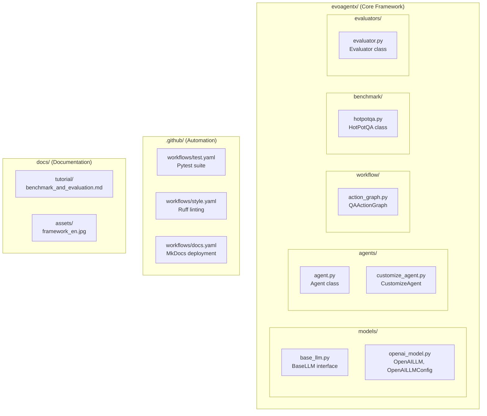
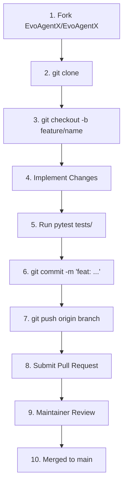
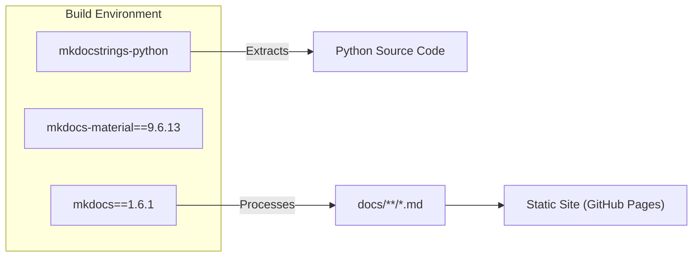

<!-- source: DeepWiki mcp.deepwiki.com · repo EvoAgentX/EvoAgentX · page 14.5 Contributing Guidelines · fetched 2026-10-26 -->

# Contributing Guidelines

<details>
<summary>Relevant source files</summary>

The following files were used as context for generating this wiki page:

- [.github/ISSUE_TEMPLATE/bug_report.yml](.github/ISSUE_TEMPLATE/bug_report.yml)
- [.github/ISSUE_TEMPLATE/feature_request.yml](.github/ISSUE_TEMPLATE/feature_request.yml)
- [.github/ISSUE_TEMPLATE/question.yml](.github/ISSUE_TEMPLATE/question.yml)
- [.github/workflows/docs.yaml](.github/workflows/docs.yaml)
- [.github/workflows/style.yaml](.github/workflows/style.yaml)
- [.github/workflows/test.yaml](.github/workflows/test.yaml)
- [CONTRIBUTING.md](CONTRIBUTING.md)
- [assets/framework_en.jpg](assets/framework_en.jpg)
- [assets/framework_zh.jpg](assets/framework_zh.jpg)
- [docs/assets/framework_en.jpg](docs/assets/framework_en.jpg)
- [docs/modules/benchmark.md](docs/modules/benchmark.md)
- [docs/modules/evaluator.md](docs/modules/evaluator.md)
- [docs/tutorial/benchmark_and_evaluation.md](docs/tutorial/benchmark_and_evaluation.md)
- [docs/zh/assets/framework_zh.jpg](docs/zh/assets/framework_zh.jpg)
- [evoagentx/evaluators/__init__.py](evoagentx/evaluators/__init__.py)
- [examples/benchmark_and_evaluation.py](examples/benchmark_and_evaluation.py)

</details>


This document provides technical guidelines for contributing to EvoAgentX. Contributors should understand the module system, follow established coding patterns, and submit pull requests that maintain compatibility with the existing architecture.

## Development Environment Setup

### Prerequisites

- Python 3.11 or 3.12 (Supported versions in CI) [[.github/workflows/style.yaml:12-12](), [.github/workflows/test.yaml:12-12]()]
- Git
- Conda (recommended) or virtualenv

### Installation Steps

Clone the repository and install in editable mode to allow immediate reflection of code changes without reinstallation [[CONTRIBUTING.md:9-10]()]:

```bash
git clone https://github.com/EvoAgentX/EvoAgentX.git
cd EvoAgentX
conda create -n evoagentx python=3.11
conda activate evoagentx
pip install -r requirements.txt
pip install -e .
```

**Sources:** [CONTRIBUTING.md:9-10](), [.github/workflows/test.yaml:12-12]()

## Repository Structure

Understanding the codebase structure is essential for effective contributions.

**Codebase Structure to Code Entities Mapping:**



**Sources:** [docs/tutorial/benchmark_and_evaluation.md:20-27](), [.github/workflows/test.yaml:1-51](), [.github/workflows/style.yaml:1-37]()

## Contribution Process

### Fork and Pull Request Workflow

EvoAgentX uses the standard GitHub fork-and-pull-request model [[CONTRIBUTING.md:59-87]()]:

**Step-by-Step Contribution Flow:**



### Commit Message Guidelines

Contributors must follow conventional commit messages to maintain a clean history [[CONTRIBUTING.md:71-74]()]:

- **Format:** `[category]: Brief description`
- **Categories:** `feat`, `fix`, `docs`, `test`, `refactor`, `chore`
- **Example:** `feat: add new agent workflow module` [[CONTRIBUTING.md:73-73]()]

**Sources:** [CONTRIBUTING.md:59-87]()

## Code Quality Standards

### Linting and Style

The project uses **Ruff** for code linting and style enforcement [[.github/workflows/style.yaml:36-37]()]. All Python code must follow **Google-style docstrings** [[CONTRIBUTING.md:90-92]()].

**Google-style Docstring Example:**
```python
def add(self, a, b):
    """Adds two numbers and updates `last_result`.

    Args:
        a (float): The first number.
        b (float): The second number.

    Returns:
        float: The sum of `a` and `b`.
    """
    self.last_result = a + b
    return self.last_result
```
[[CONTRIBUTING.md:129-140]()]

### Testing Requirements

Before submitting a PR, ensure all unit tests pass using `pytest` [[CONTRIBUTING.md:157-159]()]. The CI pipeline executes tests on Ubuntu for Python 3.11 and 3.12 [[.github/workflows/test.yaml:9-12]()].

```bash
pytest tests/
```

**Sources:** [CONTRIBUTING.md:90-140](), [.github/workflows/style.yaml:36-37](), [.github/workflows/test.yaml:33-35]()

## Documentation Contributions

### Documentation Build Pipeline

The documentation site is built using **MkDocs** with the Material theme and deployed via GitHub Actions [[.github/workflows/docs.yaml:31-43]()].



### Building Documentation Locally

To preview changes to the documentation site:

```bash
pip install mkdocs mkdocs-material mkdocstrings[python]
mkdocs serve
```

**Sources:** [.github/workflows/docs.yaml:29-43]()

## Pull Request Requirements

### Issue Templates

Contributors should use the provided GitHub templates for reporting issues:
- **Bug Reports:** Use `bug_report.yml` to provide OS, Python version, and reproduction steps [[.github/ISSUE_TEMPLATE/bug_report.yml:1-67]()].
- **Feature Requests:** Use `feature_request.yml` to describe the motivation and proposed solution [[.github/ISSUE_TEMPLATE/feature_request.yml:1-61]()].

### PR Checklist

- [ ] Code follows PEP 8 and project style (Ruff) [[.github/workflows/style.yaml:36-37]()]
- [ ] All new functions/classes have Google-style docstrings [[CONTRIBUTING.md:92-92]()]
- [ ] Unit tests are added/updated in `tests/` and pass locally [[CONTRIBUTING.md:157-159]()]
- [ ] Commit messages follow conventional format [[CONTRIBUTING.md:71-74]()]
- [ ] Documentation in `docs/` is updated if functionality changed.

**Sources:** [CONTRIBUTING.md:1-180](), [.github/workflows/test.yaml:1-51](), [.github/ISSUE_TEMPLATE/bug_report.yml:1-67]()

---

