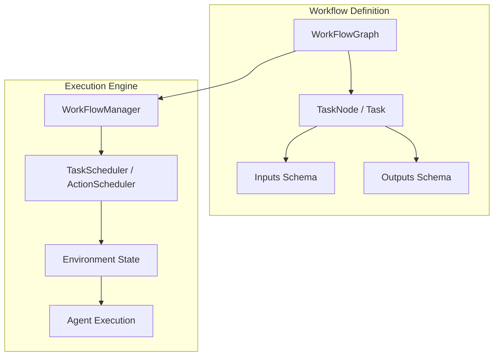
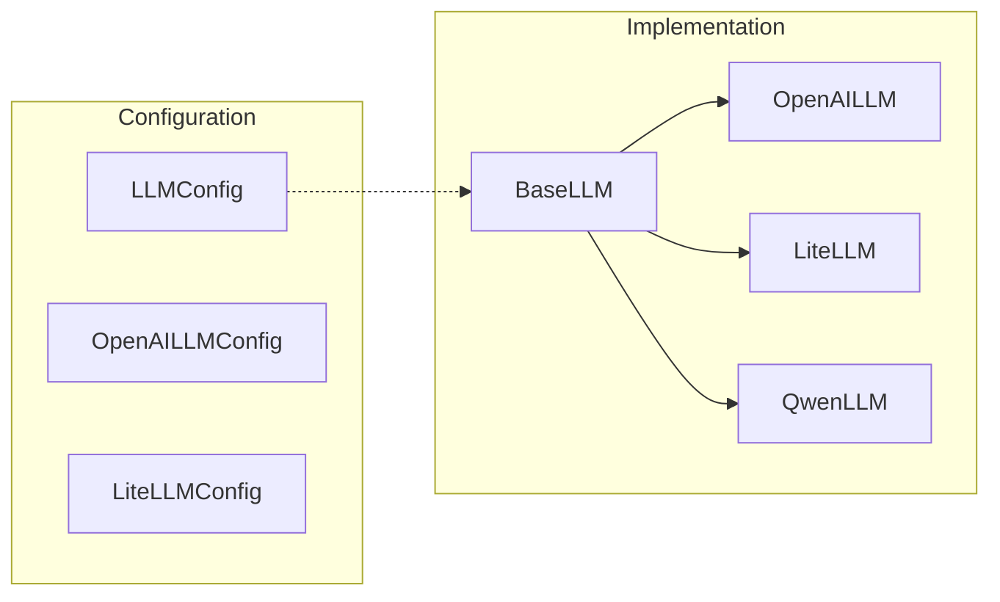

<!-- source: DeepWiki mcp.deepwiki.com · repo EvoAgentX/EvoAgentX · page 14.6 API Reference · fetched 2026-10-26 -->

# API Reference

Relevant source files

The following files were used as context for generating this wiki page:

- [docs/api/actions.md](docs/api/actions.md)
- [docs/api/benchmark.md](docs/api/benchmark.md)
- [docs/api/core.md](docs/api/core.md)
- [docs/api/evaluators.md](docs/api/evaluators.md)
- [docs/api/memory.md](docs/api/memory.md)
- [docs/api/models.md](docs/api/models.md)
- [docs/api/optimizers.md](docs/api/optimizers.md)
- [docs/api/storages.md](docs/api/storages.md)
- [docs/api/tools.md](docs/api/tools.md)
- [docs/api/workflow.md](docs/api/workflow.md)
- [docs/zh/api/actions.md](docs/zh/api/actions.md)
- [docs/zh/api/agents.md](docs/zh/api/agents.md)
- [docs/zh/api/benchmark.md](docs/zh/api/benchmark.md)
- [docs/zh/api/core.md](docs/zh/api/core.md)
- [docs/zh/api/evaluators.md](docs/zh/api/evaluators.md)
- [docs/zh/api/memory.md](docs/zh/api/memory.md)
- [docs/zh/api/models.md](docs/zh/api/models.md)
- [docs/zh/api/optimizers.md](docs/zh/api/optimizers.md)
- [docs/zh/api/storages.md](docs/zh/api/storages.md)
- [docs/zh/api/tools.md](docs/zh/api/tools.md)
- [docs/zh/api/workflow.md](docs/zh/api/workflow.md)

This page provides a comprehensive API reference for the EvoAgentX framework, organized by functional module. The documentation is derived from the codebase structure and docstring specifications.

## Core Module (`evoagentx.core`)

The `core` module defines the foundational building blocks of the framework, including the base module system, registration mechanisms, and fundamental agent interfaces.

### Module System
EvoAgentX uses a unified module system for serialization and registry management.

*   `BaseModule`: The base class for all serializable components. It handles parameter management and persistence [docs/api/core.md:1-2]().
*   `MODULE_REGISTRY`: A global registry that maps module names to their respective classes, enabling dynamic instantiation from configurations [docs/api/core.md:1-2]().

### Base Agent Interfaces
*   `BaseAgent`: The abstract base class defining the execution interface for all agents [docs/api/core.md:1-2]().
*   `CustomizeAgent`: A flexible agent implementation that can be configured with specific inputs, outputs, prompts, and toolsets [docs/api/core.md:1-2]().

Sources: `docs/api/core.md`, `docs/zh/api/core.md`

## Workflow Module (`evoagentx.workflow`)

The `workflow` module contains the logic for defining, generating, and executing multi-step agentic processes.

### Workflow Structure

*   `WorkFlowGraph`: Represents the structure of a workflow, including nodes (tasks) and edges (dependencies) [docs/api/workflow.md:1-3]().
*   `SequentialWorkFlowGraph`: A specialized graph for linear task execution [docs/api/workflow.md:1-3]().
*   `WorkFlowManager`: Orchestrates the execution of a workflow graph, managing agent assignment and state transitions [docs/api/workflow.md:1-3]().
*   `WorkFlowGenerator`: An LLM-powered component that can automatically generate a `WorkFlowGraph` from a natural language goal [docs/api/workflow.md:1-3]().

Sources: `docs/api/workflow.md`, `docs/zh/api/workflow.md`

## Language Model Module (`evoagentx.models`)

This module provides an abstraction layer over various LLM providers, ensuring a consistent interface for text generation and configuration.

### LLM Architecture

*   `BaseLLM`: The interface for all language model implementations, supporting synchronous and asynchronous generation [docs/api/models.md:1-3]().
*   `LLMConfig`: The base configuration class for model parameters (temperature, max tokens, etc.) [docs/api/models.md:1-3]().
*   `CostManager`: Tracks token usage and monetary costs across different model providers [docs/api/models.md:1-3]().

Sources: `docs/api/models.md`, `docs/zh/api/models.md`

## Tool and Action System

The action system bridges the gap between agent reasoning and environment interaction.

### Actions (`evoagentx.actions`)
*   `Action`: The base class for atomic operations performed by agents [docs/api/actions.md:1-2]().
*   `CustomizeAction`: A configurable action that can wrap specific tools or LLM calls [docs/api/actions.md:1-2]().

### Tools (`evoagentx.tools`)
*   `Tool`: A single functional unit (e.g., a python function) that can be called by an agent [docs/api/tools.md:1-2]().
*   `Toolkit`: A collection of related tools (e.g., `GmailToolkit`, `BrowserToolkit`) [docs/api/tools.md:1-2]().
*   `MCPToolkit`: Integration with the Model Context Protocol for dynamic tool discovery [docs/api/tools.md:1-2]().

Sources: `docs/api/actions.md`, `docs/api/tools.md`, `docs/zh/api/actions.md`

## Optimization and Evolution (`evoagentx.optimizers`)

This module implements algorithms for self-evolving agents and workflows.

| Optimizer | Description |
| :--- | :--- |
| `BaseOptimizer` | Abstract base for all optimization algorithms [docs/api/optimizers.md:1-2](). |
| `TextGrad` | Optimizes prompts using textual gradients and feedback [docs/api/optimizers.md:1-2](). |
| `MIPRO` | Multi-prompt instruction proposal and optimization [docs/api/optimizers.md:1-2](). |
| `AFlow` | MCTS-based workflow structure evolution [docs/api/optimizers.md:1-2](). |
| `EvoPrompt` | Evolutionary algorithms for prompt refinement [docs/api/optimizers.md:1-2](). |

Sources: `docs/api/optimizers.md`, `docs/zh/api/optimizers.md`

## Memory and Storage

### Memory System (`evoagentx.memory`)
*   `ShortTermMemory`: Manages recent message history and context windows [docs/api/memory.md:1-2]().
*   `LongTermMemory`: Interfaces with vector stores for persistent knowledge retrieval [docs/api/memory.md:1-2]().

### Storage Layer (`evoagentx.storages`)
*   `BaseStorage`: Abstraction for data persistence [docs/api/storages.md:1-2]().
*   `VectorStorage`: Interfaces for FAISS, Chroma, and Qdrant [docs/api/storages.md:1-2]().
*   `GraphStorage`: Interface for Neo4j and knowledge graph operations [docs/api/storages.md:1-2]().

Sources: `docs/api/memory.md`, `docs/api/storages.md`, `docs/zh/api/memory.md`

## Evaluation and Benchmarking

### Benchmark (`evoagentx.benchmark`)
*   `Benchmark`: Class for loading and managing datasets (HotPotQA, GAIA, etc.) [docs/api/benchmark.md:1-2]().
*   `DatasetSplit`: Handles train/dev/test partitions [docs/api/benchmark.md:1-2]().

### Evaluators (`evoagentx.evaluators`)
*   `Evaluator`: Base class for computing performance metrics [docs/api/evaluators.md:1-2]().
*   `SimpleReranker`: Logic for refining and ranking retrieved results [docs/api/evaluators.md:1-2]().

Sources: `docs/api/benchmark.md`, `docs/api/evaluators.md`, `docs/zh/api/benchmark.md`

---

