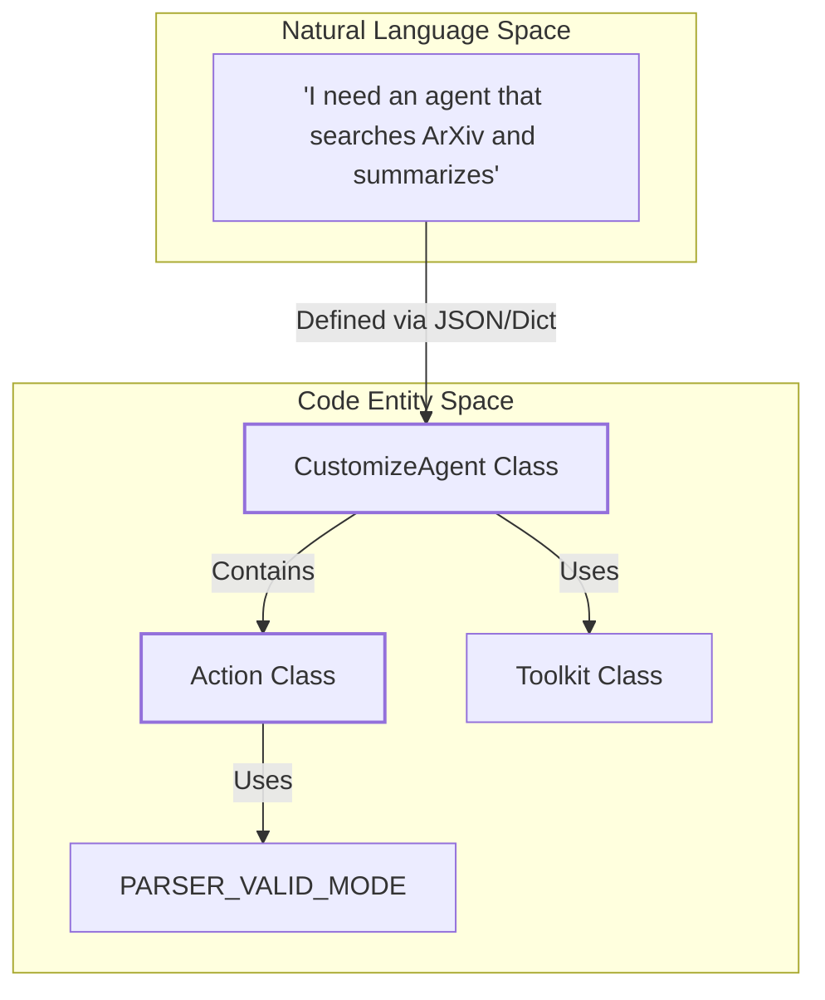
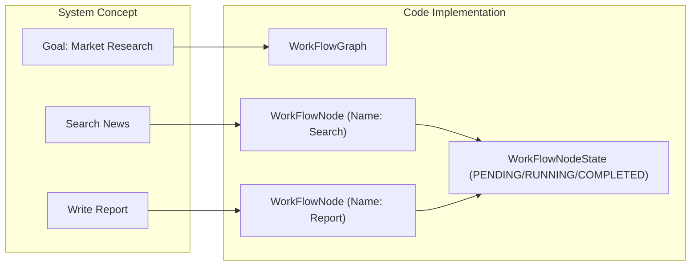

<!-- source: DeepWiki mcp.deepwiki.com · repo EvoAgentX/EvoAgentX · page 15 Glossary · fetched 2026-10-26 -->

# Glossary

Relevant source files

The following files were used as context for generating this wiki page:

- [README-zh.md](README-zh.md)
- [README.md](README.md)
- [assets/EAXLoGo.svg](assets/EAXLoGo.svg)
- [docs/assets/logo.svg](docs/assets/logo.svg)
- [docs/index.md](docs/index.md)
- [docs/overrides/main.html](docs/overrides/main.html)
- [docs/stylesheets/extra.css](docs/stylesheets/extra.css)
- [docs/tutorial/mcp.md](docs/tutorial/mcp.md)
- [docs/tutorial/tools.md](docs/tutorial/tools.md)
- [docs/zh/index.md](docs/zh/index.md)
- [docs/zh/tutorial/tools.md](docs/zh/tutorial/tools.md)
- [evoagentx/actions/action.py](evoagentx/actions/action.py)
- [evoagentx/agents/agent.py](evoagentx/agents/agent.py)
- [evoagentx/agents/agent_manager.py](evoagentx/agents/agent_manager.py)
- [evoagentx/agents/customize_agent.py](evoagentx/agents/customize_agent.py)
- [evoagentx/core/message.py](evoagentx/core/message.py)
- [evoagentx/core/module.py](evoagentx/core/module.py)
- [evoagentx/core/module_utils.py](evoagentx/core/module_utils.py)
- [evoagentx/models/base_model.py](evoagentx/models/base_model.py)
- [evoagentx/optimizers/engine/__init__.py](evoagentx/optimizers/engine/__init__.py)
- [evoagentx/optimizers/engine/base.py](evoagentx/optimizers/engine/base.py)
- [evoagentx/optimizers/engine/decorators.py](evoagentx/optimizers/engine/decorators.py)
- [evoagentx/optimizers/engine/registry.py](evoagentx/optimizers/engine/registry.py)
- [evoagentx/optimizers/example_optimizer.py](evoagentx/optimizers/example_optimizer.py)
- [evoagentx/optimizers/mipro_optimizer.py](evoagentx/optimizers/mipro_optimizer.py)
- [evoagentx/optimizers/optimizer_core.py](evoagentx/optimizers/optimizer_core.py)
- [evoagentx/tools/__init__.py](evoagentx/tools/__init__.py)
- [evoagentx/tools/mcp.py](evoagentx/tools/mcp.py)
- [evoagentx/utils/mipro_utils/module_utils.py](evoagentx/utils/mipro_utils/module_utils.py)
- [evoagentx/utils/mipro_utils/register_utils.py](evoagentx/utils/mipro_utils/register_utils.py)
- [evoagentx/utils/mipro_utils/signature_utils.py](evoagentx/utils/mipro_utils/signature_utils.py)
- [evoagentx/workflow/workflow_graph.py](evoagentx/workflow/workflow_graph.py)
- [examples/mcp_agent.py](examples/mcp_agent.py)
- [examples/optimization/mipro/math_mipro.py](examples/optimization/mipro/math_mipro.py)
- [examples/optimization/mipro/math_plug_and_play.py](examples/optimization/mipro/math_plug_and_play.py)
- [examples/sequential_workflow.py](examples/sequential_workflow.py)
- [mkdocs.yml](mkdocs.yml)

This page provides a comprehensive glossary of technical terms, architectural concepts, and domain-specific jargon used within the **EvoAgentX** framework. It is designed to help onboarding engineers navigate the codebase by linking conceptual definitions to their concrete implementations.

## Core Architectural Concepts

### BaseModule
The fundamental building block for all serializable entities in EvoAgentX. It extends Pydantic's `BaseModel` and uses a custom metaclass, `MetaModule`, to handle automatic registration into a global registry. This allows for seamless conversion between JSON/Dictionary representations and Python objects.

*   **Implementation**: Inherits from `pydantic.BaseModel` [evoagentx/core/module.py:51-61]().
*   **Key Feature**: Uses `MetaModule` to register every subclass into `MODULE_REGISTRY` [evoagentx/core/module.py:24-48]().
*   **Data Flow**: Serialization is handled via `to_dict()` [evoagentx/core/module.py:231-252]() and deserialization via `from_dict()` [evoagentx/core/module.py:182-212]().

### Agent
An autonomous entity capable of processing messages and executing actions. Agents in EvoAgentX are modular, possessing their own configuration, memory, and a set of available actions.

*   **Implementation**: Defined in `evoagentx/agents/agent.py`.
*   **CustomizeAgent**: A specialized subclass that allows creating agents dynamically via JSON configurations (inputs, outputs, prompts) without writing new Python code [evoagentx/agents/customize_agent.py:21-62]().

### Workflow Graph
A directed graph representation of a complex task, where nodes represent sub-tasks (`WorkFlowNode`) and edges represent dependencies or execution flow.

*   **WorkFlowNode**: Represents a specific task step, including its inputs, outputs, and the specific agent assigned to it [evoagentx/workflow/workflow_graph.py:40-66]().
*   **WorkFlowGraph**: The container for the entire task structure, managing the lifecycle of node states [evoagentx/workflow/workflow_graph.py:24-37]().

---

## Technical Terms & Jargon

| Term | Definition | Code Pointer |
| :--- | :--- | :--- |
| **Action** | A discrete unit of work an agent can perform, often wrapping a tool call or an LLM prompt. | [evoagentx/actions/action.py]() |
| **Toolkit** | A collection of related `Tool` objects (e.g., `GmailToolkit` contains tools for search, send, and draft). | [evoagentx/tools/tool.py:1]() |
| **HITL** | **Human-in-the-Loop**: A mechanism to pause execution for human review, correction, or input. | [README.md:66-68]() |
| **Self-Evolution** | The process of optimizing prompts or workflow structures based on evaluation feedback. | [README.md:51-53]() |
| **MCP** | **Model Context Protocol**: A standard for connecting agents to external data sources and tools. | [evoagentx/tools/mcp.py:9]() |
| **Parse Mode** | Strategy for extracting structured data from LLM text (e.g., `json`, `xml`, `title`). | [evoagentx/models/base_model.py:20]() |

---

## System Mapping: Natural Language to Code Entity

The following diagrams bridge high-level system concepts to the specific classes and files that implement them.

### 1. Agent Logic & Execution Flow
This diagram shows how a user's intent to create a "Specialized Agent" maps to the `CustomizeAgent` architecture and its internal components.

**Sources**: [evoagentx/agents/customize_agent.py:21-62](), [evoagentx/models/base_model.py:20-31](), [evoagentx/tools/tool.py:1]()

### 2. Workflow Orchestration Structure
This diagram maps the concept of a "Multi-step Task" to the `WorkFlowGraph` implementation.

**Sources**: [evoagentx/workflow/workflow_graph.py:24-66]()

---

## Detailed Tooling Glossary

EvoAgentX provides a rich ecosystem of tools. Below is the technical breakdown of the primary categories.

### Code Interpreters
Used for sandboxed execution of code generated by LLMs.
*   **`PythonInterpreterToolkit`**: Executes Python code locally with restricted imports [evoagentx/tools/interpreter_python.py]().
*   **`DockerInterpreterToolkit`**: Provides a higher level of isolation by running code inside a Docker container [evoagentx/tools/interpreter_docker.py]().

### Search & Retrieval
*   **`SerpAPIToolkit` / `SerperAPIToolkit`**: Wrappers for Google and other search engine APIs [evoagentx/tools/search_serpapi.py](), [evoagentx/tools/search_serperapi.py]().
*   **`ArxivToolkit`**: Specialized tool for querying academic papers [evoagentx/tools/request_arxiv.py]().

### Storage & Databases
*   **`StorageToolkit`**: Abstracted File I/O for saving/reading files across different backends [evoagentx/tools/storage_file.py]().
*   **`MongoDBToolkit` / `PostgreSQLToolkit`**: Managed database connectors for agent persistent state [evoagentx/tools/database_mongodb.py](), [evoagentx/tools/database_postgresql.py]().

---

## Optimization & Evolution Terms

*   **`BaseOptimizer`**: The parent class for all optimization algorithms (AFLow, SEW, TextGrad) [evoagentx/optimizers/engine/base.py]().
*   **`MODULE_REGISTRY`**: A central dictionary mapping `class_name` strings to actual Python class objects, enabling dynamic instantiation [evoagentx/core/registry.py]().
*   **`PromptTemplate`**: A structured format for LLM prompts that supports variable injection (e.g., `{input_name}`) [evoagentx/agents/customize_agent.py:13]().

**Sources**:
- [README.md:38-70]()
- [evoagentx/core/module.py:51-123]()
- [evoagentx/agents/customize_agent.py:21-81]()
- [evoagentx/workflow/workflow_graph.py:24-66]()
- [evoagentx/models/base_model.py:20-32]()
- [evoagentx/tools/__init__.py:1-32]()