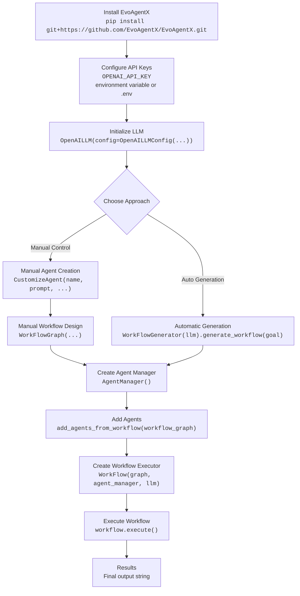
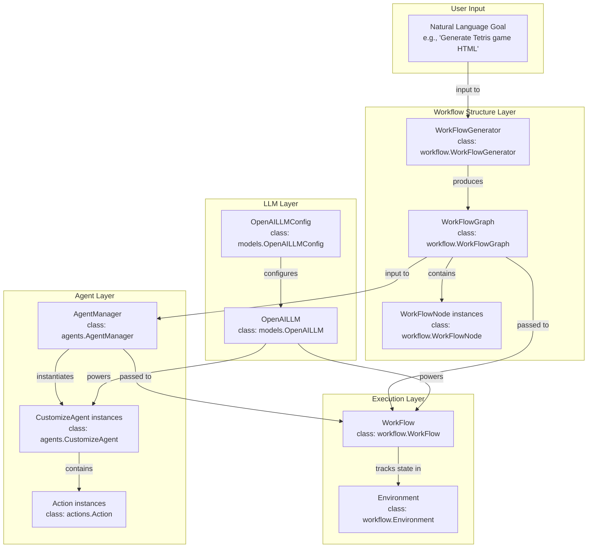

<!-- source: DeepWiki mcp.deepwiki.com · repo EvoAgentX/EvoAgentX · page 2 Getting Started · fetched 2026-10-26 -->

# Getting Started

Relevant source files

The following files were used as context for generating this wiki page:

- [docs/installation.md](docs/installation.md)
- [docs/overrides/partials/scripts.html](docs/overrides/partials/scripts.html)
- [docs/quickstart.md](docs/quickstart.md)
- [docs/tutorial/first_agent.md](docs/tutorial/first_agent.md)
- [docs/zh/installation.md](docs/zh/installation.md)
- [docs/zh/quickstart.md](docs/zh/quickstart.md)
- [docs/zh/tutorial/aflow_optimizer.md](docs/zh/tutorial/aflow_optimizer.md)
- [docs/zh/tutorial/first_agent.md](docs/zh/tutorial/first_agent.md)
- [docs/zh/tutorial/sew_optimizer.md](docs/zh/tutorial/sew_optimizer.md)
- [evoagentx/app/.env.example](evoagentx/app/.env.example)
- [evoagentx/fastapi_docs.md](evoagentx/fastapi_docs.md)
- [examples/agent_with_multiple_actions.py](examples/agent_with_multiple_actions.py)
- [pytest.ini](pytest.ini)

This page provides an overview of the essential steps and concepts needed to begin using EvoAgentX. It covers the basic workflow pattern, core components, and typical usage scenarios to help you quickly start building and executing agentic workflows.

For detailed installation instructions, see [Installation and Setup](#1.1). For in-depth explanations of fundamental concepts, see [Key Concepts](#1.2). For hands-on tutorials, proceed to [Quick Start Guide](#2.1) and [Basic Examples](#2.2).

## Prerequisites

Before working with EvoAgentX, ensure you have:

1.  **Python 3.11+** installed on your system [docs/installation.md:9]()
2.  **EvoAgentX package** installed via pip or from source [docs/installation.md:18-52]()
3.  **API keys** configured for your chosen LLM provider (OpenAI, LiteLLM, etc.) [docs/quickstart.md:15-61]()

See [Installation and Setup](#1.1) for complete installation instructions and API key configuration methods.

## Core Components Overview

EvoAgentX is built around several key components that work together to create self-evolving agentic workflows:

| Component | Code Class | Purpose |
| :--- | :--- | :--- |
| **Workflow Graph** | `WorkFlowGraph` | Defines the structure of multi-agent workflows with nodes (tasks) and edges (dependencies) [evoagentx/workflow/workflow_graph.py:287-308]() |
| **Agent Manager** | `AgentManager` | Creates and manages agent instances, tracking their states and lifecycle [evoagentx/agents/agent_manager.py:20-33]() |
| **Agents** | `Agent`, `CustomizeAgent` | Execute actions to complete tasks, with configurable prompts and tools [evoagentx/agents/customize_agent.py:21-62]() |
| **Workflow Executor** | `WorkFlow` | Orchestrates the execution of workflows, managing task scheduling and state [evoagentx/workflow/workflow.py:22-34]() |
| **LLM Configuration** | `LLMConfig`, `OpenAILLMConfig` | Configures language model providers and parameters [docs/quickstart.md:72-78]() |
| **Actions** | `Action` | Atomic tasks defined by `ActionInput` and `ActionOutput` that agents can perform [docs/tutorial/first_agent.md:118-140]() |

Sources: [docs/quickstart.md:97-99](), [docs/tutorial/first_agent.md:21-22](), [docs/tutorial/first_agent.md:111-116]()

## Getting Started Flow

The following diagram illustrates the typical progression from installation to workflow execution:

Sources: [docs/quickstart.md:10-136](), [docs/tutorial/first_agent.md:35-48]()

## Core Component Architecture

This diagram maps natural language concepts to their corresponding code entities in EvoAgentX:

Sources: [docs/quickstart.md:95-135](), [docs/tutorial/first_agent.md:20-21](), [docs/tutorial/first_agent.md:119-140]()

## Basic Usage Patterns

EvoAgentX supports two primary usage patterns:

### Pattern 1: Automatic Workflow Generation
The quickest way to start is using `WorkFlowGenerator` to automatically create workflows from natural language goals [docs/quickstart.md:101-107]().

**Workflow Pattern:**
1.  Initialize LLM with `OpenAILLM(config=OpenAILLMConfig(...))` [docs/quickstart.md:72-81]()
2.  Generate workflow with `WorkFlowGenerator(llm).generate_workflow(goal)` [docs/quickstart.md:105-106]()
3.  Create `AgentManager()` and add agents with `add_agents_from_workflow(workflow_graph, llm_config)` [docs/quickstart.md:127-128]()
4.  Execute with `WorkFlow(graph, agent_manager, llm).execute()` [docs/quickstart.md:134-135]()

### Pattern 2: Manual Agent and Action Definition
For fine-grained control, manually define agents using `CustomizeAgent` or create complex agents with multiple `Action` classes [docs/tutorial/first_agent.md:11-98]().

**Workflow Pattern:**
1.  Define `ActionInput` and `ActionOutput` schemas using Pydantic [docs/tutorial/first_agent.md:111-116]()
2.  Implement `Action.execute()` to define the logic [docs/tutorial/first_agent.md:141-153]()
3.  Create an `Agent` with a list of these actions [docs/tutorial/first_agent.md:194-200]()
4.  Execute specific actions via the agent: `agent(action_name="...", inputs=...)` [docs/tutorial/first_agent.md:214-222]()

Sources: [docs/quickstart.md:90-140](), [docs/tutorial/first_agent.md:3-10]()

## Optimization and Evolution

EvoAgentX includes specialized optimizers like **AFlow** and **SEW** to improve workflow performance over time:

*   **AFlow Optimizer**: Uses MCTS-based workflow structure evolution and prompt optimization [docs/zh/tutorial/aflow_optimizer.md:5-12]().
*   **SEW Optimizer**: Focuses on self-evolving workflows by optimizing both prompts and graph structures across different representation schemes like Python or YAML [docs/zh/tutorial/sew_optimizer.md:7-11]().

Sources: [docs/zh/tutorial/aflow_optimizer.md:142-161](), [docs/zh/tutorial/sew_optimizer.md:98-116]()

## Next Steps

Now that you understand the basic structure and components:

1.  **Start with a simple example**: See [Quick Start Guide](#2.1) for a step-by-step walkthrough.
2.  **Explore code examples**: Review [Basic Examples](#2.2) for common usage patterns like multi-action agents.
3.  **Learn about agents**: Read [Agent System](#3) for detailed agent architecture.
4.  **Understand workflows**: Study [Workflow System](#4) for automatic generation and orchestration.
5.  **Optimize performance**: See [Optimization and Evolution](#10) for details on AFlow and SEW optimizers.

Sources: [docs/quickstart.md:3-7](), [docs/tutorial/first_agent.md:3-9]()

---

