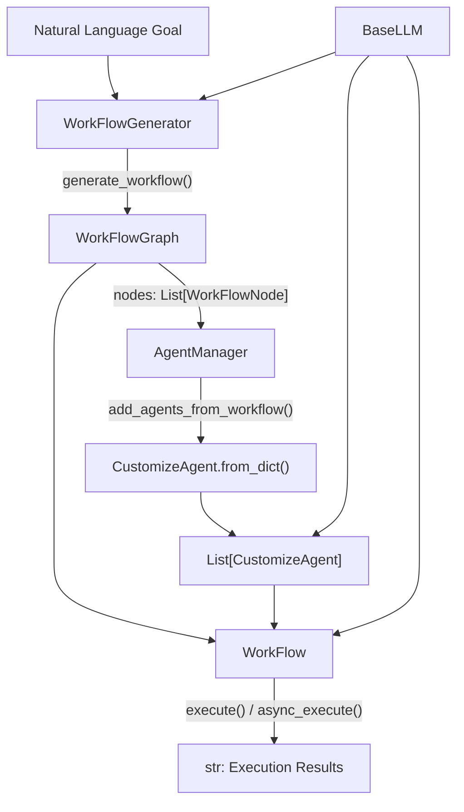
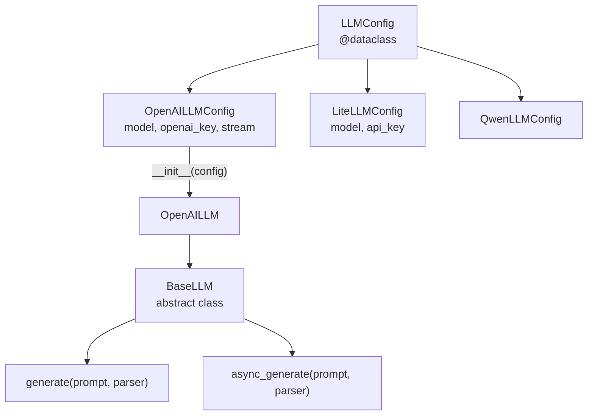
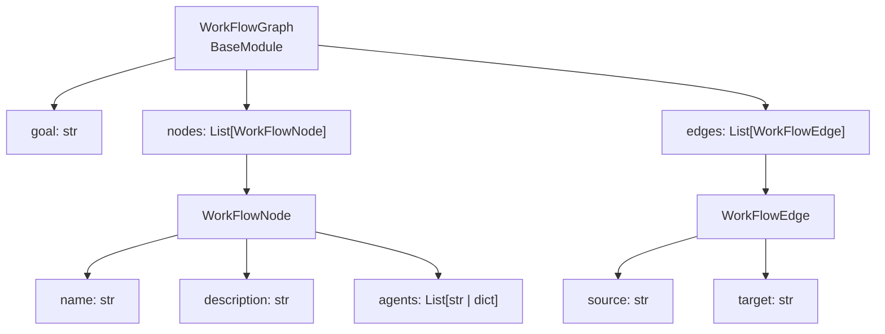
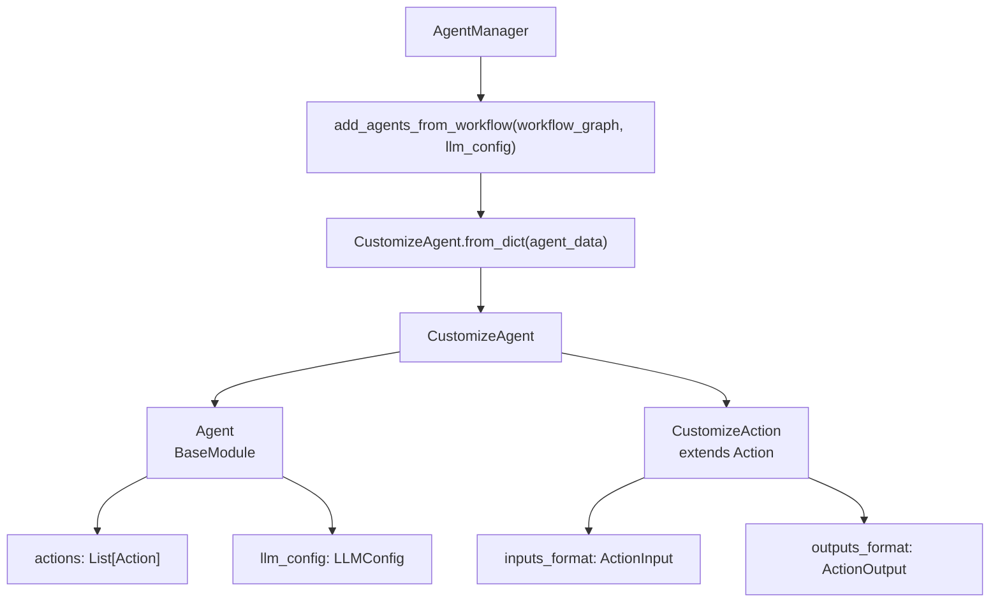
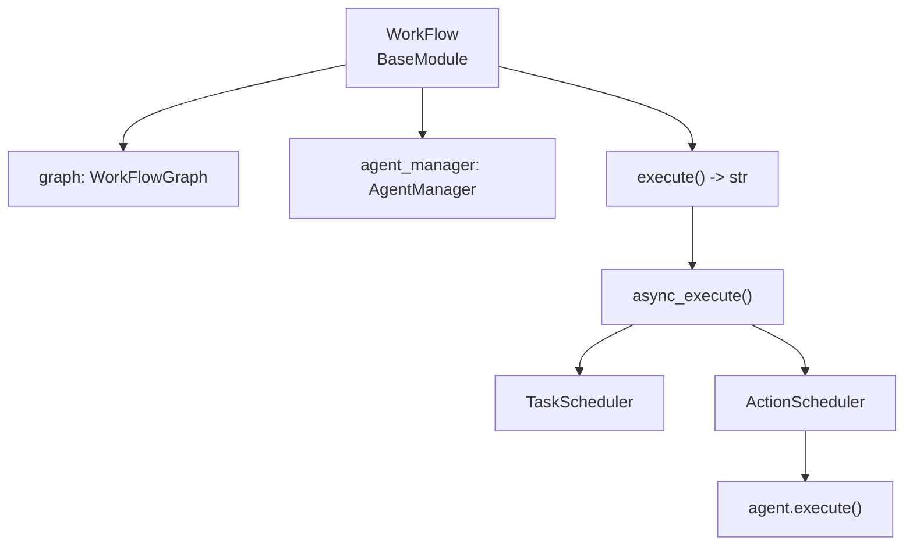

<!-- source: DeepWiki mcp.deepwiki.com · repo EvoAgentX/EvoAgentX · page 2.1 Quick Start Guide · fetched 2026-10-26 -->

# Quick Start Guide

<details>
<summary>Relevant source files</summary>

The following files were used as context for generating this wiki page:

- [docs/installation.md](docs/installation.md)
- [docs/overrides/partials/scripts.html](docs/overrides/partials/scripts.html)
- [docs/quickstart.md](docs/quickstart.md)
- [docs/tutorial/first_agent.md](docs/tutorial/first_agent.md)
- [docs/zh/installation.md](docs/zh/installation.md)
- [docs/zh/quickstart.md](docs/zh/quickstart.md)
- [docs/zh/tutorial/aflow_optimizer.md](docs/zh/tutorial/aflow_optimizer.md)
- [docs/zh/tutorial/first_agent.md](docs/zh/tutorial/first_agent.md)
- [docs/zh/tutorial/sew_optimizer.md](docs/zh/tutorial/sew_optimizer.md)
- [evoagentx/app/.env.example](evoagentx/app/.env.example)
- [evoagentx/fastapi_docs.md](evoagentx/fastapi_docs.md)
- [examples/agent_with_multiple_actions.py](examples/agent_with_multiple_actions.py)
- [pytest.ini](pytest.ini)

</details>


This guide provides a step-by-step walkthrough for creating your first workflow in EvoAgentX, from specifying a natural language goal to executing the complete workflow with agents. You'll learn the core workflow creation and execution patterns that form the foundation of the EvoAgentX framework.

For installation and environment setup, see [Installation and Setup](#1.1). For deeper understanding of core concepts like agents and workflows, see [Key Concepts](#1.2). For additional examples beyond this basic walkthrough, see [Basic Examples](#2.2).

## Overview: From Goal to Execution

EvoAgentX transforms natural language goals into executable multi-agent workflows through a structured pipeline. The process involves three main phases: workflow generation, agent instantiation, and execution.

### Core Workflow Creation Pipeline



**Sources**: [docs/quickstart.md:92-108](), [docs/quickstart.md:123-129](), [docs/quickstart.md:131-137](), [docs/tutorial/first_agent.md:52-64]()

## Step 1: LLM Configuration

Before creating workflows, configure your language model provider. EvoAgentX supports multiple LLM providers through a unified interface. You can set your `OPENAI_API_KEY` via environment variables or a `.env` file [docs/quickstart.md:15-61]().

### Basic OpenAI Configuration

```python
from evoagentx.models import OpenAILLMConfig, OpenAILLM
import os

# Configure OpenAI LLM
openai_config = OpenAILLMConfig(
    model="gpt-4o-mini",
    openai_key=os.getenv("OPENAI_API_KEY"),
    stream=True,
    output_response=True
)

llm = OpenAILLM(config=openai_config)
```

### LLM Configuration Architecture



**Sources**: [docs/quickstart.md:63-85](), [docs/tutorial/first_agent.md:15-33](), [docs/zh/tutorial/first_agent.md:15-32]()

## Step 2: Workflow Generation

Use `WorkFlowGenerator` to automatically create a workflow structure from a natural language goal. The `WorkFlowGraph` acts as a data structure storing the plan and task relationships [docs/quickstart.md:101-108]().

### Basic Workflow Generation

```python
from evoagentx.workflow import WorkFlowGenerator, WorkFlowGraph

# Define your goal
goal = "Generate HTML code for a Tetris game playable in browser"

# Generate workflow
wf_generator = WorkFlowGenerator(llm=llm)
workflow_graph: WorkFlowGraph = wf_generator.generate_workflow(goal=goal)
```

### Workflow Graph Structure

The `WorkFlowGraph` contains nodes and edges representing the task execution plan. It can be visualized or saved to JSON for persistence [docs/quickstart.md:110-121]().

**Workflow Graph Data Model**



**Sources**: [docs/quickstart.md:101-121](), [docs/zh/quickstart.md:99-119]()

## Step 3: Agent Management

Create and manage agents that will execute the workflow tasks using `AgentManager`. This component instantiates agents based on the workflow graph definitions [docs/quickstart.md:123-129]().

### Agent Instantiation from Workflow

```python
from evoagentx.agents import AgentManager

# Create agent manager
agent_manager = AgentManager()

# Generate agents from workflow graph
agent_manager.add_agents_from_workflow(
    workflow_graph, 
    llm_config=openai_config
)
```

### Agent Architecture Mapping

**Agent Creation and Management Flow**



**Sources**: [docs/quickstart.md:123-129](), [docs/tutorial/first_agent.md:35-64](), [docs/tutorial/first_agent.md:185-200](), [examples/agent_with_multiple_actions.py:7-14]()

## Step 4: Workflow Execution

Execute the complete workflow using the `WorkFlow` class, which orchestrates task scheduling and agent coordination [docs/quickstart.md:131-137]().

### Basic Execution

```python
from evoagentx.workflow import WorkFlow

# Create workflow instance
workflow = WorkFlow(
    graph=workflow_graph,
    agent_manager=agent_manager,
    llm=llm
)

# Execute workflow
output = workflow.execute()
print(output)
```

### Execution Architecture

**WorkFlow Execution Components**



**Sources**: [docs/quickstart.md:131-137](), [docs/zh/quickstart.md:129-135]()

## Complete Example

Here's a complete working example that demonstrates the entire workflow creation and execution pipeline [docs/quickstart.md:139-140]():

```python
import os
from evoagentx.models import OpenAILLMConfig, OpenAILLM
from evoagentx.workflow import WorkFlowGenerator, WorkFlow
from evoagentx.agents import AgentManager

# Step 1: Configure LLM
openai_config = OpenAILLMConfig(
    model="gpt-4o-mini",
    openai_key=os.getenv("OPENAI_API_KEY"),
    stream=True,
    output_response=True
)
llm = OpenAILLM(config=openai_config)

# Step 2: Generate workflow
goal = "Create a simple calculator with basic arithmetic operations"
wf_generator = WorkFlowGenerator(llm=llm)
workflow_graph = wf_generator.generate_workflow(goal=goal)

# Optional: Visualize the workflow structure
workflow_graph.display()

# Step 3: Create agents
agent_manager = AgentManager()
agent_manager.add_agents_from_workflow(workflow_graph, llm_config=openai_config)

# Step 4: Execute workflow
workflow = WorkFlow(
    graph=workflow_graph,
    agent_manager=agent_manager,
    llm=llm
)
result = workflow.execute()
print(f"Workflow completed with result: {result}")
```

### Key Components Mapping Table

| Component | Class | Key Methods | Purpose |
|-----------|-------|-------------|---------|
| **Workflow Generator** | `WorkFlowGenerator` | `generate_workflow(goal)` | Converts natural language goal to `WorkFlowGraph` |
| **Workflow Graph** | `WorkFlowGraph` | `display()`, `save_module()`, `from_file()` | Manages workflow structure and persistence |
| **Agent Manager** | `AgentManager` | `add_agents_from_workflow()` | Creates and manages agent instances |
| **Workflow Executor** | `WorkFlow` | `execute()` | Orchestrates workflow execution |
| **Custom Agent** | `CustomizeAgent` | `from_dict()`, `__call__()` | Dynamic agent creation with custom prompts |

**Sources**: [docs/quickstart.md:90-137](), [docs/tutorial/first_agent.md:11-64](), [docs/zh/quickstart.md:88-135]()

## Optional: Workflow Persistence

You can save and reload workflows for reuse [docs/quickstart.md:110-121]():

```python
# Save workflow graph
workflow_graph.save_module("/path/to/save/workflow_demo.json")

# Reload workflow graph
from evoagentx.workflow import WorkFlowGraph
loaded_graph = WorkFlowGraph.from_file("/path/to/save/workflow_demo.json")
```

**Sources**: [docs/quickstart.md:110-121](), [docs/zh/quickstart.md:108-119]()

---

