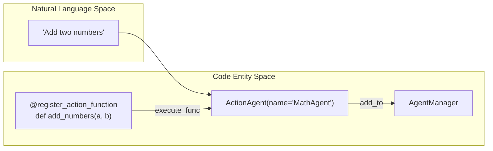
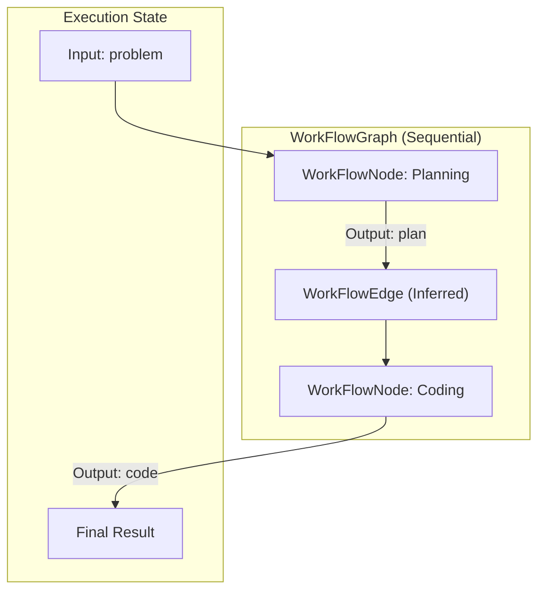
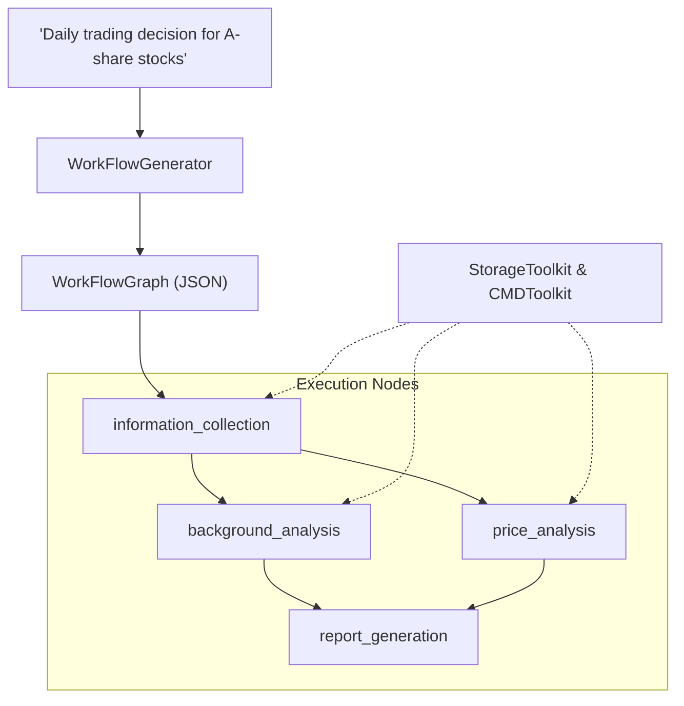

<!-- source: DeepWiki mcp.deepwiki.com · repo EvoAgentX/EvoAgentX · page 2.2 Basic Examples · fetched 2026-10-26 -->

# Basic Examples

<details>
<summary>Relevant source files</summary>

The following files were used as context for generating this wiki page:

- [docs/modules/action_graph.md](docs/modules/action_graph.md)
- [docs/modules/workflow_graph.md](docs/modules/workflow_graph.md)
- [docs/tutorial/first_workflow.md](docs/tutorial/first_workflow.md)
- [evoagentx/agents/__init__.py](evoagentx/agents/__init__.py)
- [evoagentx/agents/action_agent.py](evoagentx/agents/action_agent.py)
- [evoagentx/core/registry.py](evoagentx/core/registry.py)
- [evoagentx/prompts/context_extraction.py](evoagentx/prompts/context_extraction.py)
- [evoagentx/prompts/workflow/sew_workflow.py](evoagentx/prompts/workflow/sew_workflow.py)
- [evoagentx/workflow/__init__.py](evoagentx/workflow/__init__.py)
- [examples/action_agent.py](examples/action_agent.py)
- [examples/workflow/invest/catl_data_functions.py](examples/workflow/invest/catl_data_functions.py)
- [examples/workflow/invest/generate_report.py](examples/workflow/invest/generate_report.py)
- [examples/workflow/invest/html_report_generator.py](examples/workflow/invest/html_report_generator.py)
- [examples/workflow/invest/invest_demo_4o_mini.json](examples/workflow/invest/invest_demo_4o_mini.json)
- [examples/workflow/invest/stock_analysis.py](examples/workflow/invest/stock_analysis.py)
- [examples/workflow/invest/stock_chart_tools.py](examples/workflow/invest/stock_chart_tools.py)
- [examples/workflow/workflow_demo.py](examples/workflow/workflow_demo.py)
- [examples/workflow/workflow_direction.py](examples/workflow/workflow_direction.py)

</details>


This document provides annotated code examples for common use cases in the EvoAgentX framework, including simple agents, tool usage, and structured workflows. These examples demonstrate how to bridge natural language goals into executable code entities.

## Overview of Core Examples

EvoAgentX supports multiple operational patterns, from purely functional agents to complex multi-step investment analysis workflows.

| Pattern Category | Purpose | Key Classes | Primary Source |
|------------------|---------|-------------|---------------|
| **Action Agents** | Execute Python functions directly without LLM reasoning | `ActionAgent` | [examples/action_agent.py:91-111]() |
| **Sequential Workflows** | Linear task execution where outputs feed into next inputs | `SequentialWorkFlowGraph` | [docs/tutorial/first_workflow.md:87-91]() |
| **Tool-Enabled Workflows** | Agents using external tools (CMD, Storage) to achieve goals | `WorkFlowGenerator`, `AgentManager` | [examples/workflow/invest/stock_analysis.py:155-161]() |
| **Structured Task Graphs** | Fine-grained operation sequences within a single task | `ActionGraph` | [docs/modules/action_graph.md:64-88]() |

## Action Agents: Functional Integration

The `ActionAgent` is a specialized class that wraps standard Python functions, allowing them to participate in agentic workflows without requiring an LLM for execution [evoagentx/agents/action_agent.py:15-18]().

### Basic Function Wrapper
This pattern is ideal for deterministic tasks like mathematical calculations or data validation.

**ActionAgent Mapping: Code to Logic**


Example from [examples/action_agent.py:96-111]():
```python
from evoagentx.agents import ActionAgent
from evoagentx.core.registry import register_action_function

@register_action_function
def add_numbers(a: int, b: int) -> int:
    return a + b

math_agent = ActionAgent(
    name="MathAgent",
    description="Performs mathematical operations",
    inputs=[
        {"name": "a", "type": "int", "description": "First number"},
        {"name": "b", "type": "int", "description": "Second number"}
    ],
    outputs=[
        {"name": "result", "type": "int", "description": "Sum"}
    ],
    execute_func=add_numbers
)

result = math_agent(inputs={"a": 5, "b": 3})
```

**Sources:** [evoagentx/agents/action_agent.py:15-83](), [examples/action_agent.py:19-22](), [examples/action_agent.py:96-111]()

## Sequential Workflow Pattern

A `SequentialWorkFlowGraph` automatically infers dependencies between tasks based on their input/output requirements, creating a linear execution path [docs/modules/workflow_graph.md:63-67]().

### Planning and Coding Workflow
This example shows a two-step process where a "Planning" task generates a strategy used by a "Coding" task.

**Data Flow in Sequential Workflows**


Example from [docs/tutorial/first_workflow.md:56-91]():
```python
tasks = [
    {
        "name": "Planning",
        "description": "Create a detailed plan",
        "inputs": [{"name": "problem", "type": "str"}],
        "outputs": [{"name": "plan", "type": "str"}],
        "prompt": "Create a plan for: {problem}",
        "parse_mode": "str"
    },
    {
        "name": "Coding",
        "description": "Implement the code",
        "inputs": [
            {"name": "problem", "type": "str"},
            {"name": "plan", "type": "str"}
        ],
        "outputs": [{"name": "code", "type": "str"}],
        "prompt": "Implement code using plan: {plan}",
        "parse_mode": "custom",
        "parse_func": custom_parse_func
    }
]

graph = SequentialWorkFlowGraph(goal="Generate code", tasks=tasks)
```

**Sources:** [docs/modules/workflow_graph.md:63-98](), [docs/tutorial/first_workflow.md:56-91]()

## Advanced Use Case: Stock Analysis Workflow

The framework excels at complex, tool-heavy workflows like the Investment Analysis demo. This workflow uses `StorageToolkit` and `CMDToolkit` to process real market data [examples/workflow/invest/stock_analysis.py:43-46]().

### Automated Workflow Generation
Instead of manual definition, the `WorkFlowGenerator` can create the graph from a high-level goal [examples/workflow/invest/stock_analysis.py:155-161]().

**Investment Workflow Architecture**


Key implementation details from [examples/workflow/invest/stock_analysis.py:164-184]():
1. **Graph Loading**: `WorkFlowGraph.from_file(module_save_path)` [line 168]()
2. **Agent Setup**: `agent_manager.add_agents_from_workflow(workflow_graph)` [line 170]()
3. **Execution**: `workflow.execute(inputs={"goal": goal_string})` [line 184]()

The workflow configuration in [examples/workflow/invest/invest_demo_4o_mini.json]() defines specific agents like `information_collection` and `price_analysis` with mandatory tool usage for reading CSV data [lines 7-23]().

**Sources:** [examples/workflow/invest/stock_analysis.py:42-184](), [examples/workflow/invest/invest_demo_4o_mini.json:1-30]()

## Comparison of Graph Types

EvoAgentX provides different graph abstractions depending on the required granularity.

| Feature | `ActionGraph` | `WorkFlowGraph` |
|---------|---------------|-----------------|
| **Scope** | Detailed steps within a single task [docs/modules/action_graph.md:44]() | Multi-task orchestration [docs/modules/action_graph.md:44]() |
| **Execution** | Fixed sequence defined in Python `execute()` [docs/modules/action_graph.md:47]() | Dynamic based on dependencies/edges [docs/modules/action_graph.md:47]() |
| **Primary Class** | `ActionGraph` [docs/modules/action_graph.md:64]() | `WorkFlowGraph` [docs/modules/workflow_graph.md:105]() |

**Sources:** [docs/modules/action_graph.md:42-50](), [docs/modules/workflow_graph.md:5-9]()

---

