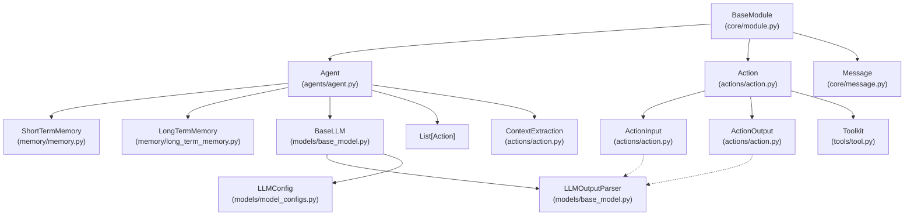
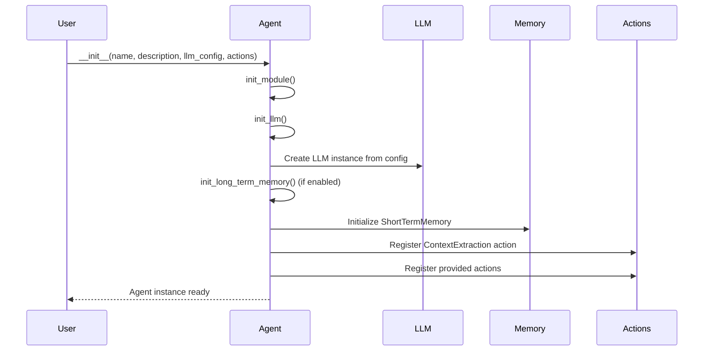
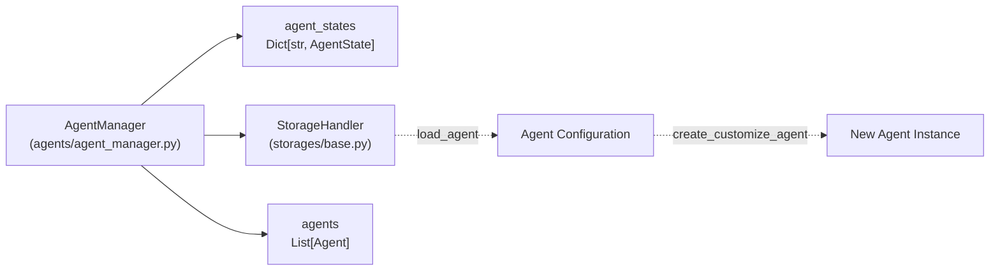
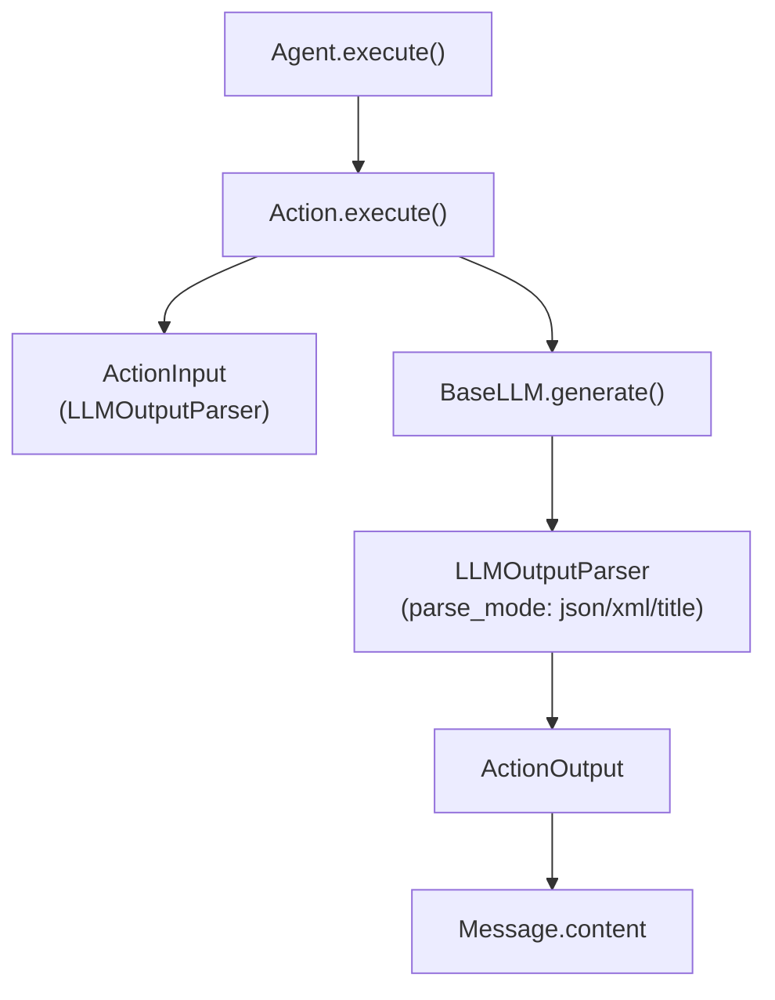
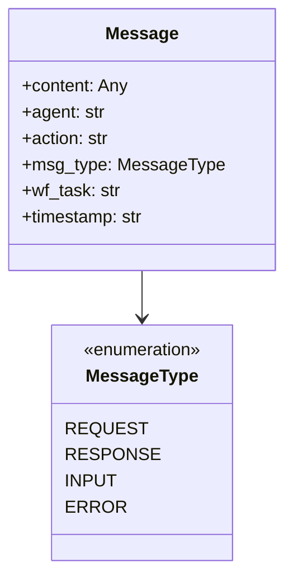

<!-- source: DeepWiki mcp.deepwiki.com · repo EvoAgentX/EvoAgentX · page 3 Agent System · fetched 2026-10-26 -->

# Agent System

Relevant source files

The following files were used as context for generating this wiki page:

- [evoagentx/actions/action.py](evoagentx/actions/action.py)
- [evoagentx/agents/agent.py](evoagentx/agents/agent.py)
- [evoagentx/agents/agent_manager.py](evoagentx/agents/agent_manager.py)
- [evoagentx/agents/customize_agent.py](evoagentx/agents/customize_agent.py)
- [evoagentx/core/message.py](evoagentx/core/message.py)
- [evoagentx/core/module.py](evoagentx/core/module.py)
- [evoagentx/core/module_utils.py](evoagentx/core/module_utils.py)
- [evoagentx/models/base_model.py](evoagentx/models/base_model.py)
- [evoagentx/workflow/workflow_graph.py](evoagentx/workflow/workflow_graph.py)

The Agent System provides the core architecture for creating, managing, and executing autonomous agents within EvoAgentX. This system defines the fundamental building blocks for agents that can perform actions, manage memory, interact with language models, and communicate through structured messages. For workflow orchestration and multi-agent coordination, see [Workflow System](#4). For tool integration and external service access, see [Tool System](#7).

## Agent Architecture Overview

The agent system is built on a modular architecture where agents are composed of actions, memory components, and LLM integrations. The core relationship flows from `BaseModule` through `Agent` to various specialized components.

Title: Agent Component Relationships

Sources: [evoagentx/agents/agent.py:20-52](), [evoagentx/actions/action.py:108-131](), [evoagentx/models/base_model.py:22-33](), [evoagentx/core/module.py:51-70](), [evoagentx/core/message.py:19-50]()

## Core Agent Classes

### Agent Base Class

The `Agent` class [evoagentx/agents/agent.py:20]() serves as the foundation for all agent implementations. It inherits from `BaseModule` [evoagentx/core/module.py:51]() to provide serialization capabilities and integrates multiple subsystems.

| Attribute | Type | Purpose |
|-----------|------|---------|
| `name` | `str` | Unique identifier for the agent |
| `description` | `str` | Human-readable description of agent purpose |
| `agent_id` | `str` | Auto-generated unique ID via `generate_id` |
| `system_prompt` | `str` | System-level instructions for the agent |
| `actions` | `List[Action]` | Available actions the agent can execute |
| `llm_config` | `LLMConfig` | Language model configuration |
| `llm` | `BaseLLM` | Language model instance |
| `short_term_memory` | `ShortTermMemory` | Context for current workflow |
| `is_human` | `bool` | Whether agent represents human user |
| `version` | `int` | Agent version number |

The agent initialization process [evoagentx/agents/agent.py:54-63]() includes LLM setup, memory initialization, and action registration.

Title: Agent Initialization Lifecycle

Sources: [evoagentx/agents/agent.py:38-63](), [evoagentx/agents/agent.py:54-63]()

For details on the base class implementation and patterns, see [Agent Base Classes](#3.1).

### CustomizeAgent

`CustomizeAgent` [evoagentx/agents/customize_agent.py:21]() provides a flexible framework for creating specialized agents without writing custom code. It enables the creation of agents with well-defined `inputs` and `outputs`, custom prompt templates, and configurable parsing strategies via `parse_mode` [evoagentx/agents/customize_agent.py:48]().

For details on dynamic agent creation, see [CustomizeAgent](#3.2).

## Agent Management and Lifecycle

### Agent Manager

The `AgentManager` class [evoagentx/agents/agent_manager.py:20]() is responsible for the lifecycle and state management of agents. It tracks agent states (e.g., `AVAILABLE`, `RUNNING`) [evoagentx/agents/agent_manager.py:15]() and handles loading agents from storage using a `StorageHandler` [evoagentx/agents/agent_manager.py:113]().

Title: Agent State and Storage Management

Sources: [evoagentx/agents/agent_manager.py:20-33](), [evoagentx/agents/agent_manager.py:101-117]()

For details on lifecycle management and multi-agent coordination, see [Agent Manager](#3.3).

## Memory System

Agents maintain both short-term and long-term memory systems for context management. `ShortTermMemory` [evoagentx/agents/agent.py:44]() stores messages for a single workflow, while `LongTermMemory` [evoagentx/agents/agent.py:47]() provides persistent storage across sessions.

| Memory Type | Class | Purpose | Storage |
|-------------|-------|---------|---------|
| Short-term | `ShortTermMemory` | Current workflow context | In-memory |
| Long-term | `LongTermMemory` | Persistent knowledge | `StorageHandler` |

For details on context extraction and message handling, see [Memory System](#3.4).

## Specialized Agents

### Alita Agent

The `Alita` agent is a specialized implementation combining web search, file storage, and code execution. It features dynamic tool creation at runtime to solve complex tasks.

For details on this specialized implementation, see [Alita Agent](#3.5).

## Action System Architecture

### Action and Parser Integration

The action system defines discrete operations through the `Action` class [evoagentx/actions/action.py:108](). Actions utilize `ActionInput` and `ActionOutput` which inherit from `LLMOutputParser` [evoagentx/models/base_model.py:22]() to handle structured data.

Title: Action Execution Data Flow

Sources: [evoagentx/actions/action.py:108-131](), [evoagentx/models/base_model.py:75-132](), [evoagentx/agents/agent.py:129-151]()

### Context Extraction

Agents use a built-in `ContextExtraction` mechanism [evoagentx/agents/agent.py:62]() to automatically map conversation history to the `inputs_format` [evoagentx/actions/action.py:129]() required by an action.

## Message System

The `Message` class [evoagentx/core/message.py:19]() is the primary data structure for communication. It tracks the sender (`agent`), the triggering `action`, and the execution `prompt` [evoagentx/core/message.py:39-42]().

Title: Message Entity Mapping

Sources: [evoagentx/core/message.py:19-50](), [evoagentx/core/message.py:9-17]()

## Agent Execution Patterns

Agents support both synchronous and asynchronous execution. The `__call__` method [evoagentx/agents/agent.py:72]() automatically detects the running environment to route requests to `execute()` [evoagentx/agents/agent.py:231]() or `async_execute()` [evoagentx/agents/agent.py:168]().

- **Synchronous**: `execute(action_name, msgs, ...)`
- **Asynchronous**: `async_execute(action_name, msgs, ...)`

Sources: [evoagentx/agents/agent.py:72-81](), [evoagentx/agents/agent.py:168-281]()

---

