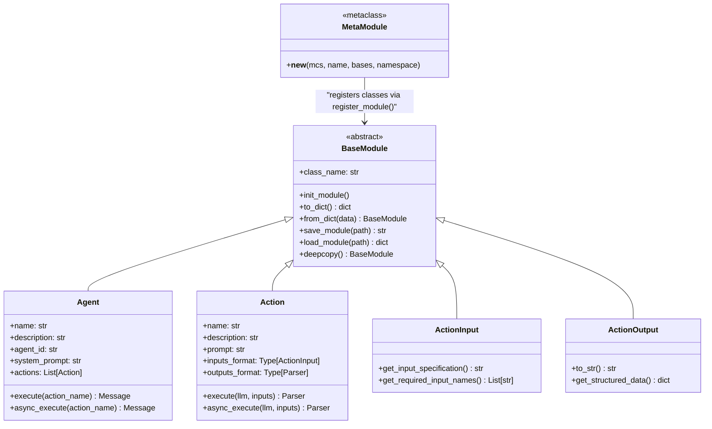
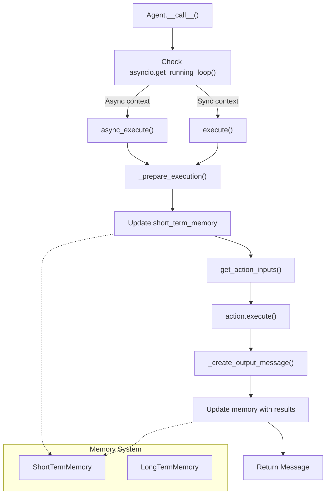
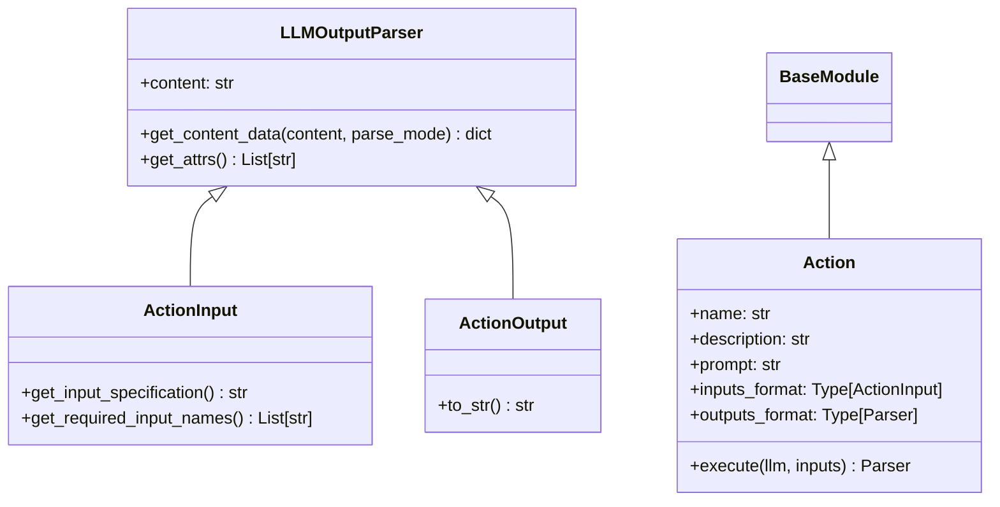
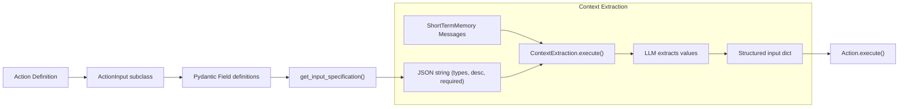

<!-- source: DeepWiki mcp.deepwiki.com · repo EvoAgentX/EvoAgentX · page 3.1 Agent Base Classes · fetched 2026-10-26 -->

# Agent Base Classes

Relevant source files

The following files were used as context for generating this wiki page:

- [evoagentx/actions/action.py](evoagentx/actions/action.py)
- [evoagentx/agents/agent.py](evoagentx/agents/agent.py)
- [evoagentx/core/message.py](evoagentx/core/message.py)
- [evoagentx/core/module.py](evoagentx/core/module.py)
- [evoagentx/core/module_utils.py](evoagentx/core/module_utils.py)
- [evoagentx/models/base_model.py](evoagentx/models/base_model.py)
- [tests/src/agents/test_agent.py](tests/src/agents/test_agent.py)
- [tests/src/agents/test_agent_manager.py](tests/src/agents/test_agent_manager.py)
- [tests/src/core/test_base_config.py](tests/src/core/test_base_config.py)
- [tests/src/core/test_message.py](tests/src/core/test_message.py)
- [tests/src/core/test_module.py](tests/src/core/test_module.py)
- [tests/src/models/mock_response.py](tests/src/models/mock_response.py)
- [tests/src/models/test_openai_model.py](tests/src/models/test_openai_model.py)

This document covers the foundational base classes that form the core of the EvoAgentX agent system: `Agent`, `Action`, `ActionInput`, `ActionOutput`, and their supporting classes. These classes define the fundamental interfaces and behaviors for creating and executing agents and their actions.

## Foundation Classes

All agent system components inherit from `BaseModule`, which provides serialization, deserialization, and registry capabilities. The `BaseModule` class serves as the foundation for all modules in the EvoAgentX framework [evoagentx/core/module.py:51-61]().

### BaseModule Architecture

The `BaseModule` uses `MetaModule` to automatically register subclasses into a global registry, enabling dynamic instantiation from dictionaries or JSON files [evoagentx/core/module.py:24-48]().

Sources: [evoagentx/core/module.py:24-48](), [evoagentx/core/module.py:51-82](), [evoagentx/agents/agent.py:20-52](), [evoagentx/actions/action.py:108-131]()

## Agent Base Class

The `Agent` class is the fundamental building block. It manages a language model instance, maintains short-term memory for conversation context, and executes specific actions [evoagentx/agents/agent.py:20-52]().

### Core Agent Structure

| Attribute | Type | Purpose |
|-----------|------|---------|
| `name` | `str` | Unique identifier for the agent [evoagentx/agents/agent.py:38]() |
| `description` | `str` | Human-readable description of agent's purpose [evoagentx/agents/agent.py:39]() |
| `agent_id` | `str` | Auto-generated unique ID via `generate_id` [evoagentx/agents/agent.py:42]() |
| `system_prompt` | `str` | System-level instructions for the agent [evoagentx/agents/agent.py:43]() |
| `actions` | `List[Action]` | Available actions the agent can perform [evoagentx/agents/agent.py:49]() |
| `llm_config` | `LLMConfig` | Configuration for the language model [evoagentx/agents/agent.py:40]() |
| `short_term_memory` | `ShortTermMemory` | Context storage for the current workflow [evoagentx/agents/agent.py:44]() |
| `is_human` | `bool` | Flag indicating if agent represents a human [evoagentx/agents/agent.py:51]() |

### Agent Execution Flow

Agents are callable. When called, they automatically detect the environment (sync vs async) and route to `execute()` or `async_execute()` [evoagentx/agents/agent.py:72-80]().

Sources: [evoagentx/agents/agent.py:72-80](), [evoagentx/agents/agent.py:82-127](), [evoagentx/agents/agent.py:231-281]()

## Action Base Classes

Actions represent discrete operations. The system consists of `Action`, `ActionInput` (input specification), and `ActionOutput` (structured results) [evoagentx/actions/action.py:18-131]().

### Action Class Hierarchy

Both `ActionInput` and `ActionOutput` inherit from `LLMOutputParser`, which allows them to parse raw LLM strings into structured Pydantic models [evoagentx/actions/action.py:18-106]().

Sources: [evoagentx/actions/action.py:18-30](), [evoagentx/actions/action.py:91-97](), [evoagentx/actions/action.py:108-131](), [evoagentx/models/base_model.py:22-32]()

### Action Input Specification

`ActionInput` subclasses use Pydantic `Field` descriptions to generate JSON schemas. These schemas are injected into LLM prompts so the model knows exactly what parameters to provide [evoagentx/actions/action.py:33-70]().

Sources: [evoagentx/actions/action.py:33-70](), [evoagentx/agents/agent.py:371-386]()

## LLM Integration and Parsing

The `LLMOutputParser` is the bridge between raw LLM text and structured data. It supports several `parse_mode` options [evoagentx/models/base_model.py:75-132]().

| Parse Mode | Implementation | Behavior |
|------------|----------------|----------|
| `"json"` | `_parse_json_content` | Extracts first valid JSON block from text using `parse_json_from_text` [evoagentx/models/base_model.py:150-184]() |
| `"xml"` | `_parse_xml_content` | Parses content wrapped in XML-style tags [evoagentx/models/base_model.py:186-204]() |
| `"str"` | `_parse_str_content` | Maps the entire raw string to all defined parser attributes [evoagentx/models/base_model.py:135-147]() |
| `"title"` | `_parse_title_content`| Parses Markdown headings as keys [evoagentx/models/base_model.py:206-235]() |

Sources: [evoagentx/models/base_model.py:75-132](), [evoagentx/core/module_utils.py:197-201]()

## Message System

Messages are the primary data structure for communication. Every agent execution results in a `Message` object [evoagentx/core/message.py:19-50]().

| Attribute | Description |
|-----------|-------------|
| `content` | The actual data (str, dict, or object) [evoagentx/core/message.py:38]() |
| `agent` | Name of the agent that sent the message [evoagentx/core/message.py:39]() |
| `action` | Name of the action that generated the message [evoagentx/core/message.py:41]() |
| `msg_type`| Enum: `REQUEST`, `RESPONSE`, `INPUT`, `ERROR`, etc. [evoagentx/core/message.py:9-17]() |
| `wf_task` | The specific workflow node/task name this belongs to [evoagentx/core/message.py:46]() |

Sources: [evoagentx/core/message.py:9-17](), [evoagentx/core/message.py:19-50]()

## Serialization Patterns

`BaseModule` provides robust serialization. When a module contains other modules (e.g., an `Agent` containing `Action` objects), the `to_dict` and `from_dict` methods handle recursive processing [evoagentx/core/module.py:145-180]().

1.  **Saving**: `save_module()` calls `to_dict()`, which includes the `class_name` to allow later reconstruction [evoagentx/core/module.py:221-240]().
2.  **Loading**: `from_dict()` looks up the `class_name` in the `MODULE_REGISTRY` and uses `_create_instance()` to recursively build the object tree [evoagentx/core/module.py:182-219]().

Sources: [evoagentx/core/module.py:145-180](), [evoagentx/core/module.py:182-240](), [evoagentx/core/registry.py:21-21]()

---

