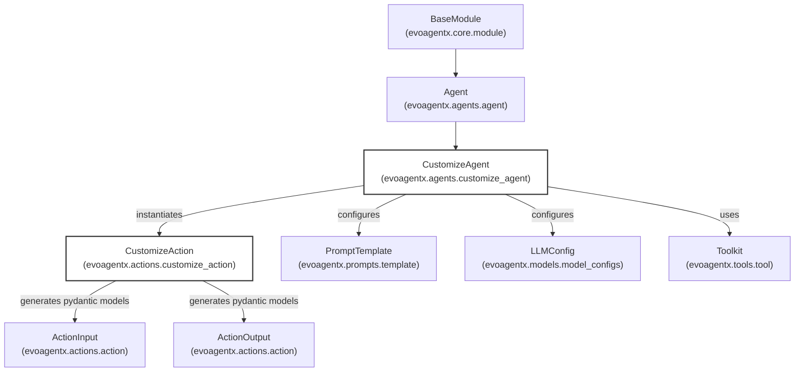
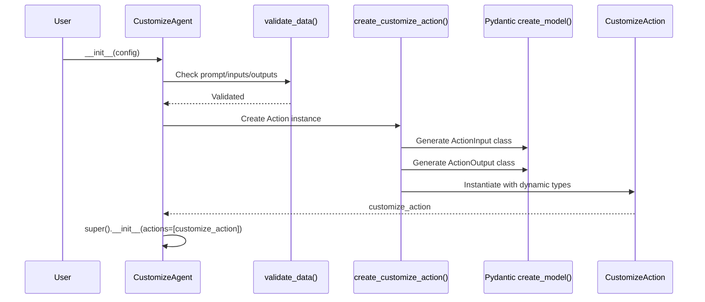
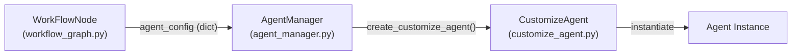

<!-- source: DeepWiki mcp.deepwiki.com · repo EvoAgentX/EvoAgentX · page 3.2 CustomizeAgent · fetched 2026-10-26 -->

# CustomizeAgent

<details>
<summary>Relevant source files</summary>

The following files were used as context for generating this wiki page:

- [assets/demo_result_1.png](assets/demo_result_1.png)
- [assets/demo_result_2.png](assets/demo_result_2.png)
- [docs/modules/agent.md](docs/modules/agent.md)
- [docs/modules/customize_agent.md](docs/modules/customize_agent.md)
- [docs/modules/llm.md](docs/modules/llm.md)
- [docs/tutorial/colab_notebooks.md](docs/tutorial/colab_notebooks.md)
- [evoagentx/actions/customize_action.py](evoagentx/actions/customize_action.py)
- [evoagentx/agents/agent_manager.py](evoagentx/agents/agent_manager.py)
- [evoagentx/agents/customize_agent.py](evoagentx/agents/customize_agent.py)
- [evoagentx/prompts/tool_calling.py](evoagentx/prompts/tool_calling.py)
- [evoagentx/tools/browser_tool.py](evoagentx/tools/browser_tool.py)
- [evoagentx/tools/file_tool.py](evoagentx/tools/file_tool.py)
- [evoagentx/workflow/workflow_graph.py](evoagentx/workflow/workflow_graph.py)
- [examples/customize_agent.py](examples/customize_agent.py)
- [examples/output/jobs/jobs_demo_4o_mini.json](examples/output/jobs/jobs_demo_4o_mini.json)
- [examples/output/jobs/mcp_jobs.config](examples/output/jobs/mcp_jobs.config)
- [examples/output/jobs/test_pdf.pdf](examples/output/jobs/test_pdf.pdf)

</details>


## Purpose and Scope

`CustomizeAgent` is a flexible framework for creating specialized LLM-powered agents without writing custom code. It enables declarative agent definition through configuration of inputs, outputs, prompts, and tools. `CustomizeAgent` dynamically generates actions with well-defined schemas and integrates seamlessly with the workflow system.

For information about the base `Agent` class and its methods, see [Agent Base Classes](#3.1). For details on the actions created by `CustomizeAgent`, see [CustomizeAction](#5.2). For agent lifecycle management, see [Agent Manager](#3.3).

---

## Class Architecture

### Inheritance and Dependencies

The following diagram illustrates how `CustomizeAgent` relates to the core module system and how it bridges the gap between natural language configurations and executable code entities like `CustomizeAction`.



**Sources:** [evoagentx/agents/customize_agent.py:21-62](), [evoagentx/actions/customize_action.py:20-31]()

---

## Core Components

### CustomizeAgent Attributes

| Attribute | Type | Description |
|-----------|------|-------------|
| `name` | `str` | Unique identifier for the agent [evoagentx/agents/customize_agent.py:29](). |
| `description` | `str` | Purpose and capabilities description [evoagentx/agents/customize_agent.py:30](). |
| `prompt` | `Optional[str]` | Prompt template string with placeholders in `{input_name}` format [evoagentx/agents/customize_agent.py:32-33](). |
| `prompt_template` | `Optional[PromptTemplate]` | Structured prompt template object (takes precedence over `prompt`) [evoagentx/agents/customize_agent.py:31](). |
| `llm_config` | `Optional[LLMConfig]` | Language model configuration [evoagentx/agents/customize_agent.py:34](). |
| `inputs` | `List[dict]` | Input parameter specifications (name, type, description, required) [evoagentx/agents/customize_agent.py:35-39](). |
| `outputs` | `List[dict]` | Output field specifications (name, type, description, required) [evoagentx/agents/customize_agent.py:40-44](). |
| `system_prompt` | `Optional[str]` | System-level prompt for LLM (defaults to `DEFAULT_SYSTEM_PROMPT`) [evoagentx/agents/customize_agent.py:45](). |
| `output_parser` | `Optional[Type[ActionOutput]]` | Custom class for parsing LLM output [evoagentx/agents/customize_agent.py:46-47](). |
| `parse_mode` | `Optional[str]` | Parsing strategy ("title", "json", "xml", "str", "custom") [evoagentx/agents/customize_agent.py:48-53](). |
| `parse_func` | `Optional[Callable]` | Custom parsing function used when `parse_mode` is "custom" [evoagentx/agents/customize_agent.py:54-55](). |
| `tools` | `Optional[List[Union[Toolkit, Tool]]]` | Tools available to the agent [evoagentx/agents/customize_agent.py:58](). |
| `max_tool_calls` | `Optional[int]` | Maximum tool call iterations (default: 5) [evoagentx/agents/customize_agent.py:59](). |

**Sources:** [evoagentx/agents/customize_agent.py:28-62]()

---

## Creating a CustomizeAgent

### Initialization Flow

The initialization process transforms high-level configurations into a functional agent by dynamically generating a `CustomizeAction`.



**Sources:** [evoagentx/agents/customize_agent.py:108-141](), [evoagentx/agents/customize_agent.py:244-349]()

### Basic Example

```python
from evoagentx.agents import CustomizeAgent
from evoagentx.models import OpenAILLMConfig

agent = CustomizeAgent(
    name="CodeWriter",
    description="Writes Python code based on requirements",
    prompt="Write Python code for: {requirement}",
    llm_config=OpenAILLMConfig(model="gpt-4o-mini"),
    inputs=[
        {"name": "requirement", "type": "string", "description": "The coding requirement"}
    ],
    outputs=[
        {"name": "code", "type": "string", "description": "The generated Python code"}
    ],
    parse_mode="str"
)
```

**Sources:** [examples/customize_agent.py:58-72]()

---

## Output Parsing Modes

`CustomizeAgent` provides several built-in modes to extract structured data from LLM responses.

| Mode | Behavior | Implementation Details |
|------|----------|------------------------|
| `title` | Parses output by section titles | Uses `title_format` (default: `"## {title}"`) [evoagentx/agents/customize_agent.py:104-105](). |
| `json` | Parses as a JSON object | Looks for JSON blocks in the response [evoagentx/agents/customize_agent.py:51](). |
| `xml` | Parses XML tags | Extracts content between `<tag>` and `</tag>` [evoagentx/agents/customize_agent.py:52](). |
| `str` | Returns plain text | Maps the entire output to the specified output fields [evoagentx/agents/customize_agent.py:50](). |
| `custom` | User-defined function | Executes `parse_func` which must return a `dict` [evoagentx/agents/customize_agent.py:54-55](). |

**Sources:** [evoagentx/agents/customize_agent.py:48-57](), [evoagentx/actions/customize_action.py:22-24]()

---

## Tool Integration

Tools are integrated via `Toolkit` or individual `Tool` objects. `CustomizeAgent` automatically wraps single tools into toolkits during initialization.

```python
if tools is not None:
    raw_tool_map = {tool.name: tool for tool in tools}
    tools = [tool if isinstance(tool, Toolkit) else Toolkit(name=tool.name, tools=[tool]) for tool in tools]
```

The agent uses `max_tool_calls` to limit the number of recursive tool-calling iterations performed by the underlying `CustomizeAction`.

**Sources:** [evoagentx/agents/customize_agent.py:85-87](), [evoagentx/agents/customize_agent.py:148]()

---

## Serialization and Persistence

`CustomizeAgent` supports full serialization, allowing agents to be saved to and loaded from JSON files.

### Saving an Agent
The `save_module` method extracts all configuration parameters (including input/output schemas and prompt templates) and writes them to a file.

```python
# From evoagentx/agents/customize_agent.py:469-490
agent.save_module("path/to/agent.json")
```

### Loading an Agent
The `load_module` class method reconstructs the agent. Note that `llm_config` and `tools` are typically provided at load time as they often contain sensitive keys or environment-specific objects.

```python
# From evoagentx/agents/customize_agent.py:444-467
loaded_agent = CustomizeAgent.load_module(
    path="path/to/agent.json",
    llm_config=model_config,
    tools=[FileToolkit()]
)
```

**Sources:** [evoagentx/agents/customize_agent.py:400-490]()

---

## Usage in Workflows

In a `WorkFlowGraph`, agents are often defined as dictionaries within a `WorkFlowNode`. The `AgentManager` is responsible for resolving these dictionaries into `CustomizeAgent` instances.



**Sources:** [evoagentx/workflow/workflow_graph.py:68-84](), [evoagentx/agents/agent_manager.py:203-237]()

---

## Key Functions Summary

| Function | File | Description |
|----------|------|-------------|
| `create_customize_action` | [evoagentx/agents/customize_agent.py:244]() | Dynamically creates `ActionInput` and `ActionOutput` Pydantic models and instantiates `CustomizeAction`. |
| `validate_data` | [evoagentx/agents/customize_agent.py:197]() | Ensures prompts contain necessary placeholders and that parse modes are valid. |
| `get_customize_agent_info` | [evoagentx/agents/customize_agent.py:400]() | Serializes the agent's configuration into a dictionary for storage. |
| `_store_inputs_outputs_info` | [evoagentx/agents/customize_agent.py:371]() | Stores metadata about inputs and outputs for runtime retrieval. |

**Sources:** [evoagentx/agents/customize_agent.py:197-442]()

---

