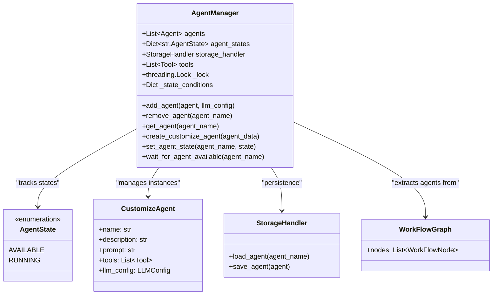
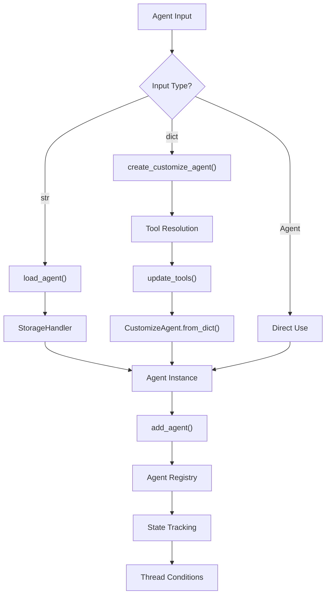
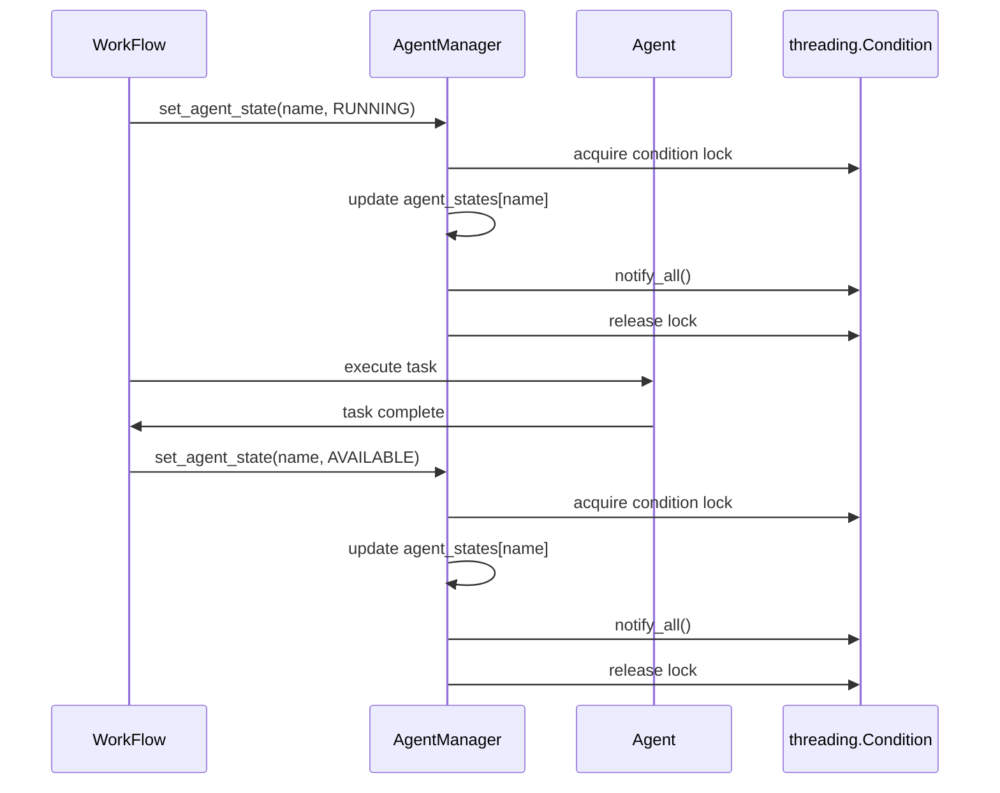
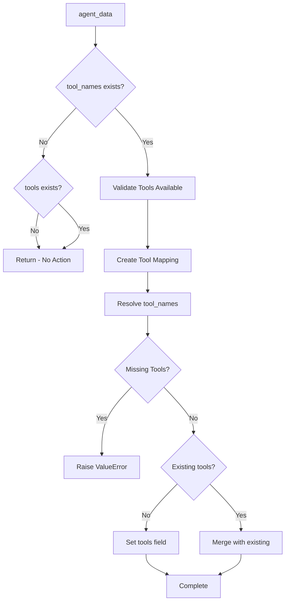

<!-- source: DeepWiki mcp.deepwiki.com · repo EvoAgentX/EvoAgentX · page 3.3 Agent Manager · fetched 2026-10-26 -->

# Agent Manager

<details>
<summary>Relevant source files</summary>

The following files were used as context for generating this wiki page:

- [evoagentx/agents/agent_manager.py](evoagentx/agents/agent_manager.py)
- [evoagentx/agents/customize_agent.py](evoagentx/agents/customize_agent.py)
- [evoagentx/workflow/workflow_graph.py](evoagentx/workflow/workflow_graph.py)
- [tests/src/agents/test_agent.py](tests/src/agents/test_agent.py)
- [tests/src/agents/test_agent_manager.py](tests/src/agents/test_agent_manager.py)
- [tests/src/core/test_base_config.py](tests/src/core/test_base_config.py)
- [tests/src/core/test_message.py](tests/src/core/test_message.py)
- [tests/src/core/test_module.py](tests/src/core/test_module.py)
- [tests/src/models/mock_response.py](tests/src/models/mock_response.py)
- [tests/src/models/test_openai_model.py](tests/src/models/test_openai_model.py)

</details>


The Agent Manager is the central component responsible for managing the lifecycle, state, and coordination of all agents within EvoAgentX workflows. It provides thread-safe operations for agent creation, storage integration, state tracking, and multi-agent coordination.

## Core Architecture

The `AgentManager` class, defined in `evoagentx/agents/agent_manager.py`, serves as the primary interface for all agent management operations. It inherits from `BaseModule` [evoagentx/agents/agent_manager.py:20](), maintaining collections of agents and their states while providing thread-safe coordination mechanisms through Python's `threading` library.

### Agent Manager Components



The `AgentManager` maintains several key collections and provides atomic operations through the `@atomic_method` decorator [evoagentx/agents/agent_manager.py:11]() for thread safety.

Sources: [evoagentx/agents/agent_manager.py:15-42](), [evoagentx/agents/customize_agent.py:21-62]()

## Agent Lifecycle Management

### Agent Creation and Registration

The `AgentManager` supports multiple ways to create and register agents:

| Method | Input Type | Description |
|--------|------------|-------------|
| `add_agent()` | `str`, `dict`, or `Agent` | Adds agent from name, specification, or instance [evoagentx/agents/agent_manager.py:283-313]() |
| `create_agent()` | `str`, `dict`, or `Agent` | Creates agent instance without adding to manager [evoagentx/agents/agent_manager.py:262-281]() |
| `create_customize_agent()` | `dict` | Creates `CustomizeAgent` from specification dictionary [evoagentx/agents/agent_manager.py:239-260]() |

### Agent Lifecycle Flow



The agent creation process includes tool resolution through the `update_tools()` method [evoagentx/agents/agent_manager.py:130-194](), which handles scenarios for tool assignment based on `tool_names` and existing `tools` fields.

Sources: [evoagentx/agents/agent_manager.py:101-117](), [evoagentx/agents/agent_manager.py:130-194](), [evoagentx/agents/agent_manager.py:239-313]()

## State Management and Threading

### Agent States

The `AgentState` enum [evoagentx/agents/agent_manager.py:15-17]() defines two primary states:
- `AVAILABLE`: Agent is ready for task assignment.
- `RUNNING`: Agent is currently executing a task.

### Thread-Safe Operations

The `AgentManager` implements thread-safe state management using per-agent condition variables.

| Component | Purpose |
|-----------|---------|
| `_lock` | Main threading lock for atomic operations [evoagentx/agents/agent_manager.py:36]() |
| `_state_conditions` | Per-agent condition variables for state waiting [evoagentx/agents/agent_manager.py:37]() |
| `wait_for_agent_available()` | Blocks until agent becomes available [evoagentx/agents/agent_manager.py:481-499]() |

### State Coordination Flow



Sources: [evoagentx/agents/agent_manager.py:15-18](), [evoagentx/agents/agent_manager.py:35-43](), [evoagentx/agents/agent_manager.py:422-452](), [evoagentx/agents/agent_manager.py:481-499]()

## Workflow Integration

### WorkFlowGraph Integration

The `AgentManager` provides specialized methods for extracting and managing agents from workflow graphs. It iterates through `WorkFlowNode` objects [evoagentx/workflow/workflow_graph.py:40]() to identify required agents.

```python
def add_agents_from_workflow(self, workflow_graph, llm_config: Optional[LLMConfig]=None, **kwargs):
    """Initialize agents from the nodes of a given WorkFlowGraph"""
    for node in workflow_graph.nodes:
        if node.agents:
            for agent in node.agents:
                self.add_agent(agent=agent, llm_config=llm_config, **kwargs)
```

### Workflow Agent Management Flow


Sources: [evoagentx/agents/agent_manager.py:322-361](), [evoagentx/workflow/workflow_graph.py:40-66]()

## Tool Management

### Tool Resolution System

The `update_tools()` method [evoagentx/agents/agent_manager.py:130]() handles four scenarios for agent tool assignment:
1. **Neither tool_names nor tools exist**: No action taken.
2. **Only tool_names exists**: Resolves `tool_names` to `Toolkit` or `Tool` objects from `self.tools` and sets the `tools` field.
3. **Only tools exists**: No action needed.
4. **Both exist**: Merges `tool_names` into existing `tools` (skipping duplicates).

### Tool Resolution Process



Sources: [evoagentx/agents/agent_manager.py:130-194]()

## Key API Methods

### Core Management Methods

| Method | Parameters | Return Type | Description |
|--------|------------|-------------|-------------|
| `add_agent()` | `agent`, `llm_config` | `None` | Adds agent to manager (thread-safe) [evoagentx/agents/agent_manager.py:283]() |
| `remove_agent()` | `agent_name`, `remove_from_storage` | `None` | Removes agent (thread-safe) [evoagentx/agents/agent_manager.py:362]() |
| `get_agent()` | `agent_name` | `Agent` | Retrieves agent by name [evoagentx/agents/agent_manager.py:315]() |
| `has_agent()` | `agent_name` | `bool` | Checks if agent exists [evoagentx/agents/agent_manager.py:82]() |
| `list_agents()` | None | `List[str]` | Returns all agent names [evoagentx/agents/agent_manager.py:79]() |

### State Management Methods

| Method | Parameters | Return Type | Description |
|--------|------------|-------------|-------------|
| `set_agent_state()` | `agent_name`, `new_state` | `bool` | Updates agent state (thread-safe) [evoagentx/agents/agent_manager.py:422]() |
| `get_agent_state()` | `agent_name` | `AgentState` | Gets current agent state [evoagentx/agents/agent_manager.py:410]() |
| `wait_for_agent_available()` | `agent_name`, `timeout` | `bool` | Waits for agent availability [evoagentx/agents/agent_manager.py:481]() |

Sources: [evoagentx/agents/agent_manager.py:79-117](), [evoagentx/agents/agent_manager.py:283-499]()

---

