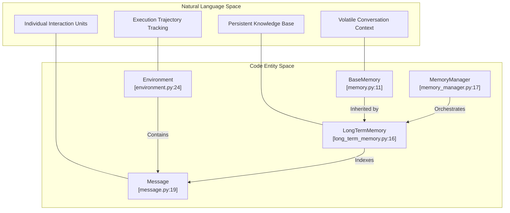
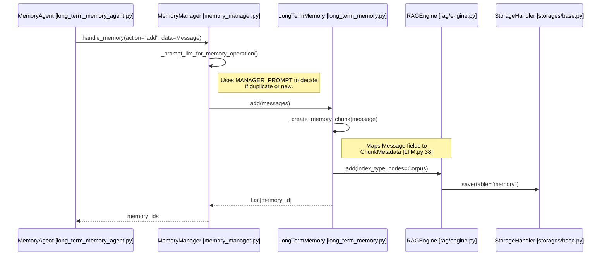

<!-- source: DeepWiki mcp.deepwiki.com · repo EvoAgentX/EvoAgentX · page 3.4 Memory System · fetched 2026-10-26 -->

# Memory System

Relevant source files

The following files were used as context for generating this wiki page:

- [evoagentx/agents/long_term_memory_agent.py](evoagentx/agents/long_term_memory_agent.py)
- [evoagentx/memory/long_term_memory.py](evoagentx/memory/long_term_memory.py)
- [evoagentx/memory/memory.py](evoagentx/memory/memory.py)
- [evoagentx/memory/memory_manager.py](evoagentx/memory/memory_manager.py)
- [evoagentx/prompts/memory/manager.py](evoagentx/prompts/memory/manager.py)
- [evoagentx/workflow/controller.py](evoagentx/workflow/controller.py)
- [evoagentx/workflow/environment.py](evoagentx/workflow/environment.py)
- [examples/agent_with_memory_action.py](examples/agent_with_memory_action.py)
- [examples/memory/example_interactive_chat.py](examples/memory/example_interactive_chat.py)
- [examples/memory/example_short_term_memory.py](examples/memory/example_short_term_memory.py)

The Memory System provides context management capabilities for agents in EvoAgentX. It consists of two primary architectures: **Short-term Memory** (STM) for managing conversation context and execution trajectories within a single workflow, and **Long-term Memory** (LTM) for persistent knowledge storage across multiple sessions, integrated with RAG (Retrieval-Augmented Generation) capabilities.

## Architecture Overview

The memory system bridges the gap between raw execution logs and structured agent context. It is implemented through several specialized classes that handle message indexing, persistence, and LLM-based management.

### Memory Hierarchy and Code Entities

The following diagram maps the Natural Language concepts to the specific Code Entities used in the implementation:

**Sources:** [evoagentx/memory/memory.py:11-23](), [evoagentx/memory/long_term_memory.py:16-25](), [evoagentx/memory/memory_manager.py:17-30](), [evoagentx/workflow/environment.py:24-32]()

## Short-term Memory and Environment

Short-term memory is primarily managed through the `BaseMemory` class and the `Environment` class. While `BaseMemory` provides indexing for messages, `Environment` tracks the "Trajectory" of an agent's execution.

### BaseMemory
`BaseMemory` maintains a chronological list of messages while providing efficient retrieval via dictionaries:
- `_by_action`: Indexing messages by the action that triggered them [evoagentx/memory/memory.py:35]().
- `_by_wf_goal`: Indexing messages by the specific workflow goal [evoagentx/memory/memory.py:36]().

### Environment
The `Environment` class acts as the live workspace for a workflow execution. It stores a list of `TrajectoryStep` objects [evoagentx/workflow/environment.py:29]().
- **TrajectoryState**: Tracks if a step is `COMPLETED` or `FAILED` [evoagentx/workflow/environment.py:9-14]().
- **Execution Data**: Extracts structured data from `LLMOutputParser` results and stores them in a shared `execution_data` dictionary for cross-task parameter passing [evoagentx/workflow/environment.py:53-60]().

**Sources:** [evoagentx/memory/memory.py:30-37](), [evoagentx/workflow/environment.py:9-65]()

## Long-term Memory System

Long-term memory extends the base memory capabilities by adding persistence via `StorageHandler` and semantic search via `RAGEngine`.

### Data Flow: Message to Vector Index
The transition from a `Message` object to a searchable persistent entity involves a conversion to a `Chunk` for the RAG system.

**Sources:** [evoagentx/memory/long_term_memory.py:36-60](), [evoagentx/memory/long_term_memory.py:77-131](), [evoagentx/memory/memory_manager.py:58-117](), [evoagentx/agents/long_term_memory_agent.py:104-115]()

### Memory Manager
The `MemoryManager` introduces an LLM-based decision layer. It uses the `MANAGER_PROMPT` to determine whether incoming information should be added as a new memory, used to update an existing one, or deleted [evoagentx/prompts/memory/manager.py:1-54]().
- **Deduplication**: Before adding, it checks for content similarity using hashes [evoagentx/memory/long_term_memory.py:89-105]().
- **Context Creation**: The `create_conversation_message` method retrieves relevant historical context using semantic search and formats it for the LLM prompt [evoagentx/memory/memory_manager.py:157-184]().

**Sources:** [evoagentx/memory/memory_manager.py:35-57](), [evoagentx/memory/long_term_memory.py:88-115]()

## Memory Actions and Agents

Specialized agents and actions are provided to interact with the long-term memory system programmatically.

### MemoryAgent
A specialized agent class `MemoryAgent` [evoagentx/agents/long_term_memory_agent.py:127]() is pre-configured with:
- A `LongTermMemory` instance.
- A `MemoryManager`.
- A `MemoryAction` that automatically retrieves context before generating responses.

### MemoryAction
The `MemoryAction` [evoagentx/agents/long_term_memory_agent.py:32]() encapsulates the retrieval-generation loop:
1. **Input**: Takes a `user_prompt` and optional `conversation_id` [evoagentx/agents/long_term_memory_agent.py:21-25]().
2. **Retrieve**: Calls `memory_manager.create_conversation_message` to fetch `top_k` relevant memories [evoagentx/agents/long_term_memory_agent.py:84-89]().
3. **Execute**: Generates a response using the LLM, passing the retrieved context into the prompt [evoagentx/agents/long_term_memory_agent.py:94-102]().
4. **Store**: Automatically saves the new response back into long-term memory [evoagentx/agents/long_term_memory_agent.py:111-114]().

**Sources:** [evoagentx/agents/long_term_memory_agent.py:21-125](), [evoagentx/agents/long_term_memory_agent.py:162-171]()

## Key Functions Reference

| Function | Class | Description |
|:---|:---|:---|
| `add_message` | `BaseMemory` | Adds a message and updates action/goal indices [memory.py:76](). |
| `get_by_action` | `BaseMemory` | Retrieves messages filtered by specific action names [memory.py:147](). |
| `update_execution_data` | `Environment` | Merges structured action outputs into the shared state [environment.py:53](). |
| `search_async` | `LongTermMemory` | Performs semantic search across persistent memories [long_term_memory.py:176](). |
| `handle_memory` | `MemoryManager` | Unified entry point for add/search/get/update/delete [memory_manager.py:58](). |

**Sources:** [evoagentx/memory/memory.py:76-93](), [evoagentx/memory/memory.py:147-166](), [evoagentx/workflow/environment.py:53-60](), [evoagentx/memory/long_term_memory.py:176-191](), [evoagentx/memory/memory_manager.py:58-82]()

---

