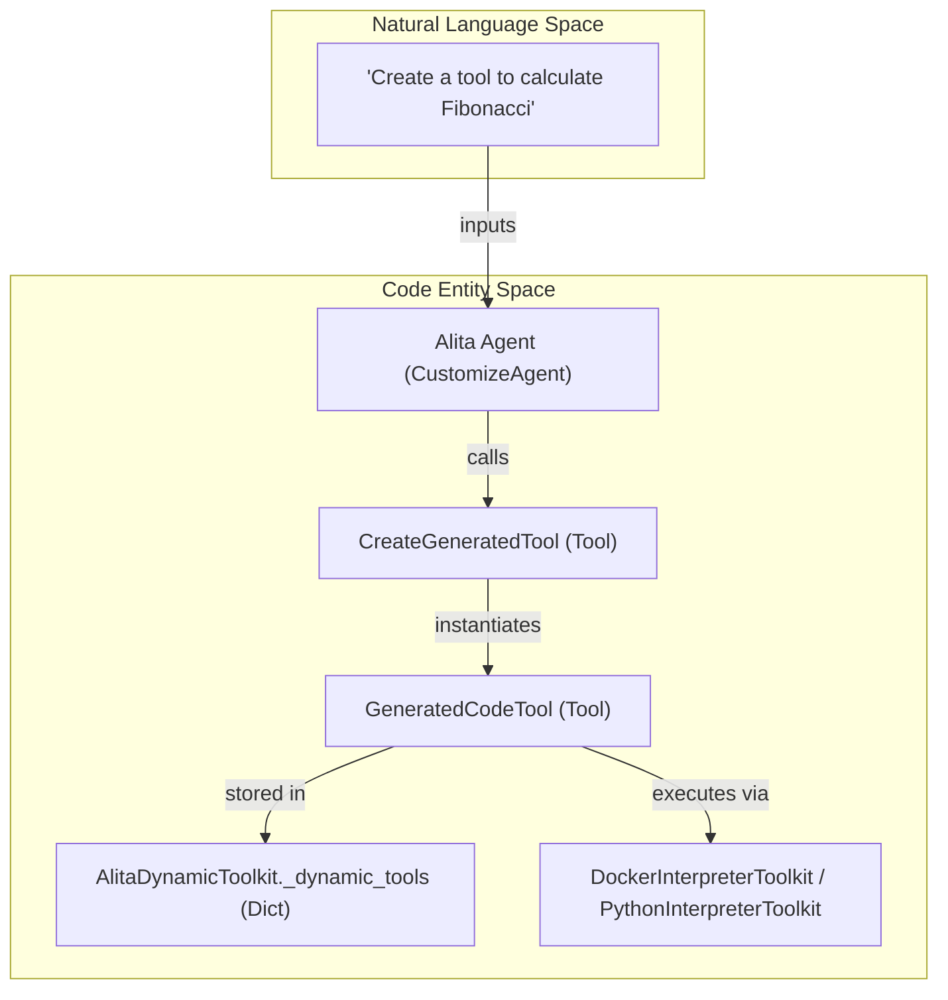
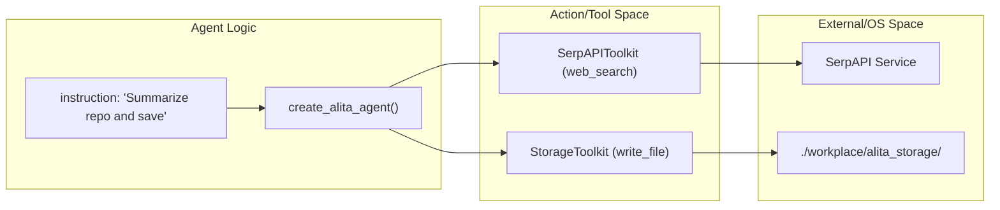

<!-- source: DeepWiki mcp.deepwiki.com · repo EvoAgentX/EvoAgentX · page 3.5 Alita Agent · fetched 2026-10-26 -->

# Alita Agent

<details>
<summary>Relevant source files</summary>

The following files were used as context for generating this wiki page:

- [docs/tutorial/alita_agent.md](docs/tutorial/alita_agent.md)
- [docs/zh/tutorial/alita_agent.md](docs/zh/tutorial/alita_agent.md)
- [evoagentx/actions/customize_action.py](evoagentx/actions/customize_action.py)
- [evoagentx/prompts/tool_calling.py](evoagentx/prompts/tool_calling.py)
- [evoagentx/tools/alita_agent.py](evoagentx/tools/alita_agent.py)
- [evoagentx/tools/browser_tool.py](evoagentx/tools/browser_tool.py)
- [evoagentx/tools/file_tool.py](evoagentx/tools/file_tool.py)
- [examples/alita_agent_example.py](examples/alita_agent_example.py)
- [examples/customize_agent.py](examples/customize_agent.py)
- [examples/output/jobs/jobs_demo_4o_mini.json](examples/output/jobs/jobs_demo_4o_mini.json)
- [examples/output/jobs/mcp_jobs.config](examples/output/jobs/mcp_jobs.config)
- [examples/output/jobs/test_pdf.pdf](examples/output/jobs/test_pdf.pdf)

</details>


The Alita Agent is a specialized, single-agent implementation designed to handle complex workflows requiring web search, persistent file storage, sandboxed code execution, and the ability to dynamically create and manage new tools at runtime. It serves as a high-capability template for agents that need to bridge the gap between natural language instructions and executable software logic.

### Purpose and Scope
Alita integrates multiple core EvoAgentX toolkits into a unified interface. Its primary distinction is the **Dynamic Tool Creation** capability, which allows the agent to write its own Python tools, persist them to disk, and invoke them in subsequent steps to solve specialized sub-problems without manual developer intervention.

## Architecture and Tool Integration

Alita is built by orchestrating several specialized toolkits. It uses a tiered code execution strategy and a strict storage policy to ensure safety and data persistence.

| Component | Toolkit / Implementation | Role |
| :--- | :--- | :--- |
| **Search** | `SerpAPIToolkit` | Provides real-time web search capabilities via SerpAPI. |
| **Storage** | `StorageToolkit` | Manages file I/O within a restricted directory (`./workplace/alita_storage`). |
| **Execution** | `DockerInterpreterToolkit` | Preferred environment for running generated code in isolated containers. |
| **Fallback** | `PythonInterpreterToolkit` | Local execution environment used if Docker is unavailable. |
| **Dynamic** | `AlitaDynamicToolkit` | Manages the lifecycle of LLM-generated tools. |

**Sources:**
- `evoagentx/tools/alita_agent.py:10-14`()
- `docs/tutorial/alita_agent.md:10-29`()

## Data Flow: Natural Language to Code Entity Space

The following diagrams illustrate how Alita translates high-level natural language instructions into concrete code execution and tool management.

### Dynamic Tool Creation Flow
This diagram shows how the `AlitaDynamicToolkit` facilitates the transition from an LLM's intent to a registered `GeneratedCodeTool`.


**Sources:**
- `evoagentx/tools/alita_agent.py:16-29`()
- `evoagentx/tools/alita_agent.py:119-126`()
- `evoagentx/tools/alita_agent.py:207-220`()

### Execution and Storage Flow
This diagram maps the interaction between the agent's internal tool calls and the underlying file system/search infrastructure.


**Sources:**
- `evoagentx/tools/alita_agent.py:344-360`()
- `examples/alita_agent_example.py:41-52`()

## Key Functions and Classes

### AlitaDynamicToolkit
This toolkit manages the "meta-tools" that allow Alita to evolve its own capabilities. Unlike standard toolkits that expose static functions, `AlitaDynamicToolkit` exposes tools that modify the agent's own available toolset.

*   **`create_generated_tool`**: Receives code and a name from the LLM to create a `GeneratedCodeTool` [evoagentx/tools/alita_agent.py:207-220]().
*   **`call_generated_tool`**: Executes a previously created tool by passing a `payload` dictionary [evoagentx/tools/alita_agent.py:245-258]().
*   **`persist_dynamic_tools`**: Saves tool definitions to a JSON file (default: `./workplace/alita/dynamic_tools.json`) for persistence across sessions [evoagentx/tools/alita_agent.py:149-154]().

### GeneratedCodeTool
A wrapper class that encapsulates LLM-generated source code.
*   **Payload Handling**: It injects a `payload` variable into the code environment [evoagentx/tools/alita_agent.py:80-86]().
*   **Result Extraction**: It expects the generated code to assign its output to a `result` variable, which is then serialized to JSON [evoagentx/tools/alita_agent.py:84-85]().

### `create_alita_agent`
A factory function that simplifies the instantiation of an Alita agent with pre-configured toolkits.
*   **Code Interpreter Selection**: It attempts to initialize `DockerInterpreterToolkit` first, falling back to `PythonInterpreterToolkit` if the Docker daemon is not found [evoagentx/tools/alita_agent.py:321-340]().
*   **Storage Scoping**: Automatically restricts file operations to a specific sub-directory to prevent arbitrary file system access [evoagentx/tools/alita_agent.py:314-319]().

**Sources:**
- `evoagentx/tools/alita_agent.py:16-60`()
- `evoagentx/tools/alita_agent.py:302-360`()

## Implementation Details

### Tool Calling Mechanism
Alita uses a "meta-tool" pattern. Instead of the agent's `tools` list growing indefinitely, the agent interacts with a fixed set of management tools:

| Tool Name | Purpose |
| :--- | :--- |
| `create_generated_tool` | Registers a new snippet of Python code as a named tool. |
| `call_generated_tool` | Executes a named snippet with a provided JSON payload. |
| `list_generated_tools` | Returns names and descriptions of all dynamic tools. |
| `remove_generated_tool` | Deletes a dynamic tool from the registry. |

This keeps the LLM's context window clean, as it only needs to know how to use these four tools to manage hundreds of custom-generated functions.

**Sources:**
- `evoagentx/tools/alita_agent.py:139-145`()
- `docs/tutorial/alita_agent.md:73-85`()

### Example Configuration
Creating an Alita agent involves defining the LLM configuration and specifying persistence settings.

```python
from evoagentx.tools.alita_agent import create_alita_agent

agent = create_alita_agent(
    llm_config=llm_config,
    persist_dynamic_tools=True,
    load_existing_dynamic_tools=True,
    dynamic_tools_path="./workplace/alita/dynamic_tools.json",
    use_docker=True
)
```
**Sources:**
- `examples/alita_agent_example.py:32-39`()
- `docs/tutorial/alita_agent.md:33-53`()

---

