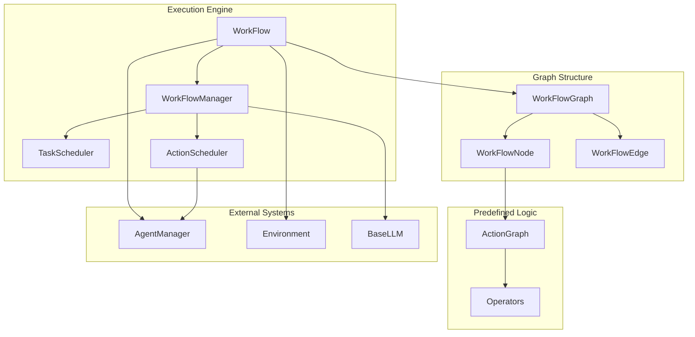
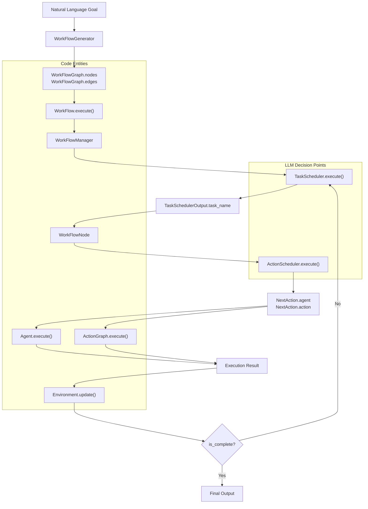
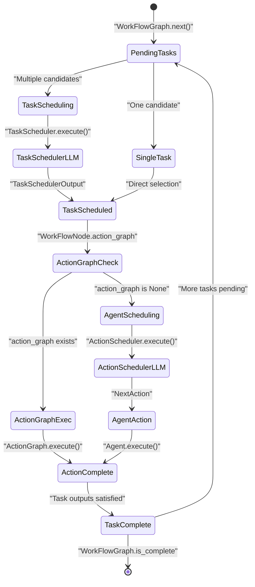

<!-- source: DeepWiki mcp.deepwiki.com · repo EvoAgentX/EvoAgentX · page 4 Workflow System · fetched 2026-10-26 -->

# Workflow System

<details>
<summary>Relevant source files</summary>

The following files were used as context for generating this wiki page:

- [evoagentx/agents/agent_manager.py](evoagentx/agents/agent_manager.py)
- [evoagentx/agents/customize_agent.py](evoagentx/agents/customize_agent.py)
- [evoagentx/prompts/workflow/workflow_manager.py](evoagentx/prompts/workflow/workflow_manager.py)
- [evoagentx/workflow/workflow.py](evoagentx/workflow/workflow.py)
- [evoagentx/workflow/workflow_graph.py](evoagentx/workflow/workflow_graph.py)
- [evoagentx/workflow/workflow_manager.py](evoagentx/workflow/workflow_manager.py)

</details>


The Workflow System is EvoAgentX's core orchestration framework for creating, managing, and executing multi-agent workflows. This system represents complex tasks as directed graphs where nodes represent subtasks and edges represent dependencies and data flow relationships. The system handles automatic task scheduling, agent coordination, and execution state management.

For information about the underlying graph structure and node management, see [WorkFlowGraph](#4.1). For details on workflow execution orchestration, see [Workflow Execution](#4.2). For details on scheduling and action selection, see [WorkFlowManager and Schedulers](#4.3).

## Core Components

The workflow system consists of several key components that work together to enable sophisticated multi-agent task execution:



**Workflow Structure Components**

Sources: [evoagentx/workflow/workflow_graph.py:40-67](), [evoagentx/workflow/workflow.py:22-34](), [evoagentx/workflow/workflow_manager.py:23-50]()

### WorkFlowGraph
The central data structure representing a workflow as a directed graph. It manages nodes (tasks) and edges (dependencies), providing methods for graph traversal, validation, and state management.
For details, see [WorkFlowGraph](#4.1).

### WorkFlowNode
Represents individual tasks within a workflow. It contains input/output parameters, agent assignments, execution status, and optional predefined action graphs.
Sources: [evoagentx/workflow/workflow_graph.py:40-67]()

### WorkFlowManager  
Handles scheduling and decision-making during workflow execution. It utilizes a `TaskScheduler` for determining next tasks and an `ActionScheduler` for selecting actions within tasks.
Sources: [evoagentx/workflow/workflow_manager.py:414-425]()

## Workflow Execution Architecture

The execution architecture coordinates between graph structure, agent management, and LLM-based decision making to transform a natural language goal into a completed task.



**Execution Flow Components**

Sources: [evoagentx/workflow/workflow.py:87-109](), [evoagentx/workflow/workflow_manager.py:431-445](), [evoagentx/workflow/workflow_manager.py:461-483]()

### WorkFlow
The main execution engine that orchestrates workflow execution through `execute()` and `async_execute()` methods. It manages the overall execution loop and coordinates between the graph, environment, and managers.
For details, see [Workflow Execution](#4.2).

### Environment
Tracks execution state, maintains message history, and provides context for scheduling decisions through trajectory management and data persistence.
Sources: [evoagentx/workflow/workflow.py:28](), [evoagentx/workflow/workflow.py:83-84]()

## Task and Action Scheduling

The system uses LLM-based scheduling to make intelligent decisions about workflow execution, allowing for dynamic path selection and error recovery.



**Scheduling Components**

Sources: [evoagentx/workflow/workflow_manager.py:46-189](), [evoagentx/workflow/workflow_manager.py:207-413]()

### TaskScheduler
Determines which workflow node to execute next based on graph state, execution history, and candidate availability. It can decide to `forward`, `re-execute`, or `iterate` on tasks.
Sources: [evoagentx/workflow/workflow_manager.py:46-56](), [evoagentx/workflow/workflow_manager.py:122-154]()

### ActionScheduler
Selects specific agent actions within a task. It analyzes the subtask information and available agents to determine the next logical step.
Sources: [evoagentx/workflow/workflow_manager.py:207-217]()

For details, see [WorkFlowManager and Schedulers](#4.3).

## Node State Management

Workflow nodes progress through defined states during execution to ensure the graph engine knows which tasks are ready for scheduling.

| State | Description |
|-------|-------------|
| `PENDING` | The node is waiting to be executed. |
| `RUNNING` | The node is currently being executed. |
| `COMPLETED` | The node has been successfully executed. |
| `FAILED` | The node execution has failed. |

**State Management**

Sources: [evoagentx/workflow/workflow_graph.py:24-37](), [evoagentx/workflow/workflow_graph.py:653-684]()

The `WorkFlowGraph` provides methods like `step()` to move from PENDING to RUNNING, and `completed()` or `failed()` for final state transitions.

## Integration with Agent System

The workflow system integrates closely with the `AgentManager` to dispatch tasks to the appropriate LLM-powered entities.

| Component | Role | Key Methods |
|-----------|------|-------------|
| `AgentManager` | Manages agent lifecycle and state | `list_agents()`, `has_agent()` |
| `Agent` | Base class for execution entities | `execute()`, `async_execute()` |
| `CustomizeAgent` | Dynamic agent with specific I/O | `create_customize_action()` |

**Integration Points**

Sources: [evoagentx/agents/agent_manager.py:20-33](), [evoagentx/agents/customize_agent.py:21-62](), [evoagentx/workflow/workflow.py:144-149]()

The `ActionScheduler` selects an agent by name from the `AgentManager`, which then provides the `Agent` instance to perform the selected action.

## Action Graph Integration

Action graphs provide predefined execution logic that can be embedded within a workflow node to perform deterministic sequences of operations.

```mermaid
graph LR
    WFN["WorkFlowNode"]
    AG["ActionGraph"]
    EX["execute(**params)"]
    AEX["async_execute(**params)"]
    
    WFN --> AG: "action_graph field"
    AG --> EX
    AG --> AEX
    
    EX --> Result["dict output"]
    AEX --> Result
```

**Action Graph Components**

Sources: [evoagentx/workflow/workflow_graph.py:65](), [evoagentx/workflow/workflow.py:150-151](), [evoagentx/workflow/workflow.py:156-199]()

When a `WorkFlowNode` contains an `ActionGraph`, the `WorkFlow` executor prioritizes the action graph's internal logic over the dynamic `ActionScheduler`.

## Data Flow and Parameter Mapping

The system manages data flow between workflow nodes through `Parameter` mapping and `Environment` state tracking.

Sources: [evoagentx/workflow/workflow_graph.py:58-67](), [evoagentx/workflow/workflow.py:108-109]()

Each `WorkFlowNode` defines `inputs` and `outputs`. After a task completes, its results are stored in the `Environment`. When the next task is scheduled, the `WorkFlowManager` extracts the necessary outputs from the environment to satisfy the next task's input requirements.

Sources: [evoagentx/workflow/workflow_graph.py:1-162](), [evoagentx/workflow/workflow.py:1-165](), [evoagentx/workflow/workflow_manager.py:1-217](), [evoagentx/agents/agent_manager.py:1-100](), [evoagentx/agents/customize_agent.py:1-150]()

---

