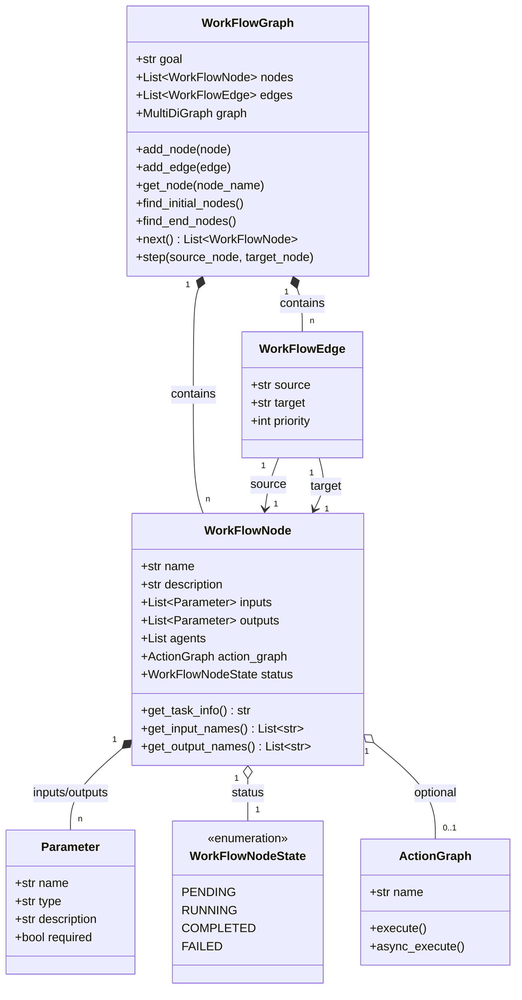
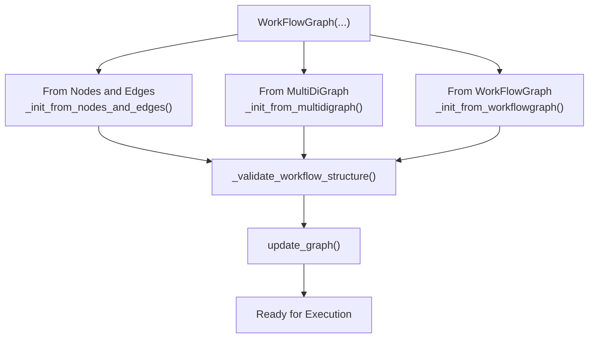
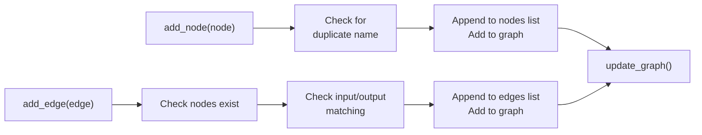
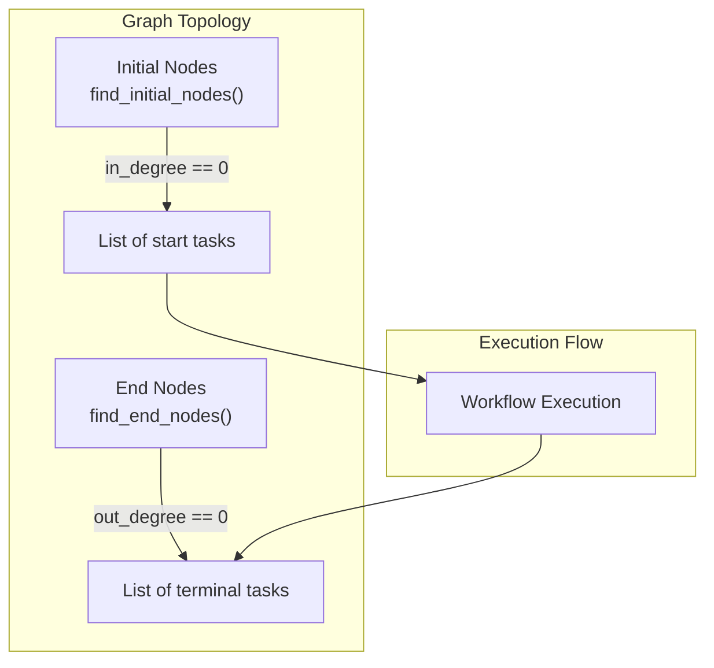
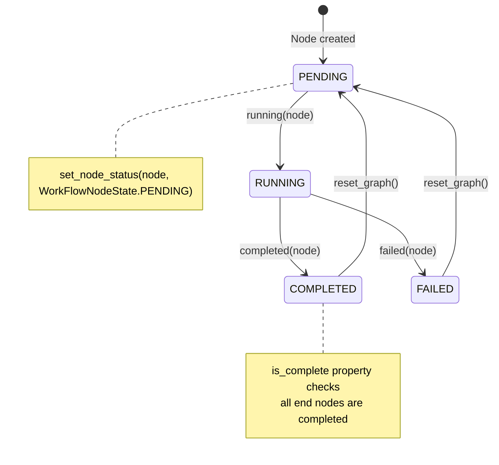
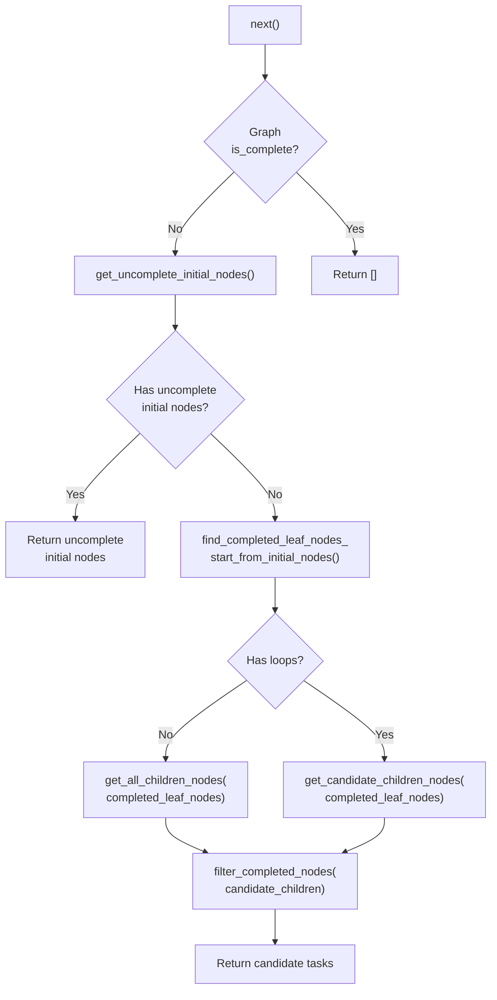
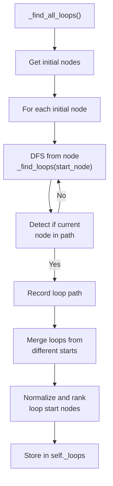
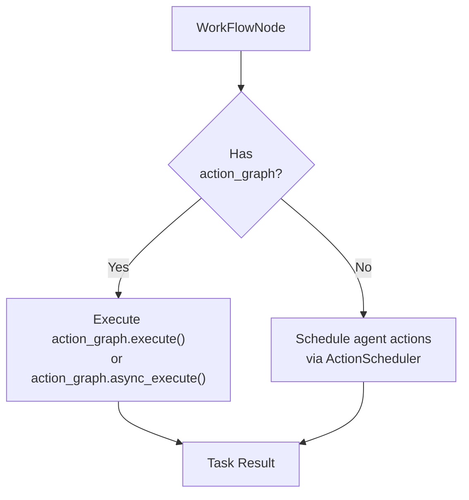

<!-- source: DeepWiki mcp.deepwiki.com · repo EvoAgentX/EvoAgentX · page 4.1 WorkFlowGraph · fetched 2026-10-26 -->

# WorkFlowGraph

<details>
<summary>Relevant source files</summary>

The following files were used as context for generating this wiki page:

- [docs/modules/action_graph.md](docs/modules/action_graph.md)
- [docs/modules/workflow_graph.md](docs/modules/workflow_graph.md)
- [docs/tutorial/first_workflow.md](docs/tutorial/first_workflow.md)
- [evoagentx/agents/agent_manager.py](evoagentx/agents/agent_manager.py)
- [evoagentx/agents/customize_agent.py](evoagentx/agents/customize_agent.py)
- [evoagentx/prompts/context_extraction.py](evoagentx/prompts/context_extraction.py)
- [evoagentx/prompts/workflow/sew_workflow.py](evoagentx/prompts/workflow/sew_workflow.py)
- [evoagentx/workflow/workflow_graph.py](evoagentx/workflow/workflow_graph.py)

</details>


## Purpose and Scope

This document describes the **WorkFlowGraph** system, which represents multi-agent workflows as directed graphs. A WorkFlowGraph models tasks (nodes) and their dependencies (edges), providing the core data structure for workflow definition, validation, and state tracking during execution. It allows for complex execution patterns including sequential flows, parallel branches, and loops.

For information about workflow execution, see [Workflow Execution](#4.2). For task and action scheduling mechanisms, see [WorkFlowManager and Schedulers](#4.3). For agent management, see [Agent Manager](#3.3).

---

## Core Data Structures

### WorkFlowGraph Class

`WorkFlowGraph` is the main container representing a complete workflow as a directed graph. It maintains nodes (tasks), edges (dependencies), and execution state. It inherits from `BaseModule`, enabling seamless serialization and integration with the registry system [evoagentx/workflow/workflow_graph.py:287-308]().

**Key Attributes:**

| Attribute | Type | Description |
|-----------|------|-------------|
| `goal` | `str` | High-level objective of the workflow |
| `nodes` | `List[WorkFlowNode]` | Tasks in the workflow |
| `edges` | `List[WorkFlowEdge]` | Dependencies between tasks |
| `graph` | `MultiDiGraph` | Internal NetworkX graph representation |

Sources: [evoagentx/workflow/workflow_graph.py:287-308]()

### WorkFlowNode Class

`WorkFlowNode` represents a single task in the workflow with its inputs, outputs, and execution metadata. It can be executed either by a set of agents or a predefined `ActionGraph` [evoagentx/workflow/workflow_graph.py:40-67]().

**Key Attributes:**

| Attribute | Type | Description |
|-----------|------|-------------|
| `name` | `str` | Unique task identifier |
| `description` | `str` | Detailed task description |
| `inputs` | `List[Parameter]` | Required input parameters |
| `outputs` | `List[Parameter]` | Expected output parameters |
| `agents` | `List[Union[str, dict]]` | Agents capable of executing this task |
| `action_graph` | `Optional[ActionGraph]` | Predefined action graph for execution |
| `status` | `WorkFlowNodeState` | Current execution state |

Sources: [evoagentx/workflow/workflow_graph.py:40-67]()

### WorkFlowEdge Class

`WorkFlowEdge` represents a directed dependency between two tasks, influencing the data flow and execution order [evoagentx/workflow/workflow_graph.py:226-243]().

**Key Attributes:**

| Attribute | Type | Description |
|-----------|------|-------------|
| `source` | `str` | Source node name |
| `target` | `str` | Target node name |
| `priority` | `int` | Edge priority (default: 0) |

Sources: [evoagentx/workflow/workflow_graph.py:226-243]()

### WorkFlowNodeState Enum

`WorkFlowNodeState` defines the lifecycle states for workflow nodes [evoagentx/workflow/workflow_graph.py:24-37]():

- `PENDING`: Task is waiting to be executed
- `RUNNING`: Task is currently executing
- `COMPLETED`: Task has finished successfully
- `FAILED`: Task execution failed

Sources: [evoagentx/workflow/workflow_graph.py:24-37]()

---

## Graph Structure and Components

The following diagram shows the relationship between the core components and how they map to code entities:



Sources: [evoagentx/workflow/workflow_graph.py:24-285]()

---

## Graph Construction

### Initialization Methods

`WorkFlowGraph` supports three initialization patterns to accommodate programmatic construction or restoration from saved states [evoagentx/workflow/workflow_graph.py:310-321](), [evoagentx/workflow/workflow_graph.py:327-356]().



Sources: [evoagentx/workflow/workflow_graph.py:310-321](), [evoagentx/workflow/workflow_graph.py:327-356]()

### Creating from Nodes and Edges

The most common construction pattern involves defining `WorkFlowNode` and `WorkFlowEdge` objects manually [evoagentx/workflow/workflow_graph.py:327-340]().

```python
from evoagentx.workflow.workflow_graph import WorkFlowGraph, WorkFlowNode, WorkFlowEdge
from evoagentx.core.base_config import Parameter

# Define nodes
node1 = WorkFlowNode(
    name="data_collection",
    description="Collect data from sources",
    inputs=[Parameter(name="goal", type="str", description="Task goal")],
    outputs=[Parameter(name="data", type="str", description="Collected data")],
    agents=["data_agent"]
)

node2 = WorkFlowNode(
    name="data_analysis",
    description="Analyze collected data",
    inputs=[Parameter(name="data", type="str", description="Data to analyze")],
    outputs=[Parameter(name="result", type="str", description="Analysis result")],
    agents=["analyst_agent"]
)

# Define edge
edge = WorkFlowEdge(source="data_collection", target="data_analysis", priority=0)

# Create graph
graph = WorkFlowGraph(
    goal="Complete data analysis pipeline",
    nodes=[node1, node2],
    edges=[edge]
)
```

Sources: [evoagentx/workflow/workflow_graph.py:327-340]()

### Specialized Implementations

#### SequentialWorkFlowGraph
`SequentialWorkFlowGraph` is a specialized subclass designed for simpler linear workflows. It accepts a list of task dictionaries and automatically infers edges based on task order and input/output matching [docs/modules/workflow_graph.md:63-98]().

```python
from evoagentx.workflow import SequentialWorkFlowGraph

tasks = [
    {
        "name": "Planning",
        "description": "Create a plan",
        "inputs": [{"name": "problem", "type": "str"}],
        "outputs": [{"name": "plan", "type": "str"}],
        "prompt": "Create a plan for {problem}"
    },
    {
        "name": "Coding",
        "description": "Implement code",
        "inputs": [{"name": "plan", "type": "str"}],
        "outputs": [{"name": "code", "type": "str"}],
        "prompt": "Implement code based on {plan}"
    }
]

graph = SequentialWorkFlowGraph(goal="Generate code", tasks=tasks)
```

Sources: [docs/tutorial/first_workflow.md:56-91](), [docs/modules/workflow_graph.md:63-98]()

---

## Node and Edge Management

### Adding Nodes and Edges

Nodes and edges can be added dynamically after initialization. The system performs checks for uniqueness and connectivity [evoagentx/workflow/workflow_graph.py:460-518]().



**Node Management:**

| Method | Description |
|--------|-------------|
| `add_node(node, update_graph=True)` | Add a single node |
| `add_nodes(*nodes, update_graph=True)` | Add multiple nodes |
| `get_node(node_name)` | Retrieve node by name |
| `list_nodes()` | Get all node names |

**Edge Management:**

| Method | Description |
|--------|-------------|
| `add_edge(edge, update_graph=True)` | Add a single edge |
| `add_edges(*edges, update_graph=True)` | Add multiple edges |

Sources: [evoagentx/workflow/workflow_graph.py:460-518](), [evoagentx/workflow/workflow_graph.py:519-569]()

### Input/Output Validation

When adding an edge, the system validates that the source node's outputs and target node's inputs have at least one matching parameter to ensure data flow continuity [evoagentx/workflow/workflow_graph.py:482-488]().

```python
# From add_edge method
source_node = self.get_node(edge.source)
target_node = self.get_node(edge.target)
source_output_names = set(param.name for param in source_node.outputs)
target_input_names = set(param.name for param in target_node.inputs)
if len(source_output_names & target_input_names) == 0:
    logger.warning(f"The edge ({edge.source}, {edge.target}) has no matching inputs and outputs!")
```

Sources: [evoagentx/workflow/workflow_graph.py:482-488]()

---

## Graph Traversal and State Management

### Finding Initial and End Nodes

The graph structure determines the entry and exit points of the workflow based on node in-degree and out-degree [evoagentx/workflow/workflow_graph.py:374-380](), [evoagentx/workflow/workflow_graph.py:686-698]().



**Methods:**

| Method | Returns | Description |
|--------|---------|-------------|
| `find_initial_nodes()` | `List[str]` | Nodes with no predecessors (in-degree = 0) |
| `find_end_nodes()` | `List[str]` | Nodes with no successors (out-degree = 0) |
| `get_node_children(node)` | `List[str]` | Direct successor nodes |
| `get_node_predecessors(node)` | `List[str]` | Direct predecessor nodes |

Sources: [evoagentx/workflow/workflow_graph.py:374-380](), [evoagentx/workflow/workflow_graph.py:686-698]()

### Node State Transitions

The lifecycle of a node is tracked through status updates, which are used by the scheduler to determine eligibility [evoagentx/workflow/workflow_graph.py:630-684]().



Sources: [evoagentx/workflow/workflow_graph.py:630-684]()

---

## Determining Next Tasks

The `next()` method is the core logic for the execution engine, identifying which tasks can be run next based on current completions [evoagentx/workflow/workflow_graph.py:835-858]().



Sources: [evoagentx/workflow/workflow_graph.py:835-858]()

---

## Loop Detection and Handling

`WorkFlowGraph` provides sophisticated loop detection and iteration tracking, allowing agents to revisit tasks until a condition is met [evoagentx/workflow/workflow_graph.py:382-458]().

### Loop Detection Algorithm



Sources: [evoagentx/workflow/workflow_graph.py:382-458](), [evoagentx/workflow/workflow_graph.py:571-597]()

### Loop Iteration Tracking

The `step()` method increments loop counters, which can be used to prevent infinite cycles via `max_num_turns` [evoagentx/workflow/workflow_graph.py:885-896]().

```python
# From step() method
if loops:
    loop = loops[0]
    key = tuple(loop)
    with self._lock:
        self._loop_num_turns[key] = self._loop_num_turns.get(key, 0) + 1
```

Sources: [evoagentx/workflow/workflow_graph.py:860-903]()

---

## ActionGraph Integration

### Using ActionGraph for Node Execution

Nodes can optionally bypass agent scheduling by providing an `action_graph` for fixed execution logic [docs/modules/action_graph.md:7-10]().



Sources: [docs/modules/workflow_graph.md:27-33](), [evoagentx/workflow/workflow_graph.py:86-161]()

### Validation of ActionGraph

The system validates that the `ActionGraph.execute` method signature matches the `WorkFlowNode` input parameters at runtime [evoagentx/workflow/workflow_graph.py:86-158]().

```python
@model_validator(mode="after")
def check_action_graph(self) -> "WorkFlowNode":
    if self.action_graph is None:
        return self
    
    # Validates method signature against input parameters
    # Monkey-patches execute to check returns match outputs at runtime
    ...
```

Sources: [evoagentx/workflow/workflow_graph.py:86-161]()

---

## Serialization and Persistence

As a `BaseModule`, `WorkFlowGraph` supports full serialization to JSON, including task configurations and agent metadata [evoagentx/workflow/workflow_graph.py:163-170]().

### Saving and Loading

```python
# Save graph
graph.save_module("workflow_graph.json")

# Load graph
loaded_graph = WorkFlowGraph.load_module("workflow_graph.json")
```

### LLM Representation

The `get_workflow_description()` method provides a text-based view of the graph used in LLM prompts for task scheduling [evoagentx/workflow/workflow_graph.py:905-942]().

```python
def get_workflow_description(self) -> str:
    """
    Returns a textual description:
    Workflow Goal: ...
    Nodes: [List of node descriptions]
    Edges: [Source -> Target]
    """
    ...
```

Sources: [evoagentx/workflow/workflow_graph.py:905-942]()

---

## Summary of Key Methods

| Category | Method | Description |
|----------|--------|-------------|
| **Construction** | `__init__` | Initialize with goal, nodes, and edges |
| | `update_graph` | Rebuild internal NetworkX graph and detect loops |
| **Traversal** | `next` | Get all executable nodes (those whose dependencies are met) |
| | `find_initial_nodes` | Get nodes with no dependencies |
| | `find_end_nodes` | Get terminal nodes |
| **State** | `completed` | Mark a node as successfully finished |
| | `failed` | Mark a node as failed |
| | `is_complete` | Property: True if all end nodes are COMPLETED |
| **Loops** | `is_loop_start` | Check if a node initiates a cycle |
| | `step` | Record transition between nodes and track loop turns |
| **Output** | `to_dict` | Serialize graph structure to dictionary |
| | `get_workflow_description` | Human/LLM readable text of the graph |

Sources: [evoagentx/workflow/workflow_graph.py:287-942]()

---

