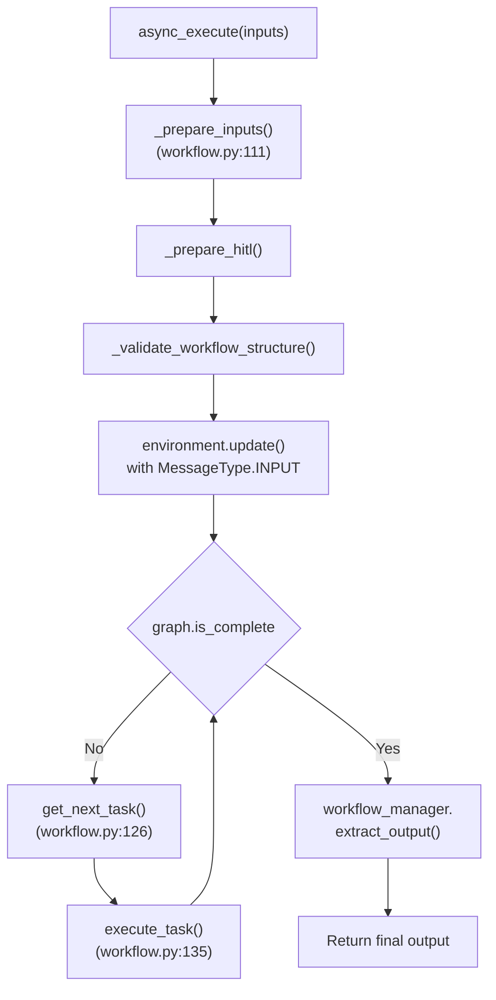
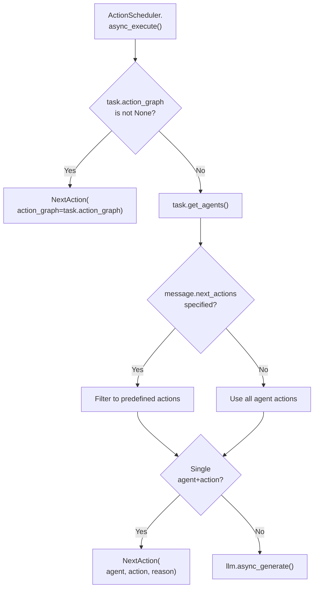

<!-- source: DeepWiki mcp.deepwiki.com · repo EvoAgentX/EvoAgentX · page 4.2 Workflow Execution · fetched 2026-10-26 -->

# Workflow Execution

<details>
<summary>Relevant source files</summary>

The following files were used as context for generating this wiki page:

- [evoagentx/agents/long_term_memory_agent.py](evoagentx/agents/long_term_memory_agent.py)
- [evoagentx/memory/long_term_memory.py](evoagentx/memory/long_term_memory.py)
- [evoagentx/memory/memory.py](evoagentx/memory/memory.py)
- [evoagentx/memory/memory_manager.py](evoagentx/memory/memory_manager.py)
- [evoagentx/prompts/memory/manager.py](evoagentx/prompts/memory/manager.py)
- [evoagentx/prompts/workflow/workflow_manager.py](evoagentx/prompts/workflow/workflow_manager.py)
- [evoagentx/workflow/controller.py](evoagentx/workflow/controller.py)
- [evoagentx/workflow/environment.py](evoagentx/workflow/environment.py)
- [evoagentx/workflow/workflow.py](evoagentx/workflow/workflow.py)
- [evoagentx/workflow/workflow_manager.py](evoagentx/workflow/workflow_manager.py)
- [examples/agent_with_memory_action.py](examples/agent_with_memory_action.py)

</details>


This page documents the workflow execution engine, including task orchestration, scheduling mechanisms, and execution coordination within EvoAgentX. It covers how workflows are executed from start to completion, including the scheduling of tasks and actions, state management, and coordination between multiple agents.

## Overview

Workflow execution in EvoAgentX is orchestrated by the `WorkFlow` class [evoagentx/workflow/workflow.py:22-22](), which coordinates task scheduling, agent management, and execution tracking. The system supports both synchronous and asynchronous execution modes, with built-in support for loops, dependencies, and multi-step task execution.

The execution architecture consists of four core components:

| Component | Class | Primary Responsibility |
|-----------|-------|------------------------|
| Workflow Orchestrator | `WorkFlow` | Main execution coordinator [evoagentx/workflow/workflow.py:22-22]() |
| Task/Action Scheduling | `WorkFlowManager` | Determines next task and action [evoagentx/workflow/workflow_manager.py:416-416]() |
| Agent Coordination | `AgentManager` | Manages agent lifecycle and state [evoagentx/agents/agent_manager.py:12-12]() |
| Execution Tracking | `Environment` | Tracks execution data and messages [evoagentx/workflow/environment.py:24-24]() |

```mermaid
graph TD
    WorkFlow["WorkFlow<br/>(workflow.py:22)"] --> workflow_manager["workflow_manager<br/>WorkFlowManager"]
    WorkFlow --> agent_manager["agent_manager<br/>AgentManager"]
    WorkFlow --> environment["environment<br/>Environment"]
    WorkFlow --> graph["graph<br/>WorkFlowGraph"]
    
    workflow_manager --> task_scheduler["task_scheduler<br/>TaskScheduler"]
    workflow_manager --> action_scheduler["action_scheduler<br/>ActionScheduler"]
    
    WorkFlow --> execute_method["execute()"]
    WorkFlow --> async_execute_method["async_execute()"]
    
    execute_method --> async_execute_method
    async_execute_method --> get_next_task["get_next_task()"]
    async_execute_method --> execute_task["execute_task()"]
    
    get_next_task --> schedule_next_task["WorkFlowManager.<br/>schedule_next_task()"]
    execute_task --> schedule_next_action["WorkFlowManager.<br/>schedule_next_action()"]
    
    schedule_next_task --> task_scheduler
    schedule_next_action --> action_scheduler
```

**Workflow Execution Architecture with Code Symbols**

Sources: [evoagentx/workflow/workflow.py:22-42](), [evoagentx/workflow/workflow_manager.py:416-429]()

## Execution Entry Points

The `WorkFlow` class provides two main execution methods:

### Synchronous Execution

The `execute()` method [evoagentx/workflow/workflow.py:43-60]() provides a synchronous wrapper around the asynchronous execution engine by creating a new event loop.

### Asynchronous Execution Flow

The `async_execute()` method [evoagentx/workflow/workflow.py:61-109]() implements the core execution logic:



**Asynchronous Execution Flow with Method References**

The execution loop continues until `graph.is_complete` returns `True`.

Sources: [evoagentx/workflow/workflow.py:61-109](), [evoagentx/workflow/workflow.py:111-124](), [evoagentx/workflow/workflow.py:126-154]()

## Task Scheduling System

The task scheduling system determines which workflow nodes to execute next based on dependencies and completion states.

### TaskScheduler Implementation

The `TaskScheduler` class [evoagentx/workflow/workflow_manager.py:46-46]() implements task selection using LLM-based decision making when multiple candidates exist. It returns a `TaskSchedulerOutput` [evoagentx/workflow/workflow_manager.py:36-36]() containing the decision, task name, and reason.

The scheduler handles edge cases via `_handle_edge_cases()` [evoagentx/workflow/workflow_manager.py:67-89](). If only one candidate task is available, it returns a "forward" decision immediately without invoking the LLM.

### Scheduling Decisions

The scheduler uses `DEFAULT_TASK_SCHEDULER` configuration [evoagentx/prompts/workflow/workflow_manager.py:54-59](), which allows three types of decisions:

| Decision Type | When Used | Description |
|---------------|-----------|-------------|
| `re-execute` | Error correction | Re-run a previous task with corrected inputs [evoagentx/prompts/workflow/workflow_manager.py:6-6]() |
| `iterate` | Loop execution | Execute a task again in a loop context [evoagentx/prompts/workflow/workflow_manager.py:7-7]() |
| `forward` | Normal progression | Select next task to advance workflow [evoagentx/prompts/workflow/workflow_manager.py:8-8]() |

Sources: [evoagentx/workflow/workflow_manager.py:46-189](), [evoagentx/prompts/workflow/workflow_manager.py:1-59]()

## Action Scheduling System

Once a task is selected, the `ActionScheduler` [evoagentx/workflow/workflow_manager.py:207-207]() determines which agent and action should execute the task.

### ActionScheduler Decision Logic

The `ActionScheduler` returns a `NextAction` object [evoagentx/workflow/workflow_manager.py:191-191](). It first checks if the task has a predefined `ActionGraph` [evoagentx/workflow/workflow_manager.py:259-259](). If not, it filters available agents and actions.



**Action Scheduling Decision Tree**

Sources: [evoagentx/workflow/workflow_manager.py:207-414](), [evoagentx/prompts/workflow/workflow_manager.py:62-123]()

## Execution Environment and State Tracking

The `Environment` class [evoagentx/workflow/environment.py:24-24]() is responsible for storing and managing intermediate states of execution.

### Trajectory and History

The environment tracks the workflow's progress through several structures:
- `trajectory`: A list of `TrajectoryStep` objects containing the `Message`, `TrajectoryState`, and optional error [evoagentx/workflow/environment.py:29-29]().
- `task_execution_history`: A chronological list of executed task names [evoagentx/workflow/environment.py:30-30]().
- `execution_data`: A dictionary storing structured data extracted from LLM outputs or message content [evoagentx/workflow/environment.py:31-31]().

### Trajectory States

The system uses `TrajectoryState` [evoagentx/workflow/environment.py:9-15]() to mark the status of execution steps:
- `COMPLETED`: Step finished successfully.
- `FAILED`: Step encountered an error.

### Data Management

The `Environment` provides methods to update and retrieve state:
- `update()`: Adds a message to the trajectory and updates history/data [evoagentx/workflow/environment.py:33-45]().
- `get_task_messages()`: Retrieves all messages related to specified tasks [evoagentx/workflow/environment.py:66-83]().
- `get_execution_data()`: Retrieves specific parameters from the structured data store [evoagentx/workflow/environment.py:102-110]().

Sources: [evoagentx/workflow/environment.py:9-111]()

## Long-Term Memory Integration

During execution, agents can interact with long-term memory through the `MemoryManager` [evoagentx/memory/memory_manager.py:17-17]() and `LongTermMemory` [evoagentx/memory/long_term_memory.py:16-16]().

### Memory Operations

The `MemoryManager.handle_memory()` method [evoagentx/memory/memory_manager.py:58-78]() supports various operations:
- `add`: Stores new messages after optional LLM-based deduplication and decision making [evoagentx/memory/memory_manager.py:83-116]().
- `search`: Performs asynchronous vector search via `LongTermMemory.search_async()` [evoagentx/memory/memory_manager.py:118-124]().
- `update`/`delete`: Modifies or removes existing memory chunks [evoagentx/memory/memory_manager.py:132-148]().

### Memory Chunks

`LongTermMemory` converts `Message` objects into `Chunk` objects for indexing [evoagentx/memory/long_term_memory.py:36-59](). It uses hash-based deduplication [evoagentx/memory/long_term_memory.py:88-114]() to ensure the same content is not indexed multiple times.

Sources: [evoagentx/memory/memory_manager.py:17-150](), [evoagentx/memory/long_term_memory.py:16-131]()

## Error Handling and Limits

The workflow includes safeguards to prevent infinite loops:
- `max_execution_steps`: The maximum number of steps to complete a subtask node (default is 5) [evoagentx/workflow/workflow.py:32-32]().
- `max_num_turns`: Used by `TaskScheduler` to limit re-executions or iterations of a specific task (default is 3) [evoagentx/prompts/workflow/workflow_manager.py:58-58]().

If an exception occurs during task execution, the `WorkFlow` catches it, creates a `MessageType.ERROR` message, and updates the environment with `TrajectoryState.FAILED` [evoagentx/workflow/workflow.py:94-101]().

Sources: [evoagentx/workflow/workflow.py:32-101](), [evoagentx/prompts/workflow/workflow_manager.py:58-58]()

---

