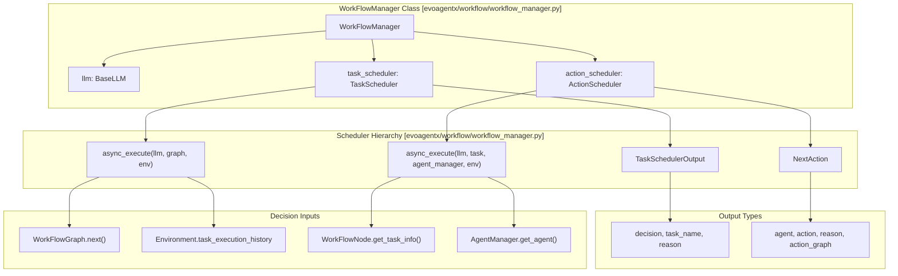
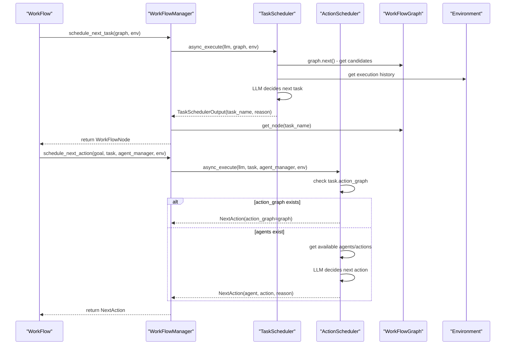
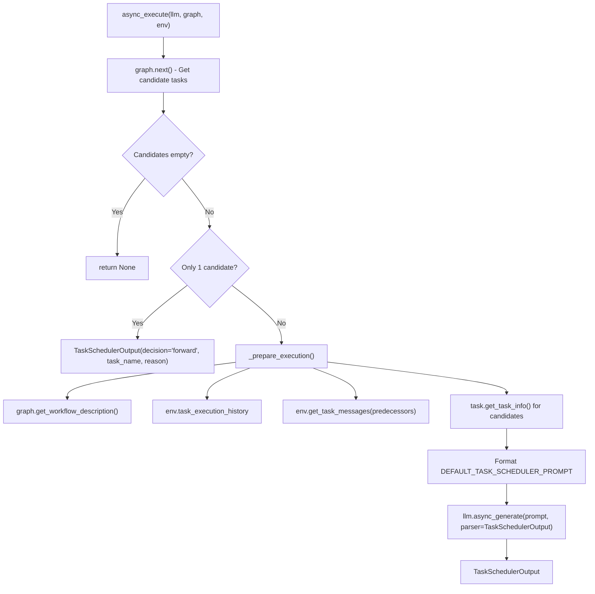
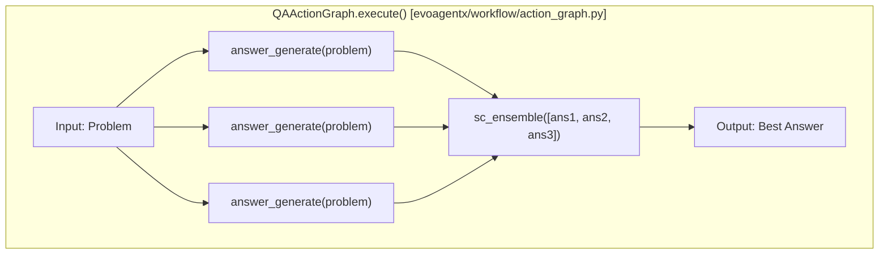

<!-- source: DeepWiki mcp.deepwiki.com · repo EvoAgentX/EvoAgentX · page 4.3 WorkFlowManager and Schedulers · fetched 2026-10-26 -->

# WorkFlowManager and Schedulers

<details>
<summary>Relevant source files</summary>

The following files were used as context for generating this wiki page:

- [evoagentx/benchmark/gsm8k.py](evoagentx/benchmark/gsm8k.py)
- [evoagentx/benchmark/hotpotqa.py](evoagentx/benchmark/hotpotqa.py)
- [evoagentx/evaluators/aflow_evaluator.py](evoagentx/evaluators/aflow_evaluator.py)
- [evoagentx/optimizers/aflow_optimizer.py](evoagentx/optimizers/aflow_optimizer.py)
- [evoagentx/prompts/workflow/workflow_manager.py](evoagentx/prompts/workflow/workflow_manager.py)
- [evoagentx/workflow/action_graph.py](evoagentx/workflow/action_graph.py)
- [evoagentx/workflow/operators.py](evoagentx/workflow/operators.py)
- [evoagentx/workflow/workflow.py](evoagentx/workflow/workflow.py)
- [evoagentx/workflow/workflow_manager.py](evoagentx/workflow/workflow_manager.py)
- [tests/src/workflow/test_action_graph.py](tests/src/workflow/test_action_graph.py)

</details>


The `WorkFlowManager` orchestrates workflow execution through two LLM-powered schedulers: `TaskScheduler` determines which workflow node (task) to execute next, and `ActionScheduler` determines which agent and action should execute to complete that task. This two-level scheduling architecture enables intelligent, dynamic workflow execution based on execution context and history.

For information about the workflow execution system that uses these schedulers, see [Workflow Execution](#4.2). For details on the workflow graph structure, see [WorkFlowGraph](#4.1).

## Architecture Overview

The `WorkFlowManager` class coordinates workflow execution through two specialized scheduler components that make LLM-powered decisions at different levels of granularity.

**WorkFlowManager Component Architecture**



**Two-Level Scheduling Process**



Sources: [evoagentx/workflow/workflow_manager.py:416-427](), [evoagentx/workflow/workflow_manager.py:431-460]()

## WorkFlowManager Class

The `WorkFlowManager` class serves as the central orchestrator for workflow execution, managing both task-level and action-level scheduling decisions through its embedded schedulers.

### Class Structure

```python
# From evoagentx/workflow/workflow_manager.py:416-427
class WorkFlowManager(BaseModule):
    llm: BaseLLM
    action_scheduler: ActionScheduler = Field(default_factory=ActionScheduler)
    task_scheduler: TaskScheduler = Field(default_factory=TaskScheduler)
```

### Key Methods

| Method | Purpose | Parameters | Returns |
|--------|---------|------------|---------|
| `schedule_next_task()` | Determine next task to execute | `graph: WorkFlowGraph, env: Environment` | `WorkFlowNode` |
| `schedule_next_action()` | Determine next action for task | `goal: str, task: WorkFlowNode, agent_manager: AgentManager, env: Environment` | `NextAction` |
| `extract_output()` | Extract final workflow output | `graph: WorkFlowGraph, env: Environment` | `str` |

### Task Scheduling Method

The `schedule_next_task()` method delegates to the `TaskScheduler` and updates the environment with the scheduling decision [evoagentx/workflow/workflow_manager.py:431-445]().

### Action Scheduling Method

The `schedule_next_action()` method delegates to the `ActionScheduler` and logs the decision [evoagentx/workflow/workflow_manager.py:447-460]().

Sources: [evoagentx/workflow/workflow_manager.py:416-460]()

## TaskScheduler

The `TaskScheduler` determines which workflow node (task) should be executed next based on the current workflow state, execution history, and candidate tasks. It supports three decision types: `re-execute`, `iterate`, or `forward` [evoagentx/prompts/workflow/workflow_manager.py:6-8]().

### Class Structure and Output

```python
# From evoagentx/workflow/workflow_manager.py:36-40
class TaskSchedulerOutput(LLMOutputParser):
    decision: str = Field(description="The decision made by the scheduler, whether to re-execute, iterate or forward a certain task.")
    task_name: str = Field(description="The name of the scheduled task.")
    reason: str = Field(description="The rationale behind the scheduling decision, explaining why the task was scheduled.")
```

### Decision Logic

**TaskScheduler Decision Flow**



### Prompt Structure

The default task scheduler prompt guides the LLM to make one of three decisions:
1. **re-execute**: Re-run a previous subtask to correct errors or gather missing information.
2. **iterate**: Select a subtask for iterative execution if there is a loop context.
3. **forward**: Select a new subtask from the candidates to move the workflow forward.

Sources: [evoagentx/workflow/workflow_manager.py:46-188](), [evoagentx/prompts/workflow/workflow_manager.py:1-59]()

## ActionScheduler

The `ActionScheduler` determines which agent and action should execute to progress a specific task. It analyzes task requirements, available agents, and execution history to make intelligent action selection decisions [evoagentx/prompts/workflow/workflow_manager.py:62-63]().

### Class Structure and Output

```python
# From evoagentx/workflow/workflow_manager.py:191-196
class NextAction(LLMOutputParser):
    agent: Optional[str] = Field(default=None, description="The name of the selected agent, should be EXACTLY the same as the provided agent name")
    action: Optional[str] = Field(default=None, description="The name of the action, should be EXACTLY the same as the provided action name")
    reason: Optional[str] = Field(default=None, description="The reasoning for selecting this agent and action")
    action_graph: Optional[ActionGraph] = Field(default=None, description="The predefined action graph for this subtask")
```

### Action Selection Strategy

The `ActionScheduler` employs a cascading strategy to minimize unnecessary LLM calls:
1. **Action Graph**: If `task.action_graph` exists, it is returned immediately [evoagentx/workflow/workflow_manager.py:348-349]().
2. **Deterministic Next Actions**: If the previous execution message explicitly specifies a `next_actions` list with a single valid pair, it is selected [evoagentx/workflow/workflow_manager.py:358-372]().
3. **Single Agent/Action**: If the task only has one possible agent and action, it is selected without LLM intervention [evoagentx/workflow/workflow_manager.py:378-384]().
4. **LLM Decision**: If multiple options exist, the LLM selects the best agent and action based on `DEFAULT_ACTION_SCHEDULER_PROMPT` [evoagentx/workflow/workflow_manager.py:390-405]().

Sources: [evoagentx/workflow/workflow_manager.py:207-413](), [evoagentx/prompts/workflow/workflow_manager.py:62-123]()

## Action Graphs and Operators

An `ActionGraph` is a specialized workflow component used to execute a single task through a set of fine-grained `Operator` nodes rather than high-level agents [evoagentx/workflow/action_graph.py:12-16]().

### Operators

`Operator` is the base class for functional nodes within an `ActionGraph`. Examples include:
* **AnswerGenerate**: Generates a step-by-step thinking process and a final answer [evoagentx/workflow/operators.py:121-128]().
* **QAScEnsemble**: Uses self-consistency to select the best answer from multiple solutions [evoagentx/workflow/operators.py:148-155]().

### QAActionGraph Example

The `QAActionGraph` implements a self-consistency pattern: it generates three candidate solutions using `AnswerGenerate` and then ensembles them using `QAScEnsemble` [evoagentx/workflow/action_graph.py:110-140]().



Sources: [evoagentx/workflow/action_graph.py:12-141](), [evoagentx/workflow/operators.py:34-155]()

## Configuration and Persistence

Action Graphs support structured serialization and can be reconstructed from configuration dictionaries or files.

### Configuration and Save/Load

| Operation | Method | Description |
|-----------|--------|-------------|
| **Export** | `get_config()` | Returns a dictionary containing the graph structure and operator prompts [evoagentx/workflow/action_graph.py:98-108](). |
| **Save** | `save_module()` | Serializes the graph configuration to a JSON file [evoagentx/workflow/action_graph.py:85-96](). |
| **Load** | `from_dict()` | Reconstructs an `ActionGraph` instance from a dictionary, including operator state [evoagentx/workflow/action_graph.py:70-83](). |

Sources: [evoagentx/workflow/action_graph.py:59-109]()

---

