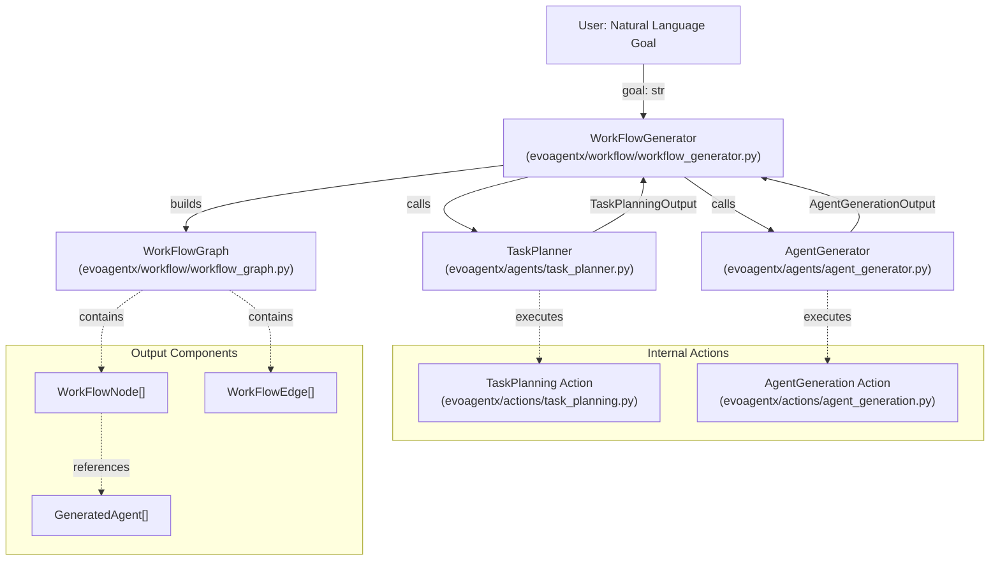
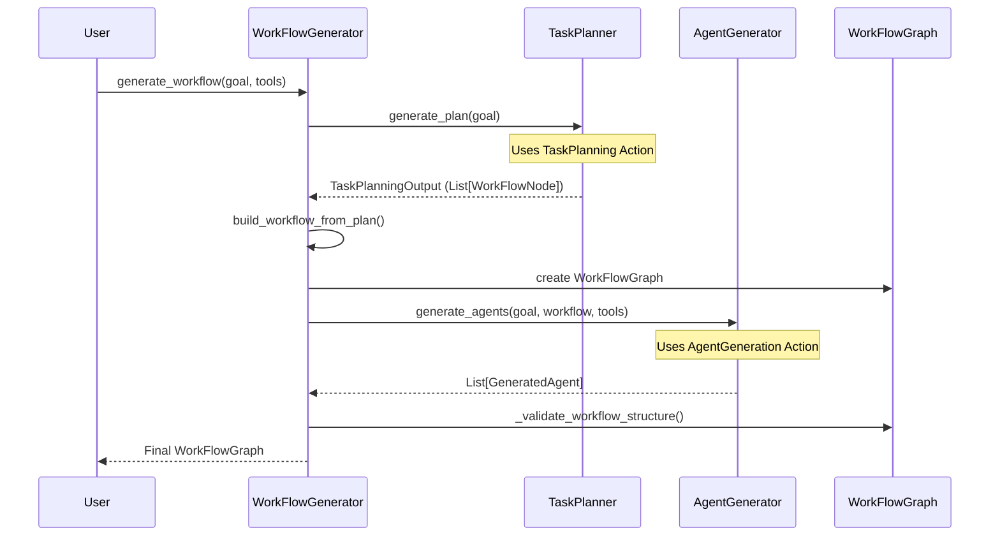
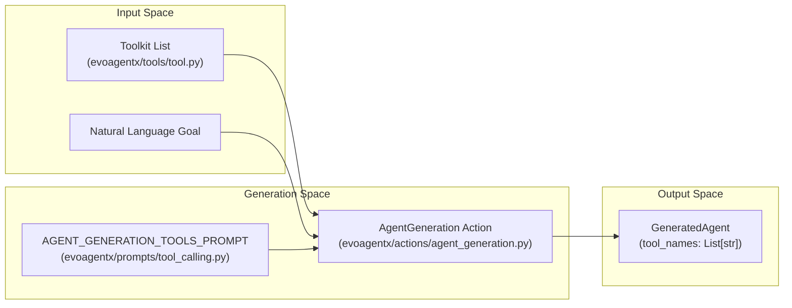

<!-- source: DeepWiki mcp.deepwiki.com · repo EvoAgentX/EvoAgentX · page 4.4 Automatic Workflow Generation · fetched 2026-10-26 -->

# Automatic Workflow Generation

Relevant source files

The following files were used as context for generating this wiki page:

- [README-zh.md](README-zh.md)
- [README.md](README.md)
- [assets/EAXLoGo.svg](assets/EAXLoGo.svg)
- [docs/assets/logo.svg](docs/assets/logo.svg)
- [docs/index.md](docs/index.md)
- [docs/overrides/main.html](docs/overrides/main.html)
- [docs/stylesheets/extra.css](docs/stylesheets/extra.css)
- [docs/zh/index.md](docs/zh/index.md)
- [evoagentx/actions/agent_generation.py](evoagentx/actions/agent_generation.py)
- [evoagentx/actions/task_planning.py](evoagentx/actions/task_planning.py)
- [evoagentx/agents/agent_generator.py](evoagentx/agents/agent_generator.py)
- [evoagentx/agents/task_planner.py](evoagentx/agents/task_planner.py)
- [evoagentx/agents/workflow_reviewer.py](evoagentx/agents/workflow_reviewer.py)
- [evoagentx/prompts/agent_generator.py](evoagentx/prompts/agent_generator.py)
- [evoagentx/prompts/code_extraction.py](evoagentx/prompts/code_extraction.py)
- [evoagentx/prompts/code_verification.py](evoagentx/prompts/code_verification.py)
- [evoagentx/prompts/task_planner.py](evoagentx/prompts/task_planner.py)
- [evoagentx/workflow/workflow_generator.py](evoagentx/workflow/workflow_generator.py)
- [mkdocs.yml](mkdocs.yml)

## Purpose and Scope

This page documents the automatic workflow generation system in EvoAgentX, which converts natural language goals into structured, executable multi-agent workflows. The system leverages specialized agents—the `TaskPlanner` and `AgentGenerator`—to analyze task requirements and construct a `WorkFlowGraph` with appropriate nodes, edges, and agent specifications.

For information about executing generated workflows, see [Workflow Execution](#4.2). For details on agent creation and management, see [Agent Manager](#3.3). For workflow optimization after generation, see [Optimization Framework](#10.1).

---

## Overview

The automatic workflow generation system transforms a natural language goal into a complete workflow specification. The process is managed by the `WorkFlowGenerator` class [evoagentx/workflow/workflow_generator.py:20-35]().

1.  **Task Planning**: The `TaskPlanner` breaks down the high-level goal into manageable `WorkFlowNode` subtasks [evoagentx/workflow/workflow_generator.py:37]().
2.  **Graph Construction**: Creating a `WorkFlowGraph` with dependencies established through input/output mapping [evoagentx/workflow/workflow_generator.py:120-126]().
3.  **Agent Generation**: The `AgentGenerator` assigns or creates specialized agents for each subtask, including prompt engineering and tool allocation [evoagentx/workflow/workflow_generator.py:38]().
4.  **Validation**: The system ensures the graph structure is logical and every node has assigned agents [evoagentx/workflow/workflow_generator.py:129-152]().

Sources: [evoagentx/workflow/workflow_generator.py:20-41](), [README.md:253-283]()

---

## System Architecture

**Natural Language to Code Entity Mapping**

This diagram shows how the `WorkFlowGenerator` orchestrates specialized agents and actions to produce the final `WorkFlowGraph`.

Sources: [evoagentx/workflow/workflow_generator.py:20-41](), [evoagentx/actions/task_planning.py:27-30](), [evoagentx/actions/agent_generation.py:126-133]()

---

## Core Generation Process

The generation process follows a strict sequence to ensure data consistency between tasks and agents.

**Workflow Generation Sequence**

Sources: [evoagentx/workflow/workflow_generator.py:100-153](), [evoagentx/actions/task_planning.py:43-75](), [evoagentx/actions/agent_generation.py:145-160]()

---

## WorkFlowGenerator Implementation

The `WorkFlowGenerator` is a `BaseModule` that coordinates the planning and generation lifecycle [evoagentx/workflow/workflow_generator.py:20]().

### Key Methods

| Method | Description |
| :--- | :--- |
| `generate_workflow` | The main entry point that executes planning, building, and agent generation with retry logic [evoagentx/workflow/workflow_generator.py:100-153](). |
| `generate_plan` | Invokes the `TaskPlanner` to decompose the goal into sub-tasks [evoagentx/workflow/workflow_generator.py:155-163](). |
| `generate_agents` | Iterates through sub-tasks to create or assign agents using `AgentGenerator` [evoagentx/workflow/workflow_generator.py:186-210](). |
| `_execute_with_retry` | Helper that handles transient LLM failures during generation [evoagentx/workflow/workflow_generator.py:70-98](). |

### Task Planning Logic
The `TaskPlanner` uses the `TaskPlanning` action to produce a list of `WorkFlowNode` objects [evoagentx/actions/task_planning.py:20-24](). It adheres to principles of simplicity, modularity, and consistency [evoagentx/prompts/task_planner.py:25-30]().

### Agent Generation Logic
The `AgentGenerator` uses the `AgentGeneration` action to define `GeneratedAgent` specifications [evoagentx/actions/agent_generation.py:29-40](). This includes:
*   **Prompt Validation**: Ensuring input placeholders (e.g., `{{input_name}}`) in the generated prompt match the defined inputs [evoagentx/actions/agent_generation.py:74-92]().
*   **Output Format Mapping**: Matching the LLM-generated output sections to the `outputs` parameter list [evoagentx/actions/agent_generation.py:94-115]().

Sources: [evoagentx/workflow/workflow_generator.py:20-41](), [evoagentx/actions/task_planning.py:27-30](), [evoagentx/actions/agent_generation.py:126-133](), [evoagentx/actions/agent_generation.py:52-117]()

---

## Tool Integration during Generation

When toolkits are provided to the `WorkFlowGenerator`, they are passed to the `AgentGenerator` [evoagentx/workflow/workflow_generator.py:52](). The generation prompt instructs the LLM to identify required capabilities and select tools from the "### Tools" section [evoagentx/prompts/agent_generator.py:49-51]().

**Tool Selection Logic**

Sources: [evoagentx/workflow/workflow_generator.py:52-68](), [evoagentx/actions/agent_generation.py:26](), [evoagentx/prompts/agent_generator.py:79]()

---

## Best Practices for Generation

### 1. Goal Description
The `generate_workflow` method validates that the goal is at least 10 characters and descriptive [evoagentx/workflow/workflow_generator.py:102-103](). 
*   **Good**: "Search for the latest 5 papers on 'Self-Evolving Agents' from ArXiv, summarize their main contributions, and save the summary to a markdown file."
*   **Bad**: "Get papers."

### 2. Tool Awareness
Provide specific toolkits to the generator so it can tailor agent prompts to use those tools. For example, if you provide an `ArxivToolkit`, the `AgentGenerator` will create agents that specifically reference the `search_arxiv` tool in their instructions [evoagentx/prompts/agent_generator.py:87-91]().

### 3. Iterative Refinement
The `WorkFlowGenerator` supports a `num_turns` parameter for refinement iterations (though the `WorkFlowReviewer` component is currently a placeholder) [evoagentx/workflow/workflow_generator.py:39-40](), [evoagentx/agents/workflow_reviewer.py:6-14]().

### 4. Handling Generated Agents
The `GeneratedAgent` class includes a `model_validator` that automatically fixes common prompt formatting errors, such as missing braces for input variables or mismatched output keys [evoagentx/actions/agent_generation.py:52-117]().

Sources: [evoagentx/workflow/workflow_generator.py:101-103](), [evoagentx/actions/agent_generation.py:52-117](), [evoagentx/prompts/agent_generator.py:82-104]()

---

