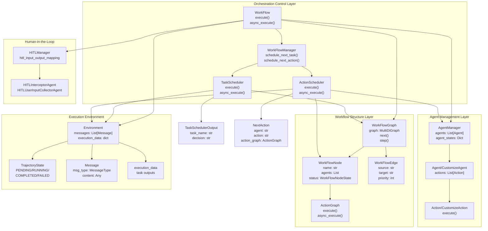
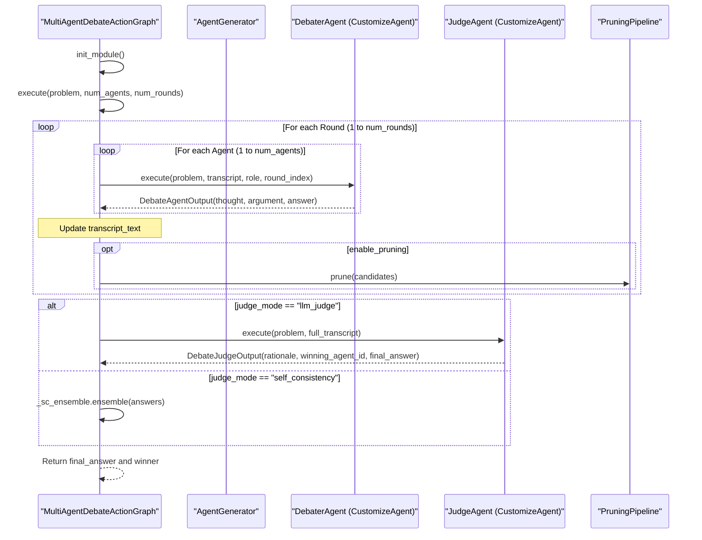
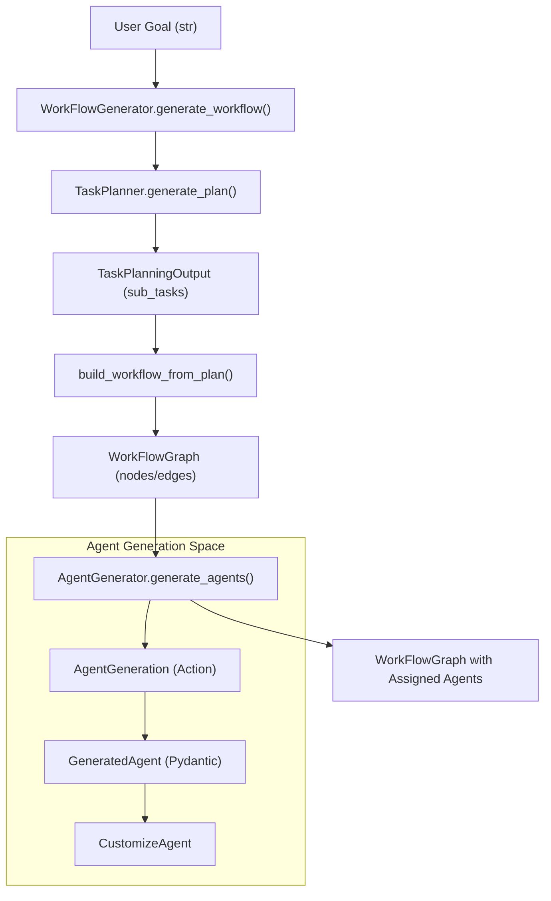

<!-- source: DeepWiki mcp.deepwiki.com · repo EvoAgentX/EvoAgentX · page 4.5 Multi-Agent Orchestration · fetched 2026-10-26 -->

# Multi-Agent Orchestration

<details>
<summary>Relevant source files</summary>

The following files were used as context for generating this wiki page:

- [docs/modules/multi_agent_debate.md](docs/modules/multi_agent_debate.md)
- [docs/tutorial/multi_agent_debate.md](docs/tutorial/multi_agent_debate.md)
- [evoagentx/actions/agent_generation.py](evoagentx/actions/agent_generation.py)
- [evoagentx/actions/task_planning.py](evoagentx/actions/task_planning.py)
- [evoagentx/agents/agent_generator.py](evoagentx/agents/agent_generator.py)
- [evoagentx/agents/task_planner.py](evoagentx/agents/task_planner.py)
- [evoagentx/agents/workflow_reviewer.py](evoagentx/agents/workflow_reviewer.py)
- [evoagentx/frameworks/multi_agent_debate/debate.py](evoagentx/frameworks/multi_agent_debate/debate.py)
- [evoagentx/frameworks/multi_agent_debate/pruning.py](evoagentx/frameworks/multi_agent_debate/pruning.py)
- [evoagentx/frameworks/multi_agent_debate/utils.py](evoagentx/frameworks/multi_agent_debate/utils.py)
- [evoagentx/prompts/agent_generator.py](evoagentx/prompts/agent_generator.py)
- [evoagentx/prompts/code_extraction.py](evoagentx/prompts/code_extraction.py)
- [evoagentx/prompts/code_verification.py](evoagentx/prompts/code_verification.py)
- [evoagentx/prompts/task_planner.py](evoagentx/prompts/task_planner.py)
- [evoagentx/prompts/workflow/multi_agent_debate.py](evoagentx/prompts/workflow/multi_agent_debate.py)
- [evoagentx/workflow/workflow_generator.py](evoagentx/workflow/workflow_generator.py)
- [examples/multi_agent_debate/config_methods_example.py](examples/multi_agent_debate/config_methods_example.py)
- [examples/multi_agent_debate/multi_agent_debate.py](examples/multi_agent_debate/multi_agent_debate.py)
- [examples/multi_agent_debate/multi_agent_debate_advanced.py](examples/multi_agent_debate/multi_agent_debate_advanced.py)
- [examples/multi_agent_debate/multi_agent_debate_group.py](examples/multi_agent_debate/multi_agent_debate_group.py)

</details>


Multi-agent orchestration in EvoAgentX enables coordinated execution of complex workflows where multiple agents collaborate to achieve shared goals. This system provides sophisticated scheduling, dependency management, and state coordination mechanisms for managing agent interactions across interconnected tasks, including specialized frameworks like Multi-Agent Debate.

## Core Orchestration Architecture

The multi-agent orchestration system is built around several key components that work together to coordinate agent execution:

### Orchestration Components



Sources: `evoagentx/workflow/workflow_generator.py:17-18`(), `evoagentx/actions/task_planning.py:8-24`(), `evoagentx/frameworks/multi_agent_debate/debate.py:43-61]()

## Multi-Agent Debate (MAD) Framework

The Multi-Agent Debate framework is a specialized orchestration pattern where multiple agents (debaters) iteratively argue and rebut on a problem until a consensus or judgment is reached.

### Debate Orchestration Logic

The `MultiAgentDebateActionGraph` manages the lifecycle of a debate, including persona assignment, round execution, and final judging.



Sources: `evoagentx/frameworks/multi_agent_debate/debate.py:43-131`(), `evoagentx/frameworks/multi_agent_debate/debate.py:132-144`(), `docs/tutorial/multi_agent_debate.md:54-71]()

### Key Debate Components

| Class | Description | Source |
| :--- | :--- | :--- |
| `MultiAgentDebateActionGraph` | Orchestrates the debate process, managing rounds and judge selection. | `evoagentx/frameworks/multi_agent_debate/debate.py:43-61`() |
| `DebateAgentOutput` | Pydantic model for individual debater responses (thought, argument, answer). | `evoagentx/frameworks/multi_agent_debate/debate.py:27-32`() |
| `DebateJudgeOutput` | Pydantic model for final judgment (rationale, winner, final answer). | `evoagentx/frameworks/multi_agent_debate/debate.py:35-40`() |
| `PruningPipeline` | Optional component to remove low-quality or redundant arguments. | `evoagentx/frameworks/multi_agent_debate/debate.py:23-23`() |

## Automated Workflow Orchestration

EvoAgentX provides a `WorkFlowGenerator` that automates the creation and orchestration of multi-agent teams based on high-level goals.

### Workflow Generation and Refinement



Sources: `evoagentx/workflow/workflow_generator.py:20-41`(), `evoagentx/workflow/workflow_generator.py:100-153`(), `evoagentx/actions/agent_generation.py:126-134]()

### Core Generators

*   **`TaskPlanner`**: Uses `TaskPlanning` action to decompose a goal into `WorkFlowNode` objects with defined inputs and outputs.
    *   Sources: `evoagentx/agents/task_planner.py:6-18`(), `evoagentx/actions/task_planning.py:27-31`()
*   **`AgentGenerator`**: Uses `AgentGeneration` action to analyze sub-tasks and create or assign `CustomizeAgent` instances.
    *   Sources: `evoagentx/agents/agent_generator.py:6-18`(), `evoagentx/actions/agent_generation.py:126-134`()
*   **`WorkFlowReviewer`**: (Placeholder) Responsible for iterative refinement of the generated plan.
    *   Sources: `evoagentx/agents/workflow_reviewer.py:6-14`()

## Agent-Model Mapping Strategies

Orchestration often requires matching specific roles to the most capable models. EvoAgentX supports dynamic mapping to optimize performance and cost.

### Role-Model Configuration Example

In complex multi-agent setups, users can map personas to specific `LLMConfig` instances to ensure analytical roles use stronger models (e.g., GPT-4o) while general roles use cost-effective models.

```python
# Example of orchestration mapping from docs
role_model_mapping = {
    "Innovator": ("gpt4o", 0.3),      # High temperature for creativity
    "Analyst": ("llama", -0.1),       # Low temperature for precision
    "Generalist": ("gpt4o_mini", 0.0) # Balanced model
}
```

Sources: `docs/tutorial/multi_agent_debate.md:182-192`(), `examples/multi_agent_debate/multi_agent_debate_advanced.py:114-130]()

## Implementation Details: Agent Generation

The `AgentGeneration` action ensures that generated agents are technically valid for the orchestration engine.

### GeneratedAgent Validation
The `GeneratedAgent` class includes a `validate_prompt` method that ensures:
1.  All defined `inputs` are present in the `prompt` template using `<input>{name}</input>` format.
2.  Output sections in the prompt match the defined `outputs` parameters.
3.  Automatic fixing of minor naming mismatches between the prompt and the metadata.

Sources: `evoagentx/actions/agent_generation.py:29-52`(), `evoagentx/actions/agent_generation.py:53-117]()

### Execution with Retry
The `WorkFlowGenerator` utilizes an `_execute_with_retry` helper to manage the brittle nature of LLM-based planning, ensuring that workflow structures are valid before execution begins.

Sources: `evoagentx/workflow/workflow_generator.py:70-98`(), `evoagentx/workflow/workflow_generator.py:108-127]()

---

