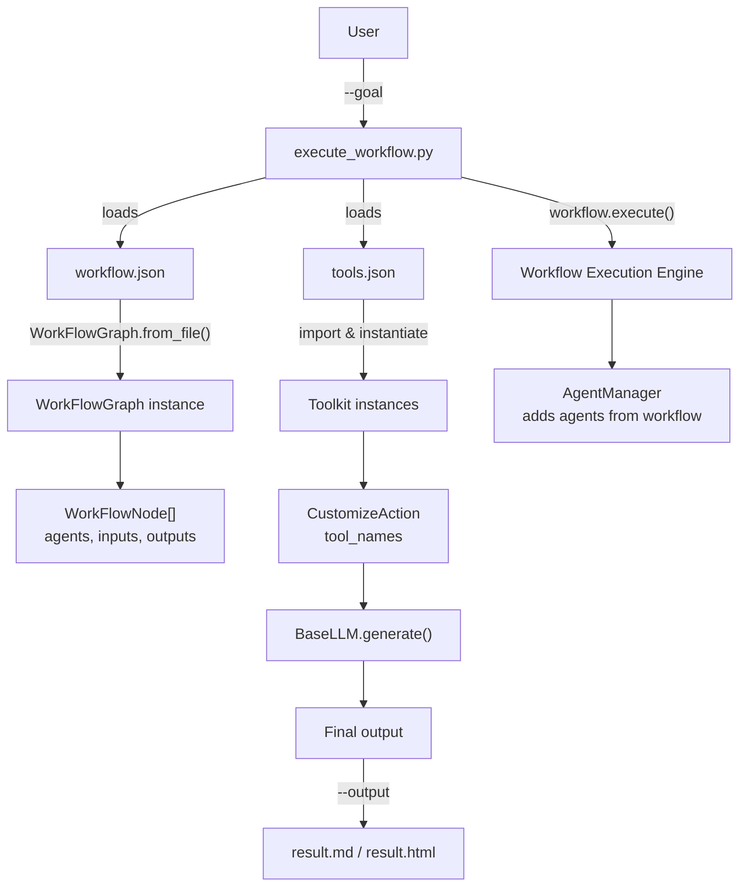
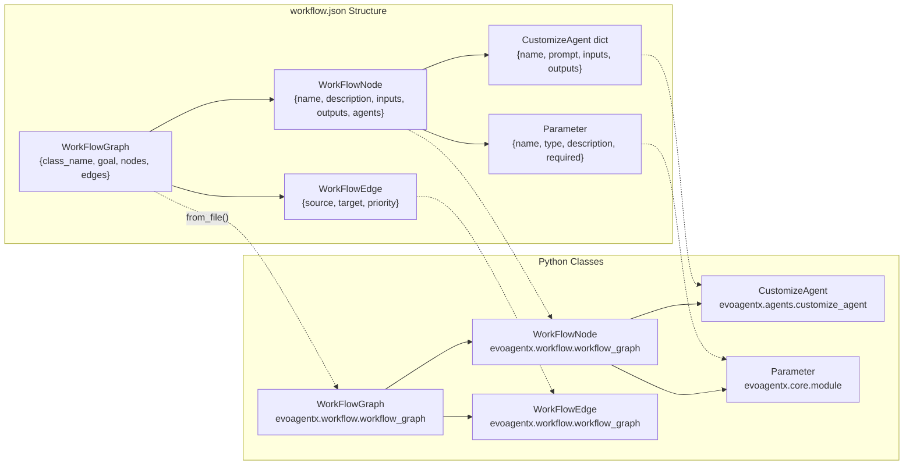
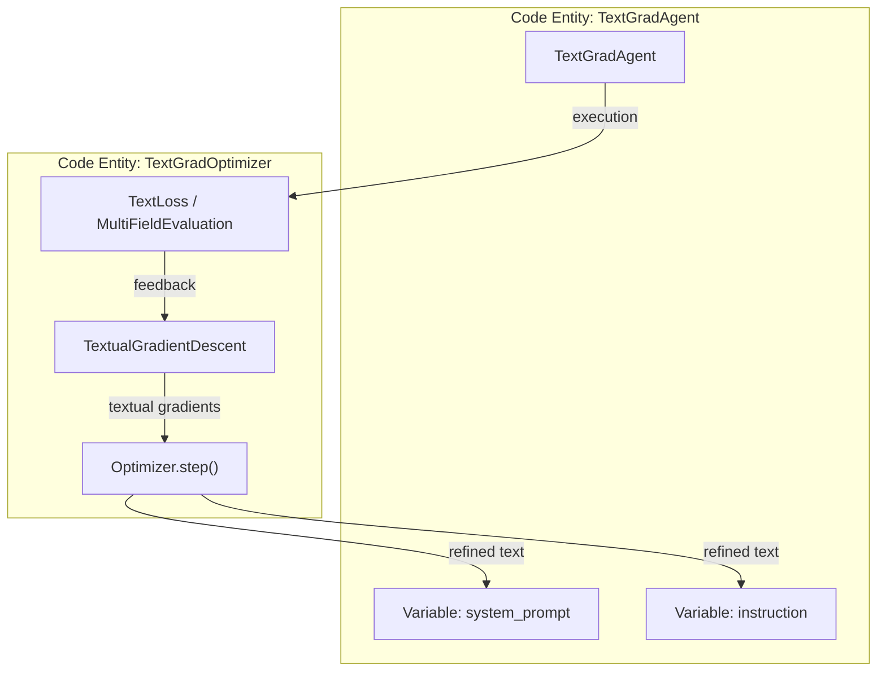
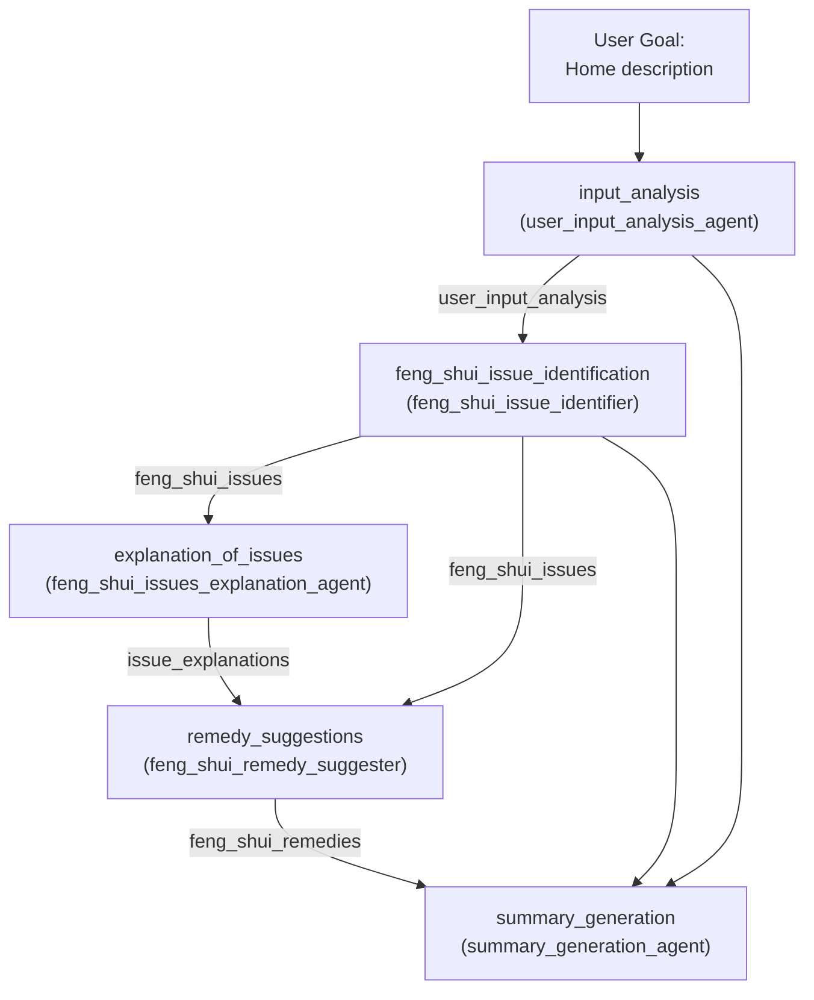

<!-- source: DeepWiki mcp.deepwiki.com · repo EvoAgentX/EvoAgentX · page 4.6 Workflow Corpus · fetched 2026-10-26 -->

# Workflow Corpus

<details>
<summary>Relevant source files</summary>

The following files were used as context for generating this wiki page:

- [Wonderful_workflow_corpus/Fengshui_analysis/tools.json](Wonderful_workflow_corpus/Fengshui_analysis/tools.json)
- [Wonderful_workflow_corpus/Fengshui_analysis/workflow.json](Wonderful_workflow_corpus/Fengshui_analysis/workflow.json)
- [Wonderful_workflow_corpus/README.md](Wonderful_workflow_corpus/README.md)
- [Wonderful_workflow_corpus/arxiv_daily_digest/tools.json](Wonderful_workflow_corpus/arxiv_daily_digest/tools.json)
- [Wonderful_workflow_corpus/arxiv_daily_digest/workflow.json](Wonderful_workflow_corpus/arxiv_daily_digest/workflow.json)
- [Wonderful_workflow_corpus/execute_workflow.py](Wonderful_workflow_corpus/execute_workflow.py)
- [Wonderful_workflow_corpus/invest/catl_data_functions.py](Wonderful_workflow_corpus/invest/catl_data_functions.py)
- [Wonderful_workflow_corpus/invest/csv_to_llm_converter.py](Wonderful_workflow_corpus/invest/csv_to_llm_converter.py)
- [Wonderful_workflow_corpus/invest/example_goal.txt](Wonderful_workflow_corpus/invest/example_goal.txt)
- [Wonderful_workflow_corpus/invest/html_report_generator.py](Wonderful_workflow_corpus/invest/html_report_generator.py)
- [Wonderful_workflow_corpus/invest/stock_analysis.py](Wonderful_workflow_corpus/invest/stock_analysis.py)
- [Wonderful_workflow_corpus/invest/stock_chart_tools.py](Wonderful_workflow_corpus/invest/stock_chart_tools.py)
- [Wonderful_workflow_corpus/invest/workflow.json](Wonderful_workflow_corpus/invest/workflow.json)
- [Wonderful_workflow_corpus/travel_recommendation/tools.json](Wonderful_workflow_corpus/travel_recommendation/tools.json)
- [Wonderful_workflow_corpus/travel_recommendation/workflow.json](Wonderful_workflow_corpus/travel_recommendation/workflow.json)
- [evoagentx/optimizers/textgrad_optimizer.py](evoagentx/optimizers/textgrad_optimizer.py)
- [evoagentx/prompts/optimizers/textgrad_optimizer.py](evoagentx/prompts/optimizers/textgrad_optimizer.py)
- [examples/workflow/invest/catl_data_functions.py](examples/workflow/invest/catl_data_functions.py)
- [examples/workflow/invest/generate_report.py](examples/workflow/invest/generate_report.py)
- [examples/workflow/invest/html_report_generator.py](examples/workflow/invest/html_report_generator.py)
- [examples/workflow/invest/invest_demo_4o_mini.json](examples/workflow/invest/invest_demo_4o_mini.json)
- [examples/workflow/invest/stock_analysis.py](examples/workflow/invest/stock_analysis.py)
- [examples/workflow/invest/stock_chart_tools.py](examples/workflow/invest/stock_chart_tools.py)
- [examples/workflow/workflow_demo.py](examples/workflow/workflow_demo.py)
- [examples/workflow/workflow_direction.py](examples/workflow/workflow_direction.py)

</details>


## Purpose and Scope

The Workflow Corpus (`Wonderful_workflow_corpus/`) is a collection of pre-built, reusable workflows that demonstrate EvoAgentX capabilities and provide starting points for common use cases. Each workflow consists of a `workflow.json` file (serialized `WorkFlowGraph`) and a `tools.json` file (tool configurations) that can be executed through a universal launcher script. This page documents the corpus structure, available workflows, file formats, and execution mechanisms.

For information about dynamically generating workflows from natural language, see [Automatic Workflow Generation (Section 4.4)](). For patterns on coordinating multiple agents, see [Multi-Agent Orchestration (Section 4.5)]().

---

## Corpus Architecture

### Directory Structure

Each workflow in the corpus is organized as a self-contained subdirectory with standardized files:

```
Wonderful_workflow_corpus/
├── execute_workflow.py          # Universal workflow executor
├── README.md                     # Corpus documentation
├── arxiv_daily_digest/
│   ├── workflow.json            # WorkFlowGraph serialization
│   └── tools.json               # Tool definitions
├── recipe_meal_plan/
│   ├── workflow.json
│   └── tools.json
├── travel_recommendation/
│   ├── workflow.json
│   └── tools.json
├── Fengshui_analysis/
│   ├── workflow.json
│   └── tools.json
├── tetris_game/
│   ├── workflow.json
│   └── tools.json
└── invest/
    ├── workflow.json
    ├── workflow_windows.json    # OS-specific variant
    ├── tools.json
    ├── stock_analysis.py        # Custom executor
    └── html_report_generator.py # Specialized output formatter
```

**Diagram: Corpus Execution Flow**



**Sources:** [Wonderful_workflow_corpus/README.md:1-141](), [examples/workflow/invest/stock_analysis.py:164-173]()

---

## Workflow File Format

### workflow.json Structure

A `workflow.json` file is a serialized `WorkFlowGraph` containing nodes, edges, and goal definition. The structure maps directly to EvoAgentX core classes:

| JSON Key | Python Class | Description |
|----------|--------------|-------------|
| `class_name` | `"WorkFlowGraph"` | Top-level workflow container |
| `goal` | `str` | Natural language workflow objective |
| `nodes` | `List[WorkFlowNode]` | Agent-based task execution units |
| `edges` | `List[WorkFlowEdge]` | Node dependencies and execution order |

**Diagram: workflow.json to Code Class Mapping**



**Sources:** [Wonderful_workflow_corpus/Fengshui_analysis/workflow.json:1-10](), [Wonderful_workflow_corpus/travel_recommendation/workflow.json:1-10](), [evoagentx/optimizers/textgrad_optimizer.py:32-43]()

### WorkFlowNode Agent Configuration

Each `WorkFlowNode` contains an `agents` list with agent definitions. Agents are stored as dictionaries following the `CustomizeAgent` schema:

```json
{
  "name": "user_input_analysis_agent",
  "description": "Analyzes user input...",
  "inputs": [
    {"name": "goal", "type": "string", "description": "...", "required": true}
  ],
  "outputs": [
    {"name": "user_input_analysis", "type": "string", "description": "...", "required": true}
  ],
  "prompt": "### Objective\n...\n### Instructions\n...\n### Output Format\n...",
  "tool_names": ["ArxivToolkit"]
}
```

| Field | Type | Required | Description |
|-------|------|----------|-------------|
| `name` | `str` | Yes | Unique agent identifier |
| `description` | `str` | Yes | Agent purpose and capabilities |
| `inputs` | `List[dict]` | Yes | Input parameters with types |
| `outputs` | `List[dict]` | Yes | Output parameters with types |
| `prompt` | `str` | Yes | Instruction prompt for the agent's action |
| `tool_names` | `List[str]` | No | Tool class names to provide to agent |

**Sources:** [Wonderful_workflow_corpus/Fengshui_analysis/workflow.json:28-50](), [Wonderful_workflow_corpus/arxiv_daily_digest/workflow.json:28-53]()

---

## Executing Workflows

### Universal Executor: execute_workflow.py

The corpus provides a universal launcher script that loads and executes any workflow:

```bash
python Wonderful_workflow_corpus/execute_workflow.py \
  --workflow <path-to-workflow.json> \
  --goal "<natural-language-goal>" \
  --output <output-file>
```

**Execution Flow:**

1. Load `workflow.json` via `WorkFlowGraph.from_file()`
2. Load `tools.json` and instantiate toolkits
3. Initialize `AgentManager` and `WorkFlow`
4. Call `workflow.execute()` with user's goal
5. Write output to specified file

**Sources:** [Wonderful_workflow_corpus/README.md:19-25](), [examples/workflow/invest/stock_analysis.py:164-188]()

### Custom Advanced Executor: Stock Analysis

The Stock Analysis workflow (`Wonderful_workflow_corpus/invest/`) requires a multi-stage execution handled by `stock_analysis.py`.

**Execution Logic:**
- **Data Acquisition:** Uses `catl_data_functions.py` to fetch CSV data (CPI, GDP, News, etc.) [examples/workflow/invest/stock_analysis.py:15-16]().
- **Visualization:** Uses `stock_chart_tools.py` to generate technical and candlestick charts [examples/workflow/invest/stock_analysis.py:16]().
- **Workflow Selection:** Automatically selects `workflow_windows.json` or `workflow.json` based on the operating system to handle OS-specific file discovery commands (e.g., `dir` vs `find`) [Wonderful_workflow_corpus/README.md:124-129]().
- **Reporting:** Combines Markdown output with charts into a neomorphism-style HTML report via `html_report_generator.py` [examples/workflow/invest/html_report_generator.py:1-5]().

**Sources:** [examples/workflow/invest/stock_analysis.py:100-195](), [Wonderful_workflow_corpus/README.md:106-129]()

---

## Available Workflows

### Simple Workflows

| Workflow | Directory | Key Features |
|----------|-----------|--------------|
| **Arxiv Daily Digest** | `arxiv_daily_digest/` | Uses `ArxivToolkit` to search, summarize, and format papers [Wonderful_workflow_corpus/arxiv_daily_digest/workflow.json:1-120](). |
| **Recipe Generator** | `recipe_meal_plan/` | Generates healthy meal plans based on available ingredients [Wonderful_workflow_corpus/README.md:46-56](). |
| **Tetris Game** | `tetris_game/` | Code generation for HTML/CSS/JS playable games [Wonderful_workflow_corpus/README.md:60-71](). |

### Advanced Workflows

| Workflow | Directory | Key Features |
|----------|-----------|--------------|
| **Travel Recommendation** | `travel_recommendation/` | Multi-agent planning using `GoogleMapsToolkit` and `SerpAPIToolkit` [Wonderful_workflow_corpus/travel_recommendation/tools.json:1-6](). |
| **Feng Shui Advisor** | `Fengshui_analysis/` | Cultural analysis pipeline: input analysis → issue identification → explanation → remedies [Wonderful_workflow_corpus/Fengshui_analysis/workflow.json:1-343](). |
| **Stock Analysis (Invest)** | `invest/` | Parallel background and price analysis; integration with local CSV data and PNG charts [examples/workflow/invest/invest_demo_4o_mini.json:1-100](). |

---

## Optimization of the Corpus

Workflows in the corpus are designed to be optimized using the `TextGradOptimizer`. This optimizer treats the `system_prompt` and instruction `prompt` as variables to be improved via LLM feedback.

**Diagram: TextGrad Optimization on Corpus Agents**



**Optimization Logic:**
- **Variable Mapping:** The `TextGradAgent` class wraps a standard `Agent`, converting its prompts into `textgrad.Variable` objects [evoagentx/optimizers/textgrad_optimizer.py:108-141]().
- **Forward Pass:** The `CustomAgentCall` executes the agent with variable inputs and captures outputs for backpropagation [evoagentx/optimizers/textgrad_optimizer.py:75-106]().
- **Loss Functions:** Uses specialized prompts like `CODE_LOSS_PROMPT` or `GENERAL_LOSS_PROMPT` to evaluate agent performance [evoagentx/prompts/optimizers/textgrad_optimizer.py:3-24]().

**Sources:** [evoagentx/optimizers/textgrad_optimizer.py:108-161](), [evoagentx/prompts/optimizers/textgrad_optimizer.py:41-62]()

---

## Example: Feng Shui Advisor Workflow

### Workflow DAG

The Feng Shui workflow demonstrates a multi-stage analysis pipeline:

**Diagram: Fengshui Workflow Dependency Graph**



**Sources:** [Wonderful_workflow_corpus/Fengshui_analysis/workflow.json:5-341]()

### Prompt Engineering Pattern

The workflow utilizes a strict language-aware prompt pattern:
- **Language Detection:** Detects user language (Chinese/English) and responds accordingly [Wonderful_workflow_corpus/Fengshui_analysis/workflow.json:48]().
- **Input Placeholders:** Uses `<input>{variable}</input>` syntax for context injection [Wonderful_workflow_corpus/Fengshui_analysis/workflow.json:48]().
- **Structured Output:** Forces a `## Thought` section followed by the specific output parameter name [Wonderful_workflow_corpus/Fengshui_analysis/workflow.json:48]().

**Sources:** [Wonderful_workflow_corpus/Fengshui_analysis/workflow.json:48-49](), [Wonderful_workflow_corpus/Fengshui_analysis/workflow.json:109-112]()

---

