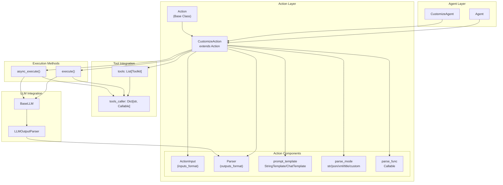
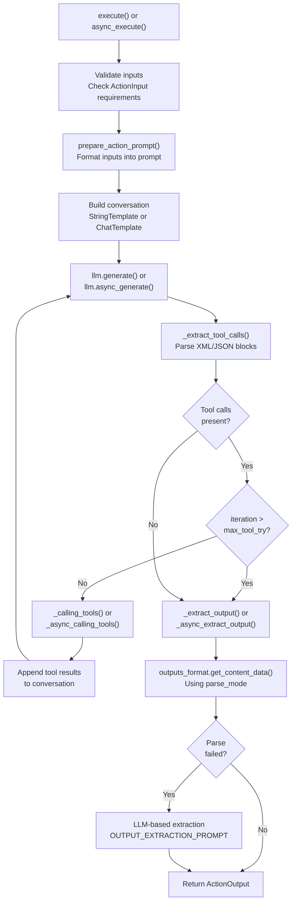
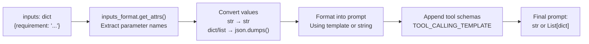

<!-- source: DeepWiki mcp.deepwiki.com · repo EvoAgentX/EvoAgentX · page 5 Action System · fetched 2026-10-26 -->

# Action System

<details>
<summary>Relevant source files</summary>

The following files were used as context for generating this wiki page:

- [evoagentx/actions/action.py](evoagentx/actions/action.py)
- [evoagentx/actions/customize_action.py](evoagentx/actions/customize_action.py)
- [evoagentx/agents/agent.py](evoagentx/agents/agent.py)
- [evoagentx/core/message.py](evoagentx/core/message.py)
- [evoagentx/core/module.py](evoagentx/core/module.py)
- [evoagentx/core/module_utils.py](evoagentx/core/module_utils.py)
- [evoagentx/models/base_model.py](evoagentx/models/base_model.py)
- [evoagentx/prompts/tool_calling.py](evoagentx/prompts/tool_calling.py)
- [evoagentx/tools/browser_tool.py](evoagentx/tools/browser_tool.py)
- [evoagentx/tools/file_tool.py](evoagentx/tools/file_tool.py)
- [examples/customize_agent.py](examples/customize_agent.py)
- [examples/output/jobs/jobs_demo_4o_mini.json](examples/output/jobs/jobs_demo_4o_mini.json)
- [examples/output/jobs/mcp_jobs.config](examples/output/jobs/mcp_jobs.config)
- [examples/output/jobs/test_pdf.pdf](examples/output/jobs/test_pdf.pdf)

</details>


The Action System defines the core execution units that agents use to accomplish tasks. This page documents the `Action` and `CustomizeAction` classes, their execution lifecycle, tool integration mechanisms, and output parsing strategies. For information about how agents orchestrate actions, see [Agent System](#3). For details on tool implementations, see [Tool System](#7).

Sources: [evoagentx/actions/customize_action.py:1-559]()

## Architecture Overview

The Action System provides the fundamental abstraction for executable tasks in EvoAgentX. Actions encapsulate a specific capability (e.g., web search, code generation, data analysis) with well-defined inputs, outputs, and execution logic. The `CustomizeAction` class extends this with dynamic prompt construction, tool calling, and flexible output parsing.

### Action System Components



**Key Classes and Their Roles:**

| Class | File Location | Purpose |
|-------|--------------|---------|
| `Action` | [evoagentx/actions/action.py:108-164]() | Base class defining action interface and serialization |
| `CustomizeAction` | [evoagentx/actions/customize_action.py:20-31]() | Dynamic action with tool calling and flexible parsing |
| `ActionInput` | [evoagentx/actions/action.py:18-30]() | Defines input requirements for actions using Pydantic Fields |
| `ActionOutput` | [evoagentx/actions/action.py:91-97]() | Handles structured output of actions |
| `LLMOutputParser` | [evoagentx/models/base_model.py:22-32]() | Base parser for extracting data from LLM-generated content |

Sources: [evoagentx/actions/customize_action.py:20-48](), [evoagentx/actions/action.py:18-164](), [evoagentx/models/base_model.py:22-132]()

## Action Execution Lifecycle

The execution lifecycle of a `CustomizeAction` involves prompt preparation, optional tool calling, LLM generation, and output parsing. This process may iterate multiple times if tools are used.

### Execution Flow Diagram



**Execution Parameters:**

| Parameter | Type | Description | Location |
|-----------|------|-------------|----------|
| `llm` | `BaseLLM` | Language model for generation | [evoagentx/actions/customize_action.py:416]() |
| `inputs` | `dict` | Input values matching `inputs_format` | [evoagentx/actions/customize_action.py:416]() |
| `sys_msg` | `str` | System message override | [evoagentx/actions/customize_action.py:416]() |
| `return_prompt` | `bool` | Whether to return the prepared prompt | [evoagentx/actions/customize_action.py:416]() |
| `time_out` | `int` | Current iteration count (internal) | [evoagentx/actions/customize_action.py:416]() |

Sources: [evoagentx/actions/customize_action.py:416-485](), [evoagentx/actions/customize_action.py:488-559]()

## Input and Output Format System

Actions define typed inputs and outputs using the `ActionInput` and `Parser` classes, which provide schema validation and automatic documentation generation for prompts.

### Input/Output Definition

```python
# Example from customize_agent.py
CustomizeAgent(
    name="CodeWriter",
    inputs=[
        {"name": "requirement", "type": "string", "description": "The coding requirement"}
    ],
    outputs=[
        {"name": "code", "type": "string", "description": "The generated Python code"}
    ]
)
```

**Input Processing Flow:**

The `prepare_action_prompt()` method transforms the input dictionary into formatted prompt text, handling string serialization for complex types like `dict` or `list`.



**Code Implementation:**

The input processing logic handles multiple data types and automatically serializes complex objects:

[evoagentx/actions/customize_action.py:71-105]()

Sources: [evoagentx/actions/customize_action.py:49-105](), [evoagentx/actions/action.py:18-90](), [examples/customize_agent.py:41-79]()

## Prompt Preparation

`CustomizeAction` supports two prompting modes: simple string prompts and structured templates. Templates provide better control over prompt structure and enable few-shot learning.

### Prompt Template Priority

When both `prompt` and `prompt_template` are provided, the system prioritizes `prompt_template` and logs a warning:

[evoagentx/actions/customize_action.py:40-44]()

**Template Examples:**

```python
# Example 1: Simple prompt (examples/customize_agent.py:46)
simple_agent = CustomizeAgent(
    prompt="Answer the following question: {question}"
)

# Example 2: StringTemplate (examples/customize_agent.py:140-151)
code_writer = CustomizeAgent(
    prompt_template=StringTemplate(
        instruction="Write Python code that implements the provided `requirement`"
    )
)
```

Sources: [evoagentx/actions/customize_action.py:49-105](), [examples/customize_agent.py:105-169]()

## Tool Calling Mechanism

`CustomizeAction` integrates with the Tool System to enable actions to call external tools. Tools are executed in parallel when multiple tool invocations are detected.

### Tool Call Format

Tools are called using a structured XML-wrapped JSON format defined in `TOOL_CALLING_TEMPLATE`:

```xml
<ToolCalling>
[
    {
        "function_name": "read_file",
        "function_args": {
            "file_path": "examples/test.py"
        }
    }
]
</ToolCalling>
```

**Tool Calling Template Structure:**

[evoagentx/prompts/tool_calling.py:50-113]()

### Tool Execution Flow

**Synchronous Tool Calling:**

[evoagentx/actions/customize_action.py:362-377]()

1. Parse tool call arguments from LLM output.
2. Submit all tool calls to `ThreadPoolExecutor` for parallel execution.
3. Call `_call_single_tool()` for each invocation.
4. Collect results and return a combined dictionary.

**Asynchronous Tool Calling:**

[evoagentx/actions/customize_action.py:406-414]()

1. Create async tasks for each tool call.
2. Use `asyncio.gather()` for concurrent execution.
3. Handle both sync and async tool functions with `inspect.iscoroutinefunction()`.

Sources: [evoagentx/actions/customize_action.py:341-414](), [evoagentx/prompts/tool_calling.py:50-121]()

## Output Parsing System

The Action System provides five parsing modes to extract structured data from LLM outputs via the `LLMOutputParser`.

### Parse Modes

| Mode | Description | Use Case |
|------|-------------|----------|
| `str` | Raw LLM output assigned to all fields | Simple text responses |
| `json` | Extracts first valid JSON object | Structured data extraction |
| `xml` | Parses content using XML tags | Resilient structured format |
| `title` | Parses content with Markdown headings | Long-form report parsing |
| `custom` | Uses user-provided `parse_func` | Domain-specific extraction |

### Fallback Extraction

When parsing fails, the system uses LLM-based extraction via `OUTPUT_EXTRACTION_PROMPT`:

[evoagentx/actions/customize_action.py:282-294]()

1. Generate `OUTPUT_EXTRACTION_PROMPT` with field descriptions.
2. Send prompt to LLM requesting a JSON object.
3. Construct `ActionOutput` from the resulting JSON.

Sources: [evoagentx/actions/customize_action.py:251-339](), [evoagentx/models/base_model.py:75-132](), [evoagentx/prompts/tool_calling.py:1-26]()

## Execution Modes

`CustomizeAction` supports both synchronous and asynchronous execution.

### Synchronous Execution

[evoagentx/actions/customize_action.py:416-485]()

- Uses `llm.generate()` for synchronous LLM calls.
- Tool execution via `ThreadPoolExecutor`.
- Iterates until no more tool calls or `max_tool_try` exceeded.

### Asynchronous Execution

[evoagentx/actions/customize_action.py:488-559]()

- Uses `await llm.async_generate()` for non-blocking calls.
- Tool execution via `asyncio.gather()`.
- Handles sync tools using `loop.run_in_executor()` to avoid blocking the event loop.

Sources: [evoagentx/actions/customize_action.py:416-559]()

## Child Pages

For more detailed technical documentation, see the following child pages:

- [Action Base Classes](#5.1) — Deep dive into `Action`, `ActionInput`, `ActionOutput` and the core execution loop.
- [CustomizeAction](#5.2) — Detailed configuration of `CustomizeAction` for dynamic agent tasks.
- [Tool Calling in Actions](#5.3) — Advanced patterns for tool integration and parallel execution.

---

