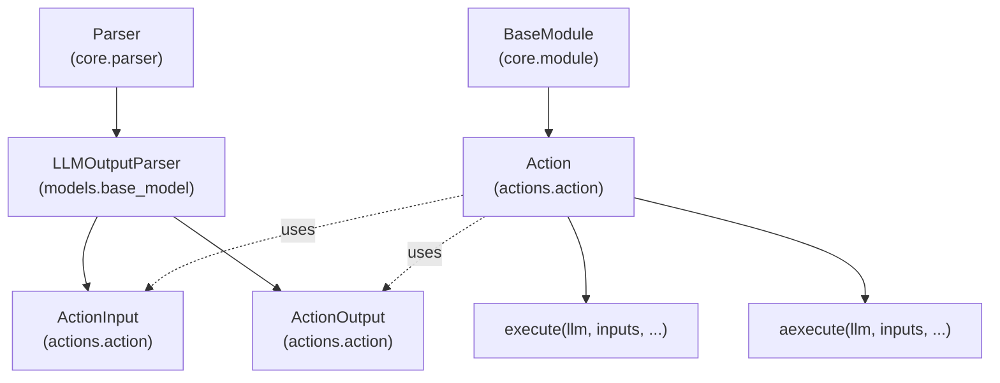
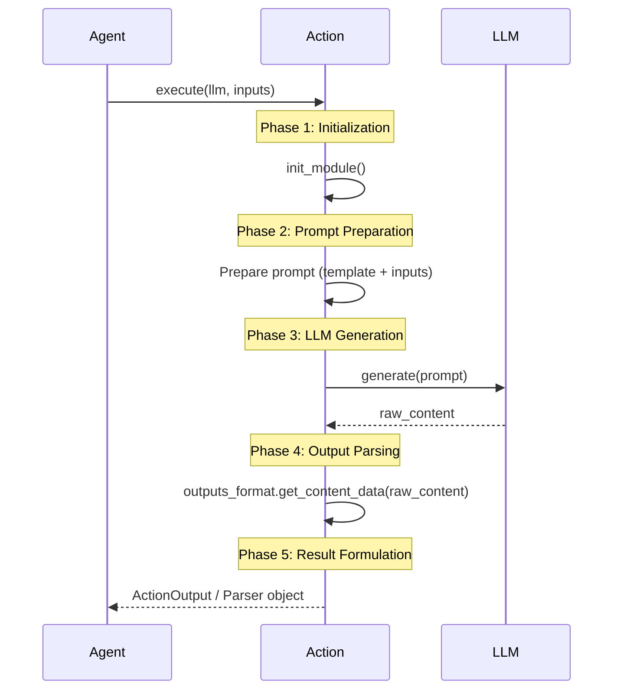
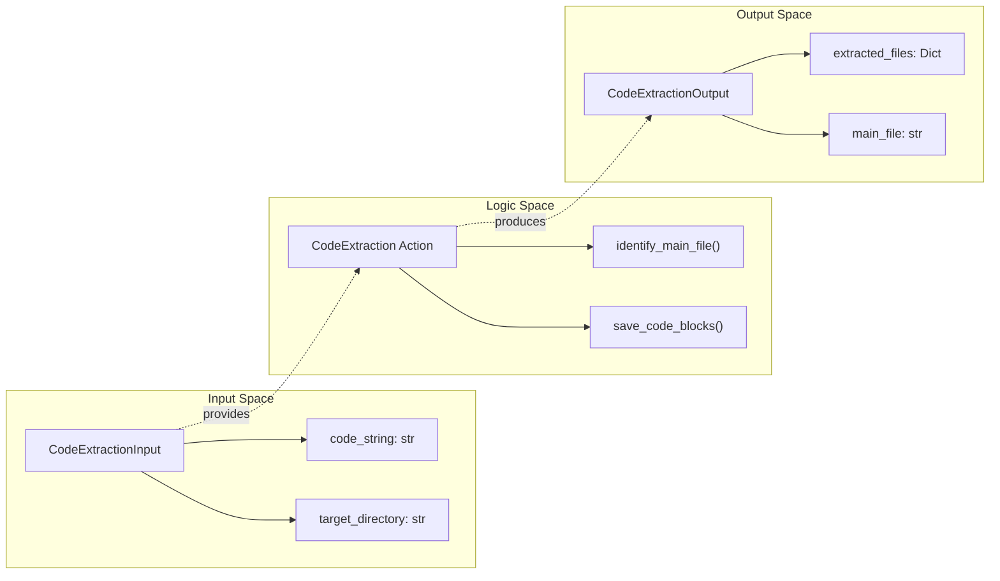

<!-- source: DeepWiki mcp.deepwiki.com · repo EvoAgentX/EvoAgentX · page 5.1 Action Base Classes · fetched 2026-10-26 -->

# Action Base Classes

Relevant source files

The following files were used as context for generating this wiki page:

- [evoagentx/actions/action.py](evoagentx/actions/action.py)
- [evoagentx/actions/code_extraction.py](evoagentx/actions/code_extraction.py)
- [evoagentx/agents/agent.py](evoagentx/agents/agent.py)
- [evoagentx/core/message.py](evoagentx/core/message.py)
- [evoagentx/core/module.py](evoagentx/core/module.py)
- [evoagentx/core/module_utils.py](evoagentx/core/module_utils.py)
- [evoagentx/models/base_model.py](evoagentx/models/base_model.py)

This page documents the base action architecture in EvoAgentX, including the `Action`, `ActionInput`, and `ActionOutput` classes, and the action execution lifecycle. Actions are the fundamental execution units that agents use to perform tasks.

## Overview

Actions in EvoAgentX represent discrete operations that agents can perform. Every action defines its inputs, outputs, and execution logic. They serve as the bridge between high-level agent goals and low-level LLM or tool calls, encapsulating prompt engineering, output parsing, and tool integration into reusable components.

The framework utilizes Pydantic-based models to ensure type safety and structured data flow between agents and their environment.

**Sources:** [evoagentx/actions/action.py:108-122](), [evoagentx/core/module.py:51-61]()

## Action Class Hierarchy

The action system is built on top of the `BaseModule`, providing serialization and registration capabilities.

| Class | Purpose | Location |
|-------|---------|----------|
| `Action` | Abstract base class defining the action interface and execution lifecycle. | [evoagentx/actions/action.py:108-131]() |
| `ActionInput` | Schema definition for action parameters, inheriting from `LLMOutputParser`. | [evoagentx/actions/action.py:18-30]() |
| `ActionOutput` | Schema for structured results produced by an action. | [evoagentx/actions/action.py:91-97]() |

**Sources:** [evoagentx/actions/action.py:18-131](), [evoagentx/models/base_model.py:22-32]()

## Input and Output System

Actions use structured schemas to define their requirements and results. This allows the framework to generate specifications for LLMs and validate data at runtime.

### ActionInput
`ActionInput` inherits from `LLMOutputParser` and is used to specify what parameters an action needs. It can generate a JSON specification of these requirements to be included in LLM prompts.

- **`get_input_specification()`**: Generates a JSON string describing parameter names, types, descriptions, and whether they are required. [evoagentx/actions/action.py:33-70]()
- **`get_required_input_names()`**: Returns a list of parameters that lack default values. [evoagentx/actions/action.py:73-88]()

### ActionOutput
`ActionOutput` defines the structure of the data returned by the action. It provides a `to_str()` method to convert structured data into formatted JSON for logging or message passing. [evoagentx/actions/action.py:99-105]()

**Sources:** [evoagentx/actions/action.py:18-105]()

## Action Execution Lifecycle

The execution lifecycle transforms inputs into structured outputs through LLM interaction and optional tool usage.

### 1. Execution Entry Points
Actions support both synchronous and asynchronous execution:
- **`execute()`**: Standard synchronous execution. [evoagentx/actions/action.py:164-180]()
- **`aexecute()`**: Asynchronous execution using `async/await`. [evoagentx/actions/action.py:182-198]()

### 2. Context Extraction
Before an action is executed, the `Agent` often needs to extract relevant information from memory to satisfy the `ActionInput` requirements. This is handled by the `ContextExtraction` action (a specialized subclass).

- **`Agent.get_action_inputs()`**: Uses a context extractor to pull data from short-term memory based on the action's input specification. [evoagentx/agents/agent.py:125-127]()

### 3. Data Flow and Messages
The result of an action is encapsulated in a `Message` object.
- **`MessageType.INPUT`**: Used when feeding data into an action. [evoagentx/core/message.py:16]()
- **`MessageType.RESPONSE`**: Used for the result of an action execution. [evoagentx/core/message.py:12]()

**Sources:** [evoagentx/actions/action.py:164-198](), [evoagentx/agents/agent.py:82-127](), [evoagentx/core/message.py:9-17]()

## Implementation Example: CodeExtraction

The `CodeExtraction` action demonstrates the use of base classes to create specialized behavior, such as extracting code blocks from text and saving them to disk.

- **`CodeExtractionInput`**: Defines `code_string` and `target_directory` as required fields using Pydantic `Field`. [evoagentx/actions/code_extraction.py:10-16]()
- **`CodeExtractionOutput`**: Defines `extracted_files` and `main_file` as the structured result. [evoagentx/actions/code_extraction.py:19-25]()
- **Internal Heuristics**: The class implements logic like `identify_main_file` to determine entry points (e.g., `main.py` or `index.html`) from the extracted content. [evoagentx/actions/code_extraction.py:71-153]()

**Sources:** [evoagentx/actions/code_extraction.py:10-153]()

## Key Functions and Methods

### LLM Output Parsing
The `LLMOutputParser` (base for `ActionInput` and `ActionOutput`) is critical for the lifecycle. It supports multiple modes:
- **`json`**: Extracts the first valid JSON block from text. [evoagentx/models/base_model.py:104-105]()
- **`xml`**: Parses content wrapped in XML tags. [evoagentx/models/base_model.py:106-107]()
- **`title`**: Parses Markdown-style headers. [evoagentx/models/base_model.py:108-109]()
- **`str`**: Returns the raw string. [evoagentx/models/base_model.py:102-103]()

### Serialization
Since `Action` inherits from `BaseModule`, it supports `to_dict()` and `from_dict()`.
- **`to_dict()`**: Specifically handles the serialization of `inputs_format` and `outputs_format` class names so they can be reconstructed via the `MODULE_REGISTRY`. [evoagentx/actions/action.py:140-150]()
- **`validate_data()`**: A Pydantic validator that resolves class name strings back into class objects during deserialization. [evoagentx/actions/action.py:152-162]()

**Sources:** [evoagentx/models/base_model.py:75-132](), [evoagentx/actions/action.py:140-162]()

---

