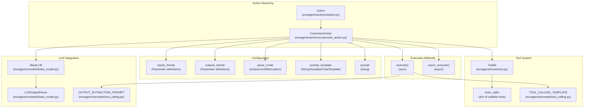
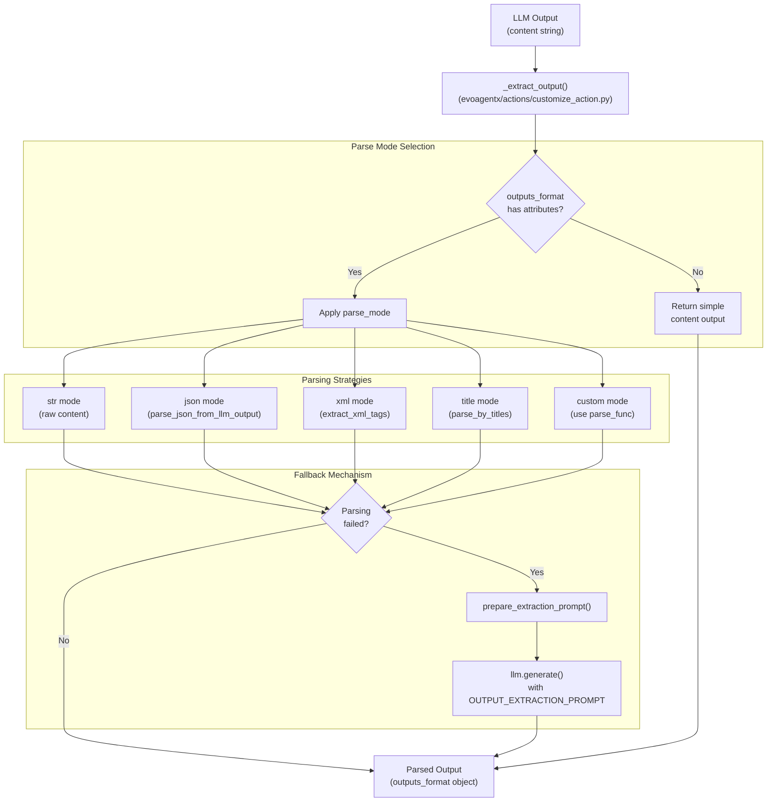

<!-- source: DeepWiki mcp.deepwiki.com · repo EvoAgentX/EvoAgentX · page 5.2 CustomizeAction · fetched 2026-10-26 -->

# CustomizeAction

<details>
<summary>Relevant source files</summary>

The following files were used as context for generating this wiki page:

- [evoagentx/actions/customize_action.py](evoagentx/actions/customize_action.py)
- [evoagentx/prompts/tool_calling.py](evoagentx/prompts/tool_calling.py)
- [evoagentx/tools/browser_tool.py](evoagentx/tools/browser_tool.py)
- [evoagentx/tools/file_tool.py](evoagentx/tools/file_tool.py)
- [examples/customize_agent.py](examples/customize_agent.py)
- [examples/output/jobs/jobs_demo_4o_mini.json](examples/output/jobs/jobs_demo_4o_mini.json)
- [examples/output/jobs/mcp_jobs.config](examples/output/jobs/mcp_jobs.config)
- [examples/output/jobs/test_pdf.pdf](examples/output/jobs/test_pdf.pdf)

</details>


CustomizeAction is a dynamic action class that enables the creation of flexible, configurable actions with tool calling capabilities, multiple output parsing strategies, and LLM-based execution. It is the primary mechanism for implementing agent behaviors in EvoAgentX.

For information about the base Action class and action lifecycle, see [Action Base Classes](5.1). For details on how actions integrate with tools, see [Tool Calling in Actions](5.3).

---

## Purpose and Scope

CustomizeAction provides a declarative interface for defining agent actions without writing custom code. It handles:

- **Prompt Construction**: Building prompts from templates or raw strings with input parameter substitution.
- **Tool Integration**: Automatic tool calling with parallel execution support.
- **Output Parsing**: Multiple parsing strategies (JSON, XML, title-based, custom) for structured data extraction.
- **LLM Communication**: Synchronous and asynchronous LLM invocation with conversation management.
- **Error Handling**: Fallback extraction when parsing fails, and retry logic for tool calls.

This document covers the implementation, configuration, and usage patterns of CustomizeAction.

---

## Architecture Overview

CustomizeAction extends the base `Action` class and orchestrates several subsystems to execute dynamic agent behaviors. The following diagram shows how CustomizeAction fits into the broader action system:

### Action System Component Diagram


**Sources**: [evoagentx/actions/customize_action.py:20-31](), [evoagentx/actions/customize_action.py:322-559](), [evoagentx/prompts/tool_calling.py:1-121]()

---

## Core Components

### Class Definition

The `CustomizeAction` class is defined with the following key attributes:

| Attribute | Type | Default | Description |
|-----------|------|---------|-------------|
| `parse_mode` | `Optional[str]` | `"title"` | Parsing strategy: `'title'`, `'str'`, `'json'`, `'xml'`, `'custom'` [evoagentx/actions/customize_action.py:22]() |
| `parse_func` | `Optional[Callable]` | `None` | Custom parsing function for `parse_mode='custom'` [evoagentx/actions/customize_action.py:23]() |
| `title_format` | `Optional[str]` | `"## {title}"` | Title format for `parse_mode='title'` [evoagentx/actions/customize_action.py:24]() |
| `custom_output_format` | `Optional[str]` | `None` | Custom output format instructions [evoagentx/actions/customize_action.py:25]() |
| `tools` | `Optional[List[Toolkit]]` | `None` | List of toolkits available to the action [evoagentx/actions/customize_action.py:27]() |
| `conversation` | `Optional[Message]` | `None` | Current conversation state [evoagentx/actions/customize_action.py:28]() |
| `max_tool_try` | `int` | `2` | Maximum tool calling iterations [evoagentx/actions/customize_action.py:30]() |

### Initialization Requirements

CustomizeAction requires either a `prompt` or `prompt_template` parameter. If both are provided, `prompt_template` takes precedence [evoagentx/actions/customize_action.py:40-44]().

```python
# Example Initialization
action = CustomizeAction(
    name="MyAction",
    prompt="Answer the question: {question}",
    inputs=[{"name": "question", "type": "string", "description": "The question"}]
)
```

**Sources**: [evoagentx/actions/customize_action.py:32-47](), [examples/customize_agent.py:23-169]()

---

## Prompt Preparation

The prompt preparation system transforms input parameters into formatted prompts for LLM consumption.

### Method: `prepare_action_prompt()`

This method handles parameter substitution and tool schema injection:

1. **Parameter Processing**: Converts input values to strings or JSON representations [evoagentx/actions/customize_action.py:72-84]().
2. **Prompt Mode Selection**: 
   - If `self.prompt` exists: Formats the string with parameters [evoagentx/actions/customize_action.py:86-91]().
   - If `self.prompt_template` exists: Uses the template's `format()` method [evoagentx/actions/customize_action.py:92-105]().
3. **Tool Schema Injection**: Appends tool descriptions using `TOOL_CALLING_TEMPLATE` if tools are present [evoagentx/actions/customize_action.py:88-90]().

**Sources**: [evoagentx/actions/customize_action.py:49-105](), [evoagentx/prompts/tool_calling.py:50-113]()

---

## Output Parsing Modes

CustomizeAction supports five parsing strategies for extracting structured data from LLM outputs.

### Parsing Flow Diagram


### Fallback Extraction
When standard parsing fails, `CustomizeAction` uses an LLM-based extraction fallback via `prepare_extraction_prompt()` [evoagentx/actions/customize_action.py:107-122](). This utilizes the `OUTPUT_EXTRACTION_PROMPT` to request a valid JSON object matching the `outputs_format` [evoagentx/prompts/tool_calling.py:1-26]().

**Sources**: [evoagentx/actions/customize_action.py:251-339](), [evoagentx/prompts/tool_calling.py:1-26]()

---

## Tool Integration

CustomizeAction supports dynamic tool calling with automatic parallel execution.

### Tool Management Architecture
1. **Registration**: `add_tools()` validates and registers `Toolkit` instances [evoagentx/actions/customize_action.py:140-199]().
2. **Extraction**: `_extract_tool_calls()` uses regex to find `<ToolCalling>` blocks and `parse_json_from_text()` to extract arguments [evoagentx/actions/customize_action.py:201-249]().
3. **Execution**: 
   - `_calling_tools()` uses `ThreadPoolExecutor` for parallel sync execution [evoagentx/actions/customize_action.py:362-377]().
   - `_async_calling_tools()` uses `asyncio.gather()` for async execution [evoagentx/actions/customize_action.py:406-414]().

### Tool Calling Format
The system expects the LLM to output tool calls within `<ToolCalling>` tags as a JSON array [evoagentx/prompts/tool_calling.py:69-80]().

**Sources**: [evoagentx/actions/customize_action.py:140-249](), [evoagentx/actions/customize_action.py:341-414](), [evoagentx/prompts/tool_calling.py:50-113]()

---

## Execution Flow

The `execute()` and `async_execute()` methods orchestrate the iterative tool calling loop.

### Iterative Loop Logic
1. **Generate**: LLM generates a response based on the conversation history [evoagentx/actions/customize_action.py:453-455]().
2. **Extract**: The system checks for tool calls in the response [evoagentx/actions/customize_action.py:461-462]().
3. **Execute**: If calls are found, tools are executed and results are appended to the history using `TOOL_CALLING_HISTORY_PROMPT` [evoagentx/actions/customize_action.py:466-477]().
4. **Repeat**: The loop continues until no tool calls are found or `max_tool_try` is reached [evoagentx/actions/customize_action.py:444-451]().

**Sources**: [evoagentx/actions/customize_action.py:416-559](), [evoagentx/prompts/tool_calling.py:29-36]()

---

## Implementation Details

### Key Files
- `evoagentx/actions/customize_action.py`: Main implementation of the dynamic action [evoagentx/actions/customize_action.py:1-559]().
- `evoagentx/prompts/tool_calling.py`: Contains prompt templates for tool invocation and fallback extraction [evoagentx/prompts/tool_calling.py:1-121]().
- `examples/customize_agent.py`: Demonstrates usage patterns including custom parsing and tool integration [examples/customize_agent.py:1-524]().

### Dependencies
CustomizeAction relies on `BaseLLM` for model interaction [evoagentx/models/base_model.py:1-20](), `Toolkit` for tool management [evoagentx/tools/tool.py:1-10](), and `MODULE_REGISTRY` for component serialization [evoagentx/core/registry.py:1-20]().

**Sources**: [evoagentx/actions/customize_action.py:1-18]()

---

