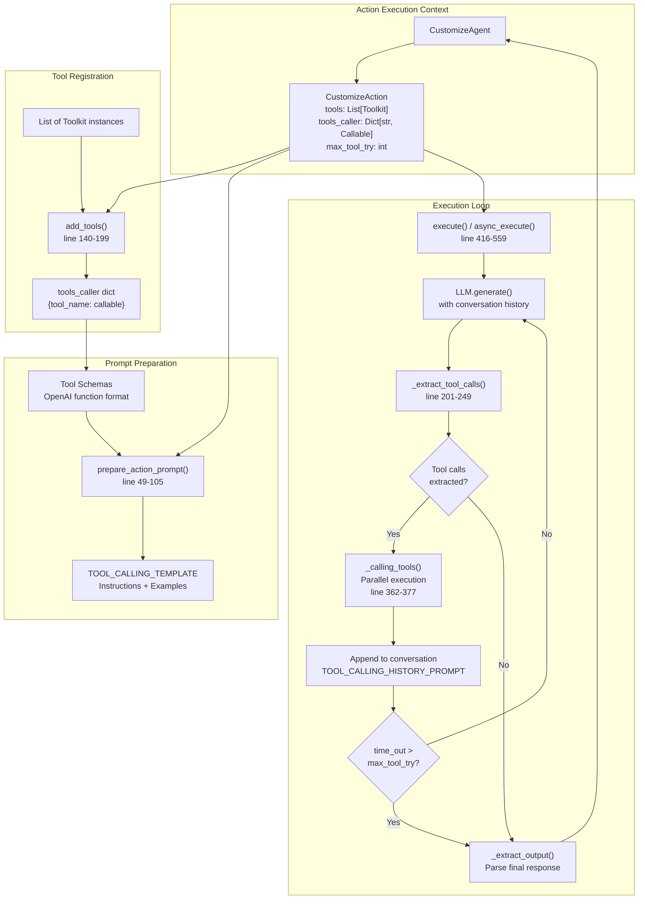
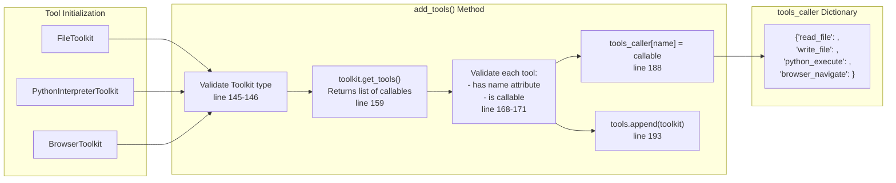
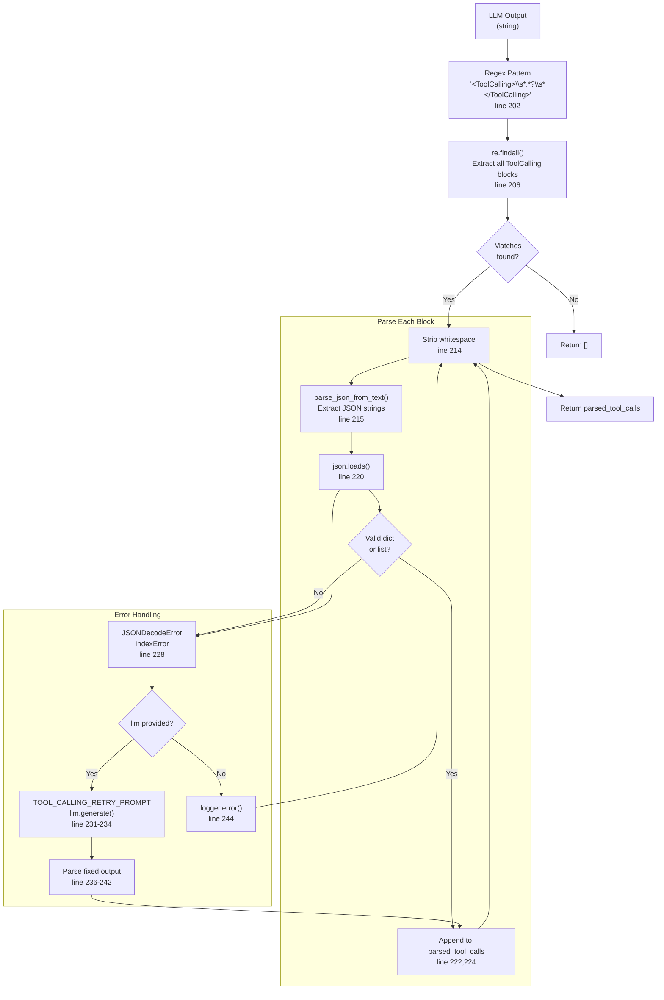
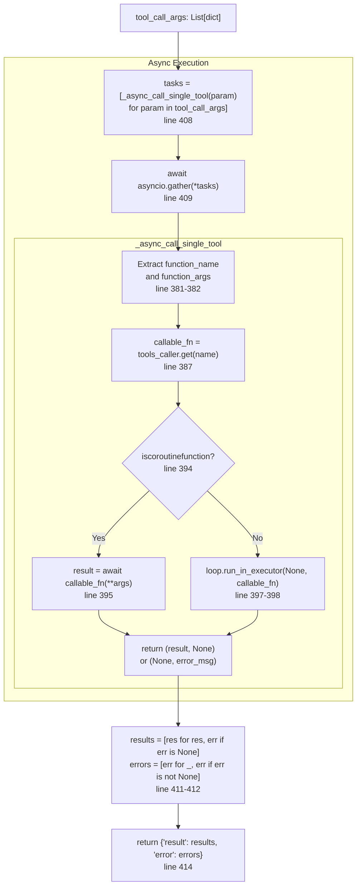
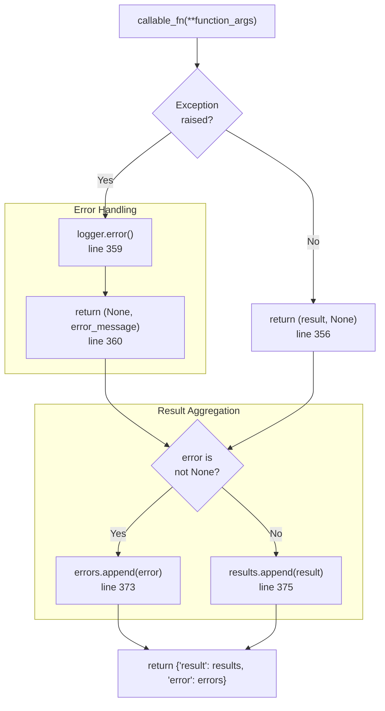

<!-- source: DeepWiki mcp.deepwiki.com · repo EvoAgentX/EvoAgentX · page 5.3 Tool Calling in Actions · fetched 2026-10-26 -->

# Tool Calling in Actions

<details>
<summary>Relevant source files</summary>

The following files were used as context for generating this wiki page:

- [docs/tutorial/mcp.md](docs/tutorial/mcp.md)
- [docs/tutorial/tools.md](docs/tutorial/tools.md)
- [docs/zh/tutorial/tools.md](docs/zh/tutorial/tools.md)
- [evoagentx/actions/customize_action.py](evoagentx/actions/customize_action.py)
- [evoagentx/prompts/tool_calling.py](evoagentx/prompts/tool_calling.py)
- [evoagentx/tools/__init__.py](evoagentx/tools/__init__.py)
- [evoagentx/tools/browser_tool.py](evoagentx/tools/browser_tool.py)
- [evoagentx/tools/file_tool.py](evoagentx/tools/file_tool.py)
- [evoagentx/tools/mcp.py](evoagentx/tools/mcp.py)
- [examples/customize_agent.py](examples/customize_agent.py)
- [examples/mcp_agent.py](examples/mcp_agent.py)
- [examples/output/jobs/jobs_demo_4o_mini.json](examples/output/jobs/jobs_demo_4o_mini.json)
- [examples/output/jobs/mcp_jobs.config](examples/output/jobs/mcp_jobs.config)
- [examples/output/jobs/test_pdf.pdf](examples/output/jobs/test_pdf.pdf)
- [examples/sequential_workflow.py](examples/sequential_workflow.py)

</details>


## Purpose and Scope

This page documents how actions integrate with tools through the tool calling mechanism in `CustomizeAction`. It covers tool registration, the iterative tool calling loop, parallel tool execution, and result handling. For information about creating custom tools, see section [7.1](). For the base `CustomizeAction` class and its configuration, see [5.2]().

---

## Tool Calling Architecture

Tool calling in actions follows an iterative LLM-in-the-loop pattern where the language model can make multiple tool calls to accomplish complex tasks. The system automatically manages tool execution, result aggregation, and conversation history.

### Action to Code Entity Mapping
The following diagram illustrates how natural language action concepts map to specific classes and functions in the EvoAgentX codebase.

| Natural Language Concept | Code Entity | File Path |
| :--- | :--- | :--- |
| Action Logic | `CustomizeAction` | [evoagentx/actions/customize_action.py:20]() |
| Tool Set | `Toolkit` | [evoagentx/tools/tool.py:1]() |
| Call Registry | `tools_caller` | [evoagentx/actions/customize_action.py:46]() |
| Parallel Runner | `ThreadPoolExecutor` | [evoagentx/actions/customize_action.py:367]() |

### Tool Execution Flow
This diagram shows the execution lifecycle from prompt preparation to iterative tool resolution.



**Sources**: [evoagentx/actions/customize_action.py:1-559]()

---

## Tool Registration and Management

### Adding Tools to Actions

Tools are added to actions through the `tools` parameter at initialization or dynamically via `add_tools()`. Each `Toolkit` contains one or more callable tools that are registered in the `tools_caller` dictionary [evoagentx/actions/customize_action.py:140-199]().



### Tool Registration Logic

The `add_tools()` method performs validation and deduplication to ensure the action has a clean registry of available functions.

| Validation Step | Purpose | Lines |
|----------------|---------|-------|
| Type check | Ensure `tools` is `Toolkit` or list of `Toolkit` | [evoagentx/actions/customize_action.py:143-146]() |
| Get tool callables | Extract callable functions from toolkit | [evoagentx/actions/customize_action.py:159]() |
| Validate callables | Check each tool has `name` attribute and is callable | [evoagentx/actions/customize_action.py:168-171]() |
| Duplicate detection | Warn and overwrite if tool name already exists | [evoagentx/actions/customize_action.py:172-173]() |
| Skip empty toolkits | Ignore toolkits with no valid tools | [evoagentx/actions/customize_action.py:179-181]() |
| Skip duplicate toolkits | Ignore if all tools from toolkit already added | [evoagentx/actions/customize_action.py:183-185]() |

**Sources**: [evoagentx/actions/customize_action.py:140-199]()

---

## Tool Call Format and Extraction

### LLM Tool Call Format

The LLM is instructed to output tool calls in a specific XML-wrapped JSON format. This format is defined in `TOOL_CALLING_TEMPLATE` [evoagentx/prompts/tool_calling.py:50-113]() and parsed by `_extract_tool_calls()`.

**Expected Format**:
```xml
<ToolCalling>
[
    {
        "function_name": "tool_name",
        "function_args": {
            "param1": "value1",
            "param2": "value2"
        }
    }
]
</ToolCalling>
```

### Tool Call Extraction Process

The extraction process uses regular expressions to isolate the `<ToolCalling>` block and then parses the internal JSON.



**Sources**: [evoagentx/actions/customize_action.py:201-249]()

---

## Parallel Tool Execution

### Synchronous Execution

The `_calling_tools()` method executes multiple tools in parallel using `ThreadPoolExecutor`. Each tool call is executed by `_call_single_tool()` in a separate thread [evoagentx/actions/customize_action.py:341-377]().

| Component | Behavior | Lines |
|-----------|----------|-------|
| `ThreadPoolExecutor` | Creates thread pool for parallel execution | [evoagentx/actions/customize_action.py:367]() |
| `executor.submit()` | Submits each tool call as separate task | [evoagentx/actions/customize_action.py:368]() |
| `as_completed()` | Waits for all tasks to complete | [evoagentx/actions/customize_action.py:370]() |
| Error handling | Catches exceptions per tool, continues execution | [evoagentx/actions/customize_action.py:358-360]() |
| Result aggregation | Separates successful results from errors | [evoagentx/actions/customize_action.py:371-375]() |

### Asynchronous Execution

For async execution, `_async_calling_tools()` uses `asyncio.gather()` to execute tools concurrently. It supports both async and sync tool functions by wrapping sync calls in `run_in_executor` [evoagentx/actions/customize_action.py:379-414]().



**Sources**: [evoagentx/actions/customize_action.py:341-414]()

---

## Iterative Tool Calling Loop

The `execute()` and `async_execute()` methods implement an iterative loop where the LLM can make multiple tool calls until either no more calls are needed or the `max_tool_try` limit is reached [evoagentx/actions/customize_action.py:416-485]().

### Conversation History Management

Each tool calling iteration appends structured information to the conversation history using `TOOL_CALLING_HISTORY_PROMPT` [evoagentx/prompts/tool_calling.py:29-36]():

```python
# From evoagentx/prompts/tool_calling.py:29-36
TOOL_CALLING_HISTORY_PROMPT = """
Iteration {iteration_number}:
Executed tool calls:
{tool_call_args}
Results:
{results}

"""
```

This format allows the LLM to track which tools were called and use their results for subsequent reasoning steps [evoagentx/actions/customize_action.py:473-477]().

---

## Tool Calling Configuration

### Action Parameters

The tool calling behavior is configured through `CustomizeAction` parameters:

| Parameter | Type | Default | Purpose | Lines |
|-----------|------|---------|---------|-------|
| `tools` | `List[Toolkit]` | `None` | List of toolkits available to action | [evoagentx/actions/customize_action.py:27]() |
| `max_tool_try` | `int` | `2` | Maximum iterations before forcing output | [evoagentx/actions/customize_action.py:30]() |
| `prompt` | `str` | `None` | Simple prompt with tool schemas appended | [evoagentx/actions/customize_action.py:86-91]() |
| `prompt_template` | `Template` | `None` | Structured template with tool integration | [evoagentx/actions/customize_action.py:93-105]() |

### Tool Schema Integration

When tools are provided, the action automatically includes tool schemas in the prompt. If a `prompt_template` is used, the schemas are injected via `self.prompt_template.set_tools(self.tools)` [evoagentx/actions/customize_action.py:95]().

**Sources**: [evoagentx/actions/customize_action.py:20-105]()

---

## Error Handling and Recovery

### Tool Execution Recovery

The system employs several strategies to handle tool failures:

1.  **Per-Tool Isolation**: Errors in one tool do not block others in a parallel batch [evoagentx/actions/customize_action.py:371-375]().
2.  **LLM Feedback**: Errors are caught and formatted into the conversation history so the LLM can see the error message and attempt to fix its parameters [evoagentx/actions/customize_action.py:473-477]().
3.  **Parse Retries**: If the LLM generates an invalid tool call JSON, the system can use a specific `TOOL_CALLING_RETRY_PROMPT` to ask the LLM to fix the formatting [evoagentx/actions/customize_action.py:230-244]().



**Sources**: [evoagentx/actions/customize_action.py:230-477](), [evoagentx/prompts/tool_calling.py:115-121]()

---

