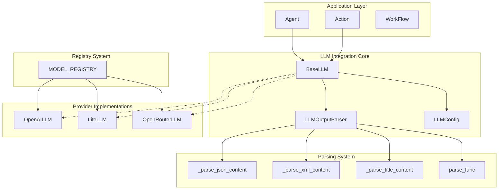
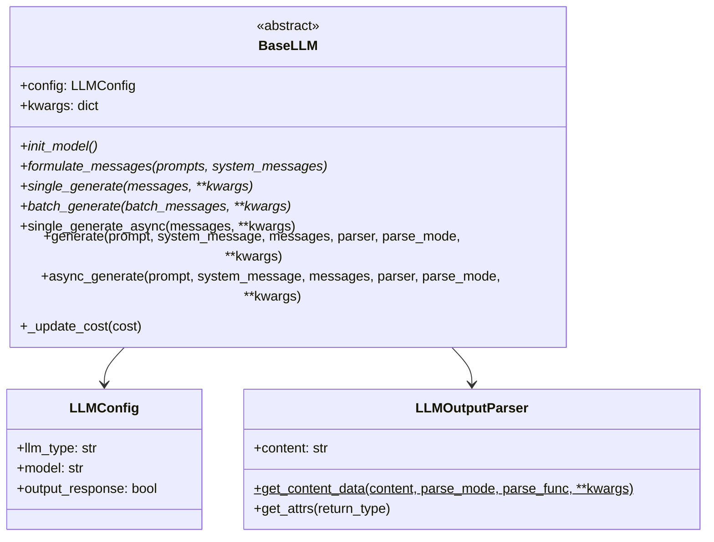
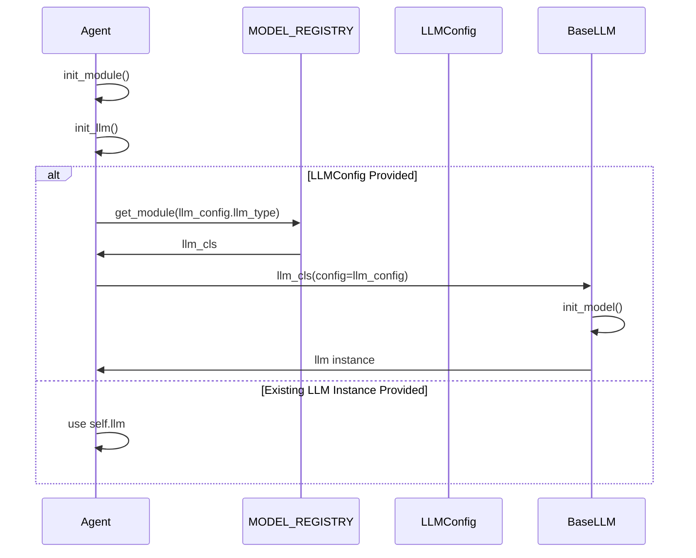
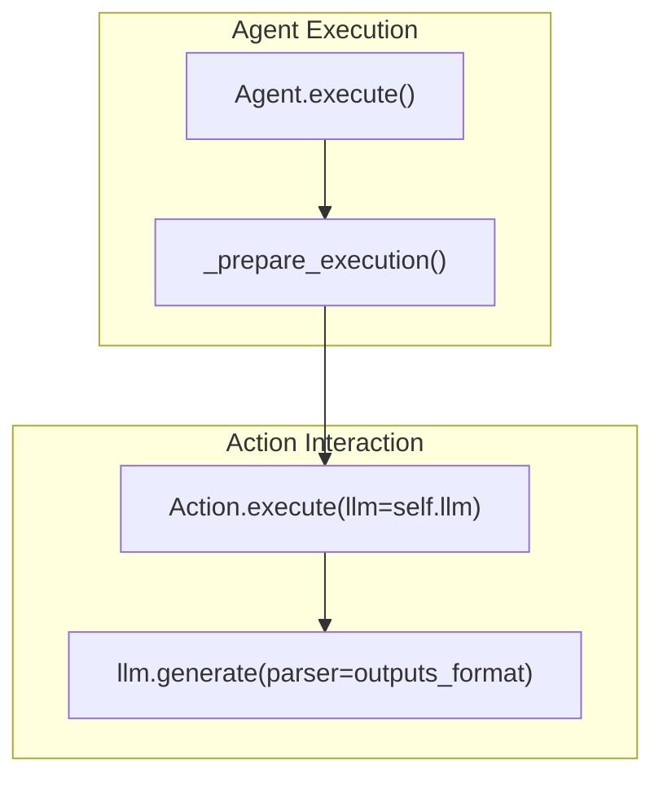
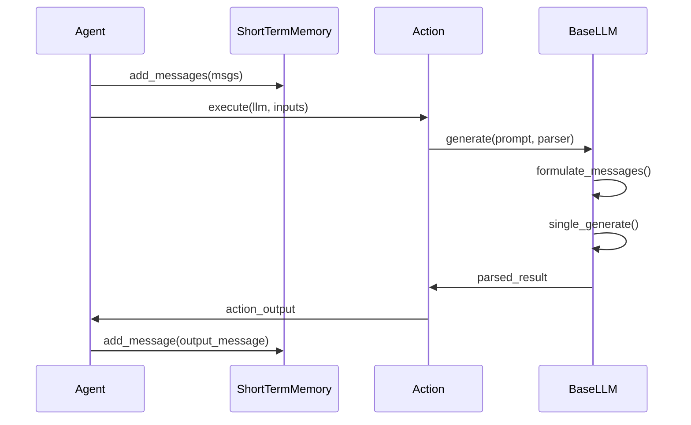

<!-- source: DeepWiki mcp.deepwiki.com · repo EvoAgentX/EvoAgentX · page 6 Language Model Integration · fetched 2026-10-26 -->

# Language Model Integration

<details>
<summary>Relevant source files</summary>

The following files were used as context for generating this wiki page:

- [evoagentx/actions/action.py](evoagentx/actions/action.py)
- [evoagentx/agents/agent.py](evoagentx/agents/agent.py)
- [evoagentx/core/base_config.py](evoagentx/core/base_config.py)
- [evoagentx/core/message.py](evoagentx/core/message.py)
- [evoagentx/core/module.py](evoagentx/core/module.py)
- [evoagentx/core/module_utils.py](evoagentx/core/module_utils.py)
- [evoagentx/models/__init__.py](evoagentx/models/__init__.py)
- [evoagentx/models/base_model.py](evoagentx/models/base_model.py)
- [evoagentx/models/litellm_model.py](evoagentx/models/litellm_model.py)
- [evoagentx/models/model_configs.py](evoagentx/models/model_configs.py)
- [evoagentx/models/model_utils.py](evoagentx/models/model_utils.py)
- [evoagentx/models/openai_model.py](evoagentx/models/openai_model.py)
- [evoagentx/models/openrouter_model.py](evoagentx/models/openrouter_model.py)

</details>


The Language Model Integration system provides a comprehensive framework for integrating, configuring, and managing Large Language Models (LLMs) throughout the EvoAgentX ecosystem. This system defines the core abstractions for LLM interactions, handles structured output parsing, and manages the lifecycle of LLM instances within agents and actions.

For information about specific LLM provider implementations, see [Provider Integration](#6.3). For details on configuring LLM parameters, see [Model Configuration](#6.2). For advanced output parsing strategies, see [Output Parsing](#6.4).

## Architecture Overview

The LLM integration system follows a layered architecture that separates abstract interfaces from concrete implementations, enabling support for multiple LLM providers while maintaining consistent interaction patterns.

**LLM Integration Architecture**



Sources: [evoagentx/models/base_model.py:338-614](), [evoagentx/agents/agent.py:20-53](), [evoagentx/actions/action.py:108-130](), [evoagentx/core/registry.py:1-25]()

## Core LLM Classes

### BaseLLM Abstract Interface

The `BaseLLM` class defines the standard interface that all LLM implementations must follow, providing both synchronous and asynchronous generation methods. It manages model-specific logic like message formulation and cost tracking.

**BaseLLM Interface Structure**



| Method | Purpose | Required Implementation |
|--------|---------|------------------------|
| `init_model()` | Initialize the underlying LLM client | Yes (abstract) [evoagentx/models/base_model.py:365-367]() |
| `formulate_messages()` | Convert prompts to provider-specific chat format | Yes (abstract) [evoagentx/models/base_model.py:369-371]() |
| `single_generate()` | Generate a single completion synchronously | Yes (abstract) [evoagentx/models/base_model.py:373-375]() |
| `batch_generate()` | Generate multiple completions in parallel/sequence | Yes (abstract) [evoagentx/models/base_model.py:377-379]() |
| `generate()` | High-level method combining generation and parsing | No (implemented) [evoagentx/models/base_model.py:417-458]() |

Sources: [evoagentx/models/base_model.py:338-612](), [evoagentx/models/model_configs.py:11-17]()

### LLM Lifecycle Management

The LLM lifecycle is managed through the `Agent` initialization process. If an `llm_config` is provided, the agent uses the `MODEL_REGISTRY` to instantiate the appropriate model class.

**LLM Initialization Flow**



Sources: [evoagentx/agents/agent.py:54-56](), [evoagentx/agents/agent.py:283-296](), [evoagentx/core/registry.py:1-25]()

## Output Parsing System

The `LLMOutputParser` (inheriting from `Parser`) provides flexible parsing of LLM outputs into structured data using multiple strategies.

### Parse Modes

| Parse Mode | Implementation | Description |
|------------|----------------|-------------|
| `json` | `_parse_json_content` | Extracts JSON blocks using regex and `yaml.safe_load`. |
| `xml` | `_parse_xml_content` | Parses content using `<tag>` markers. |
| `str` | `_parse_str_content` | Assigns the raw text content to all attributes. |
| `title` | `_parse_title_content` | Parses content with Markdown-style headings. |
| `custom` | `parse_func` | Uses a user-provided parsing function. |

Sources: [evoagentx/models/base_model.py:20-132](), [evoagentx/core/module_utils.py:204-219]()

### Parsing Implementation Details

The parsing system handles various edge cases, such as extracting JSON from conversational text or converting XML strings to typed data.

```python
# JSON parsing with extraction from text [evoagentx/models/base_model.py:150-176]
def _parse_json_content(cls, content: str, **kwargs) -> dict:
    extracted_json_list = parse_json_from_text(content)
    if len(extracted_json_list) > 0:
        json_str = extracted_json_list[0]
        data = yaml.safe_load(json_str)
        # ... validation logic ...
```

Sources: [evoagentx/models/base_model.py:147-217](), [evoagentx/core/module_utils.py:204-225]()

## Integration with Agents and Actions

### Agent-LLM Integration

Agents integrate LLMs through the `init_llm` method. During execution, the agent passes its `llm` instance to the `Action` being performed.

**Agent LLM Execution Pattern**



Sources: [evoagentx/agents/agent.py:231-251](), [evoagentx/actions/action.py:164-182]()

### Action Input/Output Specifications

Actions use `ActionInput` and `ActionOutput` (subclasses of `LLMOutputParser`) to define their interface for the LLM.

*   **ActionInput**: Generates a JSON specification of required parameters using `get_input_specification()` to guide the LLM. [evoagentx/actions/action.py:18-30]()
*   **ActionOutput**: Defines the structured schema the LLM must return. [evoagentx/actions/action.py:91-97]()

Sources: [evoagentx/actions/action.py:18-106]()

## Message Flow and Context Handling

The LLM integration system manages conversational context through the `Message` system, enabling context-aware generation.

**Message Flow in LLM Operations**



Sources: [evoagentx/agents/agent.py:108-127](), [evoagentx/models/base_model.py:417-458](), [evoagentx/core/message.py:19-49]()

## Cost Tracking

The system tracks token usage and financial costs through a `CostManager`. Every `BaseLLM` implementation calls `_update_cost()` after a successful generation to log input/output tokens and estimated costs based on the model's pricing.

For details, see [Cost Tracking](#6.5).

Sources: [evoagentx/models/base_model.py:405-415](), [evoagentx/models/openai_model.py:132-133]()

---

