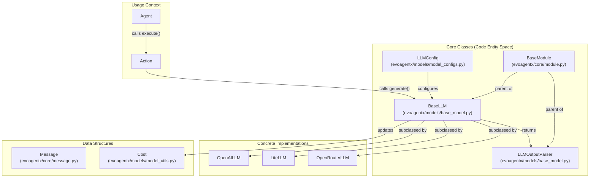
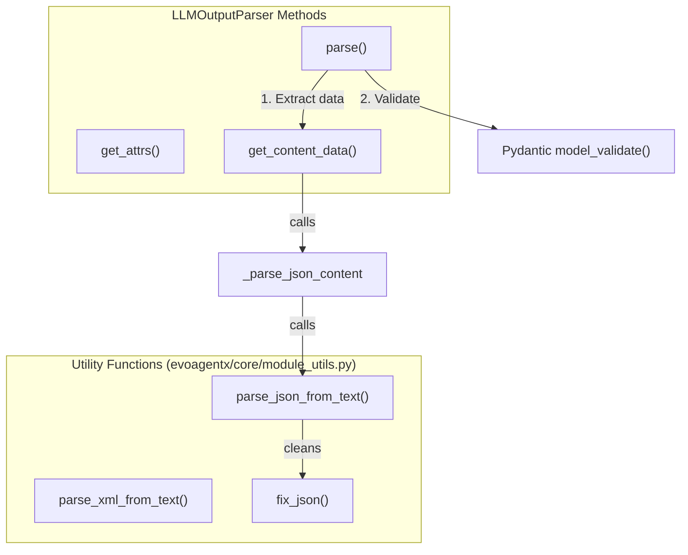
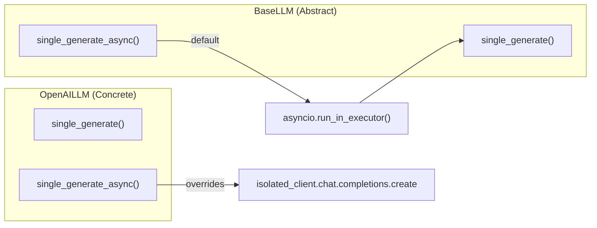

<!-- source: DeepWiki mcp.deepwiki.com · repo EvoAgentX/EvoAgentX · page 6.1 BaseLLM and Implementations · fetched 2026-10-26 -->

# BaseLLM and Implementations

<details>
<summary>Relevant source files</summary>

The following files were used as context for generating this wiki page:

- [evoagentx/actions/action.py](evoagentx/actions/action.py)
- [evoagentx/agents/agent.py](evoagentx/agents/agent.py)
- [evoagentx/core/base_config.py](evoagentx/core/base_config.py)
- [evoagentx/core/message.py](evoagentx/core/message.py)
- [evoagentx/core/module.py](evoagentx/core/module.py)
- [evoagentx/core/module_utils.py](evoagentx/core/module_utils.py)
- [evoagentx/models/__init__.py](evoagentx/models/__init__.py)
- [evoagentx/models/base_model.py](evoagentx/models/base_model.py)
- [evoagentx/models/litellm_model.py](evoagentx/models/litellm_model.py)
- [evoagentx/models/model_configs.py](evoagentx/models/model_configs.py)
- [evoagentx/models/model_utils.py](evoagentx/models/model_utils.py)
- [evoagentx/models/openai_model.py](evoagentx/models/openai_model.py)
- [evoagentx/models/openrouter_model.py](evoagentx/models/openrouter_model.py)

</details>


## Purpose and Scope

This document describes the abstract base class `BaseLLM` and the `LLMOutputParser` system that form the foundation of EvoAgentX's language model integration layer. The `BaseLLM` class defines the interface that all LLM provider implementations must follow, providing methods for text generation, message formatting, and output parsing. The `LLMOutputParser` handles structured data extraction from LLM-generated text.

For information about configuring specific LLM providers, see [Model Configuration](#6.2). For details on integrating different providers (OpenAI, LiteLLM, etc.), see [Provider Integration](#6.3). For cost tracking functionality, see [Cost Tracking](#6.5).

**Sources:** [evoagentx/models/base_model.py:1-21](), [evoagentx/models/base_model.py:431-440]()

---

## Core Components Overview

The LLM integration layer consists of two primary components that work together to provide a unified interface for language model interactions. Both `BaseLLM` and `LLMOutputParser` inherit from `BaseModule`, providing consistent serialization and registry-based instantiation [evoagentx/core/module.py:51-63]().

### Component Relationships



**Sources:** [evoagentx/models/base_model.py:22-32](), [evoagentx/models/base_model.py:431-440](), [evoagentx/agents/agent.py:20-52](), [evoagentx/actions/action.py:108-130]()

---

## LLMOutputParser

The `LLMOutputParser` class provides a flexible system for extracting structured data from LLM-generated text. It stores the raw generated text in the `.content` attribute [evoagentx/models/base_model.py:32-32]().

### Parsing Modes

The parser supports five distinct parsing modes [evoagentx/models/base_model.py:20-20]():

| Mode | Description | Implementation |
|------|-------------|----------------|
| `json` | Extracts and parses JSON objects | `_parse_json_content` [evoagentx/models/base_model.py:150-184]() |
| `xml` | Extracts values enclosed in XML tags | `_parse_xml_content` [evoagentx/models/base_model.py:186-215]() |
| `title` | Parses sections divided by Markdown headings | `_parse_title_content` [evoagentx/models/base_model.py:217-236]() |
| `str` | Assigns raw text to all attributes | `_parse_str_content` [evoagentx/models/base_model.py:135-148]() |
| `custom` | Uses a user-provided parsing function | `get_content_data` logic [evoagentx/models/base_model.py:110-128]() |

### Parser Architecture



**Sources:** [evoagentx/models/base_model.py:75-132](), [evoagentx/core/module_utils.py:197-201](), [evoagentx/core/module_utils.py:204-206]()

### Defining Custom Output Schemas

To create a custom parser, subclass `LLMOutputParser` and define Pydantic fields. The framework uses `get_attrs()` to identify fields to populate, excluding `class_name` and `content` [evoagentx/models/base_model.py:35-57]().

```python
class MyParser(LLMOutputParser):
    reasoning: str = Field(description="The reasoning process")
    answer: int = Field(description="The numerical answer")
```

**Sources:** [evoagentx/models/base_model.py:32-73]()

---

## BaseLLM Interface

The `BaseLLM` abstract base class defines the contract for LLM implementations. It handles cost tracking via `_update_cost` and integrates with `cost_manager` [evoagentx/models/base_model.py:477-486]().

### Abstract Methods

All implementations must provide the following:

| Method | Role |
|--------|------|
| `init_model()` | Initialize the provider client [evoagentx/models/base_model.py:488-490]() |
| `formulate_messages()` | Convert prompts to message dictionaries [evoagentx/models/base_model.py:492-501]() |
| `single_generate()` | Generate output for one message set [evoagentx/models/base_model.py:503-508]() |
| `batch_generate()` | Generate outputs for multiple message sets [evoagentx/models/base_model.py:510-514]() |

### Async Generation Support

`BaseLLM` provides default async wrappers using `run_in_executor` [evoagentx/models/base_model.py:516-531](). Concrete implementations like `OpenAILLM` often override these for native async support [evoagentx/models/openai_model.py:142-179]().



**Sources:** [evoagentx/models/base_model.py:516-549](), [evoagentx/models/openai_model.py:142-162]()

---

## Generation Methods

The `generate()` method is the primary high-level entry point. It orchestrates message preparation, model execution, and output parsing [evoagentx/models/base_model.py:685-725]().

### Preparation and Multimodal Handling

The framework automatically detects multimodal content (images/text) using `_is_multimodal_content` [evoagentx/models/base_model.py:339-352](). If detected, `_process_messages_for_multimodal` converts chunks into the appropriate model-specific dictionary format (e.g., `image_url` for OpenAI) [evoagentx/models/base_model.py:644-683]().

### Image Processing Pipeline

When `ImageChunk` objects are provided, `BaseLLM` converts them to Base64 data URLs:

1. **Load**: Retrieves the PIL image via `image_chunk.get_image()` [evoagentx/models/base_model.py:406-406]().
2. **Encode**: Converts image to Base64 string [evoagentx/models/base_model.py:417-418]().
3. **Format**: Constructs a data URL (e.g., `data:image/png;base64,...`) [evoagentx/models/base_model.py:421-421]().

**Sources:** [evoagentx/models/base_model.py:402-428](), [evoagentx/models/base_model.py:644-683]()

---

## Implementations

### OpenAILLM
Uses the official `openai` Python client. It handles both standard completions and streaming responses [evoagentx/models/openai_model.py:67-116](). It also implements token-based cost calculation via `_completion_cost` and `_stream_cost` [evoagentx/models/openai_model.py:181-193]().

### LiteLLM
Inherits from `OpenAILLM` but adds multi-provider support by setting environment variables for different companies (Anthropic, DeepSeek, Gemini, etc.) based on the model name [evoagentx/models/litellm_model.py:16-83](). It supports local models via `api_base` [evoagentx/models/litellm_model.py:33-38]().

### OpenRouterLLM
Specialized implementation for the OpenRouter aggregator, initializing the `OpenAI` client with a custom `base_url` [evoagentx/models/openrouter_model.py:26-31]().

**Sources:** [evoagentx/models/openai_model.py:18-34](), [evoagentx/models/litellm_model.py:15-16](), [evoagentx/models/openrouter_model.py:18-31]()

---

## Usage Patterns

### Structured Generation
To generate structured output, pass a `parser` class and `parse_mode` to `generate()`:

```python
# Assuming AnalysisParser is defined as an LLMOutputParser
result = llm.generate(
    prompt="Analyze the text...",
    parser=AnalysisParser,
    parse_mode="json"
)
# result is an instance of AnalysisParser
```

**Sources:** [evoagentx/models/base_model.py:685-715]()

### Batch Generation
Providing a list of prompts triggers batch generation, returning a list of parser instances [evoagentx/models/base_model.py:722-725]().

```python
prompts = ["Tell a joke", "Write a poem"]
results = llm.generate(prompt=prompts, parse_mode="str")
# results is List[LLMOutputParser]
```

**Sources:** [evoagentx/models/base_model.py:582-642]()

---

