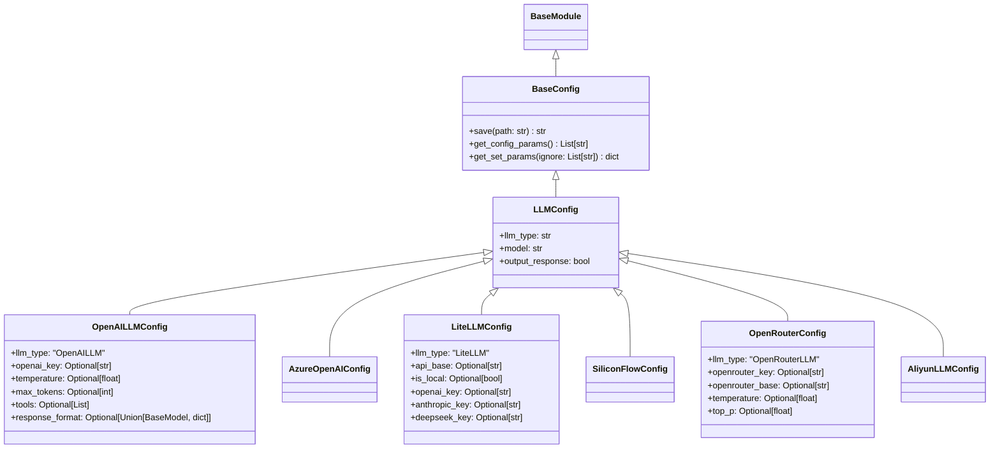
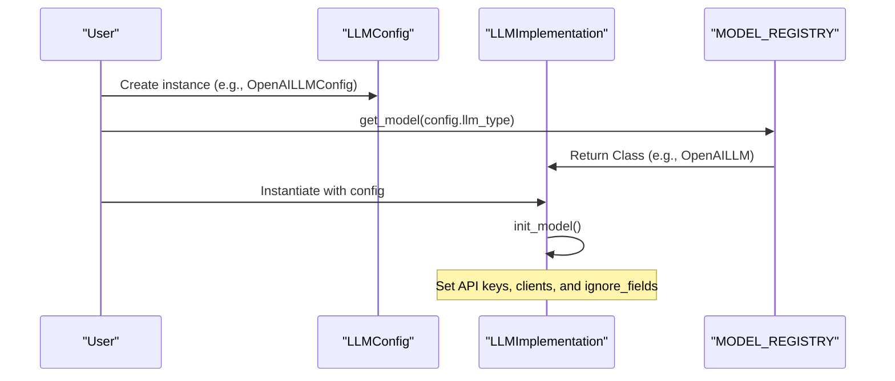

<!-- source: DeepWiki mcp.deepwiki.com · repo EvoAgentX/EvoAgentX · page 6.2 Model Configuration · fetched 2026-10-26 -->

# Model Configuration

<details>
<summary>Relevant source files</summary>

The following files were used as context for generating this wiki page:

- [evoagentx/core/base_config.py](evoagentx/core/base_config.py)
- [evoagentx/models/__init__.py](evoagentx/models/__init__.py)
- [evoagentx/models/litellm_model.py](evoagentx/models/litellm_model.py)
- [evoagentx/models/model_configs.py](evoagentx/models/model_configs.py)
- [evoagentx/models/model_utils.py](evoagentx/models/model_utils.py)
- [evoagentx/models/openai_model.py](evoagentx/models/openai_model.py)
- [evoagentx/models/openrouter_model.py](evoagentx/models/openrouter_model.py)

</details>


This document covers the model configuration system in EvoAgentX, which provides a structured approach to configuring different LLM providers and their parameters. The configuration classes define connection settings, generation parameters, and provider-specific options for various language model services.

For information about LLM base classes and interfaces, see [BaseLLM and Implementations](6.1). For provider integration details, see [Provider Integration](6.3).

## Configuration Architecture

EvoAgentX uses a hierarchical configuration system built on Pydantic models to manage LLM settings across different providers. All LLM configurations inherit from `LLMConfig`, which provides common fields and validation.

### Configuration Class Hierarchy



Sources: [evoagentx/models/model_configs.py:11-211](), [evoagentx/core/base_config.py:5-51]()

## Base Configuration System

### LLMConfig Base Class

The `LLMConfig` class serves as the foundation for all language model configurations. It inherits from `BaseConfig` and defines essential fields required by all LLM implementations. [evoagentx/models/model_configs.py:11-16]()

| Field | Type | Description |
|-------|------|-------------|
| `llm_type` | `str` | Identifies the specific LLM implementation (e.g., "OpenAILLM", "LiteLLM") |
| `model` | `str` | Model name or identifier used by the provider |
| `output_response` | `bool` | Whether to output LLM responses to stdout (default: False) |

### Configuration Management Methods

The `BaseConfig` class provides utility methods for parameter management used by model implementations to prepare API payloads. [evoagentx/core/base_config.py:5-51]()

- `get_config_params()`: Returns a list of all configuration parameter names defined in the model fields, excluding internal fields like `class_name`. [evoagentx/core/base_config.py:26-34]()
- `get_set_params(ignore)`: Returns a dictionary of parameters that have been explicitly set by the user. This is crucial for avoiding sending `None` values to LLM APIs that might reject them. [evoagentx/core/base_config.py:36-51]()
- `save(path)`: Persists the configuration to a specified file path by calling `save_module`. [evoagentx/core/base_config.py:13-24]()

Sources: [evoagentx/models/model_configs.py:11-16](), [evoagentx/core/base_config.py:26-51]()

## Provider-Specific Configurations

### OpenAI Configuration

`OpenAILLMConfig` provides comprehensive configuration for OpenAI models with support for advanced features like tool calling, structured outputs, and reasoning parameters. [evoagentx/models/model_configs.py:18-51]()

#### Key Configuration Categories

| Category | Fields | Description |
|----------|--------|-------------|
| **Authentication** | `openai_key` | API key for OpenAI requests. [evoagentx/models/model_configs.py:21]() |
| **Generation** | `temperature`, `max_tokens`, `max_completion_tokens`, `top_p`, `n` | Control generation behavior and token limits. [evoagentx/models/model_configs.py:24-28]() |
| **Streaming** | `stream`, `stream_options`, `timeout` | Configure response streaming and request timeouts. [evoagentx/models/model_configs.py:29-31]() |
| **Tools** | `tools`, `tool_choice`, `parallel_tool_calls` | Function calling configuration. [evoagentx/models/model_configs.py:34-36]() |
| **Reasoning** | `reasoning_effort` | Effort level for reasoning models (low, medium, high). [evoagentx/models/model_configs.py:39]() |
| **Output Format** | `response_format`, `modalities` | Structured output configuration and output types. [evoagentx/models/model_configs.py:49-50]() |

#### Advanced Features

The configuration supports OpenAI's latest features including:
- **Reasoning Models**: `reasoning_effort` parameter for controlling computation in o1-series models. [evoagentx/models/model_configs.py:39]()
- **Predicted Outputs**: `prediction` parameter for improving response times when large parts of the response are known. [evoagentx/models/model_configs.py:46]()
- **Token Probabilities**: `logprobs` and `top_logprobs` for analyzing model confidence. [evoagentx/models/model_configs.py:42-43]()

Sources: [evoagentx/models/model_configs.py:18-51]()

### LiteLLM Configuration

`LiteLLMConfig` enables integration with multiple LLM providers through the LiteLLM library, supporting both cloud and local models (e.g., Ollama). [evoagentx/models/model_configs.py:62-109]()

#### Multi-Provider Support

```mermaid
graph TD
    "LiteLLMConfig" --> "OpenAIProvider"["OpenAI Provider"]
    "LiteLLMConfig" --> "AnthropicProvider"["Anthropic Provider"]
    "LiteLLMConfig" --> "DeepSeekProvider"["DeepSeek Provider"]
    "LiteLLMConfig" --> "GeminiProvider"["Gemini Provider"]
    "LiteLLMConfig" --> "AzureProvider"["Azure OpenAI Provider"]
    "LiteLLMConfig" --> "LocalProvider"["Local Provider"]
    
    "OpenAIProvider" --> "openai_key"["openai_key"]
    "AnthropicProvider" --> "anthropic_key"["anthropic_key"]
    "DeepSeekProvider" --> "deepseek_key"["deepseek_key"]
    "GeminiProvider" --> "gemini_key"["gemini_key"]
    "AzureProvider" --> "azure_config"["azure_endpoint, azure_key, api_version"]
    "LocalProvider" --> "local_config"["api_base, is_local"]
```

Sources: [evoagentx/models/model_configs.py:62-109](), [evoagentx/models/litellm_model.py:41-82]()

#### Provider Authentication Fields

| Provider | Authentication Fields |
|----------|----------------------|
| OpenAI | `openai_key` |
| Anthropic | `anthropic_key` |
| DeepSeek | `deepseek_key` |
| Gemini | `gemini_key` |
| Meta Llama | `meta_llama_key` |
| OpenRouter | `openrouter_key`, `openrouter_base` |
| Perplexity | `perplexity_key` |
| Groq | `groq_key` |
| Azure OpenAI | `azure_endpoint`, `azure_key`, `api_version` |
| Local | `api_base`, `is_local`, `api_key` |

Sources: [evoagentx/models/model_configs.py:65-83]()

### Azure OpenAI Configuration

`AzureOpenAIConfig` provides specialized configuration for Azure OpenAI services with endpoint and deployment management. [evoagentx/models/model_configs.py:53-60]()

| Field | Type | Description |
|-------|------|-------------|
| `azure_endpoint` | `str` | Azure OpenAI service endpoint URL |
| `azure_key` | `str` | Azure OpenAI API key |
| `api_version` | `str` | API version (default: "2024-12-01-preview") |
| `model` | `str` | Deployment name in Azure (inherited from `LLMConfig`) |

Sources: [evoagentx/models/model_configs.py:53-60]()

### OpenRouter Configuration

`OpenRouterConfig` supports OpenRouter's extensive model marketplace with detailed parameter control. [evoagentx/models/model_configs.py:146-176]()

#### Advanced Generation Parameters

| Parameter | Type | Range | Description |
|-----------|------|-------|-------------|
| `frequency_penalty` | `float` | -2.0 to 2.0 | Reduces repetition based on frequency |
| `presence_penalty` | `float` | -2.0 to 2.0 | Reduces repetition of specific tokens |
| `repetition_penalty` | `float` | 0.0 to 2.0 | General repetition control |
| `min_p` | `float` | 0.0 to 1.0 | Minimum probability threshold |
| `top_a` | `float` | 0.0 to 1.0 | Adaptive top-k sampling |
| `seed` | `int` | - | Deterministic sampling seed |

Sources: [evoagentx/models/model_configs.py:146-176]()

## Configuration Usage Patterns

### Configuration Initialization and Validation

The model implementations use configuration validation to ensure proper setup. For instance, `OpenAILLM` checks if the model exists in the cost registry during initialization. [evoagentx/models/openai_model.py:28-29]()



Sources: [evoagentx/models/model_utils.py:139-143](), [evoagentx/models/openai_model.py:20-33](), [evoagentx/models/litellm_model.py:18-88]()

### Parameter Processing

The configuration system provides methods for extracting and processing parameters to be sent to model APIs:

1. **Parameter Filtering**: `get_set_params()` extracts only explicitly set parameters to avoid sending defaults. [evoagentx/core/base_config.py:36-51]()
2. **Ignore Lists**: Each implementation defines `_default_ignore_fields` (e.g., `llm_type`, `openai_key`) to exclude framework-specific fields from the final API call. [evoagentx/models/openai_model.py:23-27](), [evoagentx/models/litellm_model.py:84-88]()
3. **Parameter Merging**: `update_completion_params()` combines configuration and runtime parameters provided during `single_generate`. [evoagentx/models/openai_model.py:52-60]()

### Configuration Persistence

Configurations can be saved and loaded using the inherited `BaseConfig` functionality:

- `save(path)`: Serializes configuration to a file. [evoagentx/core/base_config.py:13-24]()
- Configuration loading is typically handled through the standard module loading mechanisms of `BaseModule`.

Sources: [evoagentx/models/openai_model.py:62-65](), [evoagentx/core/base_config.py:13-24]()

---

