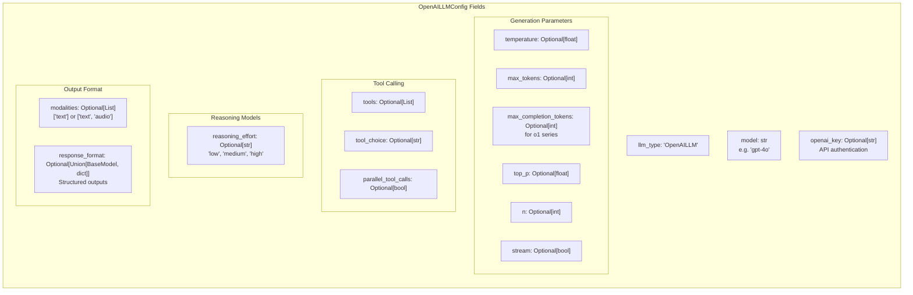
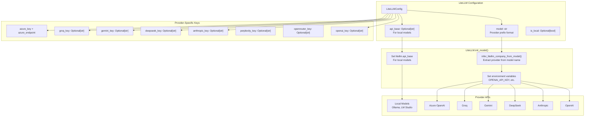
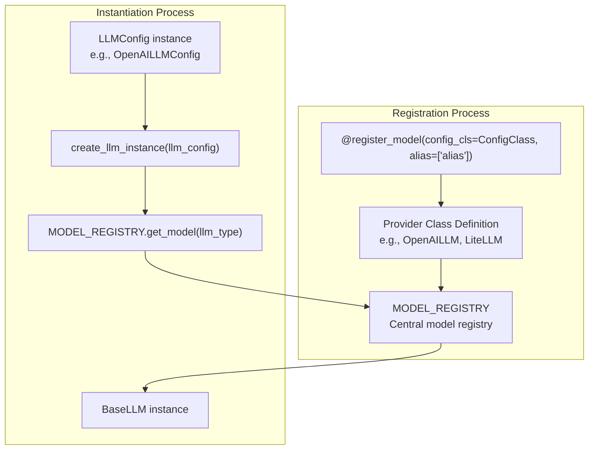

<!-- source: DeepWiki mcp.deepwiki.com · repo EvoAgentX/EvoAgentX · page 6.3 Provider Integration · fetched 2026-10-26 -->

# Provider Integration

<details>
<summary>Relevant source files</summary>

The following files were used as context for generating this wiki page:

- [evoagentx/core/base_config.py](evoagentx/core/base_config.py)
- [evoagentx/models/__init__.py](evoagentx/models/__init__.py)
- [evoagentx/models/aliyun_model.py](evoagentx/models/aliyun_model.py)
- [evoagentx/models/litellm_model.py](evoagentx/models/litellm_model.py)
- [evoagentx/models/model_configs.py](evoagentx/models/model_configs.py)
- [evoagentx/models/model_utils.py](evoagentx/models/model_utils.py)
- [evoagentx/models/openai_model.py](evoagentx/models/openai_model.py)
- [evoagentx/models/openrouter_model.py](evoagentx/models/openrouter_model.py)
- [evoagentx/models/siliconflow_model.py](evoagentx/models/siliconflow_model.py)
- [evoagentx/models/siliconflow_model_cost.py](evoagentx/models/siliconflow_model_cost.py)
- [evoagentx/optimizers/__init__.py](evoagentx/optimizers/__init__.py)
- [evoagentx/optimizers/map_elites_optimizer.py](evoagentx/optimizers/map_elites_optimizer.py)
- [examples/models/lite_azure_model_test.py](examples/models/lite_azure_model_test.py)
- [examples/models/workflow_demo_lite_azure.py](examples/models/workflow_demo_lite_azure.py)
- [examples/optimization/map_elites_demo.py](examples/optimization/map_elites_demo.py)
- [tests/src/optimizers/test_optimizer_package_imports.py](tests/src/optimizers/test_optimizer_package_imports.py)

</details>


## Purpose and Scope

This page explains how to configure and use different Language Model (LLM) providers in EvoAgentX. The framework supports multiple LLM providers through a unified abstraction layer, enabling seamless switching between OpenAI, Anthropic, local models, and other providers without modifying agent code.

For information about the base LLM interface and implementation details, see [BaseLLM and Implementations](#6.1). For general configuration patterns, see [Model Configuration](#6.2). For cost tracking across providers, see [Cost Tracking](#6.5).

---

## Provider Architecture Overview

EvoAgentX provides a flexible provider integration system that separates configuration from implementation. Each provider is accessed through a configuration class and corresponding implementation class.

```mermaid
graph TB
    subgraph "Application Layer"
        Agent["Agent/CustomizeAgent"]
        Action["CustomizeAction"]
    end
    
    subgraph "Configuration Layer"
        OpenAIConfig["OpenAILLMConfig"]
        LiteLLMConfig["LiteLLMConfig"]
        OpenRouterConfig["OpenRouterConfig"]
        AliyunConfig["AliyunLLMConfig"]
        AzureConfig["AzureOpenAIConfig"]
        SiliconConfig["SiliconFlowConfig"]
    end
    
    subgraph "Implementation Layer"
        BaseLLM["BaseLLM<br/>Abstract Interface"]
        OpenAILLM["OpenAILLM"]
        LiteLLM["LiteLLM"]
        OpenRouterLLM["OpenRouterLLM"]
        AliyunLLM["AliyunLLM"]
        AzureOpenAILLM["AzureOpenAILLM"]
        SiliconFlowLLM["SiliconFlowLLM"]
    end
    
    subgraph "Provider APIs"
        OpenAIAPI["OpenAI API<br/>gpt-4o, gpt-4o-mini"]
        AnthropicAPI["Anthropic API<br/>claude-3.5-sonnet"]
        DeepSeekAPI["DeepSeek API"]
        GeminiAPI["Gemini API"]
        QwenAPI["Qwen/Aliyun API<br/>qwen-max, qwen-turbo"]
        GroqAPI["Groq API"]
        PerplexityAPI["Perplexity API"]
        LocalAPI["Local Models<br/>Ollama, LM Studio"]
        OpenRouterAPI["OpenRouter API<br/>Multi-provider gateway"]
        AzureAPI["Azure OpenAI Service"]
        SiliconFlowAPI["SiliconFlow API"]
    end
    
    subgraph "Registry System"
        MODEL_REGISTRY["MODEL_REGISTRY"]
        RegisterDecorator["@register_model"]
    end
    
    Agent --> BaseLLM
    Action --> BaseLLM
    
    OpenAIConfig --> OpenAILLM
    LiteLLMConfig --> LiteLLM
    OpenRouterConfig --> OpenRouterLLM
    AliyunConfig --> AliyunLLM
    AzureConfig --> AzureOpenAILLM
    SiliconConfig --> SiliconFlowLLM
    
    OpenAILLM --> BaseLLM
    LiteLLM --> BaseLLM
    OpenRouterLLM --> BaseLLM
    AliyunLLM --> BaseLLM
    AzureOpenAILLM --> BaseLLM
    SiliconFlowLLM --> BaseLLM
    
    OpenAILLM --> OpenAIAPI
    LiteLLM --> OpenAIAPI
    LiteLLM --> AnthropicAPI
    LiteLLM --> DeepSeekAPI
    LiteLLM --> GeminiAPI
    LiteLLM --> GroqAPI
    LiteLLM --> PerplexityAPI
    LiteLLM --> LocalAPI
    LiteLLM --> AzureAPI
    OpenRouterLLM --> OpenRouterAPI
    AliyunLLM --> QwenAPI
    AzureOpenAILLM --> AzureAPI
    SiliconFlowLLM --> SiliconFlowAPI
    
    RegisterDecorator -.->|registers| MODEL_REGISTRY
    OpenAILLM -.->|registered via| RegisterDecorator
    LiteLLM -.->|registered via| RegisterDecorator
    OpenRouterLLM -.->|registered via| RegisterDecorator
```



**Sources:** [evoagentx/models/model_configs.py:10-211](), [evoagentx/models/openai_model.py:17-33](), [evoagentx/models/litellm_model.py:15-88](), [evoagentx/models/openrouter_model.py:18-31](), [evoagentx/core/registry.py:1-20]()

---

## Supported Providers

The following table summarizes all supported providers and their configuration classes:

| Provider | Config Class | Implementation Class | Model Examples | Key Features |
|----------|-------------|---------------------|----------------|--------------|
| **OpenAI** | `OpenAILLMConfig` | `OpenAILLM` | `gpt-4o`, `gpt-4o-mini`, `o1-preview` | Direct OpenAI API, structured outputs, reasoning models |
| **LiteLLM** | `LiteLLMConfig` | `LiteLLM` | Any LiteLLM-supported model | Multi-provider wrapper, local model support |
| **OpenRouter** | `OpenRouterConfig` | `OpenRouterLLM` | `anthropic/claude-3.5-sonnet` | Gateway to 100+ models, dynamic pricing |
| **Aliyun/Qwen** | `AliyunLLMConfig` | `AliyunLLM` | `qwen-max`, `qwen-turbo` | Chinese language optimization, web search augmentation |
| **Azure OpenAI** | `AzureOpenAIConfig` | `AzureOpenAILLM` | Enterprise deployments | Enterprise compliance, private endpoints |
| **SiliconFlow** | `SiliconFlowConfig` | `SiliconFlowLLM` | SiliconFlow models | Cost-effective inference |
| **Local Models** | `LiteLLMConfig` | `LiteLLM` | `ollama/llama3`, `local/model` | Privacy, no API costs, offline operation |

**Sources:** [evoagentx/models/model_configs.py:10-211](), [evoagentx/models/__init__.py:1-10]()

---

## OpenAI Integration

The `OpenAILLM` class provides direct integration with OpenAI's API, supporting all OpenAI models including GPT-4o, o1-preview, and multimodal models.

### Configuration

The `OpenAILLMConfig` class defines OpenAI-specific configuration parameters:



**Sources:** [evoagentx/models/model_configs.py:18-51]()

### Implementation Details

The `OpenAILLM` class initializes the OpenAI client and handles API communication:

**Initialization:** [evoagentx/models/openai_model.py:20-33]()
- Validates model name against supported OpenAI models using `get_openai_model_cost()`.
- Creates OpenAI client with API key via `_init_client`.
- Defines `_default_ignore_fields` to strip non-API parameters from requests.

**Generation Methods:**
- `single_generate()`: Synchronous single completion [evoagentx/models/openai_model.py:119-137]().
- `batch_generate()`: Multiple completions [evoagentx/models/openai_model.py:139-140]().
- `single_generate_async()`: Asynchronous completion using `run_in_executor` for the synchronous client [evoagentx/models/openai_model.py:142-178]().

**Cost Tracking:** [evoagentx/models/openai_model.py:180-202]()
- Extracts token usage from API responses via `_completion_cost`.
- Computes costs using LiteLLM's `cost_per_token()` and `token_counter`.
- Updates global `cost_manager` for tracking.

**Sources:** [evoagentx/models/openai_model.py:1-203](), [evoagentx/models/model_configs.py:18-51](), [evoagentx/models/model_utils.py:12-20]()

---

## LiteLLM Multi-Provider Integration

The `LiteLLM` class is the most flexible provider integration, supporting multiple LLM providers through the LiteLLM library. This enables access to OpenAI, Anthropic, DeepSeek, Gemini, Groq, Perplexity, Azure OpenAI, and local models through a single interface.

### Architecture



**Sources:** [evoagentx/models/litellm_model.py:18-89](), [evoagentx/models/model_configs.py:62-109]()

### Provider Detection

The `infer_litellm_company_from_model()` function determines the provider from the model name:

**Detection Logic:** [evoagentx/models/model_utils.py:22-39]()
- Model names with `/` prefix: Extract provider from prefix (e.g., `"anthropic/claude-3.5-sonnet"`).
- Model names with keywords: Detect provider from model name (e.g., `"claude"` → `"anthropic"`, `"gemini"` → `"gemini"`).
- Default: Assume OpenAI if no clear indicator.

### Configuration by Provider

#### OpenAI via LiteLLM
- Set `openai_key` in `LiteLLMConfig`.
- Environment variable: `OPENAI_API_KEY` [evoagentx/models/litellm_model.py:42-44]().

#### Anthropic
- Set `anthropic_key` in `LiteLLMConfig`.
- Environment variable: `ANTHROPIC_API_KEY` [evoagentx/models/litellm_model.py:56-59]().

#### DeepSeek
- Set `deepseek_key` in `LiteLLMConfig`.
- Environment variable: `DEEPSEEK_API_KEY` [evoagentx/models/litellm_model.py:52-55]().

#### Gemini
- Set `gemini_key` in `LiteLLMConfig`.
- Environment variable: `GEMINI_API_KEY` [evoagentx/models/litellm_model.py:60-63]().

#### Groq
- Set `groq_key` in `LiteLLMConfig`.
- Environment variable: `GROQ_API_KEY` [evoagentx/models/litellm_model.py:77-80]().

#### Perplexity
- Set `perplexity_key` in `LiteLLMConfig`.
- Environment variable: `PERPLEXITYAI_API_KEY` [evoagentx/models/litellm_model.py:73-76]().

#### Azure OpenAI
- Set `azure_key`, `azure_endpoint`, and `api_version` in `LiteLLMConfig`.
- Environment variables: `AZURE_API_KEY`, `AZURE_API_BASE`, `AZURE_API_VERSION` [evoagentx/models/litellm_model.py:45-51]().

#### OpenRouter via LiteLLM
- Set `openrouter_key` and optionally `openrouter_base` in `LiteLLMConfig`.
- Environment variables: `OPENROUTER_API_KEY`, `OPENROUTER_API_BASE` [evoagentx/models/litellm_model.py:68-72]().

### Local Model Support

For local models (Ollama, LM Studio, FastChat, LocalAI):

**Configuration:**
- Set `is_local=True` or use `"local"` as company prefix in `LiteLLMConfig`.
- Set `api_base` to local server URL (e.g., `"http://localhost:11434/v1"`).
- LiteLLM sets global `litellm.api_base` [evoagentx/models/litellm_model.py:33-38]().

**Cost Tracking:**
- Local models return zero cost via `_compute_cost` override [evoagentx/models/litellm_model.py:90-93]().

### Generation Methods

The `LiteLLM` class inherits from `OpenAILLM` and overrides key methods:

**Synchronous Generation:** [evoagentx/models/litellm_model.py:96-132]()
- Uses LiteLLM's `completion()` function.
- Injects `api_base` and Azure-specific parameters dynamically.

**Asynchronous Generation:** [evoagentx/models/litellm_model.py:151-188]()
- Uses LiteLLM's `acompletion()` function.

**Sources:** [evoagentx/models/litellm_model.py:1-189](), [evoagentx/models/model_configs.py:62-109]()

---

## OpenRouter Integration

OpenRouter provides access to 100+ models from multiple providers through a unified API gateway. The `OpenRouterLLM` class implements direct integration with OpenRouter's API.

### Configuration

The `OpenRouterConfig` class provides OpenRouter-specific configuration:

**Key Fields:** [evoagentx/models/model_configs.py:146-176]()
- `llm_type`: `"OpenRouterLLM"`
- `openrouter_key`: OpenRouter API key.
- `openrouter_base`: API base URL (default: `"https://openrouter.ai/api/v1"`).
- `openrouter_model_base`: Model details endpoint for dynamic pricing.

### Implementation

The `OpenRouterLLM` class provides similar functionality to `OpenAILLM` but with OpenRouter-specific initialization and cost calculation:

**Client Initialization:** [evoagentx/models/openrouter_model.py:26-31]()
- Creates OpenAI client with OpenRouter base URL.

**Dynamic Cost Calculation:** [evoagentx/models/openrouter_model.py:174-186]()
- Fetches pricing from `openrouter_model_base` endpoint via `_get_cost`.
- Extracts `prompt` and `completion` pricing for specific model.
- Computes cost based on actual token usage.

**Sources:** [evoagentx/models/openrouter_model.py:1-186](), [evoagentx/models/model_configs.py:146-176]()

---

## Aliyun/Qwen Integration

The `AliyunLLM` class provides integration with Aliyun's Qwen models, optimized for Chinese language tasks and offering web search augmentation.

### Configuration

The `AliyunLLMConfig` class defines Aliyun-specific parameters:

**Authentication:** [evoagentx/models/model_configs.py:178-183]()
- `aliyun_api_key`: API key.
- Alternative: `aliyun_access_key_id` + `aliyun_access_key_secret` for AccessKey authentication.

**Model-Specific Features:** [evoagentx/models/model_configs.py:197-203]()
- `model_name`: Qwen model variant (`"qwen-max"`, `"qwen-turbo"`, etc.).
- `enable_search`: Enable web search augmentation.

### Implementation

The `AliyunLLM` uses the `dashscope` SDK:

**Initialization:** [evoagentx/models/aliyun_model.py:20-37]()
- Sets `DASHSCOPE_API_KEY` environment variable.
- Initializes `dashscope.Generation` client.

**Generation:**
- `single_generate()`: Uses `self._client.call` [evoagentx/models/aliyun_model.py:194-219]().
- `get_stream_output()`: Parses chunks from Aliyun's unique response format [evoagentx/models/aliyun_model.py:96-129]().

**Sources:** [evoagentx/models/aliyun_model.py:1-219](), [evoagentx/models/model_configs.py:178-211]()

---

## SiliconFlow Integration

The `SiliconFlowLLM` class provides integration with SiliconFlow's API for cost-effective model inference.

### Implementation and Cost

SiliconFlow integration is unique in how it handles streaming usage data:

**Stream Usage:** [evoagentx/models/siliconflow_model.py:148-174]()
- SiliconFlow returns usage information in the final chunk of the stream.
- `_get_stream_output_with_response` builds a mock response object from the last chunk's usage info to allow standard cost calculation.

**Cost Computation:** [evoagentx/models/siliconflow_model.py:104-119]()
- Uses a local `model_cost` dictionary [evoagentx/models/siliconflow_model_cost.py]().
- Handles both unified `token_cost` and separate `input_token_cost`/`output_token_cost`.

**Sources:** [evoagentx/models/siliconflow_model.py:1-174](), [evoagentx/models/model_configs.py:111-141]()

---

## Provider Registration and Instantiation

All provider implementations are registered in the `MODEL_REGISTRY` using the `@register_model` decorator:



**Registration Examples:**
- `OpenAILLM`: [evoagentx/models/openai_model.py:17]()
- `LiteLLM`: [evoagentx/models/litellm_model.py:15]()
- `OpenRouterLLM`: [evoagentx/models/openrouter_model.py:18]()
- `SiliconFlowLLM`: [evoagentx/models/siliconflow_model.py:18]()

**Factory Function:** [evoagentx/models/model_utils.py:139-143]()
```python
def create_llm_instance(llm_config: LLMConfig) -> BaseLLM:
    llm_cls = MODEL_REGISTRY.get_model(llm_config.llm_type)
    llm = llm_cls(config=llm_config)
    return llm
```

**Sources:** [evoagentx/models/model_utils.py:139-143](), [evoagentx/models/openai_model.py:17](), [evoagentx/models/litellm_model.py:15](), [evoagentx/core/registry.py:1-20]()

---

## Cost Tracking

All providers track costs through the unified `cost_manager`:

**Cost Tracking Flow:**
1. Token usage extracted from API response via `_completion_cost` or `_stream_cost`.
2. Cost computed using `_compute_cost`.
3. `self._update_cost(cost=cost)` is called within `single_generate` [evoagentx/models/openai_model.py:133]().
4. `BaseLLM._update_cost` calls `cost_manager.update_cost(cost, self.config.model)` [evoagentx/models/model_utils.py:73-87]().

**CostManager Features:** [evoagentx/models/model_utils.py:50-136]()
- Thread-safe updates using `threading.Lock` and `@atomic_method`.
- Accumulates input/output tokens and USD costs per model.
- `display_cost()`: Generates a pandas DataFrame summary of usage across all models.

**Sources:** [evoagentx/models/model_utils.py:50-136](), [evoagentx/models/openai_model.py:133](), [evoagentx/models/litellm_model.py:90-93]()

---

## Common Patterns

### Completion Parameter Flow

The parameter flow from config to API:

```mermaid
graph LR
    Config["LLMConfig instance<br/>All parameters set"]
    GetSet["get_set_params(ignore=...)"]
    Filtered["Filtered parameters<br/>Explicit values only"]
    GetCompletion["get_completion_params(**kwargs)"]
    Update["update_completion_params()"]
    Final["Final completion params"]
    API["Provider API call"]
    
    Config --> GetSet
    GetSet --> Filtered
    Filtered --> GetCompletion
    GetCompletion --> Update
    Update --> Final
    Final --> API
```



**Implementation:**
1. `config.get_set_params(ignore=...)`: Extracts only explicitly set fields [evoagentx/core/base_config.py:36-51]().
2. `get_completion_params(**kwargs)`: Merges runtime overrides into config parameters [evoagentx/models/openai_model.py:62-65]().
3. `update_completion_params()`: Filters out non-API fields using `_default_ignore_fields` [evoagentx/models/openai_model.py:52-60]().

**Sources:** [evoagentx/core/base_config.py:36-51](), [evoagentx/models/openai_model.py:52-65]()

---

