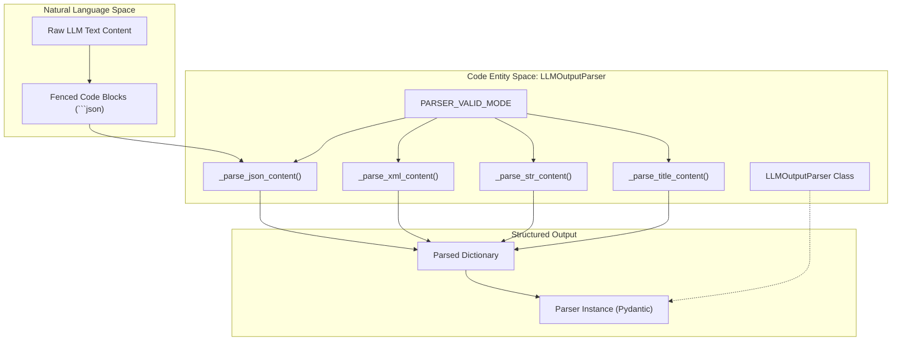
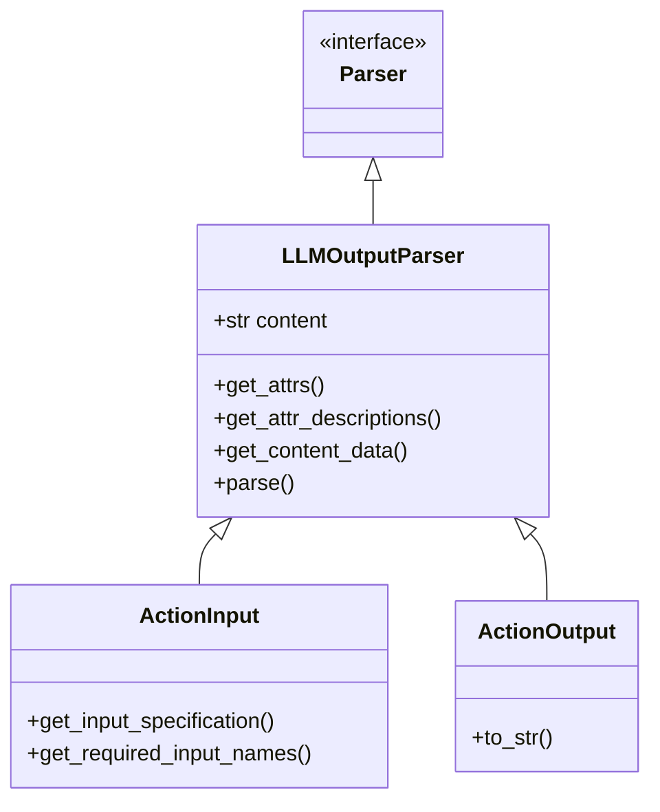
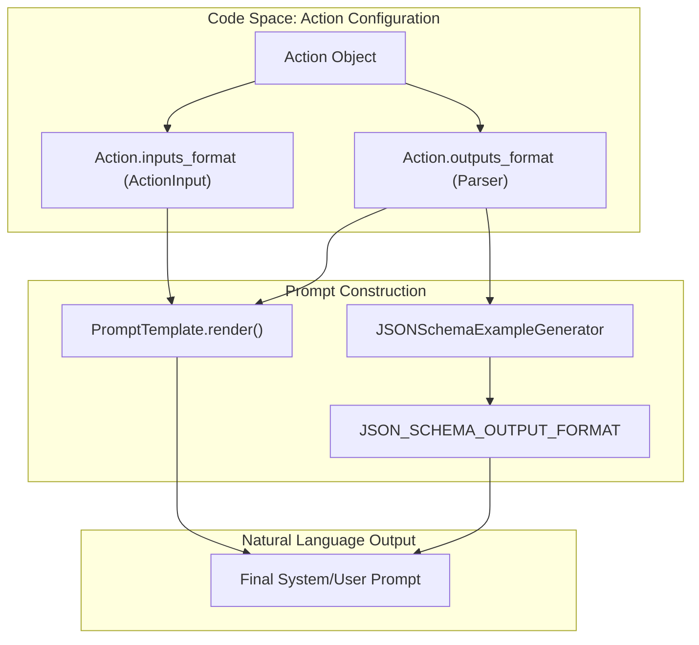

<!-- source: DeepWiki mcp.deepwiki.com · repo EvoAgentX/EvoAgentX · page 6.4 Output Parsing · fetched 2026-10-26 -->

# Output Parsing

<details>
<summary>Relevant source files</summary>

The following files were used as context for generating this wiki page:

- [evoagentx/actions/action.py](evoagentx/actions/action.py)
- [evoagentx/agents/agent.py](evoagentx/agents/agent.py)
- [evoagentx/core/message.py](evoagentx/core/message.py)
- [evoagentx/core/module.py](evoagentx/core/module.py)
- [evoagentx/core/module_utils.py](evoagentx/core/module_utils.py)
- [evoagentx/models/base_model.py](evoagentx/models/base_model.py)
- [evoagentx/prompts/__init__.py](evoagentx/prompts/__init__.py)
- [evoagentx/prompts/output_format.py](evoagentx/prompts/output_format.py)
- [evoagentx/prompts/template.py](evoagentx/prompts/template.py)
- [evoagentx/prompts/utils.py](evoagentx/prompts/utils.py)
- [evoagentx/utils/utils.py](evoagentx/utils/utils.py)

</details>


This document covers the structured output parsing system in EvoAgentX, which converts unstructured LLM-generated text into typed Python objects. The parsing system supports multiple formats including JSON, XML, markdown-style titles, and custom parsing functions.

For information about LLM integration and model configuration, see [Provider Integration](). For details about action execution and input/output handling, see [Agent Base Classes]().

## Overview

The output parsing system bridges the gap between natural language LLM outputs and structured data that can be processed programmatically. It consists of parser classes, parsing modes, and utility functions that work together to extract and validate structured information from text.

### Parsing Architecture



Sources: [evoagentx/models/base_model.py:20-132](), [evoagentx/core/module_utils.py:87-107]()

## LLMOutputParser Class

The `LLMOutputParser` class is the foundation of the parsing system. It inherits from `Parser` and `BaseModule`, storing raw LLM output and providing methods to extract structured data using different parsing strategies.

### Core Architecture



| Method | Purpose | Return Type |
|--------|---------|-------------|
| `get_attrs()` | Get parser attribute names, excluding `class_name` and `content`. | `List[str]` |
| `get_content_data()` | High-level dispatcher that parses content into a dictionary based on `parse_mode`. | `dict` |
| `parse()` | Static method to create a parser instance from text. | `LLMOutputParser` |
| `get_attr_descriptions()` | Maps attribute names to their Pydantic field descriptions. | `dict` |

Sources: [evoagentx/models/base_model.py:22-132](), [evoagentx/actions/action.py:18-107]()

## Parse Modes

The parsing system supports five different modes defined in `PARSER_VALID_MODE` [evoagentx/models/base_model.py:20]().

### JSON Mode (`json`)
Extracts and parses JSON objects from LLM output. It uses `parse_json_from_text` to find JSON blocks and `yaml.safe_load` for parsing to be more permissive than standard JSON [evoagentx/models/base_model.py:164-168](). It also handles cases where the LLM returns a list instead of an object if only one attribute is defined in the parser [evoagentx/models/base_model.py:170-181]().

### XML Mode (`xml`)
Parses content by extracting values from XML tags. It uses `parse_xml_from_text` to find tags matching the parser's attribute names [evoagentx/models/base_model.py:186-217]().

### Title Mode (`title`)
Parses content with Markdown-style headings (e.g., `## Title`). It uses regex to find sections and maps the text under a heading to the corresponding parser attribute [evoagentx/models/base_model.py:219-275]().

### String Mode (`str`)
The simplest mode; it assigns the entire raw `content` string to every attribute defined in the parser [evoagentx/models/base_model.py:135-147]().

### Custom Mode (`custom`)
Requires a `parse_func` callable. The system validates that the function accepts a `content` argument and returns a `dict` [evoagentx/models/base_model.py:110-128]().

Sources: [evoagentx/models/base_model.py:75-275](), [evoagentx/core/module_utils.py:204-245]()

## Action Input and Output Parsing

### ActionInput Class
`ActionInput` extends `LLMOutputParser` to define the input schema for an `Action`. It includes utility methods for generating documentation for the LLM.

*   **`get_input_specification()`**: Generates a JSON-formatted string describing the required types, descriptions, and "required/optional" status of all input fields [evoagentx/actions/action.py:33-70]().
*   **`get_required_input_names()`**: Identifies fields that do not have a default value [evoagentx/actions/action.py:73-89]().

### ActionOutput Class
`ActionOutput` is used to structure the results of an action execution. It provides a `to_str()` method that returns a pretty-printed JSON representation of the result [evoagentx/actions/action.py:91-105]().

Sources: [evoagentx/actions/action.py:18-107]()

## Integration and Data Flow

The `PromptTemplate` class uses these parsers to render instructions for the LLM, including JSON schemas and examples.

### Prompt Rendering to Parser Flow



Sources: [evoagentx/prompts/template.py:168-212](), [evoagentx/prompts/utils.py:11-65](), [evoagentx/prompts/output_format.py:1-29]()

## Parsing Utilities

The system relies on several robust utility functions in `module_utils.py` to handle "dirty" LLM output:

| Function | Purpose |
|----------|---------|
| `fix_json()` | Wrapper that removes comments, fixes Python booleans (`True` -> `true`), and escapes nested values [evoagentx/core/module_utils.py:197-201](). |
| `extract_fenced_blocks()` | Uses regex to find content between triple backticks (```), optionally filtered by label [evoagentx/core/module_utils.py:87-107](). |
| `parse_json_from_text()` | Autoregressively attempts to find and fix JSON objects within a larger string [evoagentx/core/module_utils.py:204-245](). |
| `parse_data_from_text()` | Performs type casting for extracted strings into `int`, `float`, `bool`, `list`, or `dict` [evoagentx/core/module_utils.py:255-300](). |

Sources: [evoagentx/core/module_utils.py:87-300]()

---

