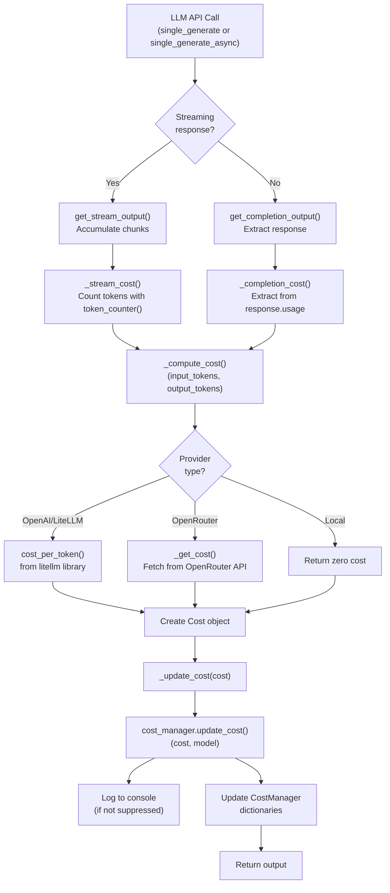
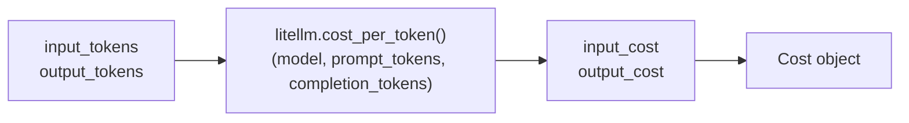
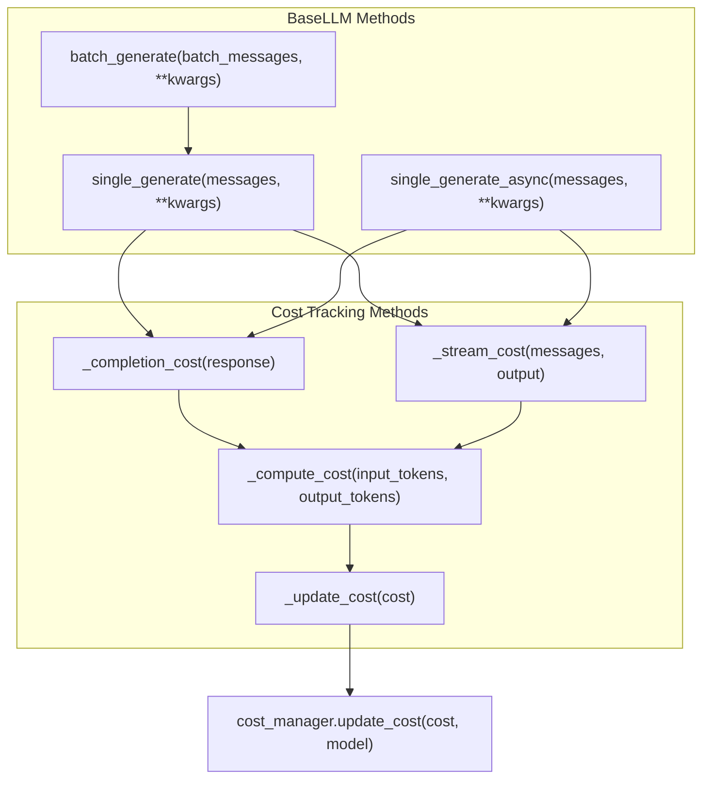
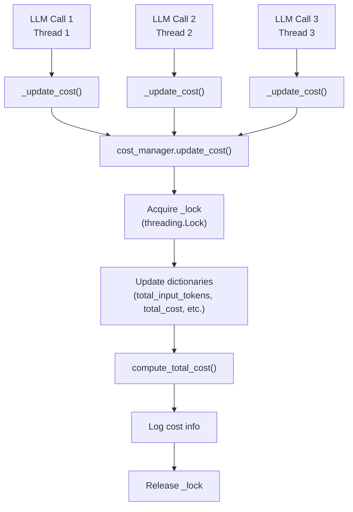
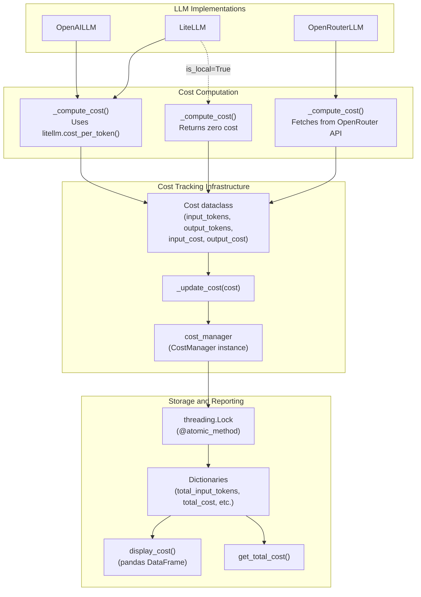

<!-- source: DeepWiki mcp.deepwiki.com · repo EvoAgentX/EvoAgentX · page 6.5 Cost Tracking · fetched 2026-10-26 -->

# Cost Tracking

<details>
<summary>Relevant source files</summary>

The following files were used as context for generating this wiki page:

- [evoagentx/core/base_config.py](evoagentx/core/base_config.py)
- [evoagentx/models/__init__.py](evoagentx/models/__init__.py)
- [evoagentx/models/litellm_model.py](evoagentx/models/litellm_model.py)
- [evoagentx/models/model_configs.py](evoagentx/models/model_configs.py)
- [evoagentx/models/model_utils.py](evoagentx/models/model_utils.py)
- [evoagentx/models/openai_model.py](evoagentx/models/openai_model.py)
- [evoagentx/models/openrouter_model.py](evoagentx/models/openrouter_model.py)

</details>


## Overview

The cost tracking system in EvoAgentX provides automated monitoring and reporting of token usage and associated costs across all LLM API calls. The system tracks costs on a per-model basis, supports multiple LLM providers with different pricing models, and provides thread-safe cost accumulation for concurrent operations.

This page documents the cost tracking implementation. For information about LLM configuration, see [Model Configuration](6.2). For provider-specific integration details, see [Provider Integration](6.3).

## Purpose and Scope

The cost tracking system automatically:
- Records input and output token counts for every LLM API call [evoagentx/models/model_utils.py:75-78]()
- Computes costs based on provider-specific pricing [evoagentx/models/openai_model.py:191-199]()
- Aggregates costs across multiple models and requests [evoagentx/models/model_utils.py:75-83]()
- Provides formatted cost reports and summary statistics [evoagentx/models/model_utils.py:89-126]()
- Ensures thread-safe cost updates in concurrent execution scenarios [evoagentx/models/model_utils.py:62-83]()

## Cost Data Structure

The `Cost` dataclass represents the cost of a single LLM API call:

```mermaid
classDiagram
    class "Cost" {
        +int input_tokens
        +int output_tokens
        +float input_cost
        +float output_cost
    }
```

**Sources:** [evoagentx/models/model_utils.py:42-47]()

The `Cost` dataclass contains four fields:

| Field | Type | Description |
|-------|------|-------------|
| `input_tokens` | `int` | Number of tokens in the prompt/input |
| `output_tokens` | `int` | Number of tokens in the completion/output |
| `input_cost` | `float` | Cost in USD for input tokens |
| `output_cost` | `float` | Cost in USD for output tokens |

## CostManager

The `CostManager` class is a singleton instance that maintains global cost tracking state across all LLM API calls in the application.

```mermaid
classDiagram
    class "CostManager" {
        -dict total_input_tokens
        -dict total_output_tokens
        -dict total_tokens
        -dict total_input_cost
        -dict total_output_cost
        -dict total_cost
        -Lock _lock
        +update_cost(cost, model)
        +display_cost()
        +get_total_cost()
        +compute_total_cost()
    }
    
    class "Cost" {
        +int input_tokens
        +int output_tokens
        +float input_cost
        +float output_cost
    }
    
    "CostManager" --> "Cost" : "uses"
```

**Sources:** [evoagentx/models/model_utils.py:50-136]()

### Data Storage

The `CostManager` maintains separate dictionaries for each metric, keyed by model name [evoagentx/models/model_utils.py:54-60]():

- `total_input_tokens`: Maps model name to cumulative input tokens
- `total_output_tokens`: Maps model name to cumulative output tokens
- `total_tokens`: Maps model name to cumulative total tokens (input + output)
- `total_input_cost`: Maps model name to cumulative input cost in USD
- `total_output_cost`: Maps model name to cumulative output cost in USD
- `total_cost`: Maps model name to cumulative total cost in USD

### Key Methods

| Method | Purpose |
|--------|---------|
| `update_cost(cost: Cost, model: str)` | Thread-safe method to add costs from a single API call [evoagentx/models/model_utils.py:72-87]() |
| `display_cost()` | Prints formatted table of costs per model with totals [evoagentx/models/model_utils.py:89-126]() |
| `get_total_cost()` | Returns total cost across all models [evoagentx/models/model_utils.py:128-133]() |
| `compute_total_cost()` | Computes total tokens and cost across all models [evoagentx/models/model_utils.py:64-70]() |

The global instance is accessible via `cost_manager` in [evoagentx/models/model_utils.py:136]().

## Cost Computation Flow

Cost tracking is integrated into every LLM generation call. The following diagram shows the flow from API call to cost update:



**Sources:** [evoagentx/models/openai_model.py:119-137](), [evoagentx/models/litellm_model.py:96-132](), [evoagentx/models/openrouter_model.py:95-112]()

### Cost Computation by Provider

Different LLM providers use different methods for cost computation:

#### OpenAI and LiteLLM Models

For OpenAI models ([evoagentx/models/openai_model.py:191-199]()) and LiteLLM models ([evoagentx/models/litellm_model.py:90-93]()):

1. **Non-streaming responses**: Token counts are extracted from `response.usage.prompt_tokens` and `response.usage.completion_tokens` [evoagentx/models/openai_model.py:180-183]().
2. **Streaming responses**: Token counts are computed using `litellm.token_counter()` for both messages and output text [evoagentx/models/openai_model.py:185-189]().
3. **Cost calculation**: Uses `litellm.cost_per_token()` which looks up pricing from LiteLLM's model database [evoagentx/models/openai_model.py:193-194]().



**Sources:** [evoagentx/models/openai_model.py:180-199](), [evoagentx/models/litellm_model.py:90-93]()

#### OpenRouter Models

OpenRouter models fetch pricing dynamically from the OpenRouter API ([evoagentx/models/openrouter_model.py:161-186]()):

1. Makes HTTP GET request to `openrouter_model_base` URL [evoagentx/models/openrouter_model.py:173]().
2. Searches the response for the specific model ID [evoagentx/models/openrouter_model.py:177]().
3. Extracts `pricing.prompt` and `pricing.completion` costs per token [evoagentx/models/openrouter_model.py:179-180]().
4. Multiplies by token counts to compute total costs [evoagentx/models/openrouter_model.py:164-165]().

**Sources:** [evoagentx/models/openrouter_model.py:161-186]()

#### Local Models

For local models running via LiteLLM with `is_local=True`, the `_compute_cost()` method returns zero costs while still tracking token counts [evoagentx/models/litellm_model.py:90-93]().

**Sources:** [evoagentx/models/litellm_model.py:90-93]()

## Integration with LLM Generation Methods

Cost tracking is automatically integrated into all LLM generation methods in the `BaseLLM` class hierarchy:



**Sources:** [evoagentx/models/openai_model.py:118-203]()

### Synchronous Generation

In `single_generate()` ([evoagentx/models/openai_model.py:119-137]()):
```python
# After getting response
if stream:
    output = self.get_stream_output(response, output_response=output_response)
    cost = self._stream_cost(messages=messages, output=output)
else:
    output = self.get_completion_output(response=response, output_response=output_response)
    cost = self._completion_cost(response)
self._update_cost(cost=cost)
```

### Asynchronous Generation

In `single_generate_async()` ([evoagentx/models/openai_model.py:142-178]()), the same pattern is followed but with async/await syntax.

### Batch Generation

The `batch_generate()` method processes each message list individually using `single_generate()`, so costs are automatically tracked for each item in the batch [evoagentx/models/openai_model.py:139-140]().

**Sources:** [evoagentx/models/openai_model.py:118-203]()

## Retrieving Cost Information

### Displaying Cost Summary

The `display_cost()` method generates a formatted table showing costs per model:

```python
from evoagentx.models import cost_manager

# After running workflows/agents
cost_manager.display_cost()
```

Output format:

| Model | Total Cost (USD) | Total Input Cost (USD) | Total Output Cost (USD) | Total Tokens | Total Input Tokens | Total Output Tokens |
|-------|------------------|------------------------|-------------------------|--------------|-------------------|---------------------|
| gpt-4o | 0.1234 | 0.0800 | 0.0434 | 15000 | 12000 | 3000 |
| gpt-3.5-turbo | 0.0156 | 0.0100 | 0.0056 | 8000 | 5000 | 3000 |
| TOTAL | 0.1390 | 0.0900 | 0.0490 | 23000 | 17000 | 6000 |

If multiple models were used, a summary row with totals is appended [evoagentx/models/model_utils.py:114-124]().

**Sources:** [evoagentx/models/model_utils.py:89-126]()

### Getting Total Cost

To retrieve the total cost programmatically:

```python
total_cost = cost_manager.get_total_cost()
print(f"Total cost: ${total_cost:.4f}")
```

This method sums costs across all models [evoagentx/models/model_utils.py:128-133]().

**Sources:** [evoagentx/models/model_utils.py:128-133]()

### Accessing Per-Model Statistics

The `CostManager` stores detailed statistics that can be accessed directly:

```python
# Get costs for specific model
model_name = "gpt-4o"
input_tokens = cost_manager.total_input_tokens.get(model_name, 0)
output_tokens = cost_manager.total_output_tokens.get(model_name, 0)
total_cost = cost_manager.total_cost.get(model_name, 0.0)
```

**Sources:** [evoagentx/models/model_utils.py:50-62]()

## Thread Safety and Concurrency

The `CostManager` uses a threading lock to ensure thread-safe updates when multiple LLM calls occur concurrently:



**Sources:** [evoagentx/models/model_utils.py:72-87]()

The `update_cost()` method is decorated with `@atomic_method` [evoagentx/models/model_utils.py:72](), which provides mutual exclusion using the `_lock` attribute [evoagentx/models/model_utils.py:62](). This ensures:

1. Only one thread can update costs at a time
2. Dictionary operations are atomic and race-condition free
3. Cost logs are printed in a consistent order
4. Total cost computations are accurate

**Sources:** [evoagentx/models/model_utils.py:50-87]()

## Suppressing Cost Logs

By default, every LLM API call logs its cost to the console [evoagentx/models/model_utils.py:87](). To suppress these logs temporarily:

```python
from evoagentx.core.callbacks import suppress_cost_logs

# Disable cost logging
with suppress_cost_logs(enabled=True):
    # LLM calls here will not log costs
    response = llm.single_generate(messages)

# Cost logging resumes automatically after context exits
```

The logging behavior is controlled by the `suppress_cost_logs.get()` check in `CostManager.update_cost()` [evoagentx/models/model_utils.py:86-87](). Costs are still tracked even when logs are suppressed; only the console output is disabled.

**Sources:** [evoagentx/models/model_utils.py:86-87]()

## Cost Tracking Architecture

The following diagram shows how cost tracking components interact:



**Sources:** [evoagentx/models/openai_model.py:191-203](), [evoagentx/models/litellm_model.py:90-93](), [evoagentx/models/openrouter_model.py:161-186](), [evoagentx/models/model_utils.py:42-136]()

## Model Configuration and Cost Tracking

Cost tracking integrates with model configurations defined in `LLMConfig` and its subclasses. The `output_response` parameter controls whether LLM responses are printed to console, but does not affect cost tracking [evoagentx/models/model_configs.py:15]():

```python
from evoagentx.models import OpenAILLMConfig, OpenAILLM

config = OpenAILLMConfig(
    model="gpt-4o",
    openai_key="your-key",
    output_response=False  # Suppress response printing
)

llm = OpenAILLM(config=config)
# Costs are still tracked regardless of output_response setting
```

**Sources:** [evoagentx/models/model_configs.py:11-16]()

## Example Usage

Complete example demonstrating cost tracking:

```python
from evoagentx.models import OpenAILLMConfig, OpenAILLM, cost_manager

# Initialize LLM
config = OpenAILLMConfig(
    model="gpt-4o-mini",
    openai_key="your-api-key",
    temperature=0.7
)
llm = OpenAILLM(config=config)

# Make multiple API calls
messages1 = [{"role": "user", "content": "What is machine learning?"}]
messages2 = [{"role": "user", "content": "Explain deep learning."}]

response1 = llm.single_generate(messages1)
response2 = llm.single_generate(messages2)

# Display cost summary
print("\n=== Cost Summary ===")
cost_manager.display_cost()

# Get total cost
total = cost_manager.get_total_cost()
print(f"\nTotal spent: ${total:.4f}")
```

**Sources:** [evoagentx/models/openai_model.py:119-137](), [evoagentx/models/model_utils.py:89-133]()

---

