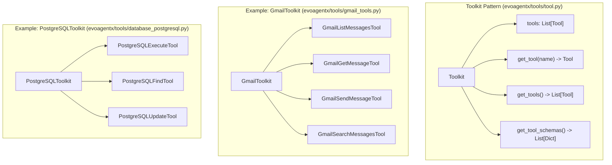
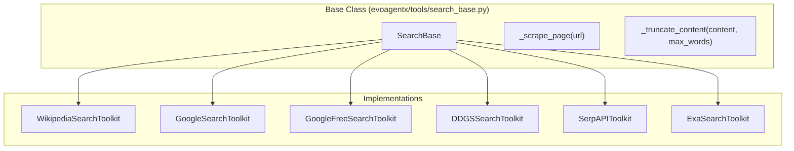
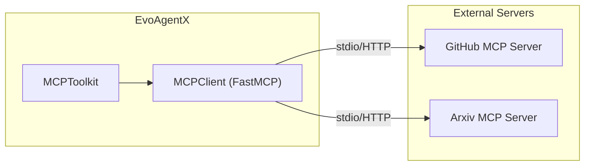

<!-- source: DeepWiki mcp.deepwiki.com · repo EvoAgentX/EvoAgentX · page 7 Tool System · fetched 2026-10-26 -->

# Tool System

Relevant source files

The following files were used as context for generating this wiki page:

- [docs/tutorial/mcp.md](docs/tutorial/mcp.md)
- [docs/tutorial/tools.md](docs/tutorial/tools.md)
- [docs/zh/tutorial/tools.md](docs/zh/tutorial/tools.md)
- [evoagentx/tools/__init__.py](evoagentx/tools/__init__.py)
- [evoagentx/tools/interpreter_base.py](evoagentx/tools/interpreter_base.py)
- [evoagentx/tools/interpreter_docker.py](evoagentx/tools/interpreter_docker.py)
- [evoagentx/tools/interpreter_python.py](evoagentx/tools/interpreter_python.py)
- [evoagentx/tools/mcp.py](evoagentx/tools/mcp.py)
- [evoagentx/tools/search_base.py](evoagentx/tools/search_base.py)
- [evoagentx/tools/search_ddgs.py](evoagentx/tools/search_ddgs.py)
- [evoagentx/tools/search_google.py](evoagentx/tools/search_google.py)
- [evoagentx/tools/search_google_f.py](evoagentx/tools/search_google_f.py)
- [evoagentx/tools/search_wiki.py](evoagentx/tools/search_wiki.py)
- [evoagentx/tools/tool.py](evoagentx/tools/tool.py)
- [examples/mcp_agent.py](examples/mcp_agent.py)
- [examples/sequential_workflow.py](examples/sequential_workflow.py)

This document provides comprehensive documentation of EvoAgentX's tool ecosystem, from base classes to specific tool implementations. The tool system enables agents to execute code, search the web, manipulate databases, process files, send emails, generate images, and integrate with external services through standardized interfaces.

For information about using these tools within agents, see [Agent System](#3). For workflow-level tool orchestration, see [Workflow System](#4). For action-level tool integration, see [Action System](#5).

## Tool System Architecture

The EvoAgentX tool ecosystem is built on a standardized architecture with two foundational classes: `Tool` and `Toolkit` defined in [evoagentx/tools/tool.py](). All tools inherit from the base `Tool` class and are organized into `Toolkit` collections for related functionality.

### Base Tool and Toolkit Classes

**Tool Ecosystem Overview**

```mermaid
graph TB
    subgraph "Base Classes (evoagentx/tools/tool.py)"
        Tool["Tool"]
        Toolkit["Toolkit"]
    end
    
    subgraph "Code Interpreters"
        PythonInterpreter["PythonInterpreterToolkit"]
        DockerInterpreter["DockerInterpreterToolkit"]
    end
    
    subgraph "Search & Web"
        WikiSearch["WikipediaSearchToolkit"]
        GoogleSearch["GoogleSearchToolkit"]
        GoogleFree["GoogleFreeSearchToolkit"]
        DDGSSearch["DDGSSearchToolkit"]
        SerpAPI["SerpAPIToolkit"]
        SerperAPI["SerperAPIToolkit"]
        ExaSearch["ExaSearchToolkit"]
    end
    
    subgraph "Database Tools"
        PostgreSQL["PostgreSQLToolkit"]
        MongoDB["MongoDBToolkit"]
        FaissDB["FaissToolkit"]
    end
    
    subgraph "Communication"
        Gmail["GmailToolkit"]
        Telegram["TelegramToolkit"]
    end
    
    subgraph "Image Processing"
        OpenAIImage["OpenAIImageToolkit"]
        FluxImage["FluxImageGenerationToolkit"]
        OpenRouterImage["OpenRouterImageToolkit"]
    end
    
    subgraph "Browser Automation"
        Browser["BrowserToolkit"]
        BrowserUse["BrowserUseToolkit"]
    end
    
    subgraph "Files & Storage"
        FileToolkit["FileToolkit"]
        StorageToolkit["StorageToolkit"]
        CMDToolkit["CMDToolkit"]
    end
    
    subgraph "External Protocols"
        MCP["MCPToolkit"]
        Request["RequestToolkit"]
        Arxiv["ArxivToolkit"]
        RSS["RSSToolkit"]
        GoogleMaps["GoogleMapsToolkit"]
    end
    
    Tool --> PythonInterpreter
    Tool --> DockerInterpreter
    Tool --> WikiSearch
    Tool --> GoogleSearch
    Tool --> GoogleFree
    Tool --> DDGSSearch
    Tool --> SerpAPI
    Tool --> SerperAPI
    Tool --> ExaSearch
    Tool --> PostgreSQL
    Tool --> MongoDB
    Tool --> Gmail
    Tool --> Telegram
    Tool --> OpenAIImage
    Tool --> FluxImage
    Tool --> OpenRouterImage
    Tool --> Browser
    Tool --> BrowserUse
    Tool --> FileToolkit
    Tool --> StorageToolkit
    Tool --> CMDToolkit
    Tool --> MCP
    Tool --> Request
    Tool --> Arxiv
    Tool --> RSS
    Tool --> GoogleMaps
    
    Toolkit --> PythonInterpreter
    Toolkit --> DockerInterpreter
    Toolkit --> WikiSearch
    Toolkit --> GoogleSearch
    Toolkit --> PostgreSQL
    Toolkit --> Gmail
```

**Base Tool Interface Properties**

| Property | Type | Purpose |
|----------|------|---------|
| `name` | `str` | Unique tool identifier |
| `description` | `str` | Tool functionality description |
| `inputs` | `Dict[str, Dict[str, Any]]` | Input parameter schema |
| `required` | `Optional[List[str]]` | Required parameter names |
| `__call__()` | Method | Tool execution logic |

**Toolkit Interface Methods**

| Method | Return Type | Purpose |
|--------|-------------|---------|
| `get_tool(tool_name: str)` | `Tool` | Retrieve specific tool by name |
| `get_tools()` | `List[Tool]` | Get all tools in toolkit |
| `get_tool_schemas()` | `List[Dict]` | Get OpenAI-compatible schemas |

Sources: [evoagentx/tools/__init__.py:1-74](), [evoagentx/tools/tool.py](), [evoagentx/tools/mcp.py:28-117]()

### Tool Organization and Discovery

**Toolkit Structure Pattern**

Sources: [evoagentx/tools/tool.py](), [evoagentx/tools/__init__.py:15-17](), [docs/tutorial/tools.md:37-70]()

## Code Execution Tools

EvoAgentX provides secure code execution capabilities through two main interpreter toolkits that isolate code execution in controlled environments. For details, see [Code Interpreters](#7.2).

### Python Interpreter Architecture

The `PythonInterpreterToolkit` executes Python code in a sandboxed environment with configurable import restrictions and directory access controls.

**Python Interpreter Configuration**

| Parameter | Type | Purpose | Default |
|-----------|------|---------|---------|
| `project_path` | `str` | Root directory for module resolution | `"."` |
| `directory_names` | `List[str]` | Directories to check for imports | `[]` |
| `allowed_imports` | `Set[str]` | Permitted Python modules for security | `set()` |

Sources: [evoagentx/tools/interpreter_python.py:17-52](), [docs/tutorial/tools.md:51]()

### Docker Interpreter Architecture

The `DockerInterpreterToolkit` provides maximum isolation by executing code within Docker containers, supporting both pre-built images and custom Dockerfiles.

**Docker Configuration Options**

| Parameter | Purpose | Example |
|-----------|---------|---------|
| `image_tag` | Pre-built Docker image | `"python:3.9-slim"` |
| `dockerfile_path` | Custom Dockerfile location | `"./Dockerfile"` |
| `container_directory` | Working directory in container | `"/home/app/"` |
| `host_directory` | Local directory to mount | `"./data"` |

Sources: [evoagentx/tools/interpreter_docker.py:13-96](), [docs/tutorial/tools.md:52]()

## Search Tools

The search tool ecosystem provides information retrieval capabilities through multiple specialized toolkits, each built on the `SearchBase` foundation class. For details, see [Search Tools](#7.3).

### Search Toolkit Architecture

**Search Tool Hierarchy**

**Search Toolkit Feature Comparison**

| Toolkit | API Key | Description |
|---------|---------|-------------|
| `WikipediaSearchToolkit` | No | Search Wikipedia and retrieve full content or summaries |
| `GoogleSearchToolkit` | Yes | Official Google Custom Search API integration |
| `GoogleFreeSearchToolkit` | No | Lightweight Google-style search without credentials |
| `DDGSSearchToolkit` | No | Privacy-focused search using DuckDuckGo backends |
| `SerpAPIToolkit` | Yes | Multi-engine search (Google/Bing/Baidu) with scraping |
| `ExaSearchToolkit` | Yes | Neural search optimized for LLM consumption |

Sources: [evoagentx/tools/search_base.py:8-42](), [evoagentx/tools/search_wiki.py:9-38](), [evoagentx/tools/search_google.py:10-29](), [evoagentx/tools/search_google_f.py:7-28](), [docs/tutorial/tools.md:54-59]()

## Database Tools

EvoAgentX provides comprehensive database toolkits for PostgreSQL, MongoDB, and FAISS. For details, see [Database Tools](#7.4).

### PostgreSQL Toolkit

The `PostgreSQLToolkit` supports dual-mode operation:
- **Remote Mode**: Connects to standard PostgreSQL servers using `psycopg2`.
- **Local Mode**: Uses local JSON files to simulate relational storage when no server is available.

Sources: [evoagentx/tools/database_postgresql.py:1-1159](), [docs/tutorial/tools.md:27]()

### MongoDB Toolkit

The `MongoDBToolkit` provides document-oriented storage operations including complex filters, projections, and aggregation pipelines.

Sources: [evoagentx/tools/database_mongodb.py:1-200](), [evoagentx/tools/__init__.py:16]()

## Gmail Integration

The `GmailToolkit` provides 11 specialized tools for email operations, including reading, searching, managing drafts, and handling attachments. For details, see [Gmail Integration](#7.5).

**Key Gmail Tools:**
- `gmail_list_messages`: List emails with optional query filters.
- `gmail_send_message`: Compose and send new emails.
- `gmail_create_draft`: Manage email drafts before sending.
- `gmail_get_attachment`: Download files attached to messages.

Sources: [evoagentx/tools/gmail_tools.py:1-500](), [docs/tutorial/tools.md:65]()

## Image Tools

EvoAgentX supports image generation and analysis through multiple providers. For details, see [Image Tools](#7.6).

| Toolkit | Provider | Primary Use Case |
|---------|----------|------------------|
| `OpenAIImageToolkit` | OpenAI | DALL-E 3 generation and GPT-4o analysis |
| `FluxImageGenerationToolkit` | Flux | High-quality image generation and editing |
| `OpenRouterImageToolkit` | OpenRouter | Multi-model image generation and analysis |

Sources: [evoagentx/tools/__init__.py:20-25](), [docs/tutorial/tools.md:28]()

## Browser Tools

EvoAgentX offers two browser automation paths. For details, see [Browser Tools](#7.7).

- **`BrowserToolkit`**: Fine-grained Selenium-based control using element IDs (e.g., `e0`, `e1`) for precise interactions.
- **`BrowserUseToolkit`**: Natural language-driven automation that translates goals directly into browser actions.

Sources: [evoagentx/tools/browser_tool.py:1-100](), [evoagentx/tools/browser_use.py:1-50](), [docs/tutorial/tools.md:29]()

## MCP Integration

The `MCPToolkit` implements the Model Context Protocol using **FastMCP 2.0**, allowing agents to connect to external tool servers (via stdio or HTTP). For details, see [MCP Integration](#7.8).

**MCP Client Workflow**

Sources: [evoagentx/tools/mcp.py:1-27](), [docs/tutorial/mcp.md:1-33]()

## Research and Specialized Tools

EvoAgentX includes a variety of specialized toolkits for domain-specific tasks. For details, see [Research and Specialized Tools](#7.9).

- **Research**: `ArxivToolkit` for paper search and `ResearchToolkit` for comprehensive literature review.
- **Communication**: `TelegramToolkit` for bot interactions.
- **Finance**: Tools for stock and crypto analysis (via specialized toolkits).
- **Navigation**: `GoogleMapsToolkit` for path planning and geoinformation.
- **System**: `CMDToolkit` for shell command execution and `FileToolkit` for file I/O.

Sources: [evoagentx/tools/__init__.py:11-14, 26, 67, 69](), [docs/tutorial/tools.md:61-64]()

---

