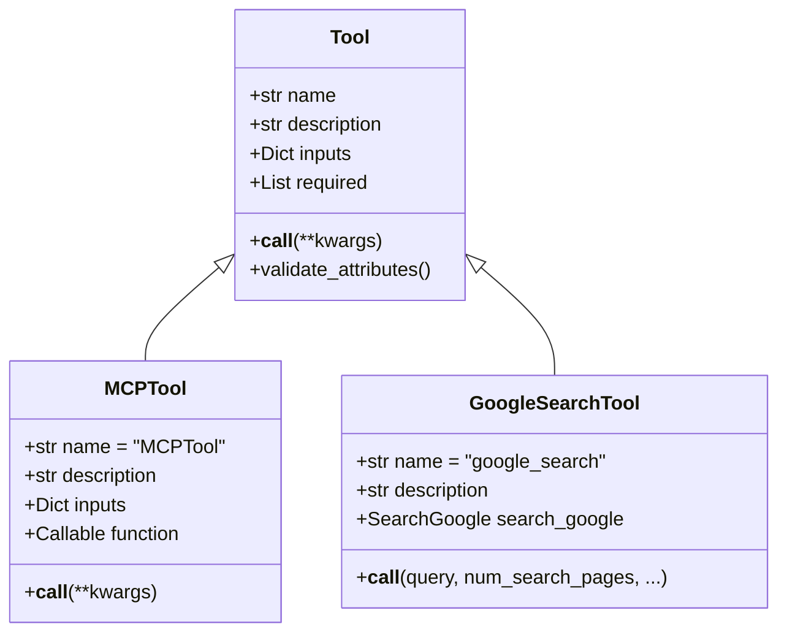
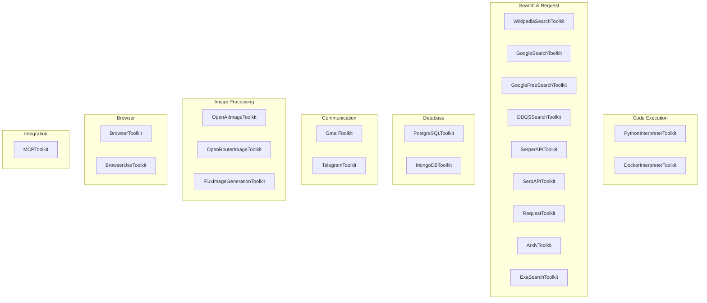
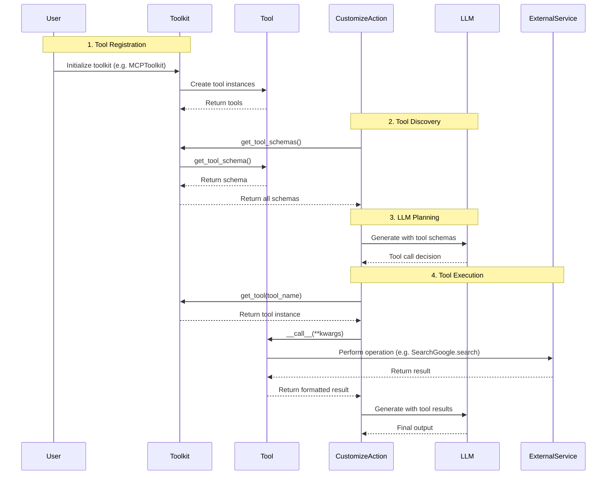
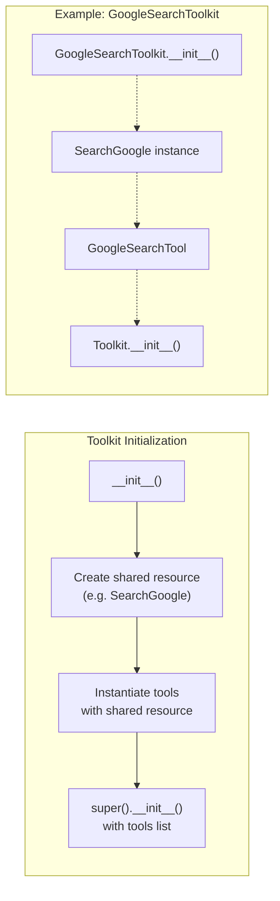
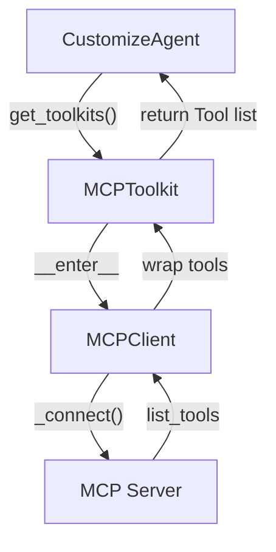
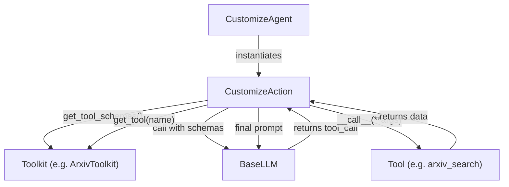

<!-- source: DeepWiki mcp.deepwiki.com · repo EvoAgentX/EvoAgentX · page 7.1 Tool Architecture · fetched 2026-10-26 -->

# Tool Architecture

<details>
<summary>Relevant source files</summary>

The following files were used as context for generating this wiki page:

- [docs/tutorial/mcp.md](docs/tutorial/mcp.md)
- [docs/tutorial/tools.md](docs/tutorial/tools.md)
- [docs/zh/tutorial/tools.md](docs/zh/tutorial/tools.md)
- [evoagentx/tools/__init__.py](evoagentx/tools/__init__.py)
- [evoagentx/tools/interpreter_base.py](evoagentx/tools/interpreter_base.py)
- [evoagentx/tools/interpreter_docker.py](evoagentx/tools/interpreter_docker.py)
- [evoagentx/tools/interpreter_python.py](evoagentx/tools/interpreter_python.py)
- [evoagentx/tools/mcp.py](evoagentx/tools/mcp.py)
- [evoagentx/tools/search_base.py](evoagentx/tools/search_base.py)
- [evoagentx/tools/search_ddgs.py](evoagentx/tools/search_ddgs.py)
- [evoagentx/tools/search_google.py](evoagentx/tools/search_google.py)
- [evoagentx/tools/search_google_f.py](evoagentx/tools/search_google_f.py)
- [evoagentx/tools/search_wiki.py](evoagentx/tools/search_wiki.py)
- [evoagentx/tools/tool.py](evoagentx/tools/tool.py)
- [examples/mcp_agent.py](examples/mcp_agent.py)
- [examples/sequential_workflow.py](examples/sequential_workflow.py)

</details>


This document describes the core architecture of the tool system in EvoAgentX, including the `Tool` and `Toolkit` base classes, tool schemas, and patterns for creating custom tools. The tool system provides a standardized interface for agents to interact with external services, execute code, query databases, search the web, and perform other operations.

For specific tool implementations and usage examples, see:
- Code execution tools: [Code Interpreters](#7.2)
- Search and web tools: [Search Tools](#7.3)
- Database tools: [Database Tools](#7.4)
- Gmail integration: [Gmail Integration](#7.5)
- Image processing tools: [Image Tools](#7.6)
- Browser automation: [Browser Tools](#7.7)
- MCP protocol integration: [MCP Integration](#7.8)

For how tools are used within actions, see [Tool Calling in Actions](#5.3).

---

## Core Components

The tool system is built on two primary base classes: `Tool` and `Toolkit`. These provide the foundation for all tool implementations in EvoAgentX.

### Tool Base Class

The `Tool` class defines the interface that all tools must implement. Each tool represents a single, well-defined operation that can be called by an agent.

**Key Attributes:**

| Attribute | Type | Description |
|-----------|------|-------------|
| `name` | `str` | Unique identifier for the tool |
| `description` | `str` | Human-readable description of what the tool does |
| `inputs` | `Dict[str, Dict[str, Any]]` | Schema defining the tool's parameters |
| `required` | `List[str]` | List of required parameter names |

**Key Methods:**

- `__call__(**kwargs)`: Executes the tool's functionality with the provided parameters.
- `validate_attributes()`: Validates that the tool implementation has all required metadata.

**Example Tool Structure:**



Sources: [evoagentx/tools/tool.py:1-40](), [evoagentx/tools/mcp.py:28-47](), [evoagentx/tools/search_google.py:108-140]()

### Toolkit Base Class

The `Toolkit` class groups related tools together and provides methods for accessing and managing them. Toolkits serve as organizational units that bundle tools for a specific domain (e.g., database operations, search functionality).

**Key Methods:**

| Method | Description |
|--------|-------------|
| `get_tool(tool_name: str)` | Returns a specific tool by name |
| `get_tools()` | Returns all available tools in the toolkit |
| `get_tool_schemas()` | Returns OpenAI-compatible schemas for all tools |

**Toolkit Implementation Pattern:**

```python
class GoogleSearchToolkit(Toolkit):
    def __init__(self, num_search_pages=5, **kwargs):
        # Create shared search instance
        search_google = SearchGoogle(num_search_pages=num_search_pages, **kwargs)
        
        # Create tools with the shared search instance
        tools = [
            GoogleSearchTool(search_google=search_google)
        ]
        
        # Initialize parent Toolkit
        super().__init__(name="GoogleSearchToolkit", tools=tools)
```

**Available Toolkits:**

The framework provides toolkits across multiple categories:



Sources: [evoagentx/tools/__init__.py:1-74](), [docs/tutorial/tools.md:50-73]()

### Tool Schemas

Tool schemas provide a standardized way to describe tool capabilities to language models. EvoAgentX uses OpenAI-compatible function schemas that specify parameter definitions with types and descriptions.

**Schema Structure Example:**

```json
{
  "type": "function",
  "function": {
    "name": "google_search",
    "description": "Search Google using the Custom Search API and retrieve content from search results",
    "parameters": {
      "type": "object",
      "properties": {
        "query": {
          "type": "string",
          "description": "The search query to execute on Google"
        },
        "num_search_pages": {
          "type": "integer",
          "description": "Number of search results to retrieve. Default: 5"
        }
      },
      "required": ["query"]
    }
  }
}
```

The `inputs` attribute on the `Tool` class defines the schema structure:

```python
inputs: Dict[str, Dict[str, str]] = {
    "query": {
        "type": "string",
        "description": "The search query to execute on Google"
    },
    "num_search_pages": {
        "type": "integer",
        "description": "Number of search results to retrieve. Default: 5"
    }
}
required: List[str] = ["query"]
```

Sources: [evoagentx/tools/search_google.py:111-125](), [docs/tutorial/tools.md:181-202]()

---

## Tool System Design

### Tool Lifecycle and Execution Flow

The following diagram shows how tools are registered, discovered, and executed within the EvoAgentX framework:



Sources: [docs/tutorial/tools.md:141-173](), [evoagentx/tools/search_google.py:131-139]()

### Tool Registration Pattern

Tools are registered by instantiating them within a toolkit's `__init__` method. This pattern ensures that all tools in a toolkit share common resources.

**Registration Flow Diagram:**



Sources: [evoagentx/tools/search_google.py:142-167](), [evoagentx/tools/search_wiki.py:140-168]()

---

## Advanced Implementations

### Code Interpreters

Code interpreters extend `BaseInterpreter` and provide safe execution environments.

- **PythonInterpreter**: Uses `ast` analysis to enforce safety and restricted imports [evoagentx/tools/interpreter_python.py:17-111]().
- **DockerInterpreter**: Runs code inside isolated Docker containers for maximum security [evoagentx/tools/interpreter_docker.py:13-39]().

### Search Base and Scrapers

Search tools often inherit from `SearchBase`, which provides utility methods like `_scrape_page` and `_truncate_content` using `BeautifulSoup` and `html2text` [evoagentx/tools/search_base.py:8-116]().

### Model Context Protocol (MCP)

The `MCPToolkit` uses `FastMCP` 2.0 to dynamically discover tools from external servers [evoagentx/tools/mcp.py:119-142]().

**MCP Tool Discovery Flow:**



Sources: [evoagentx/tools/mcp.py:119-182](), [examples/mcp_agent.py:18-46]()

---

## Creating Custom Tools

### Implementing a Custom Tool

To create a custom tool, extend the `Tool` base class and implement the `__call__()` method.

```python
from evoagentx.tools import Tool

class MyCustomTool(Tool):
    name: str = "my_tool"
    description: str = "Does something special"
    inputs: Dict[str, Dict[str, Any]] = {
        "input_val": {"type": "string", "description": "Input description"}
    }
    required: List[str] = ["input_val"]
    
    def __call__(self, input_val: str):
        return f"Processed {input_val}"
```

Sources: [evoagentx/tools/tool.py:1-40](), [docs/tutorial/tools.md:129-155]()

### Organizing into Toolkits

Organize related tools into a `Toolkit` to provide them to an agent as a single unit.

```python
from evoagentx.tools import Toolkit

class MyToolkit(Toolkit):
    def __init__(self):
        tools = [MyCustomTool()]
        super().__init__(name="MyToolkit", tools=tools)
```

Sources: [evoagentx/tools/tool.py:42-65](), [evoagentx/tools/search_google.py:142-167]()

---

## Integration with Agents

Tools are provided to agents (like `CustomizeAgent`) during initialization. The agent uses these toolkits to generate the `tools` parameter for LLM calls [examples/mcp_agent.py:23-37]().

**Data Flow in Agent Tool Calling:**



Sources: [docs/tutorial/tools.md:126-154](), [examples/mcp_agent.py:23-46]()

---

