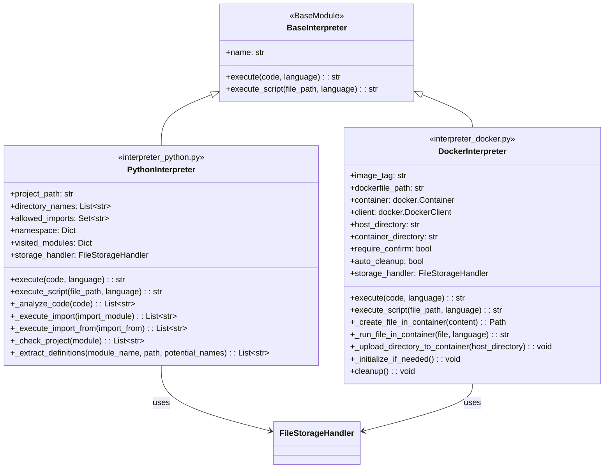
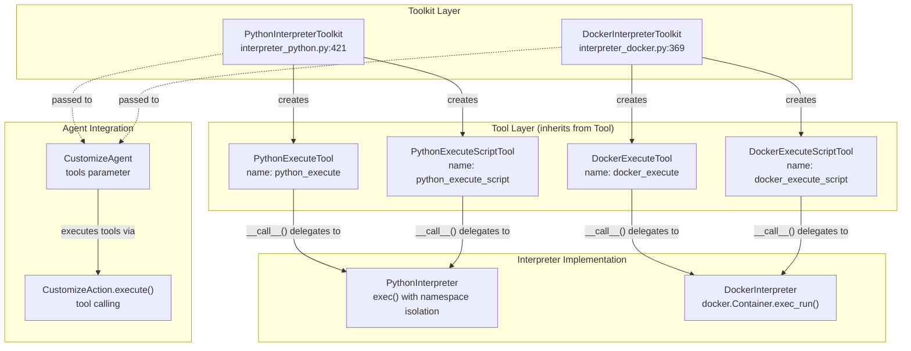
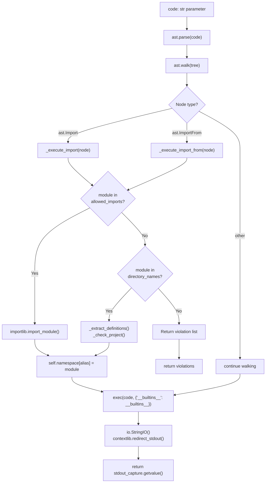
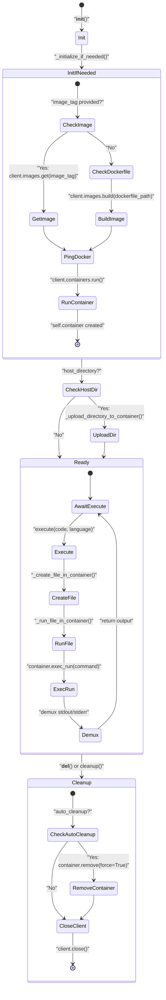
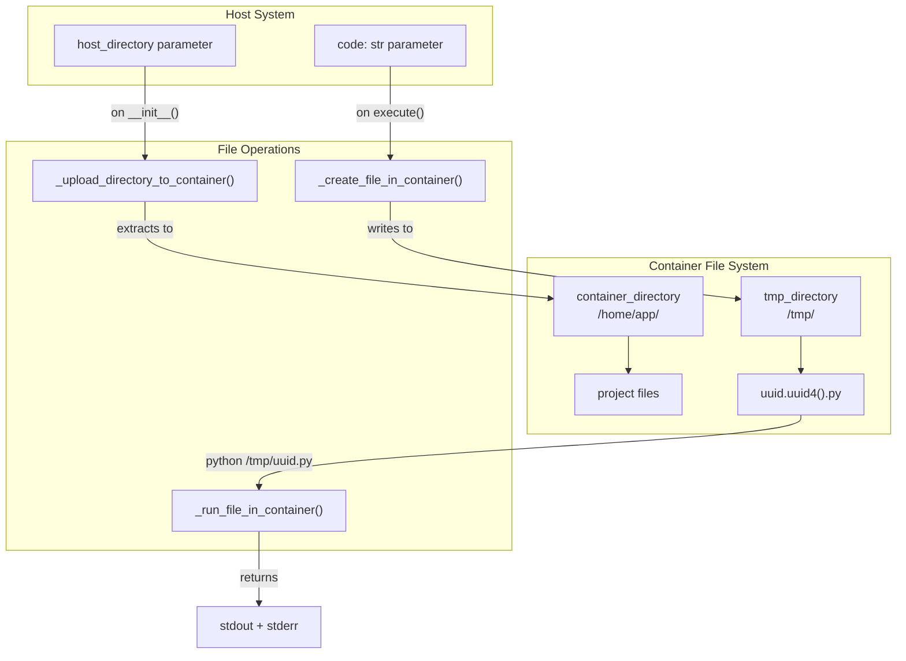

<!-- source: DeepWiki mcp.deepwiki.com · repo EvoAgentX/EvoAgentX · page 7.2 Code Interpreters · fetched 2026-10-26 -->

# Code Interpreters

Relevant source files

The following files were used as context for generating this wiki page:

- [evoagentx/tools/interpreter_base.py](evoagentx/tools/interpreter_base.py)
- [evoagentx/tools/interpreter_docker.py](evoagentx/tools/interpreter_docker.py)
- [evoagentx/tools/interpreter_python.py](evoagentx/tools/interpreter_python.py)
- [evoagentx/tools/search_base.py](evoagentx/tools/search_base.py)
- [evoagentx/tools/search_ddgs.py](evoagentx/tools/search_ddgs.py)
- [evoagentx/tools/search_google.py](evoagentx/tools/search_google.py)
- [evoagentx/tools/search_google_f.py](evoagentx/tools/search_google_f.py)
- [evoagentx/tools/search_wiki.py](evoagentx/tools/search_wiki.py)
- [evoagentx/tools/tool.py](evoagentx/tools/tool.py)

This page documents EvoAgentX's code execution capabilities through the Python and Docker interpreter systems. Code interpreters provide secure, controlled environments for executing code within agent workflows, supporting sandboxing, import restrictions, and containerized isolation.

## Architecture Overview

The code interpreter system is built on a hierarchical architecture with `BaseInterpreter` as the foundation and specialized implementations for different execution environments.

### Interpreter Class Hierarchy

Sources: [evoagentx/tools/interpreter_base.py:3-16](), [evoagentx/tools/interpreter_python.py:17-59](), [evoagentx/tools/interpreter_docker.py:13-100]()

### Tool Integration Architecture

Sources: [evoagentx/tools/interpreter_python.py:361-450](), [evoagentx/tools/interpreter_docker.py:309-411](), [evoagentx/tools/tool.py:10-113]()

## Python Interpreter

The `PythonInterpreter` class provides Python code execution within the current process but applies security constraints through AST analysis and namespace management.

### Core Components

| Component | Description | Location |
|-----------|-------------|----------|
| `PythonInterpreter` | Main interpreter class | [evoagentx/tools/interpreter_python.py:17-358]() |
| `PythonExecuteTool` | Tool wrapper for code execution | [evoagentx/tools/interpreter_python.py:361-389]() |
| `PythonExecuteScriptTool` | Tool wrapper for script execution | [evoagentx/tools/interpreter_python.py:391-419]() |
| `PythonInterpreterToolkit` | Toolkit containing both tools | [evoagentx/tools/interpreter_python.py:421-450]() |

### Security Model

The Python interpreter implements multi-layered security through AST analysis before execution:

**Key Security Components**:
- `_analyze_code()`: Parses AST and checks all import statements [evoagentx/tools/interpreter_python.py:258-283]().
- `_execute_import()`: Validates `import module` statements against `allowed_imports` [evoagentx/tools/interpreter_python.py:193-224]().
- `_execute_import_from()`: Validates `from module import name` statements [evoagentx/tools/interpreter_python.py:226-256]().
- `_check_project()`: Validates local project imports against `directory_names` [evoagentx/tools/interpreter_python.py:146-191]().
- `_extract_definitions()`: Loads local modules and extracts functions/classes safely [evoagentx/tools/interpreter_python.py:74-144]().

Sources: [evoagentx/tools/interpreter_python.py:258-283](), [evoagentx/tools/interpreter_python.py:193-256](), [evoagentx/tools/interpreter_python.py:146-191](), [evoagentx/tools/interpreter_python.py:285-342]()

### Configuration Parameters

| Parameter | Type | Default | Description |
|-----------|------|---------|-------------|
| `project_path` | `str` | `"."` | Path to the project directory for module resolution [evoagentx/tools/interpreter_python.py:19](). |
| `directory_names` | `List[str]` | `[]` | List of directory names to check for imports [evoagentx/tools/interpreter_python.py:20](). |
| `allowed_imports` | `Set[str]` | `set()` | Set of allowed module imports to enforce security [evoagentx/tools/interpreter_python.py:21](). |

Sources: [evoagentx/tools/interpreter_python.py:19-21]()

## Docker Interpreter

The `DockerInterpreter` class provides maximum isolation by executing code within Docker containers. It supports Python and Bash scripts in an isolated environment [evoagentx/tools/interpreter_docker.py:13-16]().

### Container Lifecycle

**Lifecycle Methods**:
- `_initialize_if_needed()`: Resolves image and starts the container [evoagentx/tools/interpreter_docker.py:131-164]().
- `_upload_directory_to_container()`: Uploads host directory files to the container [evoagentx/tools/interpreter_docker.py:166-196]().
- `_create_file_in_container()`: Writes code to a temporary file inside the container [evoagentx/tools/interpreter_docker.py:201-218]().
- `_run_file_in_container()`: Executes the file using `container.exec_run` [evoagentx/tools/interpreter_docker.py:220-244]().

Sources: [evoagentx/tools/interpreter_docker.py:131-244]()

### File System Integration

The Docker interpreter manages two types of file operations: persistent directory mounting and temporary code file execution.

Sources: [evoagentx/tools/interpreter_docker.py:166-244]()

### Configuration Parameters

| Parameter | Type | Default | Description |
|-----------|------|---------|-------------|
| `image_tag` | `str` | `None` | Docker image tag to use [evoagentx/tools/interpreter_docker.py:36](). |
| `dockerfile_path` | `str` | `None` | Path to Dockerfile to build [evoagentx/tools/interpreter_docker.py:37](). |
| `host_directory` | `str` | `""` | Host directory to mount [evoagentx/tools/interpreter_docker.py:32](). |
| `container_directory` | `str` | `"/home/app/"` | Directory inside container [evoagentx/tools/interpreter_docker.py:33](). |
| `require_confirm` | `bool` | `False` | Require confirmation before execution [evoagentx/tools/interpreter_docker.py:29](). |
| `auto_cleanup` | `bool` | `True` | Cleanup container on `cleanup()` call [evoagentx/tools/interpreter_docker.py:38](). |

Sources: [evoagentx/tools/interpreter_docker.py:29-40]()

---

