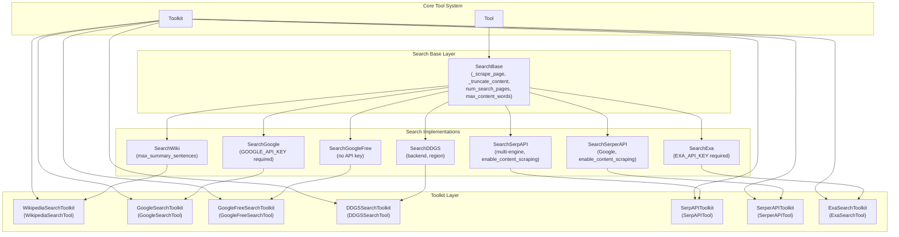
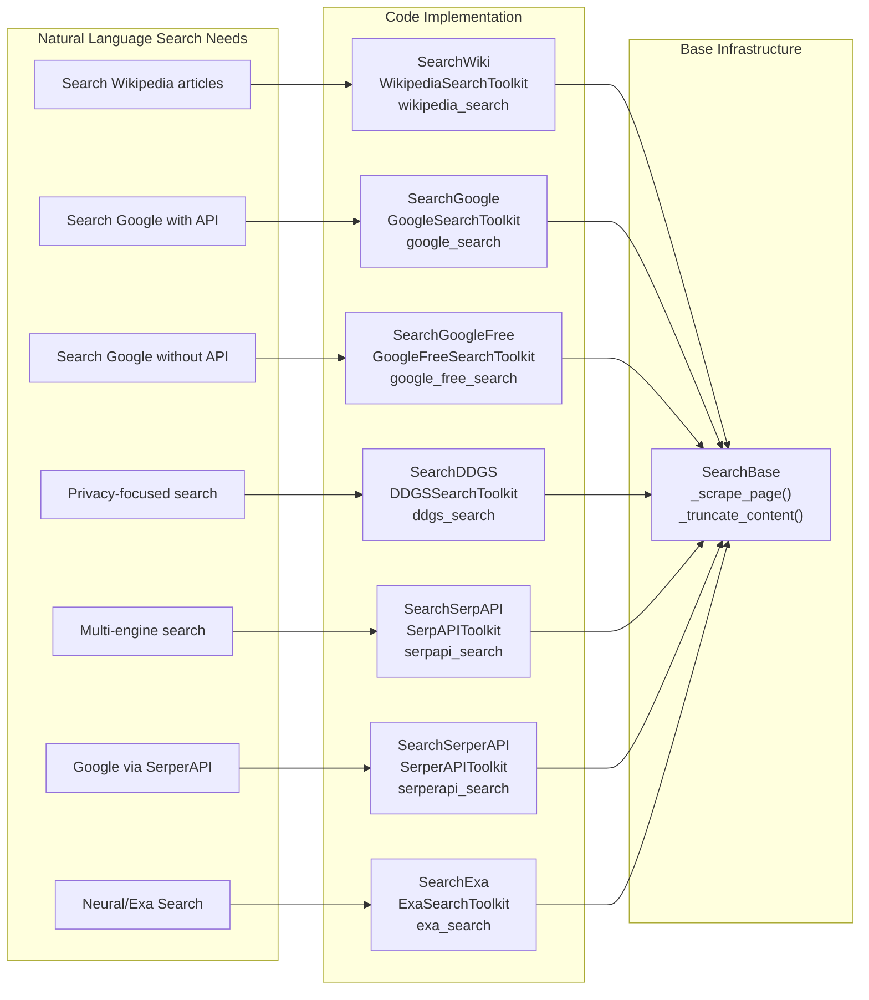

<!-- source: DeepWiki mcp.deepwiki.com · repo EvoAgentX/EvoAgentX · page 7.3 Search Tools · fetched 2026-10-26 -->

# Search Tools

<details>
<summary>Relevant source files</summary>

The following files were used as context for generating this wiki page:

- [.env.example](.env.example)
- [evoagentx/rag/embeddings/azure_openai_embedding.py](evoagentx/rag/embeddings/azure_openai_embedding.py)
- [evoagentx/rag/rag.py](evoagentx/rag/rag.py)
- [evoagentx/tools/interpreter_base.py](evoagentx/tools/interpreter_base.py)
- [evoagentx/tools/interpreter_docker.py](evoagentx/tools/interpreter_docker.py)
- [evoagentx/tools/interpreter_python.py](evoagentx/tools/interpreter_python.py)
- [evoagentx/tools/search_base.py](evoagentx/tools/search_base.py)
- [evoagentx/tools/search_ddgs.py](evoagentx/tools/search_ddgs.py)
- [evoagentx/tools/search_exa.py](evoagentx/tools/search_exa.py)
- [evoagentx/tools/search_google.py](evoagentx/tools/search_google.py)
- [evoagentx/tools/search_google_f.py](evoagentx/tools/search_google_f.py)
- [evoagentx/tools/search_serpapi.py](evoagentx/tools/search_serpapi.py)
- [evoagentx/tools/search_serperapi.py](evoagentx/tools/search_serperapi.py)
- [evoagentx/tools/search_wiki.py](evoagentx/tools/search_wiki.py)
- [evoagentx/tools/tool.py](evoagentx/tools/tool.py)
- [examples/rag/multimodal_rag.py](examples/rag/multimodal_rag.py)
- [examples/rag/rag.py](examples/rag/rag.py)
- [examples/tools/tools_search.py](examples/tools/tools_search.py)
- [pyproject.toml](pyproject.toml)
- [requirements.txt](requirements.txt)

</details>


This page documents the search tool system in EvoAgentX, which provides agents with capabilities to search for information from various sources including Wikipedia, Google, and other search engines. These tools enable agents to retrieve web content, scrape pages, and process search results during workflow execution. All search tools support content extraction and truncation for optimal LLM processing.

The search tools covered include:
- **WikipediaSearchToolkit**: Search Wikipedia articles with summary control.
- **GoogleSearchToolkit**: Google Custom Search API with full content retrieval.
- **GoogleFreeSearchToolkit**: Google search without API requirements.
- **DDGSSearchToolkit**: Privacy-focused search with multiple backend support.
- **SerpAPIToolkit**: Multi-engine search (Google, Bing, Baidu, Yahoo, DuckDuckGo).
- **SerperAPIToolkit**: Google search via SerperAPI with content extraction.
- **ExaSearchToolkit**: Neural search using Exa AI for high-quality web content.

For information about the broader tool system architecture, see page 7.1. For code execution capabilities, see page 7.2. For browser automation, see page 7.7.

## Architecture Overview

The search tool system is built on a hierarchical architecture with `SearchBase` providing common functionality for web scraping and content processing. All search tools inherit from this base class and implement the `search()` method with tool-specific parameters.

### Search Tools Hierarchy



### Search Capabilities to Code Mapping



**Sources:** [evoagentx/tools/search_base.py:8-42](), [evoagentx/tools/search_wiki.py:9-169](), [evoagentx/tools/search_google.py:10-169](), [evoagentx/tools/search_google_f.py:7-142](), [evoagentx/tools/search_ddgs.py:8-187](), [evoagentx/tools/search_serpapi.py:12-472](), [evoagentx/tools/search_serperapi.py:12-423](), [evoagentx/tools/search_exa.py:10-140]()

## SearchBase Class

The `SearchBase` class provides the foundation for all search tools, implementing common web scraping and content processing functionality. All search tool implementations inherit from this base class.

### Core Methods

| Method | Signature | Purpose |
|--------|-----------|---------|
| `_scrape_page()` | `(url: str) -> Tuple[Optional[str], Optional[str]]` | Fetches title and main text content from web pages using `requests` and `BeautifulSoup`. |
| `_truncate_content()` | `(content: str, max_words: Optional[int]) -> str` | Limits content to specified word count while preserving original spacing. |

### Configuration Parameters

| Parameter | Type | Default | Description |
|-----------|------|---------|-------------|
| `name` | `str` | Required | Tool identifier. |
| `num_search_pages` | `int` | `5` | Number of search results to retrieve. |
| `max_content_words` | `Optional[int]` | `None` | Maximum words per result (None = no limit). |

### Web Scraping Implementation

The `_scrape_page()` method provides intelligent content extraction by targeting specific HTML tags like `<main>`, `<article>`, or specific Wikipedia content containers [evoagentx/tools/search_base.py:98-113](). It uses `html2text` to convert HTML to clean Markdown-like text [evoagentx/tools/search_base.py:35-41]().

**Sources:** [evoagentx/tools/search_base.py:8-42](), [evoagentx/tools/search_base.py:43-72](), [evoagentx/tools/search_base.py:74-116]()

## Search Tool Implementations

### WikipediaSearchToolkit

The `WikipediaSearchToolkit` provides access to Wikipedia articles with automatic disambiguation handling and summary control.

**Special Features:**
- Automatic disambiguation page handling (skips ambiguous results) [evoagentx/tools/search_wiki.py:87-89]().
- Automatic non-existent page handling (continues to next result) [evoagentx/tools/search_wiki.py:90-92]().
- Sentence-level control over summaries via `max_summary_sentences` [evoagentx/tools/search_wiki.py:72-76]().

**Sources:** [evoagentx/tools/search_wiki.py:9-169](), [evoagentx/tools/search_wiki.py:40-99](), [evoagentx/tools/search_wiki.py:102-138]()

### GoogleSearchToolkit

The `GoogleSearchToolkit` provides access to Google's Custom Search API with full content scraping capabilities.

**API Requirements:**
- `GOOGLE_API_KEY` and `GOOGLE_SEARCH_ENGINE_ID` environment variables [evoagentx/tools/search_google.py:48-49]().

**Search Process:**
1. Query Google Custom Search API [evoagentx/tools/search_google.py:66-74]().
2. Extract URLs and scrape full content from each URL using `_scrape_page()` [evoagentx/tools/search_google.py:83-87]().
3. Truncate content using `_truncate_content()` [evoagentx/tools/search_google.py:90]().

**Sources:** [evoagentx/tools/search_google.py:10-169](), [evoagentx/tools/search_google.py:31-105](), [evoagentx/tools/search_google.py:108-140]()

### GoogleFreeSearchToolkit

The `GoogleFreeSearchToolkit` provides Google search functionality without requiring API credentials by using the `googlesearch-python` library [evoagentx/tools/search_google_f.py:3-9]().

**Sources:** [evoagentx/tools/search_google_f.py:7-142](), [evoagentx/tools/search_google_f.py:30-77](), [evoagentx/tools/search_google_f.py:80-112]()

### ExaSearchToolkit

The `ExaSearchToolkit` leverages Exa AI's neural search engine to retrieve high-quality web content optimized for LLMs.

**Implementation Classes:**
- `SearchExa` - Core logic using `exa_py`.
- `ExaSearchTool` - Wrapper for agent usage.
- `ExaSearchToolkit` - Toolkit container.

**API Requirements:**
- `EXA_API_KEY` environment variable [evoagentx/tools/search_exa.py:49-50]().

**Special Features:**
- `use_text`: Retrieves full text content directly from Exa [evoagentx/tools/search_exa.py:68]().
- `use_highlights`: Retrieves relevant snippets (highlights) from the content [evoagentx/tools/search_exa.py:69]().
- `category`: Allows filtering by content type (e.g., "company", "research paper", "news") [evoagentx/tools/search_exa.py:67]().

**Sources:** [evoagentx/tools/search_exa.py:10-140](), [evoagentx/tools/search_exa.py:31-102](), [.env.example:8-8]()

### DDGSSearchToolkit

Provides privacy-focused search via DuckDuckGo with backend selection (e.g., "duckduckgo", "google", "bing") [evoagentx/tools/search_ddgs.py:8-154]().

### SerpAPIToolkit & SerperAPIToolkit

These toolkits provide multi-engine search (SerpAPI) or specialized Google search (SerperAPI) with built-in knowledge graph processing and optional content scraping [evoagentx/tools/search_serpapi.py:12-472](), [evoagentx/tools/search_serperapi.py:12-423]().

## Agent Integration

Search tools integrate with EvoAgentX agents through the standardized tool calling interface defined in `Tool` and `Toolkit` base classes [evoagentx/tools/tool.py:1-40]().

### Standardized Result Structures

All search tools return results in a consistent dictionary format:

```python
{
    "results": [
        {
            "title": "Title of the page",
            "content": "Truncated text content",
            "url": "https://example.com",
            # Optional fields like 'summary' for Wiki or 'highlights' for Exa
        }
    ],
    "error": None # Or error message string
}
```

**Sources:** [evoagentx/tools/search_wiki.py:81-86](), [evoagentx/tools/search_google.py:92-96](), [evoagentx/tools/search_exa.py:87-92]()

## Environment Configuration Summary

| Tool | Env Variable Required | Source |
|------|----------------------|--------|
| Google Search | `GOOGLE_API_KEY`, `GOOGLE_SEARCH_ENGINE_ID` | [evoagentx/tools/search_google.py:48-49]() |
| SerpAPI | `SERPAPI_KEY` | [evoagentx/tools/search_serpapi.py:74-74]() |
| SerperAPI | `SERPERAPI_KEY` | [evoagentx/tools/search_serperapi.py:70-70]() |
| Exa Search | `EXA_API_KEY` | [evoagentx/tools/search_exa.py:49-49]() |

**Sources:** [.env.example:1-8](), [evoagentx/tools/search_google.py:48-49](), [evoagentx/tools/search_exa.py:49-50]()

---

