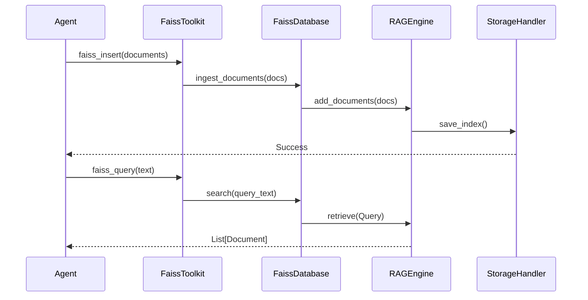

<!-- source: DeepWiki mcp.deepwiki.com · repo EvoAgentX/EvoAgentX · page 7.4 Database Tools · fetched 2026-10-26 -->

# Database Tools

<details>
<summary>Relevant source files</summary>

The following files were used as context for generating this wiki page:

- [evoagentx/tools/database_base.py](evoagentx/tools/database_base.py)
- [evoagentx/tools/database_faiss.py](evoagentx/tools/database_faiss.py)
- [evoagentx/tools/database_mongodb.py](evoagentx/tools/database_mongodb.py)
- [evoagentx/tools/database_postgresql.py](evoagentx/tools/database_postgresql.py)
- [evoagentx/tools/rss_feed.py](evoagentx/tools/rss_feed.py)
- [evoagentx/tools/storage_base.py](evoagentx/tools/storage_base.py)
- [evoagentx/tools/storage_file.py](evoagentx/tools/storage_file.py)
- [evoagentx/tools/storage_handler.py](evoagentx/tools/storage_handler.py)
- [examples/tools/tools_browser.py](examples/tools/tools_browser.py)
- [examples/tools/tools_database.py](examples/tools/tools_database.py)
- [examples/tools/tools_files.py](examples/tools/tools_files.py)
- [examples/tools/tools_integration.py](examples/tools/tools_integration.py)
- [examples/tools/tools_interpreter.py](examples/tools/tools_interpreter.py)

</details>


## Purpose and Scope

Database Tools provide data persistence, querying, and management capabilities for agent workflows. This page documents the PostgreSQL and MongoDB toolkits, which support both remote and local file-based storage, and the FAISS toolkit for vector-based semantic search.

---

## Architecture Overview

### Database Tool Hierarchy

The database tools in EvoAgentX follow a hierarchical architecture where concrete toolkits implement a common interface for connectivity and query execution.

Title: Database Tool System Architecture
```mermaid
graph TB
    subgraph "Base Classes"
        [DatabaseBase] --> [DatabaseType]
        [DatabaseBase] --> [QueryType]
        [DatabaseConnection]
    end
    
    subgraph "PostgreSQL Implementation"
        [PostgreSQLConnection] -- "manages" --> [PostgreSQLDatabase]
        [PostgreSQLDatabase] -- "used by" --> [PostgreSQLToolkit]
        [PostgreSQLToolkit] -- "contains" --> [PostgreSQLTools]
    end
    
    subgraph "MongoDB Implementation"
        [MongoDBConnection] -- "manages" --> [MongoDBDatabase]
        [MongoDBDatabase] -- "used by" --> [MongoDBToolkit]
        [MongoDBToolkit] -- "contains" --> [MongoDBTools]
    end
    
    subgraph "Vector Database"
        [FaissDatabase] -- "wraps" --> [RAGEngine]
        [FaissDatabase] -- "used by" --> [FaissToolkit]
    end

    [DatabaseBase] -.-> [PostgreSQLDatabase]
    [DatabaseBase] -.-> [MongoDBDatabase]
    [DatabaseConnection] -.-> [PostgreSQLConnection]
    [DatabaseConnection] -.-> [MongoDBConnection]
```
Sources: [evoagentx/tools/database_base.py:7-190](), [evoagentx/tools/database_postgresql.py:13-52](), [evoagentx/tools/database_mongodb.py:13-74](), [evoagentx/tools/database_faiss.py:177-201]()

### Core Abstractions

| Class | Role | Key Methods |
| :--- | :--- | :--- |
| `DatabaseBase` | Abstract interface for all DB operations. | `execute_query`, `get_schema`, `list_collections` |
| `DatabaseConnection` | Manages lifecycle of DB sessions. | `connect`, `disconnect`, `test_connection` |
| `Toolkit` | Groups individual tools for agent consumption. | `get_tools`, `get_tool` |

Sources: [evoagentx/tools/database_base.py:34-190]()

---

## PostgreSQL Toolkit

The `PostgreSQLToolkit` provides a unique dual-mode architecture. It can connect to a live PostgreSQL server or simulate a relational database using local JSON files.

### Dual-Mode Storage Logic

The `PostgreSQLDatabase` class determines its operational mode during `__init__` based on the provided connection string and local path.

Title: PostgreSQL Mode Selection Flow
```mermaid
graph TD
    [Start] --> [Check_connection_string]
    [Check_connection_string] -- "Has @ or postgresql://" --> [Remote_Mode]
    [Check_connection_string] -- "No remote prefix" --> [Check_Local_Path]
    
    [Remote_Mode] --> [Init_psycopg2]
    
    [Check_Local_Path] -- "db_info.json exists" --> [Load_Local_JSON]
    [Check_Local_Path] -- "New path" --> [Create_Local_Files]
    
    [Load_Local_JSON] --> [File_Based_Mode]
    [Create_Local_Files] --> [File_Based_Mode]
```
Sources: [evoagentx/tools/database_postgresql.py:77-138]()

### File-Based Mode Implementation
In `file_based_mode`, the toolkit implements a custom SQL parser to handle basic relational operations without a real DB server.

*   **Data Structure**: Tables are stored as `.json` files in the `local_path`. [evoagentx/tools/database_postgresql.py:176-180]()
*   **SQL Parsing**: Uses regex to parse `SELECT`, `INSERT`, `UPDATE`, `DELETE`, and `CREATE TABLE`. [evoagentx/tools/database_postgresql.py:206-237]()
*   **Joins**: Supports `INNER JOIN` and `CROSS JOIN` by iterating through local JSON datasets. [evoagentx/tools/database_postgresql.py:239-300]()
*   **Persistence**: The `_save_table_to_file` method serializes the in-memory `self.tables` dict back to disk. [evoagentx/tools/database_postgresql.py:194-202]()

### Available PostgreSQL Tools
*   `postgresql_execute`: Executes raw SQL. [evoagentx/tools/database_postgresql.py:972-1001]()
*   `postgresql_find`: High-level SELECT tool. [evoagentx/tools/database_postgresql.py:1003-1035]()
*   `postgresql_update`: Updates records. [evoagentx/tools/database_postgresql.py:1037-1067]()
*   `postgresql_create`: Creates new tables (files). [evoagentx/tools/database_postgresql.py:1069-1091]()
*   `postgresql_delete`: Removes records. [evoagentx/tools/database_postgresql.py:1093-1115]()

---

## MongoDB Toolkit

The `MongoDBToolkit` mirrors the PostgreSQL architecture but targets document-oriented storage.

### Operational Modes
1.  **Remote Mode**: Uses `pymongo.MongoClient` to connect to a real MongoDB instance. [evoagentx/tools/database_mongodb.py:147-164]()
2.  **Local Mode**: Simulates MongoDB by loading JSON collections into memory and persisting them to a local directory. [evoagentx/tools/database_mongodb.py:166-189]()

### Key MongoDB Tools
*   `mongodb_execute_query`: Executes `insert`, `update`, `delete`, or `aggregate` operations. [evoagentx/tools/database_mongodb.py:942-975]()
*   `mongodb_find`: Standard query tool with support for `filter`, `projection`, `sort`, and `limit`. [evoagentx/tools/database_mongodb.py:977-1017]()
*   `mongodb_update`: Specifically for updating existing documents. [evoagentx/tools/database_mongodb.py:1019-1055]()

Sources: [evoagentx/tools/database_mongodb.py:942-1110]()

---

## FAISS Vector Database Toolkit

The `FaissToolkit` provides semantic search capabilities by wrapping the framework's RAG engine.

### Implementation Detail
The `FaissDatabase` class integrates the `RAGEngine` to handle embeddings and the `StorageHandler` to manage persistence.

Title: FAISS Toolkit Data Flow

Sources: [evoagentx/tools/database_faiss.py:177-340]()

### Core Functionality
*   **Automatic Path Handling**: `_ensure_database_path` validates SQLite and FAISS index locations, creating parent directories if necessary. [evoagentx/tools/database_faiss.py:60-110]()
*   **File Processing**: The `faiss_insert` tool can accept raw text or file paths (PDF, TXT, MD), which are automatically read and processed. [evoagentx/tools/database_faiss.py:31-37]()
*   **Default Configuration**: Uses `text-embedding-ada-002` by default with a chunk size of 500 characters. [evoagentx/tools/database_faiss.py:156-174]()

### Available FAISS Tools
*   `faiss_query`: Semantic search using vector similarity. [evoagentx/tools/database_faiss.py:534-566]()
*   `faiss_insert`: Adds content to the vector store. [evoagentx/tools/database_faiss.py:568-605]()
*   `faiss_delete`: Removes documents by ID or metadata. [evoagentx/tools/database_faiss.py:607-639]()
*   `faiss_stats`: Returns corpus information and document counts. [evoagentx/tools/database_faiss.py:641-664]()

---

## Storage Integration

Database tools often interact with the lower-level `StorageBase` and `StorageHandler` systems to manage physical file I/O, especially in local modes.

### Path Translation
The `StorageBase` class provides `translate_in` and `translate_out` to resolve relative paths against a `base_path`, ensuring tools operate within restricted directories.

Sources: [evoagentx/tools/storage_base.py:106-191]()

### File Storage Tools
While not strictly databases, the `StorageToolkit` provides file-level persistence that database tools build upon:
*   `SaveTool`: Saves content with automatic format detection (JSON, CSV, XML, etc.). [evoagentx/tools/storage_file.py:9-132]()
*   `ReadTool`: Reads and parses file content into structured Python objects. [evoagentx/tools/storage_file.py:134-210]()

Sources: [evoagentx/tools/storage_file.py:1-250]()

---

