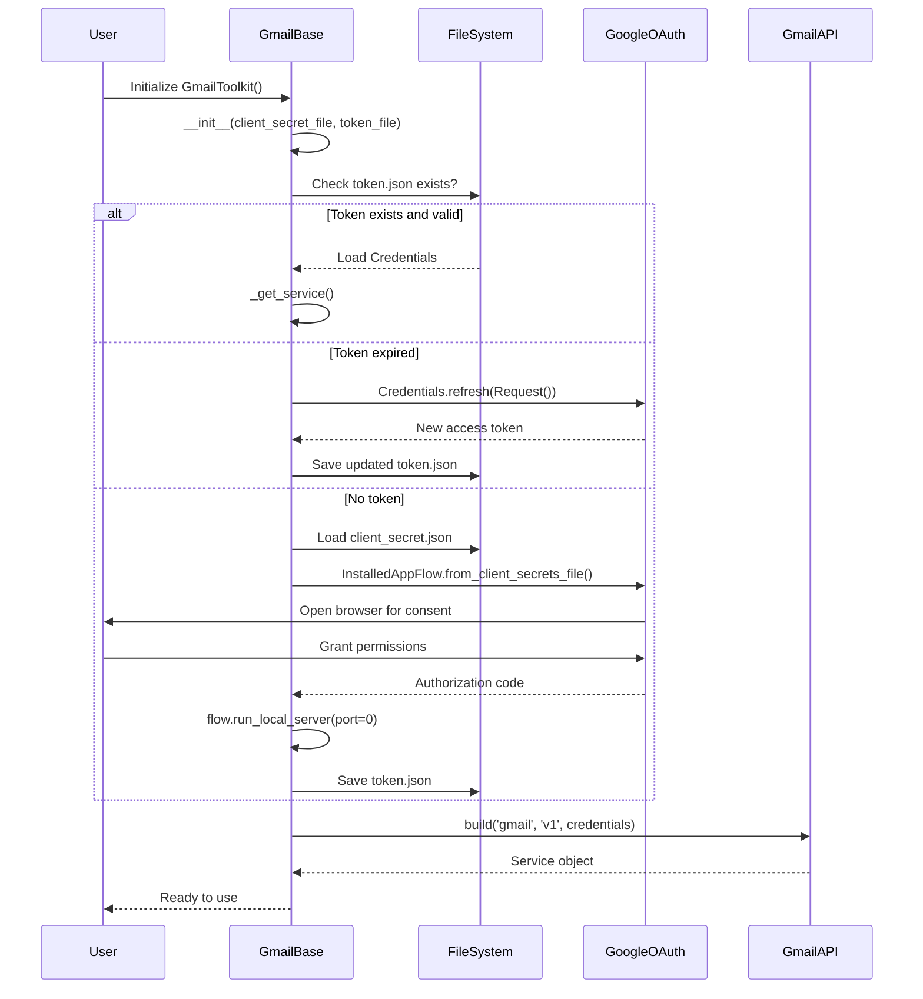
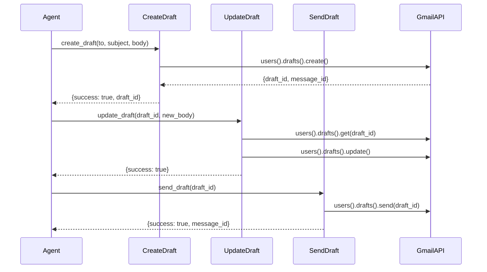

<!-- source: DeepWiki mcp.deepwiki.com · repo EvoAgentX/EvoAgentX · page 7.5 Gmail Integration · fetched 2026-10-26 -->

# Gmail Integration

<details>
<summary>Relevant source files</summary>

The following files were used as context for generating this wiki page:

- [docs/tutorial/tools/Gmail_api_setup.md](docs/tutorial/tools/Gmail_api_setup.md)
- [evoagentx/tools/gmail_tools.py](evoagentx/tools/gmail_tools.py)
- [examples/tools/gmail_example.py](examples/tools/gmail_example.py)

</details>


## Purpose and Scope

This document covers the Gmail integration toolkit in EvoAgentX, which provides comprehensive email management capabilities through the Gmail API. The toolkit includes 11 specialized tools for reading messages, managing drafts, organizing labels, and handling attachments with OAuth2 authentication.

For general tool architecture concepts, see [Tool Architecture](#7.1). For integration with agents and workflows, see [Tool Calling in Actions](#5.3).

---

## Architecture Overview

The Gmail integration is built on a layered architecture with a shared authentication base and specialized tool implementations.

### Gmail Toolkit Component Structure

```mermaid
graph TB
    subgraph "Authentication Layer"
        GmailBase["GmailBase<br/>(BaseModule)"]
        ClientSecret["client_secret.json<br/>OAuth2 Credentials"]
        TokenFile["token.json<br/>Refresh Token"]
    end
    
    subgraph "Core Utilities"
        GetService["_get_service()"]
        GetCreds["_get_credentials()"]
        FormatMsg["_format_message()"]
        CreateMsg["_create_message()"]
        FetchMsgs["_fetch_messages()"]
        FetchThreads["_fetch_threads()"]
        DownloadAttach["_download_attachments()"]
        EnsureLabel["_ensure_label()"]
        ModifyLabels["_modify_message_labels()"]
    end
    
    subgraph "Message Tools"
        ReadMessages["ReadMessagesTool<br/>read_messages"]
        SearchMessages["SearchMessagesTool<br/>search_messages"]
        ReadThreads["ReadThreadsTool<br/>read_threads"]
        TrashMessages["TrashMessagesTool<br/>trash_messages"]
    end
    
    subgraph "Draft Tools"
        ListDrafts["ListDraftsTool<br/>list_drafts"]
        SearchDrafts["SearchDraftTool<br/>search_drafts"]
        CreateDraft["CreateDraftTool<br/>create_draft"]
        UpdateDraft["UpdateDraftTool<br/>update_draft"]
        SendDraft["SendDraftTool<br/>send_draft"]
        DeleteDraft["DeleteDraftTool<br/>delete_draft"]
    end
    
    subgraph "Organization Tools"
        ModifyLabelsT["ModifyLabelsTool<br/>modify_labels"]
    end
    
    subgraph "Gmail Toolkit Registry"
        GmailToolkit["GmailToolkit"]
    end
    
    subgraph "Google APIs"
        GmailAPI["Gmail API v1<br/>users.messages<br/>users.threads<br/>users.drafts<br/>users.labels"]
    end
    
    ClientSecret --> GetCreds
    TokenFile --> GetCreds
    GetCreds --> GetService
    GetService --> GmailAPI
    
    GmailBase --> GetService
    GmailBase --> FormatMsg
    GmailBase --> CreateMsg
    GmailBase --> FetchMsgs
    GmailBase --> FetchThreads
    GmailBase --> DownloadAttach
    GmailBase --> EnsureLabel
    GmailBase --> ModifyLabels
    
    GmailBase --> ReadMessages
    GmailBase --> SearchMessages
    GmailBase --> ReadThreads
    GmailBase --> TrashMessages
    GmailBase --> ListDrafts
    GmailBase --> SearchDrafts
    GmailBase --> CreateDraft
    GmailBase --> UpdateDraft
    GmailBase --> SendDraft
    GmailBase --> DeleteDraft
    GmailBase --> ModifyLabelsT
    
    ReadMessages --> GmailToolkit
    SearchMessages --> GmailToolkit
    ReadThreads --> GmailToolkit
    TrashMessages --> GmailToolkit
    ListDrafts --> GmailToolkit
    SearchDrafts --> GmailToolkit
    CreateDraft --> GmailToolkit
    UpdateDraft --> GmailToolkit
    SendDraft --> GmailToolkit
    DeleteDraft --> GmailToolkit
    ModifyLabelsT --> GmailToolkit
    
    FetchMsgs --> GmailAPI
    FetchThreads --> GmailAPI
    DownloadAttach --> GmailAPI
```



**Sources:** [evoagentx/tools/gmail_tools.py:53-1528](), [evoagentx/tools/gmail_tools.py:1531-1550]()

The architecture follows a three-tier pattern:
1. **Authentication Layer**: Manages OAuth2 credentials and Gmail API service initialization via `GmailBase`.
2. **Core Utilities**: Shared helper methods in `GmailBase` for decoding, formatting, and fetching.
3. **Tool Layer**: 11 specialized `Tool` implementations that inherit from `GmailBase` and are registered in `GmailToolkit`.

---

## Authentication Setup

The Gmail toolkit uses OAuth2 Desktop App flow for authentication. The process requires two credential files:

| File | Purpose | Location | Generated When |
|------|---------|----------|----------------|
| `client_secret.json` | OAuth2 client credentials from Google Cloud Console | Project root or custom path | Manual setup (one-time) |
| `token.json` | Refresh token for API access | Project root or custom path | First authentication |

### OAuth2 Flow Diagram



**Sources:** [evoagentx/tools/gmail_tools.py:85-138](), [docs/tutorial/tools/Gmail_api_setup.md:78-102]()

### Required Scopes

The toolkit requires two Gmail API scopes defined in the codebase:

- `https://www.googleapis.com/auth/gmail.modify` - Read/modify messages, labels, and threads.
- `https://www.googleapis.com/auth/gmail.compose` - Create and send messages/drafts.

**Sources:** [evoagentx/tools/gmail_tools.py:43-46]()

### Configuration Options

The `GmailBase` class accepts credential file paths via constructor parameters or environment variables:

```python
# Constructor parameters (highest priority)
gmail_base = GmailBase(
    client_secret_file="/path/to/client_secret.json",
    token_file="/path/to/token.json"
)

# Environment variables (fallback)
# GMAIL_CLIENT_SECRET_FILE
# GMAIL_TOKEN_FILE
```

**Sources:** [evoagentx/tools/gmail_tools.py:59-80]()

For detailed setup instructions including Google Cloud Console configuration, see [docs/tutorial/tools/Gmail_api_setup.md]().

---

## Core Components

### GmailBase Class

The `GmailBase` class ([evoagentx/tools/gmail_tools.py:53-640]()) extends `BaseModule` and provides shared functionality for all Gmail tools.

#### Key Attributes

| Attribute | Type | Description |
|-----------|------|-------------|
| `client_secret_file` | `str` | Path to OAuth2 client credentials |
| `token_file` | `str` | Path to refresh token storage |
| `_service` | `Resource` | Cached Gmail API service instance |

#### Core Methods

##### Service Initialization

The `_get_service()` method ([evoagentx/tools/gmail_tools.py:128-138]()) lazily initializes the Gmail API client.

##### Message Formatting

The `_format_message()` method ([evoagentx/tools/gmail_tools.py:140-236]()) transforms raw Gmail API message objects into consistent dictionaries. It handles recursive part extraction for plain text and HTML bodies and decodes URL-safe base64 data.

**Sources:** [evoagentx/tools/gmail_tools.py:140-236]()

##### Label Management

- **`_ensure_label()`**: ([evoagentx/tools/gmail_tools.py:238-277]()) Checks if a label exists; if not, creates it. Returns the label ID.
- **`_modify_message_labels()`**: ([evoagentx/tools/gmail_tools.py:279-318]()) Executes the `modify` request to add or remove labels from a message.

##### Attachment Handling

The `_download_attachments()` method ([evoagentx/tools/gmail_tools.py:379-474]()) downloads all attachments from a message to a local directory, ensuring unique filenames using timestamps.

**Sources:** [evoagentx/tools/gmail_tools.py:379-474]()

##### Shared Fetch Helpers

- **`_fetch_messages()`**: ([evoagentx/tools/gmail_tools.py:476-560]()) Shared logic for listing and searching messages.
- **`_fetch_threads()`**: ([evoagentx/tools/gmail_tools.py:562-640]()) Shared logic for retrieving full conversation threads.

---

## Available Tools

The `GmailToolkit` ([evoagentx/tools/gmail_tools.py:1531-1550]()) registers 11 tools.

### Message Operations

| Tool Name | Class | Purpose |
|-----------|-------|---------|
| `read_messages` | `ReadMessagesTool` | Retrieves messages based on query/labels. [evoagentx/tools/gmail_tools.py:643-706]() |
| `search_messages` | `SearchMessagesTool` | Searches messages using keyword syntax. [evoagentx/tools/gmail_tools.py:709-759]() |
| `read_threads` | `ReadThreadsTool` | Retrieves full conversation threads. [evoagentx/tools/gmail_tools.py:762-802]() |
| `trash_messages` | `TrashMessagesTool` | Moves messages to Trash. [evoagentx/tools/gmail_tools.py:805-913]() |

### Draft Management

| Tool Name | Class | Purpose |
|-----------|-------|---------|
| `list_drafts` | `ListDraftsTool` | Lists all existing drafts. [evoagentx/tools/gmail_tools.py:916-1005]() |
| `search_drafts` | `SearchDraftTool` | Retrieves draft by ID or keyword. [evoagentx/tools/gmail_tools.py:1008-1149]() |
| `create_draft` | `CreateDraftTool` | Creates a new draft (supports attachments). [evoagentx/tools/gmail_tools.py:1152-1253]() |
| `update_draft` | `UpdateDraftTool` | Modifies an existing draft. [evoagentx/tools/gmail_tools.py:1256-1392]() |
| `send_draft` | `SendDraftTool` | Sends an existing draft. [evoagentx/tools/gmail_tools.py:1395-1463]() |
| `delete_draft` | `DeleteDraftTool` | Permanently deletes a draft. [evoagentx/tools/gmail_tools.py:1466-1528]() |

### Organization

| Tool Name | Class | Purpose |
|-----------|-------|---------|
| `modify_labels` | `ModifyLabelsTool` | Batch adds/removes labels. [evoagentx/tools/gmail_tools.py:916-1058]() |

---

## Usage Patterns

### Basic Toolkit Initialization

```python
from evoagentx.tools import GmailToolkit

# Initialize toolkit
gmail_toolkit = GmailToolkit()

# Access specific tools
read_tool = gmail_toolkit.get_tool("read_messages")
result = read_tool(query="is:unread", max_results=5)
```

**Sources:** [examples/tools/gmail_example.py:27-47]()

### Complete Draft Lifecycle Example



**Sources:** [examples/tools/gmail_example.py:127-273]()

### Attachment Handling

The `create_draft` and `update_draft` tools support an `attachments` parameter which takes a list of file paths.

```python
create_draft_tool = gmail_toolkit.get_tool("create_draft")
result = create_draft_tool(
    to="test@example.com",
    subject="Report",
    body="See attached.",
    attachments=["/path/to/report.pdf"]
)
```

**Sources:** [examples/tools/gmail_example.py:143-148](), [evoagentx/tools/gmail_tools.py:1152-1253]()

---

## Error Handling

### Authentication Errors

The `_get_credentials` method handles various failure modes:
- **Missing Secret**: Raises `FileNotFoundError` if `client_secret.json` is missing. [evoagentx/tools/gmail_tools.py:111-115]()
- **Expired Token**: Attempts `creds.refresh(Request())`. [evoagentx/tools/gmail_tools.py:103-105]()
- **Invalid Token**: Logs warning and triggers new `InstalledAppFlow`. [evoagentx/tools/gmail_tools.py:98-100]()

### API Errors

Tools wrap Gmail API calls in try-except blocks to catch `HttpError`.
- **Search Failures**: If `_fetch_messages` fails, it returns a result dictionary with `success: False` and the error message. [evoagentx/tools/gmail_tools.py:557-560]()
- **Partial Batch Success**: Tools like `TrashMessagesTool` track `trashed_ids` vs `failed_ids` to report granular status. [evoagentx/tools/gmail_tools.py:877-900]()

---

## Best Practices

1. **Publish App**: To prevent the `token.json` from expiring every 7 days (Testing mode), publish the app in the Google Cloud Console to "In Production" status. [docs/tutorial/tools/Gmail_api_setup.md:103-114]()
2. **Query Filtering**: Always use specific queries (e.g., `is:unread`, `from:x`) to minimize API load and token usage. [examples/tools/gmail_example.py:47-67]()
3. **Draft IDs**: Use `search_drafts` to find a `draft_id` before attempting an `update_draft` or `send_draft` operation. [examples/tools/gmail_example.py:180-210]()

**Sources:** [evoagentx/tools/gmail_tools.py:1-1550](), [examples/tools/gmail_example.py:1-515](), [docs/tutorial/tools/Gmail_api_setup.md:1-114]()

---

