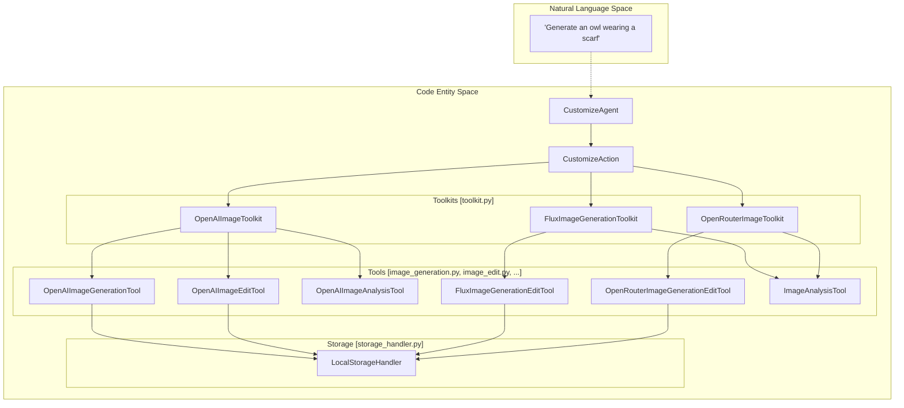
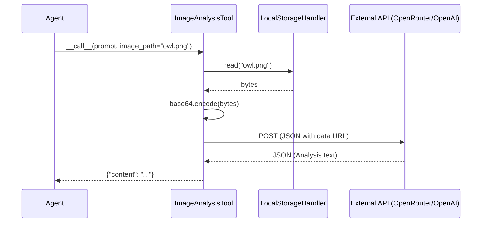

<!-- source: DeepWiki mcp.deepwiki.com · repo EvoAgentX/EvoAgentX · page 7.6 Image Tools · fetched 2026-10-26 -->

# Image Tools

Relevant source files

The following files were used as context for generating this wiki page:

- [docs/modules/image_tools.md](docs/modules/image_tools.md)
- [docs/tutorial/image_tools.md](docs/tutorial/image_tools.md)
- [evoagentx/tools/image_tools/flux_image_tools/image_generation_edit.py](evoagentx/tools/image_tools/flux_image_tools/image_generation_edit.py)
- [evoagentx/tools/image_tools/flux_image_tools/toolkit.py](evoagentx/tools/image_tools/flux_image_tools/toolkit.py)
- [evoagentx/tools/image_tools/flux_image_tools/utils.py](evoagentx/tools/image_tools/flux_image_tools/utils.py)
- [evoagentx/tools/image_tools/openai_image_tools/image_analysis_openai.py](evoagentx/tools/image_tools/openai_image_tools/image_analysis_openai.py)
- [evoagentx/tools/image_tools/openai_image_tools/image_edit.py](evoagentx/tools/image_tools/openai_image_tools/image_edit.py)
- [evoagentx/tools/image_tools/openai_image_tools/image_generation.py](evoagentx/tools/image_tools/openai_image_tools/image_generation.py)
- [evoagentx/tools/image_tools/openai_image_tools/openai_utils.py](evoagentx/tools/image_tools/openai_image_tools/openai_utils.py)
- [evoagentx/tools/image_tools/openai_image_tools/toolkit.py](evoagentx/tools/image_tools/openai_image_tools/toolkit.py)
- [evoagentx/tools/image_tools/openrouter_image_tools/image_analysis.py](evoagentx/tools/image_tools/openrouter_image_tools/image_analysis.py)
- [evoagentx/tools/image_tools/openrouter_image_tools/image_generation.py](evoagentx/tools/image_tools/openrouter_image_tools/image_generation.py)
- [evoagentx/tools/image_tools/openrouter_image_tools/toolkit.py](evoagentx/tools/image_tools/openrouter_image_tools/toolkit.py)
- [evoagentx/tools/image_tools/utils.py](evoagentx/tools/image_tools/utils.py)
- [examples/tools/tools_images.py](examples/tools/tools_images.py)

This page documents the image processing toolkits in EvoAgentX, which provide capabilities for AI-powered image generation, editing, and analysis through various external services.

For general tool architecture information, see [Tool Architecture](#7.1). For other tool categories like search or code execution, see [Tool System](#7).

---

## Purpose and Scope

EvoAgentX provides three image toolkits that integrate different AI image services:

- **OpenAIImageToolkit**: Uses OpenAI's DALL-E (2/3) and `gpt-image-1` for generation/editing, and the Responses API for analysis.
- **FluxImageGenerationToolkit**: Uses Flux Kontext Max (BFL API) for artistic image generation and transformation.
- **OpenRouterImageToolkit**: Uses OpenRouter's multi-model support (e.g., Gemini) for generation, editing, and analysis.

Each toolkit provides tools that can be used by agents to generate images from text prompts, edit existing images, and analyze image content. All toolkits support the **Storage Handler** architecture for local or cloud file management.

---

## Architecture Overview

The image toolkits follow a consistent architecture pattern where each toolkit contains multiple tool instances that share common configuration and a `storage_handler`.

### Data Flow and Entity Mapping

Sources: [evoagentx/tools/image_tools/openai_image_tools/toolkit.py:9-20](), [evoagentx/tools/image_tools/flux_image_tools/toolkit.py:9-42](), [evoagentx/tools/image_tools/openrouter_image_tools/toolkit.py:8-13]()

---

## OpenAIImageToolkit

The `OpenAIImageToolkit` groups tools for generation, editing, and analysis. It abstracts the OpenAI SDK and handles base64/URL conversions.

### Implementation Details

- **OpenAIImageGenerationTool**: Supports `dall-e-2`, `dall-e-3`, and `gpt-image-1`. It includes a validation layer (`validate_parameters`) to ensure parameters match model capabilities [evoagentx/tools/image_tools/openai_image_tools/image_generation.py:80-83]().
- **OpenAIImageEditTool**: Specifically utilizes `gpt-image-1` for image editing. It ensures images are compatible (e.g., converting to RGBA if necessary) before sending to the API [evoagentx/tools/image_tools/openai_image_tools/image_edit.py:150-162]().
- **OpenAIImageAnalysisTool**: Uses the OpenAI Responses API to process `input_text` and `input_image` [evoagentx/tools/image_tools/openai_image_tools/image_analysis_openai.py:58-69]().

### Available Tools

| Tool Name | Class | Key Inputs | Returns |
|-----------|-------|------------|---------|
| `openai_image_generation` | `OpenAIImageGenerationTool` | `prompt`, `model`, `size`, `quality` | `{"results": [path], "count": int}` |
| `openai_image_edit` | `OpenAIImageEditTool` | `prompt`, `images`, `mask_path` | `{"results": [path], "count": int}` |
| `openai_image_analysis` | `OpenAIImageAnalysisTool` | `prompt`, `image_url` OR `image_path` | `{"content": str}` |

Sources: [evoagentx/tools/image_tools/openai_image_tools/image_generation.py:12-32](), [evoagentx/tools/image_tools/openai_image_tools/image_edit.py:7-26](), [evoagentx/tools/image_tools/openai_image_tools/image_analysis_openai.py:7-17]()

---

## FluxImageGenerationToolkit

The `FluxImageGenerationToolkit` focuses on the BFL (Black Forest Labs) Flux API. It is unique in its polling mechanism, as the BFL API is asynchronous.

### Polling Logic
The `FluxImageGenerationEditTool` sends a POST request to `https://api.bfl.ai/v1/flux-kontext-max`, receives a `request_id`, and then polls the `polling_url` every 2 seconds until the status is `"Ready"` [evoagentx/tools/image_tools/flux_image_tools/image_generation_edit.py:69-89]().

### Analysis Integration
Interestingly, the `FluxImageGenerationToolkit` also includes the `ImageAnalysisTool` from the OpenRouter module by default if an `OPENROUTER_API_KEY` is present in the environment [evoagentx/tools/image_tools/flux_image_tools/toolkit.py:31-38]().

Sources: [evoagentx/tools/image_tools/flux_image_tools/image_generation_edit.py:8-13](), [evoagentx/tools/image_tools/flux_image_tools/toolkit.py:9-42]()

---

## OpenRouterImageToolkit

This toolkit provides access to multi-modal models like Gemini for both generation and analysis.

### Tool: openrouter_image_generation_edit
This tool handles both text-to-image (no images provided) and image-to-image (images provided) workflows [evoagentx/tools/image_tools/openrouter_image_tools/image_generation.py:10-13](). It converts local paths to data URLs using the `storage_handler` before sending the payload [evoagentx/tools/image_tools/openrouter_image_tools/image_generation.py:126-140]().

### Tool: image_analysis
The `ImageAnalysisTool` supports not just images, but also local PDF files. It reads the PDF, converts it to a base64 data URL with MIME type `application/pdf`, and sends it to OpenRouter [evoagentx/tools/image_tools/openrouter_image_tools/image_analysis.py:71-91]().

Sources: [evoagentx/tools/image_tools/openrouter_image_tools/image_generation.py:8-24](), [evoagentx/tools/image_tools/openrouter_image_tools/image_analysis.py:8-21]()

---

## Storage and Data Flow

All image tools utilize a `FileStorageHandler` (defaulting to `LocalStorageHandler`) to manage image I/O. This ensures that agents work with abstract file paths while the system handles the physical storage and base64 encoding for API transmission.

### Image Analysis Data Flow

Sources: [evoagentx/tools/image_tools/openrouter_image_tools/image_analysis.py:51-66](), [evoagentx/tools/image_tools/openai_image_tools/image_analysis_openai.py:40-56]()

---

## Directory Layout and Public API

The image tools are organized by provider under `evoagentx/tools/image_tools/`.

### Public API Exports
The following toolkits are exported via `evoagentx.tools`:
- `OpenAIImageToolkit` [evoagentx/tools/image_tools/openai_image_tools/toolkit.py:9]()
- `FluxImageGenerationToolkit` [evoagentx/tools/image_tools/flux_image_tools/toolkit.py:9]()
- `OpenRouterImageToolkit` [evoagentx/tools/image_tools/openrouter_image_tools/toolkit.py:8]()
- `ImageAnalysisToolkit` (OpenRouter-based convenience wrapper) [evoagentx/tools/image_tools/openrouter_image_tools/toolkit.py:18]()

### Return Contracts
Tools return consistent dictionary shapes to facilitate agent parsing:
- **Generation/Edit**: `{ "results": [str], "count": int }` (OpenAI) or `{ "saved_paths": [str] }` (OpenRouter) or `{ "file_path": str }` (Flux).
- **Analysis**: `{ "content": str, "usage": dict }`.
- **Errors**: `{ "error": str }` on failure.

Sources: [docs/modules/image_tools.md:15-30](), [docs/modules/image_tools.md:104-114]()

---

