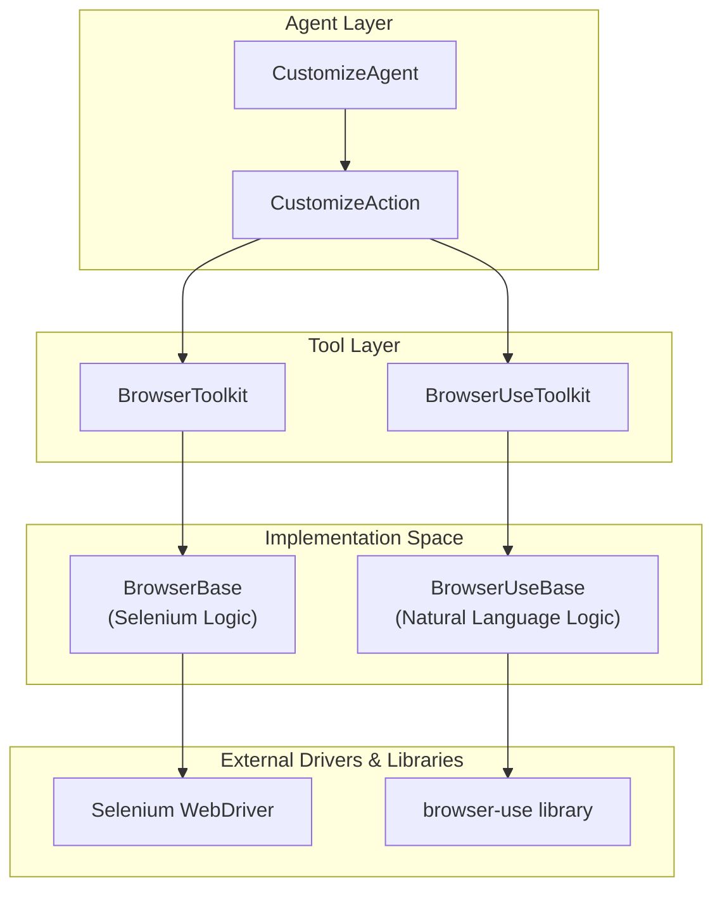
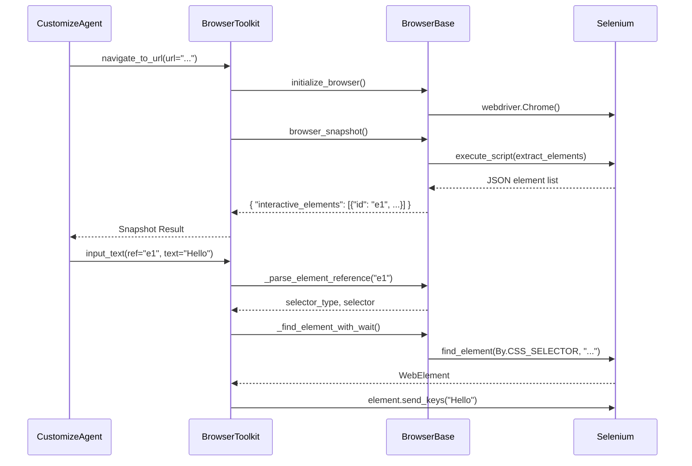

<!-- source: DeepWiki mcp.deepwiki.com · repo EvoAgentX/EvoAgentX · page 7.7 Browser Tools · fetched 2026-10-26 -->

# Browser Tools

<details>
<summary>Relevant source files</summary>

The following files were used as context for generating this wiki page:

- [evoagentx/actions/customize_action.py](evoagentx/actions/customize_action.py)
- [evoagentx/prompts/tool_calling.py](evoagentx/prompts/tool_calling.py)
- [evoagentx/tools/browser_tool.py](evoagentx/tools/browser_tool.py)
- [evoagentx/tools/browser_use.py](evoagentx/tools/browser_use.py)
- [evoagentx/tools/cmd_toolkit.py](evoagentx/tools/cmd_toolkit.py)
- [evoagentx/tools/file_tool.py](evoagentx/tools/file_tool.py)
- [evoagentx/tools/request.py](evoagentx/tools/request.py)
- [evoagentx/tools/request_arxiv.py](evoagentx/tools/request_arxiv.py)
- [evoagentx/tools/request_base.py](evoagentx/tools/request_base.py)
- [examples/customize_agent.py](examples/customize_agent.py)
- [examples/output/jobs/jobs_demo_4o_mini.json](examples/output/jobs/jobs_demo_4o_mini.json)
- [examples/output/jobs/mcp_jobs.config](examples/output/jobs/mcp_jobs.config)
- [examples/output/jobs/test_pdf.pdf](examples/output/jobs/test_pdf.pdf)
- [examples/tools/tools_browser.py](examples/tools/tools_browser.py)
- [examples/tools/tools_database.py](examples/tools/tools_database.py)
- [examples/tools/tools_integration.py](examples/tools/tools_integration.py)
- [examples/tools/tools_interpreter.py](examples/tools/tools_interpreter.py)

</details>


## Purpose and Scope

This document covers the browser automation toolkits available in EvoAgentX for web interaction tasks. Browser tools enable agents to navigate websites, interact with web elements, extract information, and perform automated web workflows.

EvoAgentX provides two distinct approaches to browser automation:
- **BrowserToolkit**: A fine-grained, Selenium-based toolkit providing explicit control over browser elements, navigation, and state through a reference-based system.
- **BrowserUse**: A high-level, natural language-driven automation toolkit based on the `browser-use` library, allowing agents to execute complex web tasks using plain English instructions.

For information about the general tool system, see [Tool Architecture](). For integration with agents, see [Tool Calling in Actions]().

---

## Architecture Overview

Browser tools in EvoAgentX are built on Selenium WebDriver and the Browser-Use framework, providing a unified interface for browser automation.

### Natural Language to Code Entity Space

The following diagram illustrates how high-level agent goals translate into specific code entities within the browser tool ecosystem.

**Diagram: Browser Tool System Architecture**

**Sources:** [evoagentx/tools/browser_tool.py:24-65](), [evoagentx/tools/browser_use.py:22-152](), [evoagentx/actions/customize_action.py:20-47]()

---

## BrowserBase Core (Selenium)

The `BrowserBase` class provides the foundational browser automation capabilities used by the `BrowserToolkit`. It handles the lifecycle of a Selenium WebDriver instance.

### Core Features
| Feature | Implementation |
|---------|-------------|
| **Auto-initialization** | Browser initializes on the first call via `_check_driver_initialized`. [browser_tool.py:68-80]() |
| **Multi-browser Support** | Supports 'chrome', 'firefox', 'safari', and 'edge'. [browser_tool.py:232-278]() |
| **Headless Mode** | Configurable via the `headless` boolean field. [browser_tool.py:38-38]() |
| **Element References** | Stores element selectors in `element_references` for stable interaction. [browser_tool.py:64-64]() |

### Selector System
The system maps human-readable strings to Selenium `By` constants:
- `css`: `By.CSS_SELECTOR`
- `xpath`: `By.XPATH`
- `id`: `By.ID`
- `class`: `By.CLASS_NAME`
- `name`: `By.NAME`
- `tag`: `By.TAG_NAME`

**Sources:** [evoagentx/tools/browser_tool.py:15-22](), [evoagentx/tools/browser_tool.py:92-96]()

---

## BrowserToolkit - Fine-Grained Control

`BrowserToolkit` exposes a suite of tools for granular control over the browser. It uses a "snapshot" pattern where the agent first captures the page state and then interacts with elements via stable reference IDs (e.g., "e1", "e2").

### Data Flow: Snapshot and Interaction
The following diagram bridges the gap between the Agent's natural language intent and the underlying Selenium operations.

**Diagram: Reference-Based Interaction Flow**

**Sources:** [evoagentx/tools/browser_tool.py:287-359](), [evoagentx/tools/browser_tool.py:712-902](), [evoagentx/tools/browser_tool.py:545-663]()

### Key Tools in BrowserToolkit
- **`navigate_to_url`**: Navigates to a URL and automatically triggers a snapshot. [browser_tool.py:287-359]()
- **`browser_snapshot`**: Analyzes the DOM to find interactive elements (links, buttons, inputs) and assigns them reference IDs. [browser_tool.py:712-902]()
- **`input_text`**: Types text into an element identified by its reference ID. [browser_tool.py:545-663]()
- **`click_element_by_ref`**: Clicks an element using its reference ID. [browser_tool.py:904-972]()
- **`execute_javascript`**: Runs custom JS and returns the result. [browser_tool.py:1091-1134]()

---

## BrowserUse - Natural Language Automation

`BrowserUseToolkit` provides a high-level interface that leverages the `browser-use` library. It allows agents to perform complex multi-step web tasks through a single natural language instruction.

### BrowserUseBase Implementation
The `BrowserUseBase` class manages the integration with external LLMs (OpenAI or Anthropic) and the `browser-use` Agent.

- **LLM Setup**: Configures `ChatOpenAI` or `ChatAnthropic` based on the provided model string. [browser_use.py:74-99]()
- **Execution**: The `execute_task` method creates a `browser_use.Agent` and runs it asynchronously. [browser_use.py:100-132]()
- **Sync Wrapper**: `execute_task_sync` provides a synchronous interface for compatibility with the standard tool calling loop. [browser_use.py:134-151]()

### BrowserUseToolkit Usage
The toolkit exposes a single tool: `browser_use`.
- **Input**: `task` (string) - The natural language description of the browser task.
- **Behavior**: It delegates the task to `BrowserUseBase.execute_task_sync`.

**Sources:** [evoagentx/tools/browser_use.py:154-205]()

---

## Integration and Usage Examples

### Using BrowserToolkit in an Agent
Agents use `BrowserToolkit` to perform precise scraping or form filling.

```python
from evoagentx.tools import BrowserToolkit
from evoagentx.agents import CustomizeAgent

browser_toolkit = BrowserToolkit(headless=True)
agent = CustomizeAgent(
    name="WebScraper",
    prompt="Navigate to {url} and extract the main title",
    tools=[browser_toolkit],
    llm_config=model_config
)
```
**Sources:** [examples/tools/tools_browser.py:27-160](), [evoagentx/actions/customize_action.py:45-47]()

### Handling Multi-Step Workflows
In complex workflows, browser tools are often used in conjunction with file tools or search tools.

| Step | Tool | Purpose |
|------|------|---------|
| 1 | `navigate_to_url` | Open the target website. |
| 2 | `browser_snapshot` | Identify interactive elements. |
| 3 | `input_text` | Fill in search queries or credentials. |
| 4 | `get_page_content` | Extract text for analysis. |
| 5 | `FileToolkit` | Save results to a local file. |

**Sources:** [examples/output/jobs/jobs_demo_4o_mini.json:4-55](), [evoagentx/tools/file_tool.py:9-24]()

---

## Error Handling and Retries

The Selenium-based tools include specific logic to handle the volatile nature of web pages:
- **Stale Elements**: If a `StaleElementReferenceException` occurs during `input_text`, the tool attempts to re-locate the element and retry once. [browser_tool.py:659-663]()
- **Timeouts**: `_wait_for_page_load` ensures the document ready state is "complete" before proceeding, with a configurable timeout. [browser_tool.py:97-115]()
- **Driver Recovery**: If the driver fails to initialize, an error status is returned immediately to the agent. [browser_tool.py:68-80]()

**Sources:** [evoagentx/tools/browser_tool.py:5-12](), [evoagentx/tools/browser_tool.py:68-115]()

---

