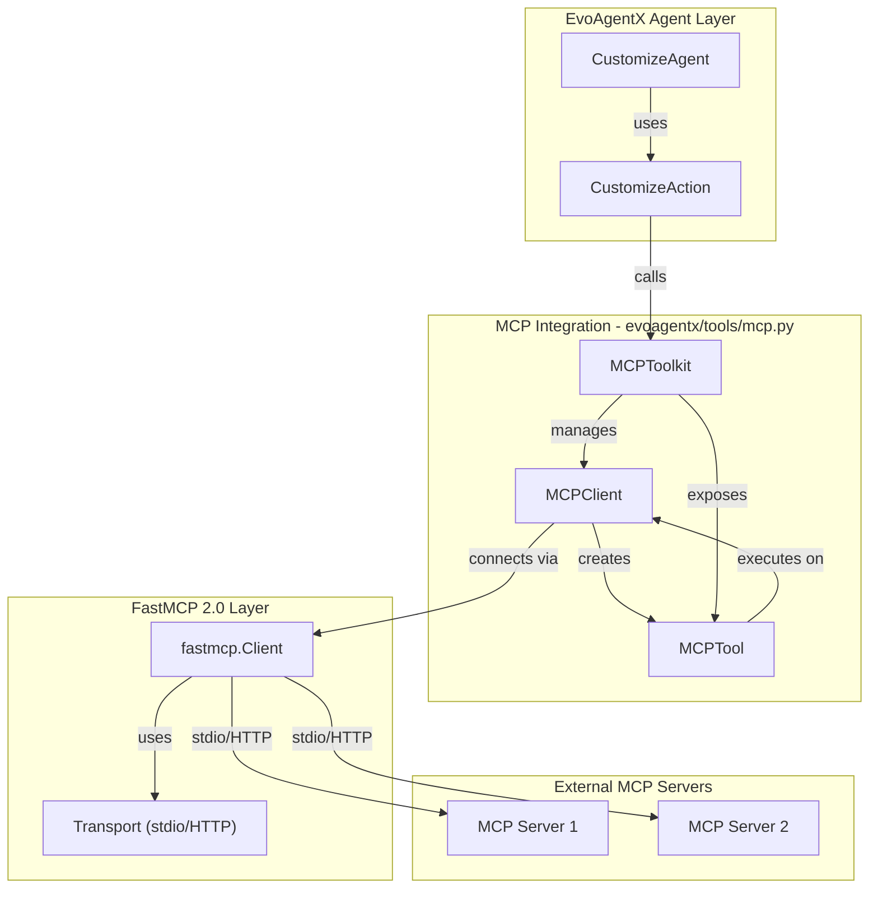
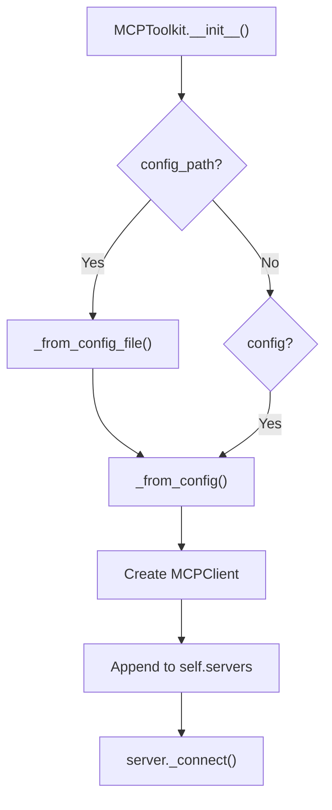
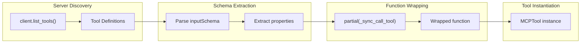
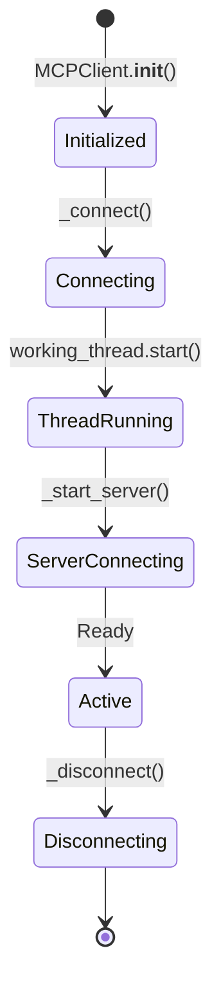

<!-- source: DeepWiki mcp.deepwiki.com · repo EvoAgentX/EvoAgentX · page 7.8 MCP Integration · fetched 2026-10-26 -->

# MCP Integration

<details>
<summary>Relevant source files</summary>

The following files were used as context for generating this wiki page:

- [docs/tutorial/mcp.md](docs/tutorial/mcp.md)
- [docs/tutorial/tools.md](docs/tutorial/tools.md)
- [docs/zh/tutorial/tools.md](docs/zh/tutorial/tools.md)
- [evoagentx/tools/__init__.py](evoagentx/tools/__init__.py)
- [evoagentx/tools/mcp.py](evoagentx/tools/mcp.py)
- [examples/mcp_agent.py](examples/mcp_agent.py)
- [examples/sequential_workflow.py](examples/sequential_workflow.py)

</details>


## Purpose and Scope

This document describes the Model Context Protocol (MCP) integration in EvoAgentX, which enables agents to communicate with external services and tools through a standardized protocol. The MCP integration allows EvoAgentX to connect to MCP-compliant servers and expose their capabilities as tools that agents can use during workflow execution.

For information about other code execution tools, see [Code Interpreters](#7.2). For general tool architecture concepts, see [Tool Architecture](#7.1).

**Sources:** [evoagentx/tools/mcp.py:1-14]()

## Overview

The MCP (Model Context Protocol) integration in EvoAgentX is built on **FastMCP 2.0**, providing improved performance and reliability. The integration maintains a synchronous API while handling asynchronous operations internally through threading, making it easy to use within EvoAgentX's workflow system.

Key capabilities:
- Connect to multiple MCP servers simultaneously.
- Auto-infer transport types (stdio/HTTP) based on configuration.
- Dynamic tool creation from server definitions.
- Thread-safe synchronous tool execution via `MCPClient`.
- Automatic connection lifecycle management.

**Sources:** [evoagentx/tools/mcp.py:1-27](), [evoagentx/tools/mcp.py:119-142]()

## Architecture

### Component Overview



**MCP Integration Architecture**

The architecture bridges EvoAgentX agents to external MCP servers by wrapping async protocol operations in synchronous tool interfaces.

**Sources:** [evoagentx/tools/mcp.py:19-27](), [evoagentx/tools/mcp.py:119-225](), [evoagentx/tools/mcp.py:297-365]()

### MCPToolkit Class

The `MCPToolkit` class is the primary entry point. It manages server connections and provides a unified interface for accessing MCP tools.

| Attribute | Type | Description |
|-----------|------|-------------|
| `servers` | `List[MCPClient]` | List of connected MCP client instances. |

| Method | Purpose |
|--------|---------|
| `__init__(servers, config_path, config)` | Initialize toolkit with server configurations. |
| `_from_config_file(config_path)` | Load server configurations from JSON file. |
| `_from_config(server_configs)` | Parse server configuration dictionary. |
| `get_toolkits()` | Return list of all tool collections from connected servers. |
| `disconnect()` | Close all server connections. |

**Sources:** [evoagentx/tools/mcp.py:297-419]()

### MCPClient Class

The `MCPClient` class manages individual connections and handles the async event loop in a background thread.

| Attribute | Type | Description |
|-----------|------|-------------|
| `server_configs` | `List[Dict]` | Server configuration dictionaries. |
| `event_loop` | `asyncio.AbstractEventLoop` | Dedicated event loop for async operations. |
| `sessions` | `list[fastmcp.Client]` | FastMCP client sessions. |
| `connect_timeout` | `float` | Connection timeout in seconds (default: 120.0). |

**Sources:** [evoagentx/tools/mcp.py:119-142]()

### MCPTool Class

The `MCPTool` class wraps individual MCP tools and provides a callable interface compatible with EvoAgentX's `Tool` system.

| Attribute | Type | Description |
|-----------|------|-------------|
| `name` | `str` | Tool name. |
| `description` | `str` | Tool description. |
| `inputs` | `Dict[str, Dict[str, Any]]` | Input parameter schema. |
| `function` | `Callable` | Wrapped tool execution function. |

**Sources:** [evoagentx/tools/mcp.py:28-46]()

## Configuration

### Configuration File Format

MCP servers are configured using JSON files or dictionaries. EvoAgentX supports the standard MCP server configuration format.

```json
{
  "mcpServers": {
    "arxiv": {
      "command": "uv",
      "args": ["tool", "run", "arxiv-mcp-server"],
      "timeout": 45
    },
    "github": {
      "command": "npx",
      "args": ["-y", "@modelcontextprotocol/server-github"],
      "env": { "GITHUB_PERSONAL_ACCESS_TOKEN": "..." }
    }
  }
}
```

**Sources:** [docs/tutorial/mcp.md:58-87](), [evoagentx/tools/mcp.py:334-365]()

### Configuration Loading Flow



**Sources:** [evoagentx/tools/mcp.py:297-365]()

## Tool Creation and Execution

### Dynamic Tool Creation

Tools are dynamically created from MCP server definitions. The `MCPClient.create_tool()` method extracts schemas and wraps execution functions.



**Sources:** [evoagentx/tools/mcp.py:226-284]()

### Tool Execution Flow

The `_sync_call_tool` function bridges the synchronous call to the async FastMCP client:

```mermaid
sequenceDiagram
    participant Agent as "CustomizeAgent"
    participant MCPTool as "MCPTool"
    participant Loop as "event_loop"
    participant FastMCP as "fastmcp.Client"
    
    Agent->>MCPTool: __call__(**kwargs)
    MCPTool->>Loop: asyncio.run_coroutine_threadsafe()
    Loop->>FastMCP: call_tool(name, arguments)
    FastMCP-->>Loop: Result
    Loop-->>MCPTool: future.result()
    MCPTool->>MCPTool: _convert_result()
    MCPTool-->>Agent: JSON Result
```

**Sources:** [evoagentx/tools/mcp.py:43-47](), [evoagentx/tools/mcp.py:226-253]()

### Result Conversion

The `_convert_result()` method handles complex MCP result types to ensure JSON serializability.

| Input Type | Conversion Strategy |
|------------|---------------------|
| Primitive types | Return as-is |
| `list`/`dict` | Recursively convert |
| `TextContent` | Extract `.text` or `.content` |
| `ImageContent` | Convert `.__dict__` to dictionary |
| Objects with `.__dict__` | Convert to dictionary recursively |

**Sources:** [evoagentx/tools/mcp.py:49-97]()

## Connection Lifecycle

The MCP integration uses a dedicated thread with an event loop to handle async operations while providing a synchronous interface.



**Sources:** [evoagentx/tools/mcp.py:143-217]()

## Usage Examples

### Integration with CustomizeAgent

```python
from evoagentx.tools.mcp import MCPToolkit
from evoagentx.agents import CustomizeAgent

# Initialize MCP toolkit
mcp_toolkit = MCPToolkit(config_path="mcp.config")
tools = mcp_toolkit.get_toolkits()

# Create agent with MCP tools
mcp_agent = CustomizeAgent(
    name="MCPAgent",
    tools=tools,
    llm_config=openai_config,
    # ... other configs
)

# Execute
result = mcp_agent(inputs={"instruction": "Search arxiv for AI papers"})
```

**Sources:** [examples/mcp_agent.py:20-46]()

## Error Handling

### Exception Hierarchy

The MCP integration uses FastMCP's exception hierarchy for robust error management.

| Exception Type | When Raised |
|----------------|-------------|
| `TimeoutError` | Connection or tool execution timeout |
| `ClientError` | FastMCP client-side error |
| `FastMCPError` | General protocol error |
| `ValueError` | Missing configuration or tool function |

**Sources:** [evoagentx/tools/mcp.py:25-26](), [evoagentx/tools/mcp.py:165-167](), [evoagentx/tools/mcp.py:341-344]()

### Graceful Degradation

Failed server connections don't prevent the toolkit from being used with successfully connected servers. The `get_toolkits` method logs warnings for failed servers and continues with the available ones.

**Sources:** [evoagentx/tools/mcp.py:317-332]()

## Comparison with Other Interpreters

| Feature | MCP Integration | Python Interpreter | Docker Interpreter |
|---------|----------------|-------------------|-------------------|
| Execution | External servers | Local process | Isolated container |
| Protocol | Model Context Protocol | Direct Python execution | Docker API |
| Security | Protocol boundaries | Import restrictions | Sandbox isolation |
| File Path | [evoagentx/tools/mcp.py]() | [evoagentx/tools/interpreter_python.py]() | [evoagentx/tools/interpreter_docker.py]() |

**Sources:** [evoagentx/tools/mcp.py:1-14](), [docs/tutorial/tools.md:51-52]()

---

