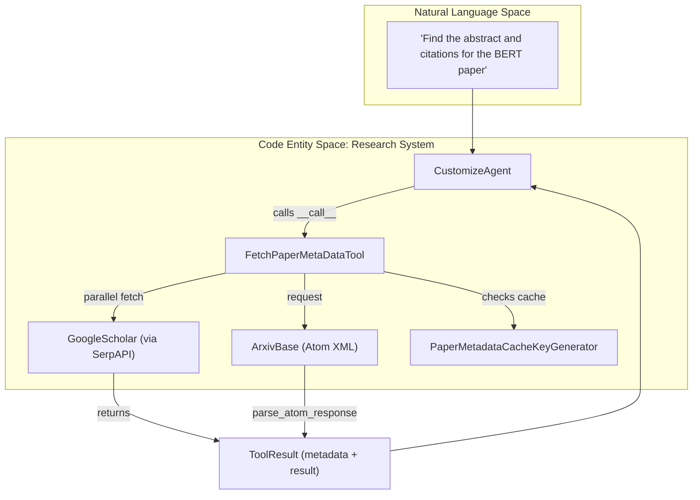
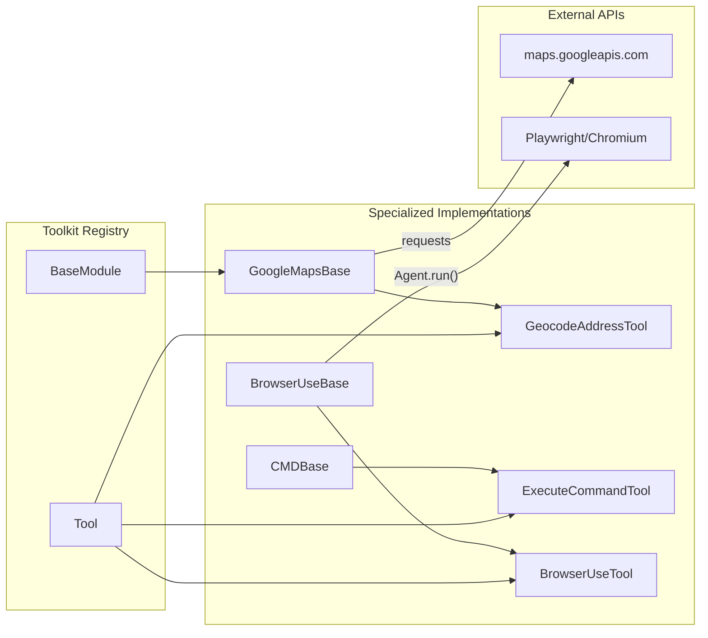

<!-- source: DeepWiki mcp.deepwiki.com · repo EvoAgentX/EvoAgentX · page 7.9 Research and Specialized Tools · fetched 2026-10-26 -->

# Research and Specialized Tools

Relevant source files

The following files were used as context for generating this wiki page:

- [.gitignore](.gitignore)
- [evoagentx/tools/api_pipeline.py](evoagentx/tools/api_pipeline.py)
- [evoagentx/tools/basic_information_tool.py](evoagentx/tools/basic_information_tool.py)
- [evoagentx/tools/browser_use.py](evoagentx/tools/browser_use.py)
- [evoagentx/tools/cmd_toolkit.py](evoagentx/tools/cmd_toolkit.py)
- [evoagentx/tools/crawler_base.py](evoagentx/tools/crawler_base.py)
- [evoagentx/tools/crawler_crawl4ai.py](evoagentx/tools/crawler_crawl4ai.py)
- [evoagentx/tools/crypto_currencies_tool.py](evoagentx/tools/crypto_currencies_tool.py)
- [evoagentx/tools/finance_tool.py](evoagentx/tools/finance_tool.py)
- [evoagentx/tools/google_maps_tool.py](evoagentx/tools/google_maps_tool.py)
- [evoagentx/tools/request.py](evoagentx/tools/request.py)
- [evoagentx/tools/request_arxiv.py](evoagentx/tools/request_arxiv.py)
- [evoagentx/tools/request_base.py](evoagentx/tools/request_base.py)
- [evoagentx/tools/research_tools/__init__.py](evoagentx/tools/research_tools/__init__.py)
- [evoagentx/tools/research_tools/_compat.py](evoagentx/tools/research_tools/_compat.py)
- [evoagentx/tools/research_tools/bib_reference.py](evoagentx/tools/research_tools/bib_reference.py)
- [evoagentx/tools/research_tools/cache.py](evoagentx/tools/research_tools/cache.py)
- [evoagentx/tools/research_tools/fetch_paper.py](evoagentx/tools/research_tools/fetch_paper.py)
- [evoagentx/tools/research_tools/google_scholar.py](evoagentx/tools/research_tools/google_scholar.py)
- [evoagentx/tools/research_tools/metadata.py](evoagentx/tools/research_tools/metadata.py)
- [evoagentx/tools/stock_tool.py](evoagentx/tools/stock_tool.py)
- [evoagentx/tools/telegram_tools.py](evoagentx/tools/telegram_tools.py)
- [examples/tools/google_maps_example.py](examples/tools/google_maps_example.py)
- [examples/tools/telegram_example.py](examples/tools/telegram_example.py)

EvoAgentX provides a sophisticated suite of specialized toolkits designed for academic research, financial analysis, real-world navigation, and communication. These tools leverage external APIs (arXiv, Google Scholar, SerpAPI, Telegram, Google Maps) and advanced web crawling capabilities to provide agents with high-fidelity data and interaction capabilities.

## Research Toolkit

The research system is designed to handle the complexities of academic data retrieval, including metadata extraction, BibTeX generation, and paper search. It uses a compatibility shim `_compat.py` to bridge internal tool structures with research-specific requirements [evoagentx/tools/research_tools/_compat.py:1-17]().

### Core Research Components

*   **ArxivPaperSearchTool**: A specialized tool for searching the arXiv repository. It uses the `ArxivBase` class to interact with the Atom XML API [evoagentx/tools/request_arxiv.py:10-24]().
*   **FetchPaperMetaDataTool**: Retrieves comprehensive details for academic papers, including abstracts, venues, and citation counts [evoagentx/tools/research_tools/fetch_paper.py:59-65](). It utilizes a `ContextualThreadPoolExecutor` to fetch data for multiple papers in parallel [evoagentx/tools/research_tools/fetch_paper.py:147-152]().
*   **BibReferenceTool**: Standardizes the retrieval of BibTeX entries from DBLP and Google Scholar [evoagentx/tools/research_tools/bib_reference.py:38-40]().
*   **GoogleScholar**: A base utility class that wraps SerpAPI to perform publication searches, find followup papers (citations), and formulate Chicago-style citations [evoagentx/tools/research_tools/google_scholar.py:33-175]().

### Research Data Flow

The following diagram illustrates how a research request for paper metadata flows through the system, bridging natural language requests to specific code entities.

**Research Metadata Retrieval Flow**

Sources: [evoagentx/tools/research_tools/fetch_paper.py:128-188](), [evoagentx/tools/request_arxiv.py:67-108](), [evoagentx/tools/research_tools/google_scholar.py:95-125]()

## Communication and Social Tools

### Telegram Integration
The `TelegramToolkit` provides agents with the ability to interact with the Telegram messaging platform via the `telethon` library [evoagentx/tools/telegram_tools.py:16-17]().

*   **TelegramBase**: Manages the `TelegramClient` lifecycle, session persistence (`ai_agent_session`), and authentication using `api_id` and `api_hash` [evoagentx/tools/telegram_tools.py:42-82]().
*   **FetchLatestMessagesTool**: Allows agents to retrieve recent conversations by contact name [evoagentx/tools/telegram_tools.py:164-180]().
*   **Async Execution**: Since `telethon` is asynchronous, the toolkit uses a `_run_async` helper to bridge sync tool calls to the async event loop [evoagentx/tools/telegram_tools.py:136-161]().

Sources: [evoagentx/tools/telegram_tools.py:39-161]()

## Financial and Market Tools

EvoAgentX includes specialized toolkits for monitoring financial markets, including stocks and cryptocurrencies.

| Toolkit | Core Tools | Primary Data Source |
| :--- | :--- | :--- |
| **StockTool** | `get_stock_price`, `get_company_info` | Financial Market APIs |
| **CryptoTool** | `get_crypto_price`, `get_market_cap` | Cryptocurrency Exchanges |
| **FinanceTool** | `analyze_portfolio`, `get_exchange_rates` | General Finance APIs |

Sources: [evoagentx/tools/stock_tool.py:1-10](), [evoagentx/tools/crypto_currencies_tool.py:1-10](), [evoagentx/tools/finance_tool.py:1-10]()

## Specialized Utilities

### Google Maps Toolkit
The `GoogleMapsToolkit` provides geographic intelligence through the Google Maps Platform API [evoagentx/tools/google_maps_tool.py:4-11]().

*   **GeocodeAddressTool**: Converts strings into `latitude` and `longitude` [evoagentx/tools/google_maps_tool.py:132-151]().
*   **GoogleMapsBase**: Handles the `_make_request` logic, including API key injection and error handling for statuses like `ZERO_RESULTS` [evoagentx/tools/google_maps_tool.py:23-125]().

### CMD Toolkit
For system-level operations, the `CMDBase` provides a controlled environment for command execution [evoagentx/tools/cmd_toolkit.py:10-15]().

*   **Safety Interceptor**: `_is_dangerous_command` uses regex patterns to block destructive commands like `rm -rf`, `format`, or `shutdown` [evoagentx/tools/cmd_toolkit.py:37-83]().
*   **Permission Requests**: `_request_permission` implements a mandatory Human-in-the-loop (HITL) check before executing any command [evoagentx/tools/cmd_toolkit.py:116-163]().

### Browser Use Toolkit
The `BrowserUseToolkit` enables high-level browser automation using natural language instructions [evoagentx/tools/browser_use.py:154-165](). It wraps the `browser-use` project and allows the agent to delegate complex web tasks to a specialized sub-agent [evoagentx/tools/browser_use.py:100-125]().

**Specialized Tool Architecture**

Sources: [evoagentx/tools/google_maps_tool.py:23-50](), [evoagentx/tools/cmd_toolkit.py:10-27](), [evoagentx/tools/browser_use.py:22-72]()

---

