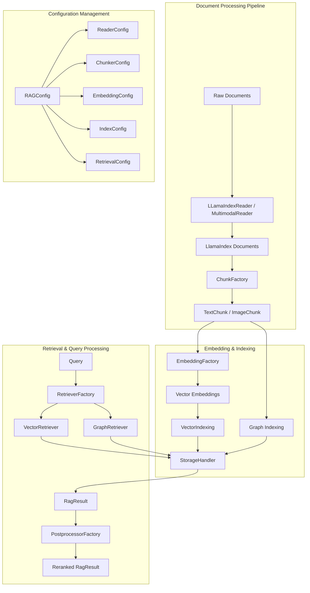
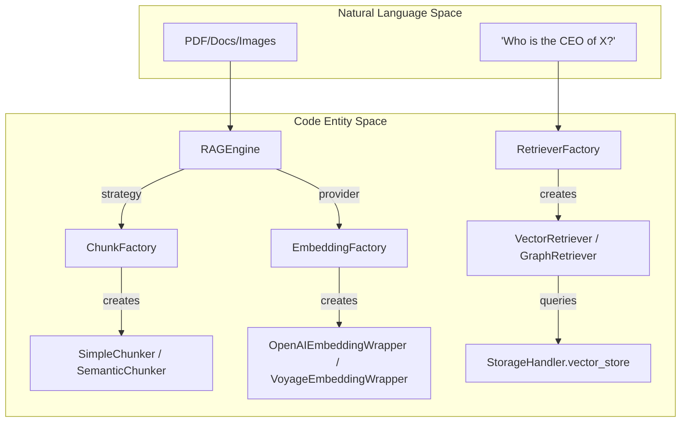

<!-- source: DeepWiki mcp.deepwiki.com · repo EvoAgentX/EvoAgentX · page 8 RAG System · fetched 2026-10-26 -->

# RAG System

Relevant source files

The following files were used as context for generating this wiki page:

- [.env.example](.env.example)
- [evoagentx/rag/chunkers/__init__.py](evoagentx/rag/chunkers/__init__.py)
- [evoagentx/rag/embeddings/__init__.py](evoagentx/rag/embeddings/__init__.py)
- [evoagentx/rag/embeddings/azure_openai_embedding.py](evoagentx/rag/embeddings/azure_openai_embedding.py)
- [evoagentx/rag/embeddings/base.py](evoagentx/rag/embeddings/base.py)
- [evoagentx/rag/postprocessors/__init__.py](evoagentx/rag/postprocessors/__init__.py)
- [evoagentx/rag/postprocessors/base.py](evoagentx/rag/postprocessors/base.py)
- [evoagentx/rag/postprocessors/simple_reranker.py](evoagentx/rag/postprocessors/simple_reranker.py)
- [evoagentx/rag/rag.py](evoagentx/rag/rag.py)
- [evoagentx/rag/rag_config.py](evoagentx/rag/rag_config.py)
- [evoagentx/rag/retrievers/__init__.py](evoagentx/rag/retrievers/__init__.py)
- [evoagentx/rag/retrievers/vector_retriever.py](evoagentx/rag/retrievers/vector_retriever.py)
- [evoagentx/tools/search_exa.py](evoagentx/tools/search_exa.py)
- [examples/rag/multimodal_rag.py](examples/rag/multimodal_rag.py)
- [examples/rag/rag.py](examples/rag/rag.py)
- [pyproject.toml](pyproject.toml)
- [requirements.txt](requirements.txt)

The RAG (Retrieval-Augmented Generation) system provides comprehensive capabilities for document ingestion, processing, indexing, and retrieval to augment LLM workflows with external knowledge. This system handles the complete pipeline from raw documents to retrieved context chunks that can be used by agents and workflows.

For information about agent memory management, see [Memory System](#3.4). For details about storage backends that support the RAG system, see [Storage Architecture](#12.1).

## Architecture Overview

The RAG system is orchestrated by the `RAGEngine` [evoagentx/rag/rag.py:25](), which manages a five-stage pipeline: reading, chunking, embedding, indexing, and retrieval.

**Sources:** [evoagentx/rag/rag.py:25-94](), [evoagentx/rag/rag_config.py:61-69](), [evoagentx/rag/retrievers/__init__.py:18-51]()

## Core Schema Components

The RAG system uses a unified schema to represent data across text and multimodal modalities:

### Document and Chunk Hierarchy

| Class | Purpose | Key Attributes |
|-------|---------|----------------|
| `Corpus` | Collection of chunks representing a dataset | `chunks: List[Chunk]`, `corpus_id: str` |
| `TextChunk` | Individual text segment | `text`, `chunk_id`, `metadata: ChunkMetadata` |
| `ImageChunk` | Image-based knowledge unit | `image_path`, `image_mimetype`, `metadata` |
| `ChunkMetadata` | Metadata including retrieval scores | `doc_id`, `corpus_id`, `similarity_score` |

### Query and Result Objects

| Class | Purpose | Key Attributes |
|-------|---------|----------------|
| `Query` | Represents a retrieval request | `query_str`, `top_k`, `similarity_cutoff` |
| `RagResult` | Output of the retrieval process | `corpus: Corpus`, `scores: List[float]`, `metadata` |

**Sources:** [evoagentx/rag/schema.py:18](), [evoagentx/rag/rag.py:39-42]()

## Data Flow and Factory Integration

The `RAGEngine` bridges natural language queries to code entities by utilizing specialized factories to instantiate providers based on `RAGConfig`.

**Sources:** [evoagentx/rag/rag.py:25-94](), [evoagentx/rag/embeddings/__init__.py:22-59](), [evoagentx/rag/chunkers/__init__.py:14-61](), [evoagentx/rag/retrievers/__init__.py:18-51]()

## Configuration System

The RAG system uses a hierarchical configuration approach managed via Pydantic models in `RAGConfig` [evoagentx/rag/rag_config.py:61]().

### Configuration Enums and Providers

| Configuration Type | Supported Providers / Strategies | Default |
|-------------------|----------------------------------|---------|
| `EmbeddingProvider` | `OPENAI`, `AZURE_OPENAI`, `HUGGINGFACE`, `OLLAMA`, `VOYAGE` | `OPENAI` |
| `ChunkingStrategy` | `SIMPLE`, `SEMANTIC`, `HIERARCHICAL` | `SIMPLE` |
| `IndexType` | `VECTOR`, `GRAPH`, `SUMMARY`, `TREE` | `VECTOR` |
| `RetrieverType` | `VECTOR`, `GRAPH` | `VECTOR` |
| `RerankerType` | `SIMPLE` | `SIMPLE` |

**Sources:** [evoagentx/rag/embeddings/base.py:36-41](), [evoagentx/rag/rag_config.py:24-69](), [evoagentx/rag/retrievers/base.py:9-13]()

## Detailed Pipeline Stages

The following child pages provide deep dives into each stage of the RAG system:

### [RAG Architecture](#8.1)
Explains the high-level orchestration of the five-stage pipeline within `RAGEngine`. It covers how `RAGConfig` governs the transition from document reading to final retrieval results.

### [Document Processing](#8.2)
Covers the `LLamaIndexReader` and `MultimodalReader` for ingestion, and the `ChunkFactory` which implements `SimpleChunker`, `SemanticChunker`, and `HierarchicalChunker` strategies.

### [Embeddings and Indexing](#8.3)
Details the `EmbeddingFactory` support for various providers (OpenAI, Voyage, Ollama, etc.) and how `IndexFactory` interfaces with the `StorageHandler` to manage vector and graph indices.

### [Retrieval and Reranking](#8.4)
Documents the `RetrieverFactory` for creating `VectorRetriever` and `GraphRetriever` instances. It also explains post-processing using `PostprocessorFactory` and the `SimpleReranker` for refining context relevance.

**Sources:** [evoagentx/rag/rag.py:25-150](), [evoagentx/rag/embeddings/__init__.py:22-59](), [evoagentx/rag/retrievers/__init__.py:18-51]()

---

