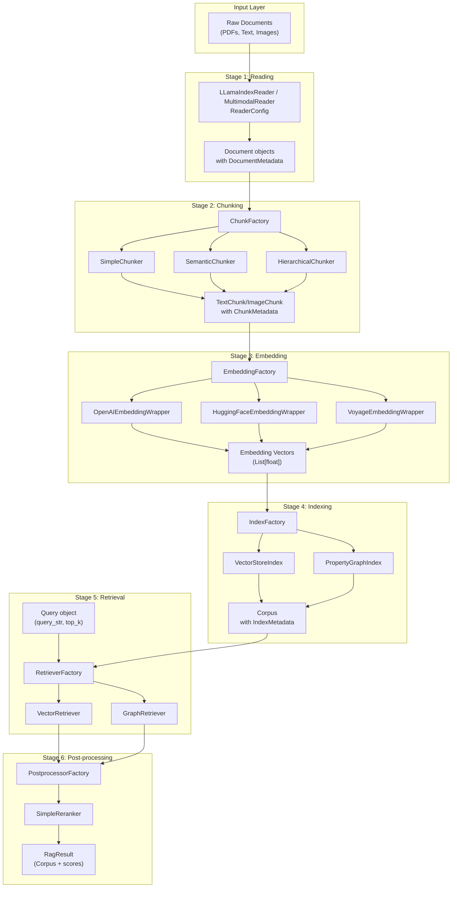
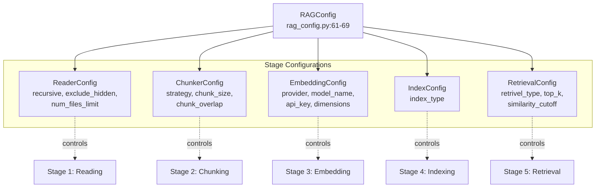
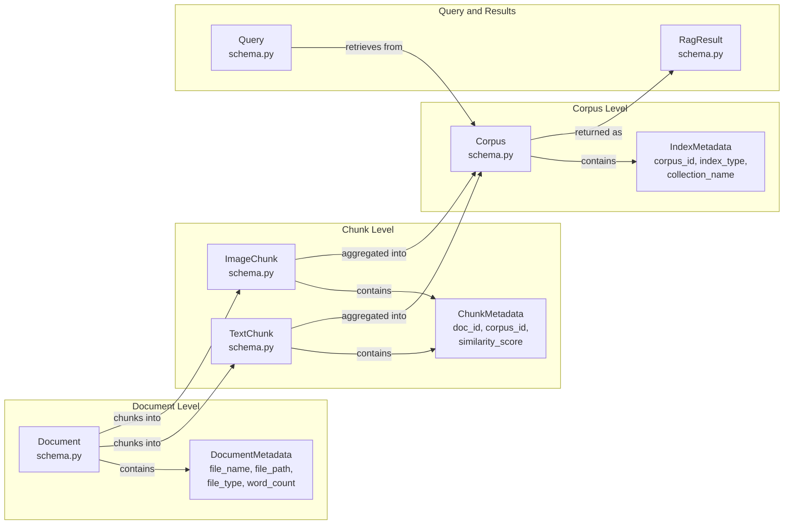
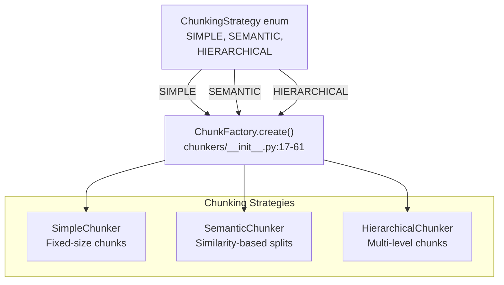
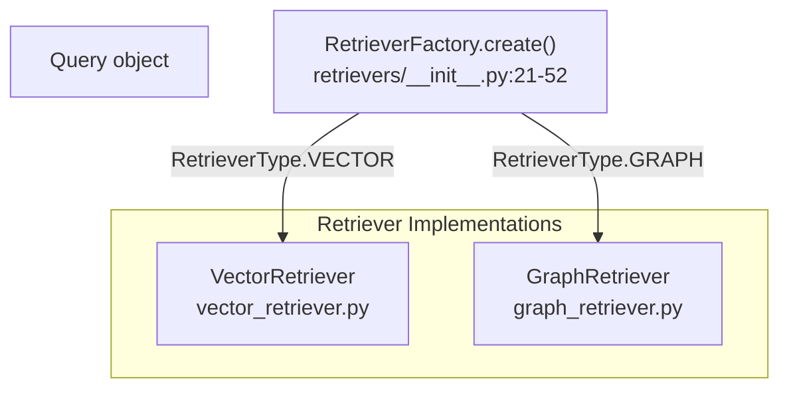

<!-- source: DeepWiki mcp.deepwiki.com · repo EvoAgentX/EvoAgentX · page 8.1 RAG Architecture · fetched 2026-10-26 -->

# RAG Architecture

<details>
<summary>Relevant source files</summary>

The following files were used as context for generating this wiki page:

- [.env.example](.env.example)
- [docs/assets/rag_pipeline.png](docs/assets/rag_pipeline.png)
- [docs/modules/rag.md](docs/modules/rag.md)
- [docs/modules/storages.md](docs/modules/storages.md)
- [docs/tutorial/rag.md](docs/tutorial/rag.md)
- [docs/zh/assets/rag_pipeline.png](docs/zh/assets/rag_pipeline.png)
- [docs/zh/modules/rag.md](docs/zh/modules/rag.md)
- [docs/zh/modules/storages.md](docs/zh/modules/storages.md)
- [docs/zh/tutorial/rag.md](docs/zh/tutorial/rag.md)
- [evoagentx/rag/chunkers/__init__.py](evoagentx/rag/chunkers/__init__.py)
- [evoagentx/rag/embeddings/__init__.py](evoagentx/rag/embeddings/__init__.py)
- [evoagentx/rag/embeddings/azure_openai_embedding.py](evoagentx/rag/embeddings/azure_openai_embedding.py)
- [evoagentx/rag/embeddings/base.py](evoagentx/rag/embeddings/base.py)
- [evoagentx/rag/postprocessors/__init__.py](evoagentx/rag/postprocessors/__init__.py)
- [evoagentx/rag/postprocessors/base.py](evoagentx/rag/postprocessors/base.py)
- [evoagentx/rag/postprocessors/simple_reranker.py](evoagentx/rag/postprocessors/simple_reranker.py)
- [evoagentx/rag/rag.py](evoagentx/rag/rag.py)
- [evoagentx/rag/rag_config.py](evoagentx/rag/rag_config.py)
- [evoagentx/rag/retrievers/__init__.py](evoagentx/rag/retrievers/__init__.py)
- [evoagentx/rag/retrievers/vector_retriever.py](evoagentx/rag/retrievers/vector_retriever.py)
- [evoagentx/tools/search_exa.py](evoagentx/tools/search_exa.py)
- [examples/rag/multimodal_rag.py](examples/rag/multimodal_rag.py)
- [examples/rag/rag.py](examples/rag/rag.py)
- [pyproject.toml](pyproject.toml)
- [requirements.txt](requirements.txt)

</details>


## Purpose and Scope

This document describes the Retrieval-Augmented Generation (RAG) system in EvoAgentX, which provides a five-stage configurable pipeline for document processing and knowledge retrieval. The RAG system enables agents to query external knowledge bases, retrieve relevant context, and augment their responses with factual information.

For information about how agents use RAG in their workflows, see [Memory System](#3.4). For details on specific retrieval implementations and reranking strategies, see [Retrieval and Reranking](#8.4).

## Pipeline Overview

The RAG system implements a modular five-stage pipeline where each stage is independently configurable through factory classes. The pipeline progresses from raw documents to ranked retrieval results.



**Sources:** [evoagentx/rag/rag_config.py:1-69](), [evoagentx/rag/chunkers/__init__.py:14-61](), [evoagentx/rag/embeddings/__init__.py:22-59](), [evoagentx/rag/retrievers/__init__.py:18-52](), [evoagentx/rag/rag.py:25-93]()

## Configuration System

The RAG pipeline is configured through a hierarchical configuration structure where `RAGConfig` contains stage-specific configurations.

### RAGConfig Hierarchy



| Config Class | Key Parameters | Purpose |
|-------------|----------------|---------|
| `ReaderConfig` | `recursive`, `exclude_hidden`, `num_files_limit`, `custom_metadata_function` | Controls document reading behavior [evoagentx/rag/rag_config.py:13-21]() |
| `ChunkerConfig` | `strategy`, `chunk_size`, `chunk_overlap`, `max_chunks` | Defines chunking strategy and parameters [evoagentx/rag/rag_config.py:24-30]() |
| `EmbeddingConfig` | `provider`, `model_name`, `api_key`, `dimensions`, `normalize` | Configures embedding model [evoagentx/rag/rag_config.py:32-44]() |
| `IndexConfig` | `index_type` | Specifies index type (VECTOR, GRAPH, SUMMARY, TREE) [evoagentx/rag/rag_config.py:45-48]() |
| `RetrievalConfig` | `retrivel_type`, `top_k`, `similarity_cutoff`, `keyword_filters` | Controls retrieval behavior [evoagentx/rag/rag_config.py:50-59]() |

**Sources:** [evoagentx/rag/rag_config.py:13-69]()

## Core Data Structures

The RAG system uses a hierarchical data model that progresses from documents to chunks to retrieval results.

### Data Model Flow



### Key Classes

#### TextChunk & ImageChunk

The `RAGEngine` initializes the `chunk_class` based on the `modality` specified in `RAGConfig`. If modality is "multimodal", `ImageChunk` is used; otherwise, `TextChunk` is the default [evoagentx/rag/rag.py:39-42]().

#### Corpus

The `Corpus` class is a collection of chunks with fast lookup and filtering capabilities. It is the primary return type of the `read` method in `RAGEngine` [evoagentx/rag/rag.py:100-147]().

#### Query

The `Query` class encapsulates retrieval parameters.

| Attribute | Type | Description |
|-----------|------|-------------|
| `query_str` | `str` | Query text |
| `top_k` | `Optional[int]` | Number of results to retrieve |
| `similarity_cutoff` | `Optional[float]` | Minimum similarity threshold |

#### RagResult

The `RagResult` class wraps retrieval results with scores and metadata. It is returned by both `VectorRetriever` and `GraphRetriever` [evoagentx/rag/retrievers/vector_retriever.py:21-47]().

**Sources:** [evoagentx/rag/schema.py:1-727](), [evoagentx/rag/rag.py:25-93]()

## Pipeline Stages

### Stage 1: Document Reading

The reading stage converts raw files into documents. `RAGEngine` selects between `LLamaIndexReader` and `MultimodalReader` based on the `modality` config [evoagentx/rag/rag.py:45-62]().

### Stage 2: Chunking

The chunking stage splits documents into smaller pieces. This stage is skipped for multimodal RAG as images are treated as direct chunks [evoagentx/rag/rag.py:78-89]().



**Sources:** [evoagentx/rag/chunkers/__init__.py:14-61](), [evoagentx/rag/rag.py:78-89]()

### Stage 3: Embedding

The embedding stage converts text chunks into vector representations. The `EmbeddingFactory` creates wrappers for various providers [evoagentx/rag/embeddings/__init__.py:25-59]().

| Provider | Supported Models (Examples) |
|----------|------------------|
| OpenAI | `text-embedding-ada-002`, `text-embedding-3-small` |
| Azure OpenAI | `text-embedding-3-small`, `text-embedding-3-large` |
| HuggingFace | `bge-small-en-v1.5`, `all-MiniLM-L6-v2` |
| Ollama | `nomic-embed-text`, `mxbai-embed-large` |
| Voyage | `voyage-2` |

**Sources:** [evoagentx/rag/embeddings/base.py:9-32](), [evoagentx/rag/embeddings/__init__.py:25-59]()

### Stage 4: Indexing

The indexing stage creates searchable indices. `RAGEngine` uses `IndexFactory` to build indices like `VECTOR` or `GRAPH` [evoagentx/rag/rag.py:30](). It also ensures vector store dimensions match the embedding model [evoagentx/rag/rag.py:71-75]().

### Stage 5: Retrieval

Retrievers are created via `RetrieverFactory` and implement the `BaseRetrieverWrapper` interface [evoagentx/rag/retrievers/__init__.py:18-52]().



**Sources:** [evoagentx/rag/retrievers/__init__.py:18-52](), [evoagentx/rag/retrievers/vector_retriever.py:8-84]()

### Stage 6: Post-processing

The `PostprocessorFactory` provides rerankers like `SimpleReranker` to refine results [evoagentx/rag/postprocessors/__init__.py:14-42]().

## Factory Pattern

The RAG system uses factory classes to maintain modularity.

**EmbeddingFactory** [evoagentx/rag/embeddings/__init__.py:25-59]():
```python
def create(
    self,
    provider: EmbeddingProvider,
    model_config: Dict[str, Any] = None
) -> BaseEmbeddingWrapper
```

**RetrieverFactory** [evoagentx/rag/retrievers/__init__.py:21-52]():
```python
def create(
    self,
    retriever_type: str,
    llm: Optional[BaseLLM] = None,
    index: Optional[BaseIndex] = None,
    graph_store: Optional[GraphStore] = None,
    embed_model: Optional[BaseEmbedding] = None,
    query: Optional[Query] = None,
    storage_handler: Optional[StorageHandler] = None,
    chunk_class = None
) -> BaseRetrieverWrapper
```

**Sources:** [evoagentx/rag/embeddings/__init__.py:22-59](), [evoagentx/rag/retrievers/__init__.py:18-52](), [evoagentx/rag/chunkers/__init__.py:14-61]()

---

