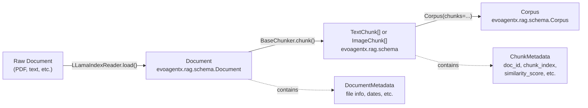
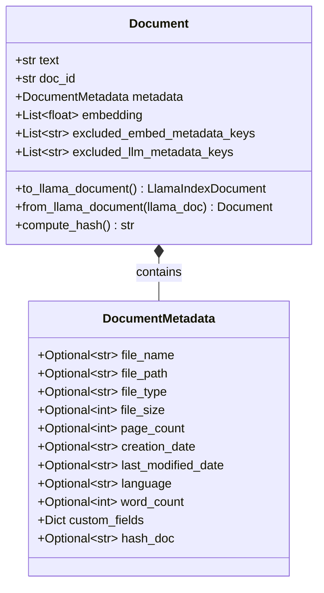
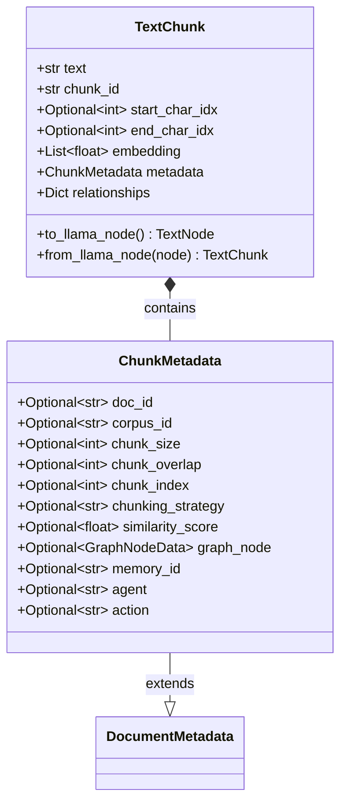
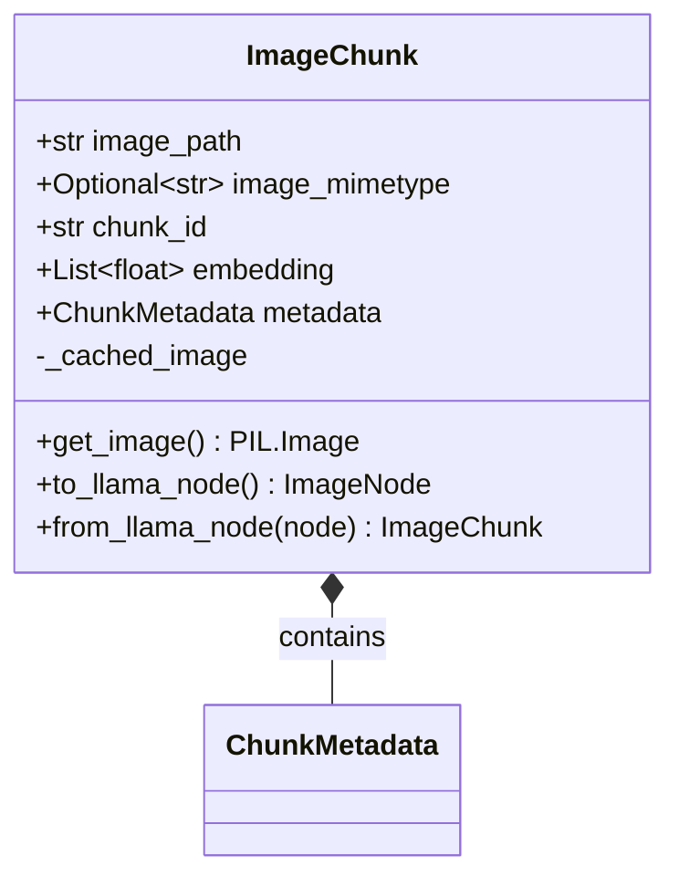
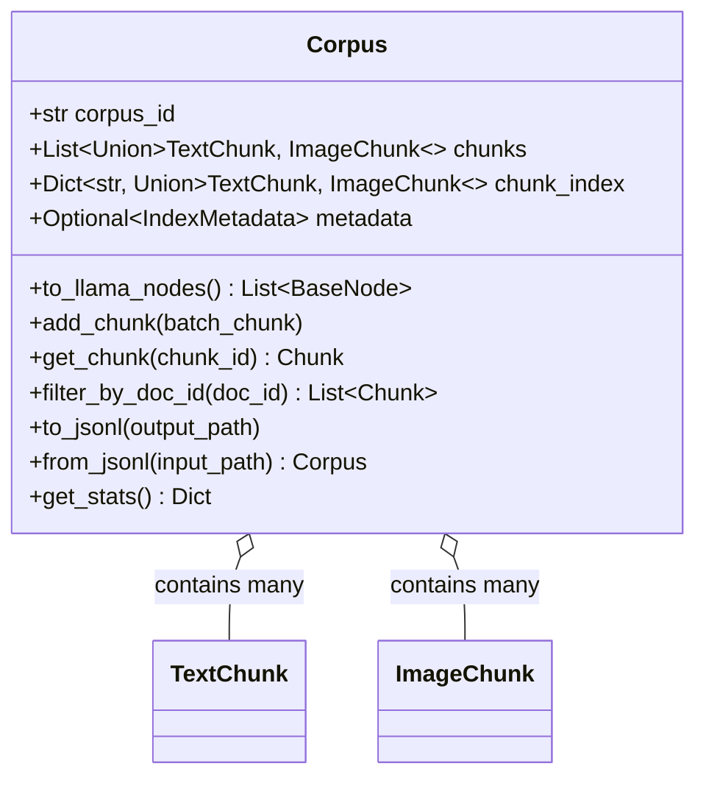

<!-- source: DeepWiki mcp.deepwiki.com · repo EvoAgentX/EvoAgentX · page 8.2 Document Processing · fetched 2026-10-26 -->

# Document Processing

<details>
<summary>Relevant source files</summary>

The following files were used as context for generating this wiki page:

- [evoagentx/benchmark/real_mm_rag.py](evoagentx/benchmark/real_mm_rag.py)
- [evoagentx/rag/__init__.py](evoagentx/rag/__init__.py)
- [evoagentx/rag/chunkers/base.py](evoagentx/rag/chunkers/base.py)
- [evoagentx/rag/chunkers/hierachical_chunker.py](evoagentx/rag/chunkers/hierachical_chunker.py)
- [evoagentx/rag/chunkers/semantic_chunker.py](evoagentx/rag/chunkers/semantic_chunker.py)
- [evoagentx/rag/chunkers/simple_chunker.py](evoagentx/rag/chunkers/simple_chunker.py)
- [evoagentx/rag/embeddings/voyage.py](evoagentx/rag/embeddings/voyage.py)
- [evoagentx/rag/readers/__init__.py](evoagentx/rag/readers/__init__.py)
- [evoagentx/rag/readers/base.py](evoagentx/rag/readers/base.py)
- [evoagentx/rag/readers/multimodal_reader.py](evoagentx/rag/readers/multimodal_reader.py)
- [evoagentx/rag/schema.py](evoagentx/rag/schema.py)

</details>


## Purpose and Scope

This document covers the document processing subsystem within the RAG pipeline, specifically focusing on how documents are represented, chunked, and organized for retrieval. This includes the data structures (`Document`, `TextChunk`, `ImageChunk`, `Corpus`), metadata schemas (`DocumentMetadata`, `ChunkMetadata`), and chunking strategies (simple, semantic, hierarchical) used to prepare documents for embedding and indexing.

For information about the overall RAG architecture and pipeline stages, see [RAG Architecture (8.1)](). For details on embeddings and indexing, see [Embeddings and Indexing (8.3)](). For retrieval mechanisms, see [Retrieval and Reranking (8.4)]().

## Document Processing Pipeline

The document processing pipeline transforms raw documents into retrievable chunks through several stages:



**Sources:** [evoagentx/rag/schema.py:102-111](), [evoagentx/rag/readers/base.py:95-103](), [evoagentx/rag/chunkers/base.py:13-31](), [evoagentx/rag/schema.py:519-535]()

## Core Data Structures

### Document and DocumentMetadata

The `Document` class represents a complete document before chunking. It wraps the LlamaIndex `Document` object while providing EvoAgentX-specific features.



**Key Features:**

| Feature | Description | Code Reference |
|---------|-------------|----------------|
| LlamaIndex Compatibility | Converts to/from LlamaIndex `Document` for interoperability | [evoagentx/rag/schema.py:144-174]() |
| Metadata Exclusion | Controls which metadata fields are included in embeddings/LLM context | [evoagentx/rag/schema.py:119-120]() |
| Deduplication | Hash-based document deduplication via `compute_hash()` | [evoagentx/rag/schema.py:180-182]() |
| Metadata Schema | Ensures type safety for file information and custom fields | [evoagentx/rag/schema.py:25-42]() |

**Default Excluded Metadata:**

The following metadata fields are excluded by default from embeddings and LLM context to avoid noise:

```python
DEAFULT_EXCLUDED = ['file_name', 'file_type', 'file_size', 'page_count', 
                    'creation_date', 'last_modified_date', 'language', 
                    'word_count', 'custom_fields', 'hash_doc', 'graph_node']
```

**Sources:** [evoagentx/rag/schema.py:20-23](), [evoagentx/rag/schema.py:25-42](), [evoagentx/rag/schema.py:102-120]()

### TextChunk and ChunkMetadata

The `TextChunk` class (aliased as `Chunk` in `evoagentx.rag.schema`) represents a single chunk of text after document splitting. Each chunk maintains a reference to its parent document and contains detailed metadata about the chunking process.



**ChunkMetadata Fields:**

| Category | Fields | Purpose |
|----------|--------|---------|
| Document Tracking | `doc_id`, `corpus_id` | Links chunk to parent document and corpus |
| Chunking Info | `chunk_size`, `chunk_overlap`, `chunk_index`, `chunking_strategy` | Records how chunk was created |
| Retrieval | `similarity_score` | Stores retrieval relevance score |
| Graph Support | `graph_node` | For graph-based RAG using Relation/EntityNode properties |
| Agent Interaction | `agent`, `action`, `wf_task`, `wf_goal` | Contextual info for agent-generated chunks |

**Sources:** [evoagentx/rag/schema.py:62-90](), [evoagentx/rag/schema.py:219-245]()

### ImageChunk

The `ImageChunk` class handles image-based chunks with lazy loading to optimize memory usage during multimodal RAG.



**Key Features:**

- **Lazy Loading**: Images are loaded on-demand via `get_image()` using the `PIL.Image` library [evoagentx/rag/schema.py:454-468]().
- **LlamaIndex Integration**: Converts to/from `ImageNode` for multimodal RAG pipelines [evoagentx/rag/schema.py:481-498]().
- **Memory Efficiency**: Avoids storing image bytes directly in the object, using file paths instead [evoagentx/rag/schema.py:414-432]().

**Sources:** [evoagentx/rag/schema.py:414-517]()

### Corpus

The `Corpus` class is a collection of chunks that provides filtering, sorting, and serialization capabilities.



**Corpus Operations:**

| Operation | Method | Description |
|-----------|--------|-------------|
| Add Chunks | `add_chunk(batch_chunk)` | Adds single chunk or list of chunks, updating the `chunk_index` [evoagentx/rag/schema.py:571-583]() |
| Filter | `filter_by_doc_id()` | Filter chunks belonging to a specific parent document [evoagentx/rag/schema.py:590-592]() |
| Export | `to_jsonl(output_path)` | Serialize to JSONL format for persistent storage [evoagentx/rag/schema.py:613-631]() |
| Statistics | `get_stats()` | Returns metrics like chunk count, unique docs, and strategies used [evoagentx/rag/schema.py:658-688]() |

**Sources:** [evoagentx/rag/schema.py:519-688]()

## Chunking Strategies

The framework provides specialized chunkers implementing the `BaseChunker` interface.

```mermaid
graph TB
    subgraph "Chunking Strategies"
        Simple["SimpleChunker<br/>Fixed-size splitting"]
        Semantic["SemanticChunker<br/>Embedding-based splitting"]
        Hierarchical["HierarchicalChunker<br/>Multi-level hierarchy"]
    end
    
    subgraph "Base Classes"
        Base["BaseChunker (ABC)<br/>evoagentx.rag.chunkers.base"]
        Strategy["ChunkingStrategy (Enum)<br/>SIMPLE, SEMANTIC, HIERARCHICAL"]
    end
    
    Simple --|> Base
    Semantic --|> Base
    Hierarchical --|> Base
    
    Simple -.->|"strategy=SIMPLE"| Strategy
    Semantic -.->|"strategy=SEMANTIC"| Strategy
    Hierarchical -.->|"strategy=HIERARCHICAL"| Strategy
```

**Sources:** [evoagentx/rag/chunkers/base.py:8-31](), [evoagentx/rag/chunkers/simple_chunker.py:10-21](), [evoagentx/rag/chunkers/semantic_chunker.py:12-21](), [evoagentx/rag/chunkers/hierachical_chunker.py:12-32]()

### Simple Chunking

The `SimpleChunker` splits documents into fixed-size segments with character overlap. It uses multi-threading to process documents in parallel.

**Implementation Details:**
- Uses `llama_index.core.node_parser.SimpleNodeParser` [evoagentx/rag/chunkers/simple_chunker.py:49-56]().
- Supports `ThreadPoolExecutor` for parallel document processing [evoagentx/rag/chunkers/simple_chunker.py:101-109]().
- Parameters: `chunk_size` (default 1024), `chunk_overlap` (default 20) [evoagentx/rag/chunkers/simple_chunker.py:44-45]().

**Sources:** [evoagentx/rag/chunkers/simple_chunker.py:10-111]()

### Semantic Chunking

The `SemanticChunker` splits documents based on semantic similarity using an embedding model. This ensures that chunks preserve semantic coherence.

**Implementation Details:**
- Uses `llama_index.core.node_parser.SemanticSplitterNodeParser` [evoagentx/rag/chunkers/semantic_chunker.py:31-34]().
- Requires a `BaseEmbedding` model to compute similarity between sentences [evoagentx/rag/chunkers/semantic_chunker.py:30]().
- Parameters: `similarity_threshold` (default 0.7) [evoagentx/rag/chunkers/semantic_chunker.py:23]().

**Sources:** [evoagentx/rag/chunkers/semantic_chunker.py:12-91]()

### Hierarchical Chunking

The `HierarchicalChunker` creates a multi-level hierarchy of chunks (e.g., Parent -> Child). This allows for retrieving broad context while maintaining precise details.

**Implementation Details:**
- Uses `llama_index.core.node_parser.HierarchicalNodeParser` [evoagentx/rag/chunkers/hierachical_chunker.py:84-91]().
- Supports custom `level_parsers` or default `chunk_sizes` (e.g., [2048, 512, 128]) [evoagentx/rag/chunkers/hierachical_chunker.py:53-54]().
- Maintains relationships such as `SOURCE`, `PREVIOUS/NEXT`, and `PARENT/CHILD` [evoagentx/rag/chunkers/hierachical_chunker.py:15-18]().

**Sources:** [evoagentx/rag/chunkers/hierachical_chunker.py:12-152]()

## Document Reading

The framework utilizes `LLamaIndexReader` and `MultimodalReader` to ingest data from the file system.

| Reader | Purpose | Formats |
|--------|---------|---------|
| `LLamaIndexReader` | Universal text reader based on `SimpleDirectoryReader` [evoagentx/rag/readers/base.py:14-28]() | PDF, Word, Markdown, Txt, etc. |
| `MultimodalReader` | Specialized image reader for multimodal RAG [evoagentx/rag/readers/multimodal_reader.py:8-12]() | PNG, JPG, WEBP, etc. |

**Key Reader Features:**
- **Recursive Loading**: Support for nested directories [evoagentx/rag/readers/base.py:41]().
- **Async Support**: `aload_data` for non-blocking I/O [evoagentx/rag/readers/base.py:157]().
- **File Merging**: Option to merge multiple LlamaIndex documents into a single `evoagentx.rag.schema.Document` per file [evoagentx/rag/readers/base.py:160-174]().

**Sources:** [evoagentx/rag/readers/base.py:13-176](), [evoagentx/rag/readers/multimodal_reader.py:7-183]()

---

